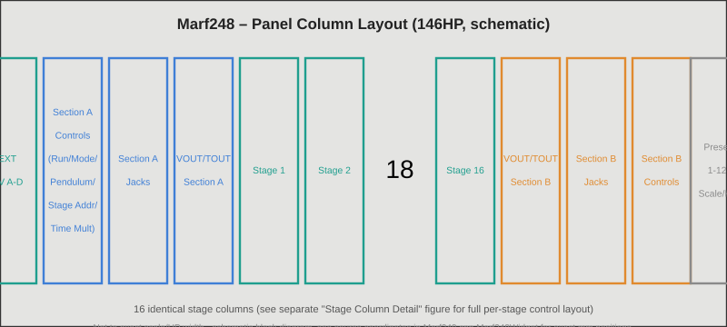
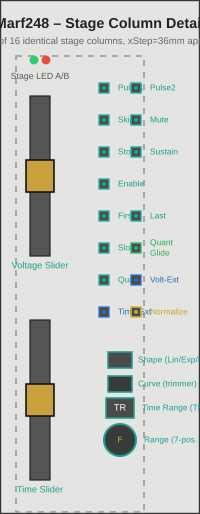
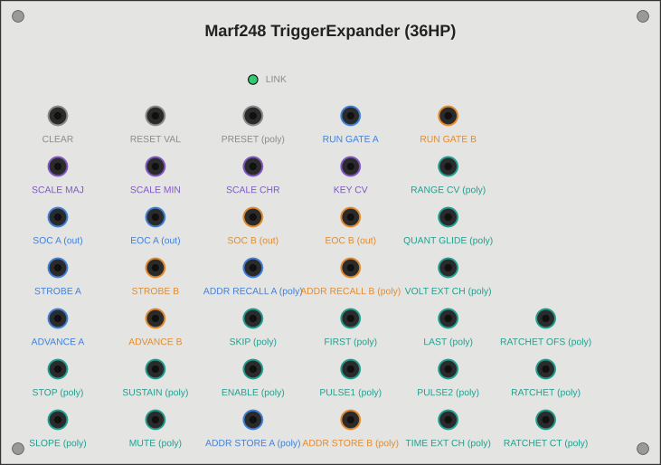
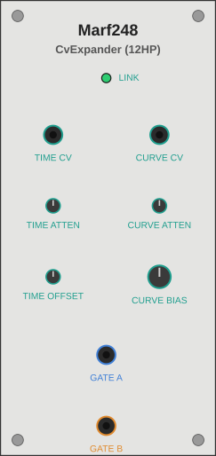

# Kinovice reminiscence of the unattained – Technical Documentation

VCV Rack C++ implementation of a multiple arbitrary function generator,
heavily inspired by the wonderful Buchla world of modules. This documentation describes the main module
**Sofonisba**, its compact variant **Lucia**, and the two expander modules
**Amilcare** (Trigger Expander, 42HP) and **Bianca** (CV Expander, 12HP):
every control, every input/output, the internal signal processing, the most
important C++ functions, and the known pitfalls in how the features
interact. The plugin comprises seven modules in total. The three others each
have their own documentation: the quad function generator **Europa**
(`Europa-Dokumentation_DE.md` / `Europa-Documentation_EN.md`), the polyphonic
dual voltage processor **Minerva** (`Minerva-Dokumentation_DE.md` /
`Minerva-Documentation_EN.md`) and the CV processor **Elena**
(`Elena-Dokumentation_DE.md` / `Elena-Documentation_EN.md`).

Sources: publicly available user documentation and community resources on the
hardware that inspired this module family.

**Notice:** The *Kinovice reminiscence of the unattained* plugin is an independent work, heavily inspired by the wonderful Buchla world of modules. It is not affiliated with, authorized by, or endorsed by Buchla, Tiptop Audio, or any other manufacturer. Product and company names mentioned are trademarks of their respective owners and are used only to describe which functional concepts inspired a module.

Status: every feature described in this documentation has been live-tested
and confirmed by Kinovice in a running Rack instance (including Address
Memory Store/Recall, 4-channel A–D selection with zone boundaries and
fallback behavior, backward compatibility of existing mono patches, V/Oct
tempo control including right-click numeric entry, Stage Mute
including APOUT suppression, Reference/Time-Output separation, the
tri-color RGB status LED, and Stage-Number Broadcast including
undo/redo).

---

<a id="toc"></a>

## Table of Contents

*Each entry has two links: the first (standard Markdown anchor) works in GitHub, Codeberg, VSCodium preview & most other viewers; "Obsidian" is the wikilink specifically for Obsidian. Within Obsidian you can also use the first link - it just isn't always resolved reliably there, hence the second variant as a fallback.*

1. [Architecture Overview](#sec1) · [[#1. Architecture Overview|Obsidian]]
2. [Basic Concepts: Stage, Section, Modifier Bits](#sec2) · [[#2. Basic Concepts: Stage, Section, Modifier Bits|Obsidian]]
3. [Sofonisba – Main Module](#sec3) · [[#3. Sofonisba – Main Module|Obsidian]]
   - [Panel Layout](#sec3-1) · [[#3.1 Panel Layout|Obsidian]]
   - [Per-Stage Controls](#sec3-2) · [[#3.2 Per-Stage Controls|Obsidian]]
   - [Per-Section Controls (A/B)](#sec3-3) · [[#3.3 Per-Section Controls (A/B)|Obsidian]]
   - [Module-Wide Shared Elements](#sec3-4) · [[#3.4 Module-Wide Shared Elements|Obsidian]]
   - [Inputs/Outputs Overview](#sec3-5) · [[#3.5 Inputs/Outputs Overview|Obsidian]]
   - [Lucia – Compact Version](#sec3-6) · [[#3.6 Lucia – Compact Version|Obsidian]]
4. [Internal Signal Processing](#sec4) · [[#4. Internal Signal Processing|Obsidian]]
   - [The Afg Core (Section Sequencing)](#sec4-1) · [[#4.1 The Afg Core (Section Sequencing)|Obsidian]]
   - [Stage-Advance Logic: Forward / Reverse / Pendulum / Skip](#sec4-2) · [[#4.2 Stage-Advance Logic: Forward / Reverse / Pendulum / Skip|Obsidian]]
   - [Stage Address: Reset / Continuous / Strobe / Channel Select](#sec4-3) · [[#4.3 Stage Address: Reset / Continuous / Strobe / Channel Select|Obsidian]]
   - [Voltage Signal Path: Range, Quantize, Slew](#sec4-4) · [[#4.4 Voltage Signal Path: Range, Quantize, Slew|Obsidian]]
   - [Time Signal Path: Time Range, External Time, Time CV, Time Multiplier](#sec4-5) · [[#4.5 Time Signal Path: Time Range, External Time, Time CV, Time Multiplier|Obsidian]]
   - [Sustain / Enable / Stop](#sec4-6) · [[#4.6 Sustain / Enable / Stop|Obsidian]]
   - [Pulse Outputs: APOUT, EOS, P1/P2OUT, Start/End of Cycle](#sec4-7) · [[#4.7 Pulse Outputs: APOUT, EOS, P1/P2OUT, Start/End of Cycle|Obsidian]]
   - [Preset System (Pickup/Catch)](#sec4-8) · [[#4.8 Preset System (Pickup/Catch)|Obsidian]]
   - [Address Memory](#sec4-9) · [[#4.9 Address Memory|Obsidian]]
   - [Clock-Quantized Advance](#sec4-10) · [[#4.10 Clock-Quantized Advance|Obsidian]]
   - [Scale/Key Quantization](#sec4-11) · [[#4.11 Scale/Key Quantization|Obsidian]]
   - [Tempo/BPM Control (V/Oct, BEATS_FACTOR)](#sec4-12) · [[#4.12 Tempo/BPM Control (V/Oct, BEATS_FACTOR)|Obsidian]]
   - [Ratcheting](#sec4-13) · [[#4.13 Ratcheting|Obsidian]]
   - [Stage-Number Broadcast](#sec4-14) · [[#4.14 Stage-Number Broadcast|Obsidian]]
5. [Sofonisba – Function Reference (C++)](#sec5) · [[#5. Sofonisba – Function Reference (C++)|Obsidian]]
6. [Amilcare – Trigger Expander](#sec6) · [[#6. Amilcare – Trigger Expander|Obsidian]]
7. [Bianca – CV Expander](#sec7) · [[#7. Bianca – CV Expander|Obsidian]]
8. [Expander Mechanism (Inter-Module Communication)](#sec8) · [[#8. Expander Mechanism (Inter-Module Communication)|Obsidian]]
9. [Persistence (Patch Storage)](#sec9) · [[#9. Persistence (Patch Storage)|Obsidian]]
10. [Known Pitfalls in Feature Interaction](#sec10) · [[#10. Known Pitfalls in Feature Interaction|Obsidian]]
11. [Design Decisions & Scope Boundaries](#sec11) · [[#11. Design Decisions & Scope Boundaries|Obsidian]]
12. [Cross-Compile Workflow](#sec12) · [[#12. Cross-Compile Workflow|Obsidian]]
13. [List of Figures](#figures) · [[#List of Figures|Obsidian]]

---

<a id="sec1"></a>

## 1. Architecture Overview
*[↑ Back to Table of Contents](#toc) · [[#Table of Contents|Obsidian]]*

The plugin consists of seven VCV Rack modules. Four of them belong to the Sofonisba family and are described in this file, the other three (Europa, Minerva, Elena) each have their own documentation:

**Marf248** *(`Marf248.hpp`, `Marf248.cpp`)*<br>
Main module **Sofonisba** (146HP): two independent AFG sections (A/B) that share 16 common stages. Contains all of the DSP core logic.

**Marf248Compact** *(`Marf248.cpp`, `modelMarf248Compact`)*<br>
Compact variant **Lucia** (about 40HP): the same `struct Marf248` and DSP engine with its own panel and only one visible stage slot, see [3.6](#sec3-6). Can sit next to Sofonisba in the same patch.

**Marf248TriggerExpander** *(`Marf248TriggerExpander.hpp/.cpp`)*<br>
Optional 42HP expander: additional trigger/gate inputs and outputs (Clear, Presets, Scale/Key, Start/End of Cycle, Run gates, Advance, Address Memory, stage-modifier CV including VOLT_EXT/TIME_EXT channel selection, SEXT).

**Marf248CvExpander** *(`Marf248CvExpander.hpp/.cpp`)*<br>
Optional 12HP expander: polyphonic CV modulation of stage time and slew curve, plus polyphonic per-stage gate outputs.

**Core principle of the expander mechanism:** Neither expander has any
DSP logic of its own. They are purely "jack carriers." The main module's
`Marf248::process()` checks every sample whether a matching module is
docked to its left or right (`getLeftExpander()`/`getRightExpander()`)
and reads/writes that module's parameters, inputs, and outputs directly.
This avoids message-passing/double-buffering, but is only valid because
the expanders have no independent processing of their own (see the VCV
Rack Plugin API Guide, "Expanders" section: "you can implement its entire
DSP algorithm in the [primary] module"). Each expander also independently
checks every frame whether a Sofonisba is docked, so it can reset its own
outputs/lights cleanly to 0V when removed or moved away.

The trigger-expander lookup deliberately sits right at the top of
`Marf248::process()`, before stage-address processing, since SEXT
(external strobe pulses) must already know about the trigger expander
before `applyStageAddress()` is called.

**Europa** *(`Europa.cpp`, `EnvGen4.hpp`, `modelEuropa`)*<br>
Fifth module: quad function generator with VCA (four envelope generators with four stages each, 23HP). Own engine, technically independent of Sofonisba, see `Europa-Documentation_EN.md`.

**Minerva** *(`Minerva.cpp`, `VoltageProc.hpp`, `modelMinerva`)*<br>
Sixth module: polyphonic dual voltage processor (14HP) with two identical sections that each combine four voltages into one output voltage (attenuverter, crossfader, offset). Each of the 16 channels has its own knob values, one shared channel selector applies to both sections. Own engine, technically independent of Sofonisba, see `Minerva-Documentation_EN.md`.

**Elena** *(`Elena.cpp`, `CvProcElena.hpp`, `modelElena`)*<br>
Seventh module: digital CV processor (42HP) with A/B transformation sections (input select, transfer curve with optional breakpoint, adjustable per channel) and six slew limiters C–H with pulse output, in three blocks of two slewers each. Own engine, technically independent of Sofonisba, see `Elena-Documentation_EN.md`.

All seven modules are registered in `plugin.cpp`/`plugin.hpp`
(`modelMarf248`, `modelMarf248Compact`, `modelMarf248TriggerExpander`,
`modelMarf248CvExpander`, `modelEuropa`, `modelMinerva`, `modelElena`).

---

<a id="sec2"></a>

## 2. Basic Concepts: Stage, Section, Modifier Bits
*[↑ Back to Table of Contents](#toc) · [[#Table of Contents|Obsidian]]*

- **Stage**: one of 16 programming steps (`NUM_STAGES = 16`). Each stage
  has a voltage value, a time value, Range and Curve controls, and a
  bundle of digital modifier bits. The 16 stages are **shared module-wide**
  – Section A and Section B read the same programming but run
  independently as two separate "pointers" (`currentStage`) over it.
- **Section (A/B)**: two independent AFG instances (`Afg afgA`, `Afg afgB`
  inside `Marf248`), each with its own run direction, its own run/stop
  state, its own time multiplier, its own stage-address source, etc., but
  stepping through the same 16 stages.
- **Modifier bits** (`enum StageModifierBits`, in `Marf248.hpp`): a single
  `int stageModifier[NUM_STAGES]` array encodes all digital per-stage
  states as a bitmask. Overview:

| Bit | Meaning | Hardware precedent? |
|---|---|---|
| `MOD_QUANT_OCT` | Quantize the stage voltage to Scale/Key | yes |
| `MOD_SLOPED` | Stage ramps (slew) instead of stepping | yes |
| `MOD_STOP` | Programmed stop stage | yes |
| `MOD_SUSTAIN` | Holds the stage while the start gate is high | yes |
| `MOD_ENABLE` | Holds the stage while the start gate is low | yes |
| `MOD_FIRST` | Marks the stage as the start of a cycle | yes |
| `MOD_LAST` | Marks the stage as the end of a cycle | yes |
| `MOD_SLEW_EXP` / `MOD_SLEW_LOG` | Ramp curve shape (no bit = linear) | yes |
| `MOD_RANGE_HALF` / `MOD_RANGE_LIMITED` (+ 3-bit octave offset) | Voltage range Full/Half/Limited | yes |
| `MOD_VOLT_EXT` / `MOD_TIME_EXT` | External voltage/time source (channel select A–D) instead of the knob | yes |
| `MOD_PULSE1` / `MOD_PULSE2` | Programmed pulse outputs P1OUT/P2OUT | yes |
| `MOD_SKIP` | Stage is skipped entirely during automatic playback | **no** (pure software extension) |
| `MOD_SLEW_NORMALIZE` | Stretches the visibly-moving curve to fill the full stage time | **no** |
| `MOD_TRANGE_1/2/4` | Time Range TR1/TR2/TR4 (no bit = TR3, default) | yes (TR1–4) |
| `MOD_MUTE` | Suppresses P1OUT/P2OUT **and** APOUT for this stage, without changing `MOD_PULSE1`/`MOD_PULSE2`; voltage/slew unaffected | **no** |
| `MOD_QUANT_GLIDE` | Quantizes the entire slew (not just the target) sample-by-sample to Scale/Key – "staircase glide"; only effective together with `MOD_SLOPED` | **no** (pure software extension) |
| `MOD_RATCHET` | Ratcheting: N rhythmic sub-triggers on P1OUT/P2OUT instead of a single trigger per stage (only effective with a patched count CV on the trigger expander) | **no** (pure software extension) |

In addition, a 3-bit field (`RANGE_OFFSET_MASK`) encodes the octave offset
in Limited-range mode (5 steps: +0/+2/+4/+6/+8 V).

Two further storage structures, **independent** of the modifier-bit array,
supplement stage programming: the **preset system** (complete programming
of all 16 stages, 12 slots, see [4.8](#sec4-8)) and the new **Address
Memory** (a pure jump bookmark onto a stage index, 16 slots per section,
see [4.9](#sec4-9)) – both are conceptually distinct and should not be
confused with one another.

---

<a id="sec3"></a>

## 3. Sofonisba – Main Module
*[↑ Back to Table of Contents](#toc) · [[#Table of Contents|Obsidian]]*

<a id="sec3-1"></a>

### 3.1 Panel Layout
*[↑ Back to Table of Contents](#toc) · [[#Table of Contents|Obsidian]]*

The panel is 146HP wide (was 120HP, then 126HP for the new outputs
column, then widened further as the slider/button relayout grew the
required width – see below) and organized into several vertical columns
(left to right):

```
[External CV A–D] [Section A Controls] [Section A Jacks] [Section A Outputs] [Stage Array (16×)] [Section B Outputs] [Section B Jacks] [Section B Controls] [Preset Column]
```

*[See [Figure 1](#fig1) for a schematic overview of this column layout · [[#Figure 1 – Sofonisba Panel Column Layout (schematic overview)|Obsidian]]]*

- **External CV column** (far left): the four module-wide shared external
  CV inputs (jacks A–D), which per-stage `MOD_VOLT_EXT`/`MOD_TIME_EXT` can
  reference.
- **Section A/B Controls column**: Tempo knob/attenuverter, BEATS_FACTOR
  trimmer, Run button, Mode/Pendulum buttons, Stage Address controls.
- **Section A/B Jacks column** (12–121mm): Start/Stop, Tempo CV, live BPM
  display, BEATS_FACTOR CV, P1OUT/P2OUT, APOUT, Stage Address CV, Stage
  Address channel-select CV.
- **Section A/B Outputs column** (12mm wide, 12–56mm, frame extended
  since the "Time/Reference-Output Separation" session): VOUT (voltage
  output), Reference (`TOUT_A/B`, ramp), and Time (`TIMESTATIC_A/B`,
  **new**, static CV) – its own narrow column between the Jacks column
  and the stage array, mirrored for A/B. Moved out of the Jacks column
  to make room for the enlarged BPM display.
- **Stage array** (center, 16 identically-structured columns): the actual
  programming for each of the 16 stages.
- **Preset column** (far right): Load/Save, Scale/Key, 12 preset slots.
- Above the stage array, centered: **Global Clear**, **Reset Values**, and
  **Auto-Fill**.

Each column is visually enclosed by a thin frame (`StageFrame` widget);
functionally related jack groups are additionally separated by thin
horizontal divider lines (`HDivider`).

<a id="sec3-2"></a>

### 3.2 Per-Stage Controls
*[↑ Back to Table of Contents](#toc) · [[#Table of Contents|Obsidian]]*

*[See [Figure 2](#fig2) for the exact position of every control described below, since all 16 stage columns share the identical layout · [[#Figure 2 – Sofonisba Stage Column Detail|Obsidian]]]*


Each of the 16 stage columns contains, from top to bottom:

**Voltage** (`STAGE_VOLTAGE_PARAM`) *(Vertical slider, 0–10V)*<br>
Programmed output voltage of the stage. In External mode (`MOD_VOLT_EXT`), the slider position instead selects the channel A–D (4 zones of 2.5V each). The tooltip shows volts, note name (when Quantize is active), or channel name (when External is active) – see `StageVoltageQuantity`. **Right-click number entry also accepts note names** (e.g. "C4", "C#4", "Db4" – note letter case-insensitive, accidental `#` or lowercase `b`, octave number required, reference 0V=C4) instead of plain volt values. Works regardless of the stage's Quantize state; falls back to normal numeric parsing on invalid input.

**Time** (`STAGE_TIME_PARAM`) *(Vertical slider, normalized 0–1)*<br>
Programmed stage time as a position **within** the selected Time Range bracket (TR1–4). The tooltip shows the classic dial value (0–10, leading) with the exactly resolved number of seconds in parentheses afterward, e.g. `4.0 (0.132 s)` – see `StageTimeQuantity`. Right-click number entry still accepts the 0–10 dial value. In External mode (`MOD_TIME_EXT`), the position selects the channel A–D.

**Grip Value Readout** *(both sliders, printed directly on the grip)*<br>
In addition to the tooltip, the slider grip shows the current value rounded to a whole number (0–10) directly on the panel – for Voltage the voltage level in volts, for Time the same classic dial value shown in the tooltip (the leading number before the parentheses), since `pq->getDisplayValue()` returns the same 0–10 scale for both parameters. Font is ShareTechMono, gold outline (RGB 235,170,60) with a black fill, centered in the grip. In Quantize/External special modes the digit still shows the raw slider-position value (0–10), not the resolved meaning (note name or channel A–D) – the tooltip remains authoritative for those, since an abbreviated readout wouldn't reliably fit in the 8×6mm grip.

**Two stage LEDs (`STAGE_LIGHT_A/B`)** *(Light)*<br>
Indicate whether Section A or B is currently addressing this stage (green/red, side by side).

**Pulse 1 / Pulse 2 / Skip / Mute** *(LED buttons (toggle), all four red)*<br>
Pulse/output group (2×2 grid): `MOD_PULSE1`/`MOD_PULSE2` fire a short trigger on the section's P1OUT/P2OUT when the stage is reached. `MOD_SKIP` (pure software extension) skips the stage entirely during automatic playback – no time, no triggers, no voltage output from it. Only affects automatic playback, not manual addressing (Reset/Strobe/Continuous). `MOD_MUTE` suppresses P1OUT/P2OUT **and** APOUT for this stage entirely, without changing the Pulse1/Pulse2 programming itself (takes effect again immediately once unmuted); acts module-wide for both sections at once, see [4.7](#sec4-7) and [Pitfalls](#sec10). Also overridable via CV through `STAGE_MUTE_POLY_INPUT` on the trigger expander (see [6](#sec6)). For the rationale behind these four buttons sharing a red LED, see the color-scheme note under [Design Decisions](#sec11) · [[#11. Design Decisions & Scope Boundaries|Obsidian]].

**Stop / Sustain / Enable** *(LED buttons (toggle))*<br>
Row 2: `MOD_STOP` = programmed stop stage (pauses playback until the section is restarted). `MOD_SUSTAIN` = holds the stage while a high level (gate) is present at the start input (ADSR-like release behavior). `MOD_ENABLE` = holds the stage while **no** high level is present (release only via a gate). Both hold states pause the dwell-time counter `elapsed`. **Watch out for the pitfall with no cable patched into START_A/B – see [Section 10](#sec10).**

**First / Last / Slope / Quantized Glide** *(LED buttons (toggle))*<br>
Row 3: `MOD_FIRST`/`MOD_LAST` mark cycle start/end (wrap points for Forward/Reverse/Pendulum, and fire Start/End-of-Cycle triggers on the trigger expander; multiple First/Last pairs are possible, see [4.2](#sec4-2)). `MOD_SLOPED` switches between stepped (default) and ramped (slew) voltage change. `MOD_QUANT_GLIDE`, placed right next to Slope, quantizes the entire ramp sample-by-sample to the global Scale/Key grid instead of only the target value – see [4.4](#sec4-4) for the "staircase glide" effect this produces and only has an audible/visible effect while Slope is also active.

**Quantize / Volt-Ext / Time-Ext** *(LED buttons (toggle))*<br>
Row 4: `MOD_QUANT_OCT` quantizes the target voltage to the global Scale/Key grid. `MOD_VOLT_EXT`/`MOD_TIME_EXT` switch the stage's voltage/time source to external (channel selection via the respective knob).

**Shape** (`STAGE_SHAPE_PARAM`) + two lights *(LED button (3-state cycle))*<br>
Cycles Linear → Exponential → Logarithmic (only effective when Slope is active). Two separate LEDs (`STAGE_SHAPE_EXP_LIGHT`/`STAGE_SHAPE_LOG_LIGHT`) instead of a combined indicator; no bit set = linear.

**Curve** (`STAGE_CURVE_PARAM`) *(Trimmer, 0–1)*<br>
Curve strength of the exponential/logarithmic ramp. Center (0.5) = reference curvature (`SLEW_CURVE_POWER = 2.5`), left more linear, right more pronounced (up to exponent ≈15.6). Can additionally be modulated by the Slew Curve CV on the CV expander.

**Normalize** (`STAGE_NORMALIZE_PARAM`) *(LED button (toggle))*<br>
`MOD_SLEW_NORMALIZE` (pure software extension): at extreme curve settings, stretches the visibly-moving part of the curve to fill the entire stage time instead of squeezing it into a tiny time fraction.

**Time Range** (`STAGE_TRANGE_PARAM`, `TrangeButton`) *(Large, self-drawing button (4-state cycle))*<br>
Selects TR1 (0.002–0.03s) through TR4 (2–30s); shows the current digit 1–4 directly on the button. TR3 (0.2–3s) is the default (no bit set). Right-click opens a context menu for direct selection.

**Range** (`STAGE_RANGE_PARAM`, `RangeKnob`) *(Large knob with text display (7 detent positions))*<br>
Full (0–10V unchanged) → Half (compressed to 0–5V) → Limited +0/+2/+4/+6/+8V (2V span, equivalent to 2 octaves at 1V/oct, shifted by the chosen offset). Shows an abbreviation ("F"/"H"/"L0"…"L8") directly on the knob plus a colored pointer. Right-click opens a checklist context menu (more reliable than text entry for this snap-enabled control).

**Stage-Number Broadcast** *(right-click context menu, session "Stage-Number-Broadcast")*<br>
On nine of the toggle buttons (Pulse1/2, Skip, First/Last, Stop/Sustain/Enable, Slope) as well as all four continuous controls (Voltage, Time, Range, Curve), right-clicking adds an "Apply … to all stages" entry to the respective standard menu – copies the current state/value of the clicked stage onto all 16 stages at once. Fully undoable in a single Ctrl+Z step. See [4.14](#sec4-14) for scope, trigger mechanism, and undo details.

<a id="sec3-3"></a>

### 3.3 Per-Section Controls (A/B)
*[↑ Back to Table of Contents](#toc) · [[#Table of Contents|Obsidian]]*

Identical, mirrored layout for Section A and B:

**Controls column** (top to bottom):
- **Tempo** (`TIME_MULT_A/B_PARAM`, −5…+5V) + **attenuverter**
  (`TIME_MULT_ATTEN_A/B_PARAM`, −1..+1) for the associated CV input.
  **Breaking change vs. the original 0.5×–4.0× factor semantics**: the
  knob now stores a V/Oct tempo voltage (0V = 120 BPM, exponential)
  instead of a direct time factor. Tooltip and right-click numeric entry
  work in BPM (`TempoQuantity`). See [4.12](#sec4-12) for the full
  derivation.
- **BEATS_FACTOR** (`BEATS_FACTOR_A/B_PARAM`, trimmer, 0.1–64, default 4)
  + associated CV input: sets how many beats a full cycle across all
  non-skipped stages should represent; the actually effective time factor
  is back-calculated from this. Switchable to **Auto** via right-click
  context menu (segment-length sync instead of a fixed value, CV stays
  additive). See [4.12](#sec4-12).
- **Run** (`RUN_A/B_PARAM`, LED button): toggles Start/Stop of the section
  (green LED = running). OR-combined with an external Start/Stop gate
  from the trigger expander. **Ignored while Advance is patched – see
  [4.10](#sec4-10) and [Pitfalls](#sec10).**
- **Mode** (`MODE_A/B_PARAM`, LED button): inverts the base run direction
  (off = Forward, on = Reverse).
- **Pendulum** (`PENDULUM_A/B_PARAM`, LED button): additionally enables
  back-and-forth bouncing between First and Last (see [4.2](#sec4-2)).
- **Stage Address knob** (`STAGE_ADDR_KNOB_A/B_PARAM`, trimmer 0–15):
  internal stage address (only effective in Int mode). **Never moves
  `currentStage` on its own – only Strobe/Continuous/Reset actually apply
  the address, see [Pitfalls](#sec10).**
- **Stage Address Int/Ext** (`STAGE_ADDR_MODE_A/B_PARAM`, LED button):
  selects between the internal knob and external CV
  (`STAGE_ADDR_EXT_A/B_INPUT`) as the address source.
- **Continuous** (`STAGE_ADDR_CONT_A/B_PARAM`, LED button): keeps
  `currentStage` synchronized with the address every frame and forces
  immediate full excursion – the section does not run internally while
  this is active (`running` is forced ineffective inside
  `applyStageAddress()`). An active slew ramp toward the addressed target
  keeps progressing regardless (see [4.3](#sec4-3)).
- **Strobe** (`STAGE_ADDR_STROBE_A/B_PARAM`, momentary button): a
  one-time jump to the current address; afterward, normal
  playback/slew continues. Flashes briefly (blue) as feedback.
- **Reset** (`STAGE_ADDR_RESET_A/B_PARAM`, momentary button): jumps
  immediately to the `MOD_FIRST` stage with the **lowest index**
  (`findLowestFirst()`, fallback: stage 1) – important when multiple
  First/Last segments are defined, see [4.2](#sec4-2).

**Jacks column** (top to bottom): Start trigger, Stop trigger, Tempo CV
input, **live BPM display** (a pure text readout, not a component, shows
the actually effective tempo including CV – see [4.12](#sec4-12)),
BEATS_FACTOR CV input, P1OUT/P2OUT (programmed pulses, with a red ring
light `PulseRingLight` around the jack that blinks with the pulse), APOUT
(All Pulses, fires on **every** stage change), Stage Address CV input,
Stage Address channel-select CV input.

**Outputs column** (its own narrow column between the Jacks column
and the stage array): VOUT (voltage output), Reference (`TOUT_A/B_OUTPUT`,
0–10V descending ramp over stage time, intended for downstream low-pass-gate style modules),
Time (`TIMESTATIC_A/B_OUTPUT`, **new, session "Time/Reference-Output
Separation"**: static CV 0–10V proportional to the raw interval-time
slider position, independent of Time Range/external source/elapsed
phase – placed directly below Reference, same 14.5mm pitch as VOUT→
Reference; the outputs frame was extended for this from 12–44mm to
12–56mm). **Naming correction:** the jack originally labeled "TOUT"
actually computes what the reference documentation calls the "Reference Output" ramp, not
the static "Time Output" voltage – both functions now exist as separate
jacks, see [4.5](#sec4-5).

**"Run/Hold/Stop" tri-color status LED** (at the same panel position):
a single RGB light (`RUN_A/B_LIGHT`, as a 3-channel light block
`_R`/`_G`/`_B`) rather than separate individual lights – additive color
mixing:
- **Green** (G channel only): section is running normally (or Advance
  mode is active – deliberately shown as "running", see [4.10](#sec4-10)).
- **Yellow** (R+G together, G dimmed to `HOLD_BRIGHTNESS = 0.5` instead of
  full brightness, so yellow reads distinctly from pure red/green):
  section is waiting in a Sustain/Enable stage for a start gate.
- **Red** (R channel only): section stopped (button/pulse, a programmed
  stop stage, or Continuous addressing active).

<a id="sec3-4"></a>

### 3.4 Module-Wide Shared Elements
*[↑ Back to Table of Contents](#toc) · [[#Table of Contents|Obsidian]]*

- **Global Clear** (`CLEAR_PARAM`, LED button, red flash light): resets
  all modifier bits, Range (→ Full), and Curve (→ center) on all 16
  stages. Also discards any pending preset pickups. Deliberately follows
  only the subset described in the reference documentation (Output Pulses, voltage
  programming, operating mode, Time Range) – the Voltage/Time controls
  themselves are left untouched. **Address Memory is left untouched by
  Global Clear** (see [4.9](#sec4-9)).
- **Reset Values** (`RESET_VALUES_PARAM`, LED button, yellow flash
  light): a pure software extension with no hardware precedent. Resets
  **only** the Voltage and Time controls of all 16 stages to their
  defaults (0V and mid-time position) – modifier bits, Range, and Curve
  are left unchanged. Clearly separated from Global Clear.
- **Auto-Fill** (`AUTOFILL_PARAM`, LED button, blue flash light): a pure
  software extension with no hardware precedent, built for the phasor
  generator use case. Sets the 16 shared Voltage knobs to a linear 0–10V
  grid (step size 10/16 = 0.625V, stage 1 = 0V … stage 16 = 9.375V) and
  simultaneously forces `Range = Full` per stage. Time and modifier bits
  are left untouched (analogous to Reset Values). Because
  Voltage/Range are shared module-wide between Section A and B, there is
  deliberately only a single global button – separate A/B variants are
  not architecturally possible without a fundamental rework of the shared
  stage data structure.
- **Preset system** (`LOAD_PARAM`, `SAVE_PARAM`, `PRESET_PARAM` ×12):
  Load or Save is "armed" (latching), after which the next press on one
  of the 12 preset buttons selects the slot. A preset stores the complete
  programming of all 16 stages (Voltage/Time/Range/Curve knob values +
  all modifier bits). See [4.8](#sec4-8) (Pickup/Catch). Empty slots are
  ignored on load (no accidental reset), a short flash provides "nothing
  stored here" feedback.
- **Scale/Key** (`SCALE_PARAM`, `KEY_PARAM`): same arming principle as
  Load/Save, reusing the same 12 preset buttons as a dual assignment.
  Scale: only buttons 10/11/12 are valid (Major/Minor/Chromatic). Key:
  all 12 buttons are valid (C…B). See [4.11](#sec4-11).

<a id="sec3-5"></a>

### 3.5 Inputs/Outputs Overview
*[↑ Back to Table of Contents](#toc) · [[#Table of Contents|Obsidian]]*

| Category | Inputs/Outputs | Shared? |
|---|---|---|
| Section start/stop | `START_A/B_INPUT`, `STOP_A/B_INPUT` | per section |
| External voltage sources | `EXT_A/B/C/D_INPUT` | module-wide shared |
| Stage address CV | `STAGE_ADDR_EXT_A/B_INPUT` (poly, up to 4 channels A–D) | per section |
| Stage address channel-select CV | `STAGE_ADDR_EXT_CHANNEL_A/B_INPUT` (new) | per section |
| Time Multiplier CV | `TIME_MULT_CV_A/B_INPUT` (Tempo, V/Oct) | per section |
| BEATS_FACTOR CV | `BEATS_FACTOR_CV_A/B_INPUT` (new) | per section |
| Section outputs | `VOUT_A/B` (Voltage), `TOUT_A/B` (Reference, descending ramp), `TIMESTATIC_A/B` (Time, new, static CV), `APOUT_A/B`, `P1OUT_A/B`, `P2OUT_A/B` | per section |

---

<a id="sec3-6"></a>

### 3.6 Lucia – Compact Version
*[↑ Back to Table of Contents](#toc) · [[#Table of Contents|Obsidian]]*

**Lucia** is the compact variant of Sofonisba (named after the Anguissola sister regarded as the most talented painter of the family). It uses the same `struct Marf248` and therefore the same DSP engine, but has its own panel (`Marf248CompactWidget`, a second model `modelMarf248Compact`, slug `Marf248Compact`) with only **one visible stage slot** instead of 16 parallel stage columns. It is about 40HP wide (derived from the column spacing in the widget) instead of 146HP. Both versions can be in the same patch at once.

**Panel structure**<br>
From left to right: external-CV column (EXT A–D), Section A controls, Section A jacks, Section A outputs (with STAGE selection), the one stage slot, Section B outputs, Section B jacks, Section B controls and the preset column. All elements except the stage slot match the full version.

**One shared stage slot**<br>
`STAGE_VOLTAGE_PARAM`, `STAGE_TIME_PARAM`, `STAGE_RANGE_PARAM`, `STAGE_CURVE_PARAM` and all modifier bits are each **one** array across all 16 stages, not separate per section. A second slot for Section B would therefore write the same params as the one for Section A. Lucia therefore has exactly one slot for both sections, like the shared stage columns of the full version.

**STAGE selection and AKTIVIEREN**<br>
A selector knob (14 mm) with a center display and an activate button (8 mm) sit in the Section A output column. Dragging vertically preselects the stage (`pendingStage`), AKTIVIEREN accepts it (`displayedStage`). The number in the knob is green when preselection and display match, amber otherwise. The button is then green, otherwise red. Only after activating does the slot show the values of the chosen stage.

**Not a param, JSON persistence**<br>
`pendingStage` and `displayedStage` (int 0–15) are members of `struct Marf248` but deliberately **not Rack params**: pickup/catch, history and preset recall should not affect pure GUI navigation. They are stored via `dataToJson()`/`dataFromJson()` with clamping. The members also exist in the full version, unused there and with no difference in behavior.

**Expanders**<br>
Amilcare and Bianca dock to Lucia exactly as they do to Sofonisba, see [Section 8](#sec8).

---

<a id="sec4"></a>

## 4. Internal Signal Processing
*[↑ Back to Table of Contents](#toc) · [[#Table of Contents|Obsidian]]*

<a id="sec4-1"></a>

### 4.1 The Afg Core (Section Sequencing)
*[↑ Back to Table of Contents](#toc) · [[#Table of Contents|Obsidian]]*

`struct Afg` (in `Marf248.hpp`) encapsulates the **entire runtime state
and sequencing logic of a single section** (A or B). `Marf248` holds two
instances (`afgA`, `afgB`) that read the same stage data (via function
parameters) but run independently.

Key state fields:
- `currentStage`: index (0–15) of the currently addressed stage.
- `running` / `effectiveRunning`: `running` stores the persistent
  button/pulse state; `effectiveRunning = running || runGateHigh` is the
  state actually in effect for this frame (see trigger expander run
  gate). Deliberately kept **independent** of Advance mode (see
  [4.10](#sec4-10)).
- `elapsed`: dwell-time counter since entering the current stage.
- `voltageFrom` / `voltageOut`: the ramp's start value and current value
  (for seamless slew across stage boundaries).
- `reverseMode`, `pendulumMode`, `pendulumDir`, `pendulumHeld`,
  `pendulumWasOn`: run direction control (see [4.2](#sec4-2)).
- `continuousActive`: tracks whether `applyStageAddress()` ran in the
  Continuous branch this frame (see [4.3](#sec4-3)).
- `advanceModeActive`: true while `ADVANCE_A/B_INPUT` is patched (see
  [4.10](#sec4-10)).
- `statusHeld`, `statusStoppedByStage`: for the tri-color status LED.
- Several `dsp::PulseGenerator`/`dsp::SchmittTrigger` instances for edge
  detection and pulse output, including `advanceTrigger` (true edge
  detection, only processed while the jack is patched) and
  `runGateTrigger` (pure level detection with Schmitt hysteresis).

<a id="sec4-2"></a>

### 4.2 Stage-Advance Logic: Forward / Reverse / Pendulum / Skip
*[↑ Back to Table of Contents](#toc) · [[#Table of Contents|Obsidian]]*

`Afg::advanceStage()` is called when `elapsed >= stageTime[currentStage]`
(automatic playback) or immediately if the current stage is marked as
Skip. Sequence:

1. **Determine the next stage**, depending on the run mode:
   - **Forward** (default): `next = currentStage + 1`; upon reaching the
     end or a `MOD_LAST` stage, wraps back to the next `MOD_FIRST` stage
     (`findFirstBefore()`).
   - **Reverse** (`reverseMode`): mirror image of Forward, decrements and
     wraps at `MOD_FIRST` to the next `MOD_LAST` stage
     (`findLastAfter()`).
   - **Pendulum** (`pendulumMode`): bounces back and forth between First
     and Last (assumes First..Last is a contiguous, non-wrapping range).
     At each turning point, the stage is **repeated once**
     (`pendulumHeld`) before the direction reverses – this makes the
     total period exactly 2×M (M = number of stages in the First–Last
     range) instead of 2×(M−1), keeping Pendulum in sync with a
     concurrently forward-running section. The starting direction when
     Pendulum is switched on is derived from `reverseMode` (Forward →
     bounce toward Last, Reverse → bounce toward First); toggling
     `reverseMode` while Pendulum is already running has no effect until
     the next off/on cycle (avoids an abrupt jump mid-bounce).

   **Sync behavior with a concurrently running Forward section**
   (live-verified, August 2026 session): with identical stage times on
   both sections, an exactly periodic two-state pattern emerges over every
   2 Forward cycles (= 1 complete Pendulum round trip, 2×M ticks): during
   the 1st cycle both run **in lockstep** (Pendulum rising just like
   Forward), during the 2nd cycle both run **mirrored** (Pendulum falling
   while Forward rises again) – both states count as "in sync" in terms of
   voltage trajectory. A turning-point hold removed on a trial basis
   (period 2×(M−1) instead of 2×M) was reverted: without the hold, the
   Pendulum period is **no longer** a clean multiple of the Forward period
   M (least common multiple of M=16 and 2×(M−1)=30 would be 240 ticks) –
   the two sections drifted completely apart instead of staying in sync.
   A single outlier initially observed (3 of 4 passes in sync, one not)
   could not be traced to a code defect and disappeared after a joint
   restart/reset of both sections – pointing to a start-time offset
   between A and B rather than a Pendulum logic issue.
2. **Skip stages**: a loop (capped at `NUM_STAGES` attempts as a
   safety net) repeats the same stepping logic as long as the found
   stage has `MOD_SKIP` set. Skip only applies during automatic
   playback, not to manual addressing.
3. **Set the ramp start point** (`voltageFrom = voltageOut`), reset
   `elapsed` to 0, trigger `allPulseGen` (APOUT).
4. On re-entry **without** an index change (Pendulum turning-point
   repeat): an additional short retrigger pulse (`regateGen`,
   `REGATE_GAP_SECONDS = 5ms`) for the CV expander, so downstream
   envelope generators retrigger reliably.
5. `resetPulseEdgeState()` resets the edge-detection previous values for
   P1/P2/First/Last (see [4.7](#sec4-7)).

**Multiple First/Last segments:** since `findFirstBefore()`/
`findLastAfter()` wrap locally (relative to the current position) rather
than globally, the 16-stage field can be divided into several
independently-looping segments (e.g. First=1/Last=3, First=5/Last=8,
First=12/Last=16) – each segment loops on its own within its boundaries.
Switching between segments happens actively via external stage-address CV
combined with Strobe/Continuous, not automatically. Reset in this case
jumps specifically to the **very first** segment (`findLowestFirst()`,
lowest index) – not to whichever First is nearest from the current
position (which is what `findFirstBefore()` would have done, landing on a
different segment depending on `currentStage`).

<a id="sec4-3"></a>

### 4.3 Stage Address: Reset / Continuous / Strobe / Channel Select
*[↑ Back to Table of Contents](#toc) · [[#Table of Contents|Obsidian]]*

`Afg::applyStageAddress()` is called **before** the actual
`Afg::process()` (order matters, since Continuous must make `running`
ineffective so the normal playback logic pauses in the same frame):

- **Reset**: jumps immediately to the `MOD_FIRST` stage with the lowest
  index (`findLowestFirst()`, fallback stage 1) – regardless of the
  current mode, regardless of Continuous/Strobe. Highest-priority branch
  inside `applyStageAddress()`, checked before Continuous/Strobe. Reset is
  deliberately not a clock-synchronous action the way it is on classic
  step sequencers: `elapsed` is set to 0 immediately and the ramp/internal
  timer starts in the same sample, without waiting for an external clock –
  even while clock-quantized Advance is active for that section (see
  [10.13](#sec10)).
- **Continuous**: keeps `currentStage` synchronized with the address
  every frame (knob or external CV) and forces an immediate full
  excursion. The actual ramp progress (`elapsed += sampleTime`) keeps
  running continuously in `process()` regardless, so a slew ramp toward
  the newly addressed target still progresses smoothly – this matches the
  behavior described in the reference documentation (slope time equal to the
  programmed interval time, which also applies during external/Continuous
  addressing) and is deliberately used for glide behavior, e.g., in
  string-style patches. Start/Stop has no effect in
  Continuous mode (`running` remains ineffective).
- **Freeze** (**new**, Trigger Expander only, `STAGE_ADDR_FREEZE_POLY_INPUT`):
  holds `currentStage` steady while the gate is high – the address CV
  (e.g. a phasor) keeps running unimpeded, but `jumpToStage()` is
  suppressed inside the Continuous branch until the gate goes low again.
  `elapsed` keeps advancing independently during the freeze (see the
  Continuous paragraph above), so a slew ramp already in progress toward
  the last addressed stage finishes cleanly instead of breaking off at its
  current value. On release (gate low again), `currentStage` jumps
  directly to wherever the CV has since arrived – potentially across
  several stages if the CV moved a lot in the meantime. This is not a
  bug but a direct consequence of the addressing model: `addr` is
  recomputed fresh from the voltage every frame, there is no step-by-step
  catch-up (confirmed by Kinovice's test). Only effective while Continuous
  is active for that section; outside Continuous the gate has no effect,
  since Start/Stop/Sustain/Enable are already available for pausing
  there.
- **Strobe**: a one-time jump to the current address (`jumpToStage()`);
  afterward, normal playback/slew continues unchanged. Deliberately
  ignored inside the Continuous branch via an early return.

The address itself comes either from the internal knob
(`STAGE_ADDR_KNOB_A/B`) or – when Ext mode is active – from external CV
(`STAGE_ADDR_EXT_A/B_INPUT`).

**4-channel A–D selection (new):** `STAGE_ADDR_EXT_A/B_INPUT` is now a
**polyphonic** input and can carry up to 4 independent address CVs
(channel A–D) simultaneously. Which channel is actually read is
determined by the new, dedicated channel-select CV
`STAGE_ADDR_EXT_CHANNEL_A/B_INPUT` (0–10V, split into 4 equally-sized
2.5V zones, the same zoning principle used for `MOD_VOLT_EXT`/
`MOD_TIME_EXT`). If the channel-select jack is **not** patched, channel
selection automatically falls back to channel A (index 0) – this keeps
existing mono patches into `STAGE_ADDR_EXT_A/B_INPUT` (which automatically
land on channel 1) working unchanged (backward compatibility, live-verified
by Kinovice). Testing the channel selection requires **Continuous** mode
in addition to Ext mode, so the section actually follows the selected
source live – Ext mode alone only supplies the address value but, just
like the internal knob, does not apply it automatically (see
[Pitfalls](#sec10)).

Additionally, an external strobe pulse ("SEXT", from the trigger expander)
can trigger the same action as the panel Strobe button (OR-combined).

<a id="sec4-4"></a>

### 4.4 Voltage Signal Path: Range, Quantize, Slew
*[↑ Back to Table of Contents](#toc) · [[#Table of Contents|Obsidian]]*

Order of the signal path (inside `Afg::process()`), per sample:

1. **Range** (`applyRange()`): scales/shifts the raw slider voltage
   first (Full unchanged, Half compressed to 0–5V, Limited compressed to
   a 2V span plus octave offset).
2. **Quantize** (`quantizeToScale()`), if `MOD_QUANT_OCT` is set: snaps
   the already-scaled result to the nearest note within the selected
   scale+key (Major/Minor: 7-note grid; Chromatic: pure semitone grid,
   Key has no effect). Searches a window of ±12 semitones around the
   naively rounded value for the nearest scale member.
3. **Slew** (`applySlewCurve()`), if `MOD_SLOPED` is set: interpolates
   between `voltageFrom` and the target value `target` based on the
   normalized phase `t = elapsed / stageTime` and the selected curve
   shape:
   - Linear (default): `f(t) = t`
   - Exponential: `f(t) = 1 - (1-t)^power` (fast start, gentle target)
   - Logarithmic: `f(t) = t^power` (gentle start, fast target)

   `power` is computed per stage from the Curve knob position (plus an
   optional Slew Curve CV from the CV expander): center → `SLEW_CURVE_POWER
   = 2.5`, ends of travel → linear (power=1) or strongly curved
   (power≈15.6), a quadratically smoothed transition curve between
   `CURVE_FACTOR_CENTER` and `CURVE_FACTOR_EXTREME`.

   Without `MOD_SLOPED`, `voltageOut` jumps immediately to the target
   value (stepped behavior).
4. **Normalize** (`MOD_SLEW_NORMALIZE`, optional): at extreme curve
   settings, corrects the fact that the theoretically almost-complete
   curve (>99.9%) only reaches the target exactly at `t=1` instead of
   getting "stuck" earlier – stretches the time axis to achieve this
   (`slewExpNormalized()`).
5. **Quantized Glide** (`quantizeToScale()` again), if both `MOD_SLOPED`
   and `MOD_QUANT_GLIDE` are set: unlike step 2, which only quantizes
   the target value once, this re-quantizes the already-interpolated
   `voltageOut` on every sample throughout the ramp. Each time the
   moving voltage crosses a scale-grid boundary, the output snaps to it
   and holds until the next boundary is crossed – producing an audible/
   visible staircase *within* a single stage transition, instead of a
   smooth ramp that only snaps at the very end (Kinovice feature, no
   direct hardware precedent; on comparable hardware the same effect is
   achieved by patching an external quantizer after VOUT). Works
   independently of `MOD_QUANT_OCT` – even if the endpoint itself isn't
   separately quantized, continuous re-quantization during the ramp
   still leaves the resting value on the scale grid.

<a id="sec4-5"></a>

### 4.5 Time Signal Path: Time Range, External Time, Time CV, Time Multiplier
*[↑ Back to Table of Contents](#toc) · [[#Table of Contents|Obsidian]]*

Each stage's Time knob does **not** store a direct number of seconds, but
a normalized position 0–1 **within** the bracket selected by
`STAGE_TRANGE_PARAM` (TR1–TR4). Resolved in `Marf248::process()` (not in
`Afg`, since `Afg` only knows the final time in seconds):

1. **Time Range** (`getTimeRangeIndex()`) determines
   `[timeRangeMin, timeRangeMax]` from `TIME_RANGE_MIN[]`/`TIME_RANGE_MAX[]`
   (TR1: 0.002–0.03s … TR4: 2–30s; TR3 = 0.2–3s is the default with no bit
   set).
2. **External Time** (`MOD_TIME_EXT`): the (normalized) knob position
   selects the channel A–D (4 equally-sized zones). If the selected
   channel has no patch cable, the time falls back to the fastest value
   in the bracket (per the reference documentation).
3. **Internal Time**: `resolvedTime[i] = timeRangeMin + stageTime[i] *
   timeRangeSpan`.
4. **Additive stage-time CV** (CV expander, optional): added to the
   resolved time, scaled relative to the span of the currently selected
   Time Range (see [Section 7](#sec7)).
5. Clamp to `[0.001s, 30s]`.
6. **Tempo/Time Multiplier** (per section, V/Oct BPM control + BEATS_FACTOR
   back-calculation, modulated via CV + attenuverter): scales the
   already-resolved time **on top**, computed separately for Section A
   (`resolvedTimeA`) and B (`resolvedTimeB`), since these values are not
   shared module-wide. **Breaking change** vs. the original 0.5×–4.0×
   factor semantics – full derivation in [4.12](#sec4-12).

**Reference vs. Time Output (session "Time/Reference-Output Separation"):**
The reference documentation describes two separate jacks that were originally merged into
one in the code:

- **Reference Output** (`TOUT_A/B_OUTPUT`, originally named "TOUT"):
  `(1.f - phase) * 10.f` – a ramp descending over the stage time,
  intended as a control voltage for downstream low-pass-gate style modules. Pure naming
  correction of the `configOutput()` description, no behavioral change.
- **Time Output** (`TIMESTATIC_A/B_OUTPUT`, **new**): `stageTime[stage] *
  10.f` – a static voltage proportional to the **raw** interval-time
  slider position of the currently addressed stage (0–1 → 0–10V),
  independent of Time Range, external source, or the running phase. The
  chosen value range follows the wording of the reference documentation,
  which describes the output as proportional to the interval-time slider
  position (not to the elapsed stage time) – this points to a static,
  per-stage programmed value rather than a phase-dependent signal. No
  firmware source code was available, so the value range is an
  assumption.

<a id="sec4-6"></a>

### 4.6 Sustain / Enable / Stop
*[↑ Back to Table of Contents](#toc) · [[#Table of Contents|Obsidian]]*

The three hold modifiers pause `elapsed` (the `elapsed += sampleTime`
increment and the `elapsed >= stageTime` comparison both live inside the
same conditional, which also requires `!continuousActive &&
!advanceModeActive`):

- **Stop**: pauses unconditionally.
- **Sustain**: pauses while the start input carries a high level (gate,
  threshold `GATE_THRESHOLD = 2V`, covering both a 10V trigger and a 5V
  hold level). ADSR-like release behavior.
- **Enable**: pauses while **no** high level is present – released only
  by a gate.

After the hold ends, `elapsed` continues exactly from the value at which
it was frozen – the hold time itself does not count toward stage time,
so the real elapsed time until the next stage change is correspondingly
longer. At the end of a Sustain/Enable hold (transition of `statusHeld`
from true to false, without `advanceStage()`/`jumpToStage()` being
called, since `currentStage` stays the same), `regateGen` also fires –
from the perspective of a downstream envelope generator, the stage
"starts" anyway.

If Sustain **and** Enable are set on the same stage simultaneously,
Enable effectively wins (holds) with no cable patched, since both
conditions are evaluated independently and OR-combined into `statusHeld`
– Sustain contributes nothing to holding in this case but also does not
prevent it. **Be sure to see [Section 10](#sec10) for the
counterintuitive behavior of Sustain/Enable on an unconnected start
input.**

STOP/SUSTAIN/ENABLE also take precedence over clock-quantized Advance
(see [4.10](#sec4-10)): a trigger arriving during a hold is simply not
evaluated – no queuing, no catch-up after the hold ends.

<a id="sec4-7"></a>

### 4.7 Pulse Outputs: APOUT, EOS, P1/P2OUT, Start/End of Cycle
*[↑ Back to Table of Contents](#toc) · [[#Table of Contents|Obsidian]]*

- **APOUT** (`allPulseGen`): fires on **every** stage entry (including
  re-entry without an index change), a 1ms trigger.
- **EOS** (`eosGen`, **new**, "End of Stage", trigger expander only): also
  fires on **every** stage entry, triggered at the same call sites as
  `allPulseGen` (`advanceStage()` **and** `jumpToStage()`) – manual jumps
  (Strobe button, Reset, Address Memory recall) fire EOS identically to
  APOUT, not just normal automatic playback. Unlike APOUT, it remains
  **unaffected by `MOD_MUTE`**, since it's a structural transition marker
  rather than a programmed output pulse like P1/P2/APOUT – the same
  principle as Start/End of Cycle (below), which are likewise exempt from
  mute. Fires **simultaneously** with APOUT, not before it, since both
  generators are triggered within the same sample inside
  `advanceStage()`/`jumpToStage()` – this simultaneity deliberately was
  not given a 1-sample delay relative to the other stage triggers
  (Kinovice's decision, verified by testing): in a sample-based system,
  the end of one stage and the start of the next fall on the same
  discrete instant, there is no intermediate step.
- **P1OUT/P2OUT**: fire when the current stage has `MOD_PULSE1`/
  `MOD_PULSE2` set. Detected via **continuous edge detection** (not just
  once on entry): `resetPulseEdgeState()` resets the previous values
  (`pulse1PrevActive`, etc.) to `false` on each (re-)entry; the actual
  firing then happens **every sample** in `Afg::process()` via an edge
  comparison (`bit-active && !prevActive`). This also catches a gate set
  externally via CV (trigger expander) that only goes high mid-stage,
  instead of missing it entirely until the next stage change; toggling
  the gate multiple times during a single stage (e.g. an external clock)
  fires on every rising edge (a deliberate design choice: free-running
  clock operation rather than "only once per visit").
- **Start/End of Cycle** (only available on the trigger expander):
  analogous mechanism for `MOD_FIRST`/`MOD_LAST`, independent of run
  direction. Even on a Pendulum turning-point repeat (the stage is
  deliberately visited twice), each landing fires its own pulse.
- **`MOD_MUTE`**: suppresses `p1Gen`/`p2Gen` **and** `allPulseGen` (i.e.
  P1OUT, P2OUT, and APOUT) for the stage entirely, without changing
  `MOD_PULSE1`/`MOD_PULSE2` themselves – the programming is preserved and
  takes effect again immediately once Mute is lifted. Implemented as a
  guard right before the `allPulseGen.trigger(1e-3f)` calls in
  `jumpToStage()`/`advanceStage()`, and in the `pulse1Active`/
  `pulse2Active` computation in `Afg::process()`. APOUT is deliberately
  included (not just P1/P2), since otherwise both pulse bits would need
  to be disabled individually to actually silence a stage completely.
  The stage's voltage/slew output is **completely unaffected** – a pure
  intervention in trigger generation, no interaction with
  `applyRange()`/`applySlewCurve()`. `MOD_MUTE` is, like all other
  modifier bits, **module-wide per stage**, not per section A/B.
  Controllable via panel button/light (`STAGE_MUTE_PARAM`/
  `STAGE_MUTE_LIGHT`, see [3.2](#sec3-2)) **and** additionally
  overridable via CV through `STAGE_MUTE_POLY_INPUT` on the trigger
  expander (see [6](#sec6)) – CV takes precedence over the manual click
  while a cable is patched.

<a id="sec4-8"></a>

### 4.8 Preset System (Pickup/Catch)
*[↑ Back to Table of Contents](#toc) · [[#Table of Contents|Obsidian]]*

A preset slot (`Marf248::PresetSlot`) stores the complete programming of
all 16 stages: raw (unresolved) Voltage, Time, Range, and Curve knob
values, plus all modifier bits.

- `savePreset(slot)`: copies the current raw knob values + modifiers into
  the slot, marks it as `used`.
- `loadPreset(slot)`: modifier bits are applied **immediately** (purely
  digital state). The four continuous controls are **not** set directly –
  that would make the physical knob value "jump." Instead, **pickup/catch**
  is armed for each control (`PickupState::arm()`).

**`PickupState`** (in `Marf248.hpp`): holds a pending target value
separate from the current knob value. `resolve(currentRaw)` returns,
every frame, either the stored target value (while pickup is pending) or
the physical knob value directly. The crossing is detected via a sign
change in the difference "knob value − target value" between two
consecutive frames (this also handles the case where the knob happens to
already sit on the target value when loading → immediate pickup).

**Important distinction from Address Memory (see [4.9](#sec4-9)):** a
preset stores the **complete** stage programming; Address Memory stores
**only** a stage index as a jump target. Both systems can be used
independently of one another.

<a id="sec4-9"></a>

### 4.9 Address Memory
*[↑ Back to Table of Contents](#toc) · [[#Table of Contents|Obsidian]]*

New feature (trigger expander, row 12): a pure jump-bookmark system for
the Stage Address function, independent of the preset system. 16 slots
**per section** (`AddrMemorySlot addrMemA[NUM_STAGES]`,
`addrMemB[NUM_STAGES]`, analogous to `NUM_STAGES`), each slot storing just
`{bool used; int stage;}` – **not** the Voltage/Time/Range/Curve/modifier
values a preset stores.

- **Store** (`ADDR_STORE_A/B_POLY_INPUT`, poly, 16 channels, channel i =
  slot i): a rising edge immediately writes the currently addressed stage
  (`afgA.currentStage`/`afgB.currentStage`) into slot i and marks it as
  `used` – **no arming mechanism**, identical to
  `PRESET_LOAD_POLY_INPUT`.
- **Recall** (`ADDR_RECALL_A/B_POLY_INPUT`, poly, 16 channels): a rising
  edge calls `afgA/B.jumpToStage(addrMemA/B[i].stage, stageModifier)`,
  **but only if `used` is set** – a never-written slot has no effect
  (analogous to the empty-slot protection in the preset system).

Store/Recall are processed **after** `afgA.process()`/`afgB.process()`
within the same frame, so they take effect only in the next sample frame,
but then take precedence over Continuous/Strobe/Int-Ext for that frame –
if Continuous stays active, it automatically overwrites the jump again on
the frame after next (predictable behavior, not a bug).

`performGlobalClear()` leaves Address Memory untouched (like presets);
only `onReset()` (VCV Rack "Initialize") clears both arrays. JSON
persistence: one array of 16 `{used, stage}` objects per section, always
written in full.

**Store/Recall have no panel buttons to click** – the trigger expander is
deliberately a pure jack carrier with no controls of its own; an actual
cable from a trigger/gate source is required (see [Pitfalls](#sec10)).

<a id="sec4-10"></a>

### 4.10 Clock-Quantized Advance
*[↑ Back to Table of Contents](#toc) · [[#Table of Contents|Obsidian]]*

New feature (trigger expander, `ADVANCE_A/B_INPUT`, a pure edge-trigger
input, not a level like Run Gate): once patched, `advanceModeActive` takes
complete control of that section's stage change, **independent of**
`running`/`effectiveRunning` – the Start/Stop button and Run Gate are
deliberately ignored while the cable is connected (analogous to
`continuousActive`).

Behavior in detail:
- `elapsed` keeps running (capped at `stageTime[currentStage]`), so
  Slope/TOUT look as if the stage time had elapsed normally – the stage
  sits at the target value/TOUT=0 until the next trigger arrives.
- The actual stage change does **not** depend on this time value at all,
  only on the trigger: if the trigger arrives **before** the stage time
  elapses, the change happens immediately – the trigger always takes
  precedence over the time.
- Skip remains immediately effective, independent of Advance mode.
- STOP/SUSTAIN/ENABLE still take precedence (see [4.6](#sec4-6)): a
  trigger arriving during a hold is ignored, no queuing.
- **Mutually exclusive with Continuous**: while Continuous is active, the
  Advance branch stays inactive, since Continuous addresses the stage
  directly anyway.
- The tri-color RUN/STOP status LED deliberately shows **green** (running)
  while Advance mode is active, unlike Continuous, which continues to
  show red (stopped) – since `advanceModeActive` itself does not change
  `effectiveRunning`, this is evaluated separately.

On the panel, `ADVANCE_A_INPUT`/`ADVANCE_B_INPUT` sit on the trigger
expander in the existing Run Gate row (column C/D), since that space was
still free there (see [Section 6](#sec6)).

<a id="sec4-11"></a>

### 4.11 Scale/Key Quantization
*[↑ Back to Table of Contents](#toc) · [[#Table of Contents|Obsidian]]*

Global (module-wide), applies to all stages with `MOD_QUANT_OCT` active,
both sections: `currentKey` (0=C…11=B) and `currentScale` (0=Major,
1=Minor, 2=Chromatic, default). `quantizeToScale()`:

- **Chromatic**: identical to the plain semitone grid
  (`quantizeToSemitone()`), Key has no effect.
- **Major/Minor**: searches a window of ±12 semitones around the naively
  rounded target value for the nearest member of the 7-note scale
  (`SCALE_MAJOR`/`SCALE_MINOR`) relative to the selected key.

Operation: arm the Scale/Key buttons, then the next press on one of the
12 preset buttons selects the value (see [3.4](#sec3-4)).

<a id="sec4-12"></a>

### 4.12 Tempo/BPM Control (V/Oct, BEATS_FACTOR)
*[↑ Back to Table of Contents](#toc) · [[#Table of Contents|Obsidian]]*

**Breaking change**: `TIME_MULT_A/B_PARAM` originally stored a direct time
factor (0.5×–4.0×). The same parameter slot now stores a **V/Oct tempo
voltage** (−5…+5V) instead – existing patches/presets interpret the stored
raw value completely differently as a result (an old value of 2.0 used to
mean a 2.0× time factor, now it means 2 volts → 480 BPM). The Tempo knob
must be re-set in old patches.

**Base formula** (`tempoVoltsToBpm()`, Marf248.hpp):

```
BPM = 120 × 2^Volts
```

0V = 120 BPM (`TEMPO_BASE_BPM`), exponential per 1V/oct convention (1V =
one octave = tempo doubling). CV is added **directly** in volts to the
knob value (no "full span at X volts" concept like the old Time
Multiplier) – the attenuverter only scales the CV amplitude:

```
totalVolts = Knob + Attenuverter × CV
```

`totalVolts` is clamped to ±8V (`TEMPO_VOLT_SAFETY_CLAMP`) – a purely
numeric safeguard against absurd BPM values from a misconnected cable, not
a musical limit.

**BEATS_FACTOR back-calculation**: `BEATS_FACTOR_A/B_PARAM` (+ CV,
additive, ±5V covers the full 0.1–64 parameter span) sets how many beats a
full cycle across all **non-skipped** stages should represent. The
multiplier actually applied to `resolvedTime[]` is back-calculated from
this:

```
baseCycleTime = Σ resolvedTime[i]  (stages without MOD_SKIP only)
desiredCycleTime = (60 / BPM) × BEATS_FACTOR
multiplier = desiredCycleTime / baseCycleTime
```

`multiplier` is additionally clamped to `[1e-4, 1e4]` (pure computational
safeguard, e.g. against division by zero if every stage is skipped).

**BEATS_FACTOR Auto mode (segment-length sync)**: an alternative to the
fixed trimmer value, switchable via right-click context menu on the
BEATS_FACTOR trimmer (`BeatsFactorTrimpot::appendContextMenu()`, checkbox
"Auto (Segment Length)"), independently per section A/B. In Auto mode
BEATS_FACTOR is not taken from the trimmer value but derived from the
count of **non-skipped** stages in the currently active First/Last segment
around the addressed stage – and the summation base for the multiplier is
then also just that segment, not all 16 stages anymore:

```
segment = [nearest First at/before currentStage … nearest Last at/after currentStage]
BEATS_FACTOR = count of non-skipped stages in the segment (+ CV, additive)
baseCycleTime = Σ resolvedTime[i]  (stages in the segment without MOD_SKIP only)
```

Without First/Last programming, the segment automatically corresponds to
all 16 stages (fallback of `findFirstBefore()`/`findLastAfter()`), i.e.
the same behavior as before. `BEATS_FACTOR_CV_A/B_INPUT` stays additive in
Auto mode (same scaling as in manual mode, ±5V ≈ the full span of ~64) –
only the raw trimmer value itself is ignored, but stays stored/visible and
takes effect immediately again when switching back to manual.

Since `stageModifier[]` is shared module-wide but `currentStage` runs
independently per section, Section A and B can be synced to different
segments of the same 16-stage array at the same time (multi-segment
configurations, see [4.2](#sec4-2)).

Segment boundaries and sum are cached and **only recomputed on an actual
segment change** (`Afg::updateAutoSegment()`), not every sample – a cheap
`currentStage` comparison decides per sample whether a recomputation is
even needed. At this point in the signal flow, `currentStage` still
reflects the state from the end of the *previous* frame (stage addressing
runs later in `process()`) – a one-sample delay on segment changes,
musically irrelevant.

**Pendulum behavior (Option B, deliberate decision)**: BEATS_FACTOR
**always refers to a single pass** (forward traversal across all
non-skipped stages), regardless of whether Pendulum is active – this holds
equally in manual and Auto mode (in Auto mode, "a single pass" refers to
one traversal through the segment). With Pendulum active, a full
back-and-forth cycle therefore automatically takes 2×BEATS_FACTOR beats –
there is **no** automatic doubling/halving in the code. Anyone who wants a
fixed full-cycle value sets BEATS_FACTOR to half that value themselves
(not possible in Auto mode, since BEATS_FACTOR isn't freely settable there
– switching back to manual is the only option).

**Live BPM display** (`TempoBpmDisplay`, Jacks column): a pure NVG text
readout with no interaction of its own, showing the actually effective
tempo (including CV) per section. Updated in a decimated fashion on the
`stageButtonDivider` cadence (not audio-rate) – the actual multiplier
calculation itself still runs every sample, since it directly feeds
`resolvedTimeA/B`. Same amber color/outline technique as `TrangeButton`
(Time Range), for visual consistency.

**Right-click numeric entry** (`TempoQuantity`): `getDisplayValue()`/
`setDisplayValue()` are mapped to BPM (not volts), with a log2 inverse
transform (`Volts = log2(BPM / 120)`) – entry and tooltip display use the
same field. **Important bug found during development**: an earlier
version only overrode `getDisplayValueString()` (tooltip text), not
`getDisplayValue()`/`setDisplayValue()` – as a result, right-click entry
operated on the raw volt value while the tooltip showed BPM. Entering
"120" would then land as 120 volts, immediately clamped to the maximum
(5V). Fixed by explicitly overriding both methods.

**Practical guidance**: BEATS_FACTOR=4 (default) means 1 stage = 1
sixteenth note – at true 120 BPM that gives a 2s cycle time across all 16
stages, often too fast for the typically slower function-generator
character. BEATS_FACTOR=8 (1 stage = 1 eighth note, 4s/cycle at 120 BPM)
or 16 (1 stage = 1 quarter note/beat, 8s/cycle) tend to fit classic
patches better in practice.

---

<a id="sec4-13"></a>

### 4.13 Ratcheting
*[↑ Back to Table of Contents](#toc) · [[#Table of Contents|Obsidian]]*

Kinovice feature (Tangerine-Dream-style rhythmic sub-triggers per stage),
no hardware equivalent. While active, it replaces the
continuous P1/P2 edge detection described in [4.7](#sec4-7) with N sub-
triggers distributed across the stage time, either evenly or warped/offset
(see below). The envelope/slew (`voltageOut`) is **completely unaffected**
– ratcheting only touches the trigger outputs.

**Activation and bit (`MOD_RATCHET`)**: like `MOD_MUTE`, this session
provides **no panel counterpart** – the bit is set/cleared exclusively via
`STAGE_RATCHET_POLY_INPUT` on the trigger expander (level override,
threshold 2V). With no cable patched the bit stays permanently cleared,
since there is no "last panel click" state to fall back to.

**Sub-trigger count (1–8, `STAGE_RATCHET_COUNT_POLY_INPUT`)**: eight
equal-sized zones of 1.25V across the 0–10V range
(`resolveRatchetCount()` in `Marf248.hpp`). **Important:** ratcheting
remains completely **ineffective** despite the `MOD_RATCHET` bit being
set, as long as this jack is unpatched – the stage then automatically
falls back to normal P1/P2 behavior (deliberate design decision, no panel
default exists). With count=0 (unpatched), a stage with the enable gate
active behaves exactly as if ratcheting didn't exist.

**Timing formula**: sub-trigger i (i=0…N−1) fires at
`rawPhase = i / N`, optionally warped and offset (see below):

```
targetTime = ratchetTargetPhase(rawPhase, blend, offset) × stageTime
```

Since `rawPhase < 1` for all i<N, the last sub-trigger is **guaranteed to
fire before** the stage time elapses – unlike, e.g., Befaco Burst, where
the last trigger isn't necessarily synchronized to the end of the stage.

**Target outputs – P1OUT/P2OUT, not unconditional**: ratcheting only
replaces the *kind* of trigger on an output already enabled via
`MOD_PULSE1`/`MOD_PULSE2`. If both bits are set, P1OUT and P2OUT fire in
sync; if only one is set, only that one fires; if both are cleared, the
internal sub-trigger counter still keeps running (in case the bits get set
via CV later during the stage visit), but nothing is output. `MOD_MUTE`
suppresses ratcheting the same way it suppresses normal pulse triggers
(see [4.7](#sec4-7)).

**Warp blend (Bianca, `WARP_CV_INPUT`/`WARP_CV_ATTEN_PARAM`/
`WARP_GLOBAL_PARAM`)**: continuously blends the linear sub-trigger
distribution into a smootherstep-warped distribution
(`smootherstep01()`/`ratchetWarpPhase()` in `Marf248.hpp`), 0–100%
(`WARP_GLOBAL_PARAM`, always active, even without a patched CV cable –
analogous to `CURVE_GLOBAL_PARAM`). Smootherstep has fixed points at
`rawPhase=0` and `rawPhase=1` (zero derivative at both ends) – **so at
ratchet count 1 and 2, warp has no audible effect**: at count=1 there's
only `rawPhase=0` (a fixed point), at count=2 there's additionally
`rawPhase=0.5`, which is also a fixed point under smootherstep
(`smootherstep01(0.5)=0.5`). Warp only becomes audible from count≥3
onward, where genuine intermediate phases (not 0, not 1, not 0.5) get
noticeably pulled toward the edge or the middle by the S-curve.

**Phase offset (`STAGE_RATCHET_OFFSET_POLY_INPUT`, trigger expander)**:
direct linear 0–10V → 0–100% mapping (no zone grid like count), an
additive shift of the already-warped phase toward the stage end, hard-
capped at `RATCHET_OFFSET_PHASE_CEILING = 0.9995`
(`ratchetTargetPhase()` in `Marf248.hpp`). **Deliberately no wraparound**
back to phase 0: with multiple sub-triggers (N>1) a wraparound would
scramble their firing order, since the target times would no longer
increase monotonically with the index – which would break the
incremental "while (elapsed ≥ target) fire" logic in `Afg::process()`,
which depends on that ordering. Instead, at high offset and N>1 the later
sub-triggers bunch up toward the stage end rather than wrapping back to
the start. At count=1, the offset shifts the single pulse cleanly and
continuously from the stage start to just before the stage end.

**Activating mid-stage: skip rather than catch up**
(`ratchetWasActive` edge detection): if the enable gate is armed *after*
the stage has already started (e.g. via CV), ratcheting does **not**
retroactively fire a burst of already-elapsed sub-triggers (Kinovice
decision: "rather just miss them and start fresh next time around").
Technically: on the activation edge (inactive→active) the sub-trigger
counter is fast-forwarded once to the current position (strict `>`
comparison, `elapsed > targetTime`, without firing); afterward the regular
firing loop (`>=` comparison) proceeds unchanged. On a regular, immediate
stage entry (`elapsed==0`) this skip effect does not apply – the first
sub-trigger still fires normally right at the stage start, even with an
active offset.

**Bugfix – pulse duration adapted to the sub-trigger spacing instead of a
fixed 1ms**: the Rack SDK's `dsp::PulseGenerator::trigger()` only
*extends* the remaining high time if the newly requested duration is
longer than what's left, but never shortens it. At short stage times
and/or a high ratchet count, the sub-trigger spacing can fall below the
(originally fixed) 1ms pulse duration – the next trigger would then land
inside the previous high pulse, merging both into a single, longer-
lasting pulse instead of two clean blips. Fix: the pulse duration is now
dynamically clamped per sub-trigger to the spacing to the next sub-trigger
(or to the stage end for the last one), `[0.1ms, 1ms]`
(`rack::clamp(nextTargetTime - targetTime, 1e-4f, 1e-3f)`).

**Example, count=2** (warp blend=0, linear): sub-triggers at
`rawPhase=0` (stage start) and `rawPhase=0.5` (exact stage midpoint) – the
theoretical third slot at phase 1.0 doesn't exist, since only two sub-
triggers are programmed.

---

<a id="sec4-14"></a>

### 4.14 Stage-Number Broadcast
*[↑ Back to Table of Contents](#toc) · [[#Table of Contents|Obsidian]]*

A right-click context-menu entry, "Apply … to all stages", on a modifier
button or a continuous control copies the current state/value of the
clicked source stage onto all 16 stages at once. Two separate technical
paths, since the two control categories are stored differently:

**Scope (Kinovice decision, session design question):**
- **Bit modifiers** (`StageModBroadcastButton`, replaces the previously
  bare `LEDButton` for exactly these nine param families): Pulse1,
  Pulse2, Skip, First, Last, Stop, Sustain, Enable, Slope.
- **Continuous controls**: Voltage, Time (both via `StageSlider`), Range
  (`RangeKnob`), Curve (new `StageCurveTrimpot` wrapper around
  `Trimpot`).
- **Deliberately excluded**: Quantize, Quantized Glide, Normalize, Mute,
  Volt-Ext/Time-Ext channel selection, Shape – not part of this session.

**Bit-modifier path:** the nine bits live in `Marf248::stageModifier[]`
(a module-internal array), which is **not** an engine-managed param –
VCV's built-in `history::ParamChange` therefore doesn't apply here.
`broadcastModifierBitToAllStages()` copies the source stage's bit
**state** (set → set on all, cleared → cleared on all) and creates a
dedicated `StageModifierBroadcastAction : history::Action`, which
captures a full snapshot of the `stageModifier[]` array before/after the
broadcast (16× int, cheap) rather than tracking just the single bit.

**Continuous-control path:** these are ordinary, engine-managed
`ParamQuantity`s – a collection of standard `history::ParamChange`
objects (Rack's built-in mechanism) bundled in a `history::ComplexAction`
suffices, no custom Action class needed
(`broadcastParamToAllStages()`). The value is set via
`APP->engine->setParamValue()` (the engine-thread-safe path).

**Undo/Redo (Kinovice decision: full VCV history system instead of a
confirmation dialog):** both paths create exactly **one** undo step per
broadcast (Ctrl+Z undoes the entire operation in one step), since a
single broadcast can potentially overwrite 16 stage values at once. No
history entry is created if nothing actually changes (all stages already
had the same state/value) – avoids empty, no-op history entries.

**Trigger (Kinovice decision):** right-click context menu only – no
Shift-click, no dedicated panel button. A pure widget-class swap for the
nine bit-modifier buttons and the curve trimpot (no rendering difference
vs. the previous `LEDButton`/`Trimpot` instances), so **no enum
reordering, no changed param IDs** – existing patch cables/presets are
unaffected.

<a id="sec5"></a>


## 5. Sofonisba – Function Reference (C++)
*[↑ Back to Table of Contents](#toc) · [[#Table of Contents|Obsidian]]*

### `Marf248.hpp`

**`applySlewCurve(t, mod, power)`**<br>
Applies the selected slew curve shape (exp/log/linear) to the normalized phase `t`, including optional normalization.

**`slewExpNormalized(t, power)`**<br>
Helper for `MOD_SLEW_NORMALIZE`: compresses/stretches the time axis so the curve reaches the threshold exactly at `t=1`.

**`quantizeToSemitone(v)`**<br>
Snaps a voltage to the nearest 1V/oct semitone grid.

**`quantizeToScale(v, key, scaleMode)`**<br>
Quantizes to a Major/Minor/Chromatic scale + key.

**`applyRange(raw, mod)`**<br>
Applies Full/Half/Limited range scaling including octave offset.

**`voltageToNoteName(v)`**<br>
Converts a 1V/oct voltage into a note name (Eurorack convention, 0V=C4).

**`noteNameToVoltage(raw, outVoltage)`**<br>
Inverse of `voltageToNoteName()`: parses a note name entered via right-click (e.g. "C4", "C#4", "Db4" – note letter case-insensitive, `#`/lowercase `b` as accidental, octave number required) into a 1V/oct voltage. Returns `true` on success and writes the result to `outVoltage`, or `false` on invalid input so the caller can fall back to normal numeric parsing.

**`getTimeRangeIndex(mod)`**<br>
Resolves the exclusive `MOD_TRANGE_*` bits to an index 0–3 (TR3 = default).

**`getRangeOffsetIndex(mod)` / `setRangeOffsetIndex(mod, idx)`**<br>
Reads/writes the 3-bit octave-offset field in Limited range mode.

**`tempoVoltsToBpm(volts)`**<br>
Converts a V/Oct tempo voltage to a BPM number via `BPM = 120 × 2^Volts`, see [4.12](#sec4-12).

**`resolveRatchetCount(voltage)`**<br>
**New**: resolves a 0–10V CV into eight equal-sized zones (1.25V/zone) to a ratchet count 1–8, see [4.13](#sec4-13).

**`smootherstep01(x)`**<br>
**New**: Ken Perlin smootherstep (`x³(x(6x−15)+10)`), zero derivative at both ends – basis for ratchet warp, see [4.13](#sec4-13).

**`ratchetWarpPhase(rawPhase, blendAmount)`**<br>
**New**: blends between linear (`rawPhase`) and smootherstep-warped phase, `blendAmount` 0–1.

**`ratchetTargetPhase(rawPhase, blendAmount, offset)`**<br>
**New**: combines `ratchetWarpPhase()` with an additive phase offset, hard-capped at `RATCHET_OFFSET_PHASE_CEILING` (0.9995) instead of wrapping around – returns the final target phase for a ratchet sub-trigger, see [4.13](#sec4-13).

**`PickupState::arm(target, currentRaw)`**<br>
Arms pickup for a new target value (preset load).

**`PickupState::resolve(currentRaw)`**<br>
Returns the effective value to use per frame (target or physical knob value), detects crossing.

**`Afg::jumpToStage(stage, mod)`**<br>
Immediate jump to a specific stage (Reset/Strobe/Continuous/Address Memory recall), ramp start remains the last output value. **Extended**: also triggers `eosGen` (End of Stage), regardless of `MOD_MUTE`, see [4.7](#sec4-7).

**`Afg::applyStageAddress(continuous, addr, strobe, reset, mod, frozen)`**<br>
Processes Reset/Continuous/Strobe/Freeze addressing, see [4.3](#sec4-3).

**`Afg::findLowestFirst(mod)`**<br>
**New**: finds the `MOD_FIRST` stage with the lowest index (independent of `currentStage`) – used by Reset, so that with multiple First/Last segments, the very first segment is always reached.

**`Afg::findFirstBefore(mod, idx)` / `Afg::findLastAfter(mod, idx)`**<br>
Ring search for the nearest `MOD_FIRST`/`MOD_LAST` stage for automatic wrap-around during Forward/Reverse playback.

**`Afg::advanceStage(mod)`**<br>
Core logic for the next stage step (Forward/Reverse/Pendulum, skip handling), see [4.2](#sec4-2). **Extended**: like `jumpToStage()`, also triggers `eosGen`, see [4.7](#sec4-7).

**`Afg::resetPulseEdgeState()`**<br>
Resets the P1/P2/First/Last edge-detection previous values (on every stage (re-)entry). **Extended**: also resets `ratchetIndex` and `ratchetWasActive`, see [4.13](#sec4-13).

**`Afg::process(...)`**<br>
Main per-sample processing of a section: start/stop, Run Gate, Advance, Sustain/Enable/Stop logic, automatic playback, voltage/time output, all pulse outputs including ratcheting (see [4.13](#sec4-13)). Takes the already-resolved stage arrays (voltage, time, modifier, curve power, **ratchet count, warp blend, ratchet offset**) plus Key/Scale and Start/Stop/Run-Gate/Advance inputs. Signature extended with a `float* outEos` output parameter (EOS pulse voltage, see [4.7](#sec4-7)).

### `Marf248.cpp`

**`StageVoltageQuantity::getDisplayValueString()`**<br>
Tooltip text of the Voltage knob: channel name in External mode, note name with Quantize, otherwise a voltage figure.

**`StageVoltageQuantity::setDisplayValueString()`**<br>
Right-click number entry: first tries to interpret the input as a note name via `noteNameToVoltage()` (always active, regardless of the stage's Quantize state); falls back to the existing numeric parsing incl. the comma fix (`normalizeDecimalComma()`) on failure. Fixes a bug where note names could not be entered even though `getDisplayValueString()` already displayed them correctly.

**`StageTimeQuantity::getDisplayValue()` / `setDisplayValue()`**<br>
**New**: converts the internal 0–1 raw value to/from the classic dial convention (0–10) for display and right-click entry – the internal parameter value itself stays 0–1 (no breaking change for existing presets).

**`StageTimeQuantity::getDisplayValueString()`**<br>
Tooltip text of the Time knob: shows the 0–10 dial value leading, followed by the number of seconds exactly resolved against the current Time Range in parentheses (e.g. `4.0 (0.132 s)`).

**`StageRangeQuantity::getDisplayValueString()`**<br>
Tooltip text of the Range knob as plain text ("Full", "Half", "Lim +0"…"+8").

**`TempoQuantity::getDisplayValue()` / `setDisplayValue()`**<br>
**New**: maps the raw volt parameter value to BPM (`getDisplayValue`) and converts an entered BPM number back to volts via log2 (`setDisplayValue`) – tooltip and right-click entry use the same field, see [4.12](#sec4-12).

**`TempoBpmDisplay::draw()`**<br>
**New**: self-drawing live text widget (not a ParamWidget), shows `displayBpmA/B` in amber, same outline technique as `TrangeButton`.

**`Marf248::onReset(e)`**<br>
Handles VCV Rack's "Initialize": in addition to the standard params, also fully resets modifier bits, both Afg instances, Mode/Pendulum, Stage Address, presets, **Address Memory**, and Scale/Key (fields not stored as Rack params).

**`Marf248::savePreset(slot)` / `loadPreset(slot)`**<br>
See [4.8](#sec4-8).

**`Marf248::performGlobalClear()`**<br>
Resets modifier bits, Range, and Curve on all stages, discards pending pickups, triggers the flash light. Shared between the panel button and the trigger-expander input. Leaves Address Memory untouched.

**`Marf248::performResetValues()`**<br>
Resets only Voltage/Time on all stages to default. Shared between the panel button and the trigger-expander input.

**`Marf248::performAutoFill()`**<br>
**New**: sets the 16 shared Voltage knobs to a linear 0–10V grid and forces `Range = Full` per stage, see [3.4](#sec3-4).

**`Marf248::process(args)`**<br>
Central per-sample processing function. Sequence (see also sections 3–4): trigger-expander lookup (right at the top, for SEXT) → Global Clear/Reset Values/Auto-Fill → preset/scale/key arming logic → stage-modifier click buttons (decimated via `stageButtonDivider`) → stage-modifier poly-CV overrides from the trigger expander (every sample, undecimated) → per-stage resolution of voltage/time/curve (range, external sources, time range, additive CV, curve-power cache) → **tempo/BEATS_FACTOR resolution and multiplier back-calculation per section, incl. BEATS_FACTOR Auto mode/segment-length sync (see [4.12](#sec4-12))** → per-section stage-address processing (incl. channel-select CV) → `afgA.process()`/`afgB.process()` calls (incl. Run Gate and Advance) → output writing, **incl. `TIMESTATIC_A/B_OUTPUT`** (static CV proportional to the raw time-slider position of the currently addressed stage, see [4.5](#sec4-5)) → decimated update of the live BPM display values → trigger-expander actions (Clear/Reset/Preset/Address Memory Store/Recall/Scale/Key/Start-End-of-Cycle) → CV-expander gate output → tri-color RGB status LEDs (see [3.3](#sec3-3)).

**`Marf248::dataToJson()` / `dataFromJson(rootJ)`**<br>
Persists modifier bits, Mode/Pendulum/Stage-Address states, Scale/Key, all 12 preset slots, and Address Memory (see [Section 9](#sec9)).

**`TrangeButton::draw()`**<br>
Self-drawing Time Range button (no SVG asset): dark rounded background + digit 1–4 in amber with a dark outline.

**`TrangeButton::appendContextMenu()`**<br>
Right-click checklist for direct TR1–4 selection (manipulates `stageModifier` directly rather than via the momentary button's raw value).

**`RangeKnob::draw()`**<br>
In addition to the standard `RoundBlackKnob`, draws a colored pointer (covering the original SVG pointer) and a text abbreviation of the current state in the center of the knob.

**`RangeKnob::appendContextMenu()`**<br>
Right-click checklist for direct Range selection (standard text entry was found unreliable for this snap-enabled control in practice).

**`PulseRingLight`**<br>
Custom light widget: draws a thin ring around the P1/P2 output jack instead of a separate dot.

**`StageModifierBroadcastAction`** *(struct, `history::Action`)*<br>
**New**, session "Stage-Number-Broadcast": dedicated undo/redo action for bit-modifier broadcasts. Captures a full snapshot of `stageModifier[NUM_STAGES]` before and after the broadcast, since the bits are not an engine-managed param.

**`broadcastModifierBitToAllStages(m, bit, sourceStage, actionName)`**<br>
**New**: copies the state of a single modifier bit from `sourceStage` onto all 16 stages, creating the corresponding `StageModifierBroadcastAction` undo step. No history entry if nothing changes.

**`broadcastParamToAllStages(m, baseParamId, sourceStage, actionName)`**<br>
**New**: copies the current value of a continuous control (Voltage/Time/Range/Curve) from `sourceStage` onto all 16 stages, set via `APP->engine->setParamValue()`, bundled into a `history::ComplexAction` made of standard `history::ParamChange` objects.

**`StageModBroadcastButton::appendContextMenu()`**<br>
**New**: replaces the previously bare `LEDButton` for the nine broadcastable bit-modifier families (Pulse1/2, Skip, First/Last, Stop/Sustain/Enable, Slope). Looks up its own `paramId` in `BROADCAST_BIT_TABLE` and adds the "Apply … to all stages" menu entry.

**`StageSlider::appendContextMenu()`**<br>
**New**: distinguishes between the Voltage and Time families by `paramId` range (both share the `StageSlider` class) and offers the corresponding broadcast menu entry.

**`RangeKnob::appendContextMenu()`**<br>
**Extended**: in addition to the existing Full/Half/Limited checklist, now also offers a broadcast menu entry for Range.

**`StageCurveTrimpot::appendContextMenu()`**<br>
**New**: thin `Trimpot` wrapper solely for `STAGE_CURVE_PARAM` (previously a bare `Trimpot` with no dedicated widget class), hooks into Rack's standard context menu and adds the Curve broadcast entry.

**`Marf248Widget::Marf248Widget(module)`**<br>
Builds the complete 146HP panel: frames, column geometry (including the VOUT/Reference/Time outputs column per section, outputs frame extended to 12–56mm), all knobs/buttons/jacks/lights for external CV, both sections, and the 16 stage columns as well as the preset column (see [3.1](#sec3-1)).

---

<a id="sec6"></a>

## 6. Amilcare – Trigger Expander
*[↑ Back to Table of Contents](#toc) · [[#Table of Contents|Obsidian]]*

42HP expander (development history: 12HP → 18HP for the stage-modifier
poly CVs → 24HP for Advance → 30HP for the panel-labeling session, which
needed a 5th column plus larger, more legible text and used the
opportunity to regroup several jacks → 36HP for the ratcheting session,
which needed a 6th column for the three new ratchet inputs → 42HP for the
"End of Stage Output" session, which needed a 7th column for the two new
EOS outputs, since the 36HP panel was already fully occupied by then
(7 rows × 6 columns), see Panel Layout below). A pure jack carrier with no
DSP logic of its
own – all processing happens in `Marf248::process()` once the module is
recognized as a direct left or right neighbor (`LINK_LIGHT` shows the
docking status).

*[See [Figure 3](#fig3) for the full panel with every jack labeled · [[#Figure 3 – Amilcare Panel (42HP)|Obsidian]]]*

### Inputs

**`CLEAR_INPUT`** *(Trigger)*<br>
Fires `performGlobalClear()` (same as the panel button).

**`RESET_VALUES_INPUT`** *(Trigger)*<br>
Fires `performResetValues()`.

**`PRESET_LOAD_POLY_INPUT`** *(Poly trigger (12 channels))*<br>
Channel p (0–11) loads preset p+1 **immediately**, with no arming mechanism. Empty slots are ignored. Unused channels return 0V (no trigger). **Channels 13–16 are not evaluated** – the processing loop only runs from `p=0` to `p=11` (see [Pitfalls](#sec10)).

**`SCALE_MAJOR_INPUT` / `SCALE_MINOR_INPUT` / `SCALE_CHROMATIC_INPUT`** *(Trigger)*<br>
Sets `currentScale` directly (no arming required).

**`KEY_CV_INPUT`** *(Continuous CV, 0–10V)*<br>
Sets `currentKey` directly (0–11 = C–B), only effective when actually patched (`isConnected()` check prevents an unwanted fallback to C).

**`STROBE_A_INPUT` / `STROBE_B_INPUT` ("SEXT")** *(Trigger)*<br>
Triggers the same effect as the respective panel Strobe button (OR-combined), including the Continuous lock.

**`RUN_GATE_A_INPUT` / `RUN_GATE_B_INPUT`** *(Level (gate), Schmitt hysteresis 0.1V/1V)*<br>
OR-combined with the Run button state (`effectiveRunning = running || runGateHigh`); the button's own state is preserved when the gate falls back low. **Ignored while Advance is patched on the same section.**

**`ADVANCE_A_INPUT` / `ADVANCE_B_INPUT`** *(pure edge trigger)*<br>
Clock-quantized Advance, see [4.10](#sec4-10). Since the panel-labeling session, sits in row 5, column A/B.

**`STAGE_SKIP_POLY_INPUT`, `STAGE_FIRST_POLY_INPUT`, `STAGE_LAST_POLY_INPUT`, `STAGE_STOP_POLY_INPUT`, `STAGE_SUSTAIN_POLY_INPUT`, `STAGE_ENABLE_POLY_INPUT`, `STAGE_PULSE1_POLY_INPUT`, `STAGE_PULSE2_POLY_INPUT`, `STAGE_SLOPE_POLY_INPUT`** *(Poly gate (16 channels = stage 1–16))*<br>
Level override (threshold `GATE_THRESHOLD = 2V`) for the respective modifier bit. Only effective while the jack is patched (`isConnected()`); when active, the CV takes precedence and overrides a manual click processed in the same frame. Without a cable, the state last set by clicking is preserved. **Shape/Lin-Exp-Log is deliberately left without a CV override**, since it is a genuine 3-state cycle rather than a simple bit.

**`STAGE_MUTE_POLY_INPUT`** *(poly gate (16 channels = stage 1–16))*<br>
Same level-override principle, sets `MOD_MUTE` instead of one of the bits above (see [4.7](#sec4-7)). Sits in row 7, column B. Complements the panel button/light on the main module (`STAGE_MUTE_PARAM`/`STAGE_MUTE_LIGHT`, see [3.2](#sec3-2)) with a CV override; while a cable is patched, CV takes precedence over the manual click.

**`STAGE_VOLTEXT_CH_POLY_INPUT` / `STAGE_TIMEEXT_CH_POLY_INPUT`** *(**New**, poly CV (16 channels = stage 1–16))*<br>
CV channel selection for `MOD_VOLT_EXT`/`MOD_TIME_EXT` (see [4.5](#sec4-5) and the bit table in [2.](#sec2)). Extends the existing bit-override principle used by the other stage-modifier poly inputs with a simultaneous channel choice (A–D), instead of being a simple on/off gate. Five 2V zones across the 0–10V range: 0–2V = Internal (bit cleared), 2–4V = channel A, 4–6V = B, 6–8V = C, 8–10V = D (bit set **and** channel forced). Only effective while the jack is patched – the CV then takes priority over both the panel button **and** the existing knob-position channel selection (the slider position otherwise determines the channel). Without a cable, existing behavior (click to toggle, knob position selects channel) is unchanged. Unpatched poly channels default to 0V = Internal zone. Deliberately two separate inputs rather than one shared, since Voltage and Time channel selection can be independent. Deliberately **not** placed on the CV Expander despite being CV signals: these are state/bit overrides analogous to Skip/First/Last etc., not an additive/attenuated modulation value like Stage Time CV/Curve CV – so they consistently live on the Trigger Expander alongside all the other stage-modifier poly overrides. `VOLT EXT CH` sits in row 4, column E; `TIME EXT CH` sits in row 7, column E (both previously unused slots, no panel widening needed).

**`ADDR_STORE_A_POLY_INPUT` / `ADDR_STORE_B_POLY_INPUT`** *(poly trigger (16 channels = slot 1–16))*<br>
Address Memory Store, see [4.9](#sec4-9). Sits in row 7, column C/D.

**`ADDR_RECALL_A_POLY_INPUT` / `ADDR_RECALL_B_POLY_INPUT`** *(poly trigger (16 channels = slot 1–16))*<br>
Address Memory Recall, see [4.9](#sec4-9). Sits in row 4, column C/D (next to SEXT, since the panel-labeling session).

**`STAGE_RANGE_POLY_INPUT`** *(poly CV (16 channels = stage 1–16))*<br>
CV channel selection for the 7-position Range knob (`STAGE_RANGE_PARAM`/`RangeKnob`, see [3.2](#sec3-2)). Seven equal zones of ~1.4286V across the 0–10V range (no "Internal/off" special case, unlike the 5-zone Volt-Ext/Time-Ext scheme, since every zone maps to a valid Range position): zone 0 = Full, 1 = Half, 2–6 = Limited +0/+2/+4/+6/+8V (`RANGE_ZONE_THRESHOLDS[6]`/`resolveRangeZone()` in `Marf248.hpp`). Overrides the panel knob position (including Pickup) completely while patched; unpatched poly channels default to 0V = zone 0 = Full. Sits in row 2, column E.

**`STAGE_QUANTGLIDE_POLY_INPUT`** *(poly gate (16 channels = stage 1–16))*<br>
Level override for `MOD_QUANT_GLIDE` (see [4.4](#sec4-4)), same principle as `STAGE_SLOPE_POLY_INPUT` above (threshold 2V, `isConnected()` guard, overrides a manual panel click). Sits in row 3, column E, directly below Range CV.

**`STAGE_RATCHET_POLY_INPUT`** *(**New**, poly gate (16 channels = stage 1–16))*<br>
Ratcheting enable, see [4.13](#sec4-13). Same level-override principle as above (threshold 2V), sets `MOD_RATCHET`. **No panel button/light on the main module** – unlike Mute (see above), this is currently the only way to control Ratcheting. Sits in row 6, column F.

**`STAGE_RATCHET_COUNT_POLY_INPUT`** *(**New**, poly CV (16 channels = stage 1–16))*<br>
Ratchet sub-trigger count, see [4.13](#sec4-13). Eight 1.25V zones across the 0–10V range = count 1–8 (`resolveRatchetCount()`). Unpatched = ratcheting stays ineffective, even with the enable gate active. Sits in row 7, column F, directly below Ratchet Enable.

**`STAGE_RATCHET_OFFSET_POLY_INPUT`** *(**New**, poly CV (16 channels = stage 1–16))*<br>
Ratchet phase offset, see [4.13](#sec4-13). Direct linear 0–10V → 0–100% mapping (no zone grid like count), additively shifts the sub-trigger phase toward the stage end (capped, no wraparound). Unpatched = 0% (no shift). Sits in row 5, column F.

**`STAGE_ADDR_POLY_INPUT`** *(poly CV (channel 1 = Section A, channel 2 = Section B))*<br>
Full override of the stage address: when patched, bypasses both the panel knob and the Int/Ext logic entirely, regardless of the current `STAGE_ADDR_MODE_A/B` state. 0–10V = stage 1–16, linear. Also used by Continuous/Freeze (see [4.3](#sec4-3)). Sits in row 1, column F.

**`STAGE_ADDR_INTEXT_POLY_INPUT`** *(poly gate (channel 1 = Section A, channel 2 = Section B))*<br>
Level override (threshold `ADDR_GATE_THRESHOLD = 2V`) for the Int/Ext panel button (`STAGE_ADDR_MODE_A/B_PARAM`). Independent of `STAGE_ADDR_CONTINUOUS_POLY_INPUT` (Continuous works with both Int and Ext equally, no mutual exclusion). Sits in row 2, column F.

**`STAGE_ADDR_CONTINUOUS_POLY_INPUT`** *(poly gate (channel 1 = Section A, channel 2 = Section B))*<br>
Same level-override principle as above, overrides `STAGE_ADDR_CONT_A/B_PARAM`. See [4.3](#sec4-3) for Continuous behavior itself. Sits in row 3, column F.

**`STAGE_ADDR_FREEZE_POLY_INPUT`** *(**New**, poly gate (channel 1 = Section A, channel 2 = Section B))*<br>
Holds `currentStage` steady while the gate is high (threshold 2V, same level comparison as `STAGE_ADDR_CONTINUOUS_POLY_INPUT`) – see [4.3](#sec4-3) for the full behavior, including the jump on release. Only effective while Continuous is active for that section. No dedicated panel button (a pure expander feature, analogous to `STAGE_RATCHET_POLY_INPUT`), no stored state needed. Sits in row 4, column F.

### Outputs

**`START_CYCLE_A/B_OUTPUT`**<br>
Fires (1ms trigger) when Section A/B reaches a `MOD_FIRST`-marked stage (continuous edge detection, independent of run direction).

**`END_CYCLE_A/B_OUTPUT`**<br>
Same, for `MOD_LAST`.

**`EOS_A_OUTPUT` / `EOS_B_OUTPUT`** *(**New**, "End of Stage")*<br>
Fires (1ms trigger) on **every** stage entry of the respective section – triggered at the same call sites as APOUT (`advanceStage()` **and** `jumpToStage()`), see [4.7](#sec4-7) for the full behavior (including simultaneity with APOUT and independence from `MOD_MUTE`). Sits in row 3 (A) resp. row 4 (B), column G – directly next to Start/End of Cycle resp. the Stage Address Continuous/Freeze gate.

### Panel Layout (42HP, 7 columns spaced 27mm apart, 14mm row pitch)

Since the panel-labeling session (plain code/NanoVG labels instead of SVG
artwork, see [1.](#sec1)), the panel has a 5th column and a new, more
generous row pitch – the larger, more legible text (9pt instead of the
initially too-small 6pt) needed more room, which Kinovice used as an
opportunity to regroup a few jacks more sensibly. The ratcheting session
added a 6th column (`colF`), since the 5-column version was already fully
occupied by then and left no room for the three new ratchet inputs. The
"End of Stage Output" session added a 7th column (`colG`), for the same
reason: the 36HP panel (7 rows × 6 columns) was already fully occupied by
then. 7 rows (`colA`=16mm … `colG`=178mm, `y`=20mm to 104mm in 14mm
steps):

- **Row 1** (y=20): Clear (A) / Reset Values (B) / Preset Load, poly (C) / Run Gate A (D) / Run Gate B (E) / Stage Address CV (F) – Run Gate sits here since this session instead of its own row, since it fits thematically with the other global housekeeping controls.
- **Row 2** (y=34): Scale Major (A) / Scale Minor (B) / Scale Chromatic (C) / Key CV (D) / Stage Range channel-select CV (E) / Stage Address Int/Ext gate (F).
- **Row 3** (y=48): Start of Cycle A (A) / End of Cycle A (B) / Start of Cycle B (C) / End of Cycle B (D) / Stage Quantized Glide gate (E) / Stage Address Continuous gate (F) / **EOS A (G, new)**.
- **Row 4** (y=62): Strobe A/SEXT (A) / Strobe B/SEXT (B) / Address Memory Recall A (C) / Address Memory Recall B (D) / Voltage External channel-select CV (E) / Stage Address Freeze gate (F) / **EOS B (G, new)** – Recall A/B sits here since the panel-labeling session instead of its own row (Kinovice's wish: Recall next to Strobe).
- **Row 5** (y=76): Advance A (A) / Advance B (B) / Stage Skip (C) / Stage First (D) / Stage Last (E) / Ratchet phase offset (F).
- **Row 6** (y=90): Stage Stop (A) / Stage Sustain (B) / Stage Enable (C) / Stage Pulse1 (D) / Stage Pulse2 (E) / Ratchet Enable (F).
- **Row 7** (y=104): Stage Slope (A) / Stage Mute (B) / Address Memory Store A (C) / Address Memory Store B (D) / Time External channel-select CV (E) / Ratchet Count (F).

Both channel-select CV inputs (`STAGE_VOLTEXT_CH_POLY_INPUT` in row 4,
`STAGE_TIMEEXT_CH_POLY_INPUT` in row 7) have occupied the only two
previously unused column-E slots since the panel-labeling session. The
three ratchet inputs occupy the column F created during the ratcheting
session, in rows 5–7. The four stage-address poly overrides (CV/Int-Ext/
Continuous from an earlier session this documentation previously did not
cover, plus the Freeze gate) fill column F in rows 1–4 – column F is now
occupied in all 7 rows. The new column G is so far only occupied in rows
3/4 (EOS A/B) – rows 1/2/5–7 currently leave column G empty. Color coding
by function: System (gray) / Musical (violet) / Section A (blue) /
Section B (orange) / Stage Modifier (teal), consistent across all rows.
Still open: visual collision check of the labels directly in Rack
(positioning was checked numerically but not yet confirmed on screen).

### Important implementation note: continuous vs. one-time edge detection

An earlier bug: `triggerStagePulses()` evaluated the P1/P2/First/Last
bits only **once**, exactly on the entry sample. An externally-set CV
gate that only went high mid-stage was therefore completely missed. Fix:
`resetPulseEdgeState()` now only resets the four edge-detection previous
values; the actual firing has since happened continuously, **every
sample**, in `Afg::process()` via edge detection. Deliberately **not**
decimated via `stageButtonDivider`, since a fast external CV gate could
otherwise be swallowed between two divider ticks (aliasing) – the extra
CPU cost (~10 operations/sample/section) is negligible.

---

<a id="sec7"></a>

## 7. Bianca – CV Expander
*[↑ Back to Table of Contents](#toc) · [[#Table of Contents|Obsidian]]*

12HP expander (originally 6HP, widened to add the Slew Curve CV column;
height stayed at 12HP through the ratcheting session too – the new Warp
Blend row was added vertically instead of another column, see below).

*[See [Figure 4](#fig4) for the full panel with every jack/knob labeled · [[#Figure 4 – Bianca Panel (12HP)|Obsidian]]]*

Also a pure jack carrier with no DSP logic of its own.

### Inputs

**`STAGE_TIME_CV_INPUT` (poly, 16 channels)**<br>
Additive CV per stage on the resolved stage time, **after** External/Internal time resolution, **before** the Time Multiplier (so it is also scaled by the multiplier). A shared attenuverter (`TIME_CV_ATTEN_PARAM`) scales all 16 channels together; ±5V CV at full attenuverter travel covers the full span of the currently active Time Range (TR1–4).

**`CURVE_CV_INPUT` (poly, 16 channels)**<br>
Additive CV per stage on the Curve knob position (slew curve curvature), added before the power calculation. Its own attenuverter (`CURVE_CV_ATTEN_PARAM`), ±5V reference span.

**`WARP_CV_INPUT` (**New**, poly, 16 channels)**<br>
Ratchet warp-blend CV, see [4.13](#sec4-13). Added to `WARP_GLOBAL_PARAM` before the clamp to 0–1. Its own attenuverter (`WARP_CV_ATTEN_PARAM`), ±5V reference span (same pattern as curve CV, but a unipolar 0–100% target semantics instead of a bipolar curvature direction).

### Parameters

**`TIME_CV_ATTEN_PARAM`**<br>
Attenuverter for stage-time CV (−1..+1).

**`TIME_CV_OFFSET_PARAM`**<br>
Offset trimmer (−10..+10V), subtracted from the raw CV **before** the attenuverter – makes a unipolar source (e.g. a 0–10V envelope) usable bipolarly.

**`CURVE_CV_ATTEN_PARAM`**<br>
Attenuverter for slew-curve CV (−1..+1).

**`CURVE_GLOBAL_PARAM`**<br>
Global bias knob (−1..+1): always affects all 16 stages, even with no cable patched into `CURVE_CV_INPUT` – unlike `TIME_CV_OFFSET_PARAM`, which has no effect without a cable.

**`WARP_CV_ATTEN_PARAM`** *(**New**)*<br>
Attenuverter for ratchet warp-blend CV (−1..+1).

**`WARP_GLOBAL_PARAM`** *(**New**)*<br>
Global blend bias (0..1, displayed as %): always affects all 16 stages, even with no cable patched into `WARP_CV_INPUT` – analogous to `CURVE_GLOBAL_PARAM`, but unipolar instead of bipolar (0% = purely linear, 100% = full smootherstep warp), since blend amount isn't a bipolar concept the way curve curvature direction is.

### Outputs

**`GATE_A_OUTPUT` / `GATE_B_OUTPUT` (poly, 16 channels)**<br>
Channel i is high (10V) as soon as Section A/B is currently addressing stage i – independent of the run state. Optional retrigger gap (context menu, `regateGapEnabled`, on by default): briefly pulls the gate of the currently addressed stage to 0V (~5ms) when a re-entry without an index change is detected (Pendulum turning point, Strobe onto the same address, Sustain/Enable release), so downstream envelope generators retrigger reliably. **Unaffected by ratcheting** – even with ratcheting active, the gate stays high for the full stage duration and does not pulse along with the sub-triggers (deliberate design decision so the stage gate remains independently usable externally, regardless of ratcheting; the actual ratchet sub-triggers appear on the main module's P1OUT/P2OUT, see [4.13](#sec4-13)). **Pitfall:** poly-to-mono conversion of these gates produces a continuously high level due to seamless channel transitions (verified via Bogaudio MONO on a scope) – for trigger purposes, use APOUT instead, see [Section 10](#sec10).

### Context menu

Right-click on the panel: "Retrigger gap on stage re-entry (~5ms)"
(checkbox, `regateGapEnabled`, persisted via JSON).

### Panel layout (ratcheting session addendum)

The Warp Blend row (`WARP_CV_INPUT` on the left, `WARP_CV_ATTEN_PARAM` on
the right) plus `WARP_GLOBAL_PARAM` beneath it (right column) were
inserted **below** the existing Time/Curve rows rather than as a third
column – at only 12HP there was no horizontal room for that, but there
was the vertical buffer the original author had already noted.
`GATE_A_OUTPUT`/`GATE_B_OUTPUT` move down by two rows (28mm) as a result.
Checked numerically (the last row's label ends just short of the lower
mounting screws), but as always in the sandbox without the Rack SDK, not
yet visually confirmed on screen.

---

<a id="sec8"></a>

## 8. Expander Mechanism (Inter-Module Communication)
*[↑ Back to Table of Contents](#toc) · [[#Table of Contents|Obsidian]]*

Both expanders detect Sofonisba **or Lucia** to their left **or** right
(`getLeftExpander()`/`getRightExpander()`) and show this via a green
`LINK_LIGHT`. Detection uses `dynamic_cast` against the slim marker
interface `struct Marf248Host { virtual ~Marf248Host() = default; };` in
`Marf248.hpp` (`Marf248 : Module, Marf248Host`), instead of comparing
`getModel()` as before. Reason: Sofonisba and Lucia use the same `struct
Marf248` with two different models, a model comparison would have detected
only one of them. The interface is needed because `struct Marf248` is fully
defined in `Marf248.cpp` and `dynamic_cast` needs the complete target type. As long as no
Sofonisba is docked, the expanders reset their own outputs to 0V every
frame (preventing hanging voltages when removed or moved away).

Conversely, `Marf248::process()` looks every frame for a
`Marf248TriggerExpander` or `Marf248CvExpander` (also via
`dynamic_cast<Marf248TriggerExpander*>` / `<Marf248CvExpander*>`) as a direct neighbor and
reads/writes that module's parameters/inputs/outputs directly via
`getParam()`/`getInput()`/`getOutput()` – with no message-passing, since
the expanders themselves have no processing of their own. Both expander
types can be docked independently of each other (none, one, or both at
once); if an expander is missing, the associated modulation simply falls
away (e.g. Curve CV/Time CV = 0, no poly-gate overrides, no Advance, no
Address Memory).

Only the **direct** left/right neighbor is checked, there is no chain
search. Amilcare and Bianca must therefore dock on **different sides** of
the main module. If both sit on the same side (Sofonisba – Amilcare –
Bianca), the more distant one is not detected.

External CV inputs are generally handled such that, with unused channels
left unpatched, the behavior without an expander is preserved exactly
(0V on unpatched poly channels, `isConnected()` checks wherever 0V would
otherwise collide with a valid state, e.g. Key CV or the new Stage Address
channel-select CV).

---

<a id="sec9"></a>

## 9. Persistence (Patch Storage)
*[↑ Back to Table of Contents](#toc) · [[#Table of Contents|Obsidian]]*

`Marf248::dataToJson()`/`dataFromJson()` persist, in addition to the
params automatically stored by VCV Rack:

- `stageModifier[]` (all 16 stages) as a JSON array.
- `reverseA/B`, `pendulumOnA/B`, `addrExtA/B`, `addrContOnA/B`.
- `currentKey`, `currentScale`.
- `beatsFactorAutoA/B` (BEATS_FACTOR Auto mode, see [4.12](#sec4-12)).
- All 12 preset slots (`used` flag + Voltage/Time/Range/Curve arrays +
  modifier array per slot).
- **New:** Address Memory – one JSON array of 16 `{used, stage}` objects
  per section (`addrMemA`/`addrMemB`), always written in full (no sparse
  skipping like presets, since the data volume is trivial).

`Marf248CvExpander::dataToJson()`/`dataFromJson()` additionally persists
`regateGapEnabled`.

**Breaking change (Time Range introduction):** since TR1–4 were
introduced, the Time knob stores a normalized position 0–1 instead of
seconds directly. Old patches therefore interpret the stored raw value
differently (e.g. 0.1 used to mean 0.1s, now it means 10% position within
the selected TR bracket) – Time sliders in old patches may need to be
re-set. The display itself (dial value + seconds, see [5](#sec5)) has no
bearing on this, since only presentation, not storage, is affected.

---

<a id="sec10"></a>

## 10. Known Pitfalls in Feature Interaction
*[↑ Back to Table of Contents](#toc) · [[#Table of Contents|Obsidian]]*

This section collects every misunderstanding and counterintuitive-but-
**correct** (non-bug) behavior encountered across the development
sessions so far – each with a pointer to where it lives in the code.

### 10.1 Sustain/Enable with no cable at Start behave oppositely

`startVoltage` is the raw voltage at `START_A/B_INPUT`, **regardless** of
`startConnected`. An unconnected input returns 0V in Rack, which is
treated exactly like a permanently LOW gate – not as "gate concept turned
off" or "neutral." That has **opposite** consequences for Sustain and
Enable:

- **Sustain with no cable**: **never** holds (`startGateHigh` is always
  `false`) → the stage appears to play through like a normal stage; the
  Sustain bit has no visible effect at all without a patched gate.
- **Enable with no cable**: **always** holds (`!startGateHigh` is always
  `true`) → the stage stays put forever, no matter how many Advance
  triggers arrive or how much stage time elapses – it looks like a
  hung/broken module, but is exactly the specified "waits for release via
  gate" semantics.

To test/verify: patch a cable (e.g. from a manual trigger/gate button
module) into START_A/B and toggle its gate high/low – only then does the
other, "releasing" behavior show up (Sustain then holds WHILE high, Enable
then holds WHILE low and releases on high). *(Code: `GATE_THRESHOLD`
comment block in `Afg::process()`, `Marf248.hpp`.)*

### 10.2 The Stage Address knob never moves currentStage on its own

The internal Stage Address knob (`STAGE_ADDR_KNOB_A/B_PARAM`) only
supplies a **value**, not an action. Only **Strobe** (one-time jump),
**Continuous** (continuous tracking), or **Reset** actually apply the
address – simply turning the knob (or changing the external address CV)
alone does **not** move `currentStage`. The same holds unchanged for the
new channel-select CV: Ext mode only supplies the address value through
the selected channel, but, just like the internal knob, does not apply it
automatically. Live-testing the 4-channel selection therefore additionally
requires **Continuous**, so the section actually follows the selected
source continuously.

### 10.3 Address Memory Store/Recall have no panel buttons

`ADDR_STORE/RECALL_A/B_POLY_INPUT` are pure CV/trigger jacks on the
trigger expander with **no** associated panel button to click. Store and
Recall only work via an actual cable patched from a trigger/gate source –
a mouse click is deliberately not supported here, since the trigger
expander is conceptually a pure jack carrier with no controls of its own.

### 10.4 Channel number on Store/Recall = slot, not stage

The channel number (1–16) on the `ADDR_STORE`/`ADDR_RECALL` poly input
determines **only** the slot number (the "storage bin"), and has
**nothing** to do with the currently addressed stage number. Example:
stage 12 can deliberately be stored in slot 1 – channel and stage are
completely independent numbers. A mono cable into one of these poly jacks
automatically lands on channel 1 (= slot 1).

### 10.5 Preset-Load poly: channels 13–16 are ignored

The processing loop for `PRESET_LOAD_POLY_INPUT` only runs from `p = 0`
to `p = 11` (12 presets). A trigger on channel 13–16 is **never**
evaluated (`getPolyVoltage()` for those channels isn't even queried) –
not a malfunction, simply outside the valid range. The `configInput`
tooltip text ("poly, ch. 1-12 = preset 1-12") describes this correctly.

### 10.6 Continuous + Advance + timer auto-advance are mutually exclusive

Each section has three mechanisms that can change `currentStage`: normal
timer auto-advance, Continuous addressing, and clock-quantized Advance.
All three are explicitly decoupled from one another in the code via
mutual `!continuousActive`/`!advanceModeActive` guards: Continuous always
takes precedence (timer and Advance both stay inactive while Continuous is
running), while Advance for its part completely ignores Start/Stop and
Run Gate as long as the Advance jack is patched. Anyone trying to use, say,
Run Gate and Advance simultaneously to control the same section will find
that Advance always wins.

### 10.7 CV Expander gates: poly-to-mono conversion yields a constant high level

The polyphonic gate outputs (`GATE_A/B_OUTPUT`) on the CV expander are
designed so that exactly one channel (the currently addressed stage) is
high. When converting to a mono signal (e.g. via Bogaudio MONO), the
seamless transitions between the 16 channels instead produce a
**continuously high level** rather than discrete trigger pulses (verified
on a scope) – for pure trigger purposes, **APOUT** is the right choice
instead, delivering a genuine 1ms pulse on every stage change.

### 10.8 Start/Stop has no effect during Continuous addressing

`applyStageAddress()` forces `running = false` in the Continuous branch,
regardless of the state of the Start/Stop button or pulse. A Start button
pressed while Continuous addressing is active therefore appears to have no
effect – this is intentional (Continuous addresses the stage directly, a
timer concept doesn't apply there), not broken. The `addrContOnA/B` state
is also persisted via JSON: a preset saved with Continuous active
reactivates Continuous automatically on load.

### 10.8b Freeze jumps across multiple stages on release instead of catching up smoothly

`STAGE_ADDR_FREEZE_POLY_INPUT` only suppresses the `jumpToStage()` call
while the gate is high – the address CV is still evaluated normally every
frame. When the gate falls low again, `currentStage` therefore jumps
directly to wherever the CV has arrived by then, potentially across
several stages. This is intentional, not a bug: Continuous has no
step-by-step catch-up to begin with, Freeze only delays the next jump that
would happen anyway (see [4.3](#sec4-3)). A smooth re-catch (glide instead
of jump) would be a separate, not yet implemented feature.

### 10.9 Multiple First/Last segments: Reset always jumps to the first segment

With multiple First/Last pairs in the 16-stage field, Reset **always**
jumps to the `MOD_FIRST` stage with the lowest index (`findLowestFirst()`),
regardless of which segment `currentStage` currently sits in. This is
deliberately different from the wrap logic of automatic playback
(`findFirstBefore()`), which instead wraps locally to the nearest First
point. Anyone wanting to switch between segments must do so actively via
external stage-address CV combined with Strobe or Continuous – a simple
Reset press always returns to the very first segment.

### 10.10 Global Clear permanently erased the First/Last bits (fixed, August 2026)

**A bug, not a design point** – unlike the other entries in this section.
`performGlobalClear()` set `stageModifier[i] = 0` for all 16 stages
without afterwards restoring the factory-default bits (stage 1 =
`MOD_FIRST`, stage 16 = `MOD_LAST`) the way `onReset()`/the constructor
do. Since `stageModifier[]` is shared module-wide (a single array, not
split per section A/B), pressing Global Clear affected **both** sections
at once.

**Symptoms this caused:**
- Pendulum got stuck at stage 16 with no turning point at all
  (`rack::clamp` upper bound in `advanceStage()`) – the turnaround relies
  exclusively on `wasFirst`/`wasLast`, unlike Forward/Reverse, which also
  have an array-bound fallback (`next >= NUM_STAGES`) and therefore kept
  wrapping correctly despite the missing bits. This masked the bug for a
  long time: Forward/Reverse felt normal after Global Clear, only
  Pendulum visibly broke.
- The Start/End-of-Cycle outputs on the Trigger Expander also went silent
  after Global Clear (same bit dependency, see [4.7](#sec4-7)).

**Fix:** `performGlobalClear()` now re-sets `stageModifier[0] |=
MOD_FIRST` and `stageModifier[NUM_STAGES-1] |= MOD_LAST` after clearing –
mirroring `onReset()`. A VCV "Initialize" (right-click → Initialize)
already repaired the state before the fix, since `onReset()` correctly
re-set the bits – only the Global Clear panel/CV trigger itself was
affected.

### 10.11 Mute acts module-wide per stage and has no dedicated CV reset mechanism

*Correction note: this section originally described Mute as a CV-only
feature with no panel control. Since the "main module relayout" session,
Mute has its own panel button/light (`STAGE_MUTE_PARAM`/
`STAGE_MUTE_LIGHT`, see [3.2](#sec3-2)) – the description below has been
updated accordingly.*

Two quirks of `MOD_MUTE` that are easy to trip over on first test:

- **Module-wide per stage, not per section A/B** – like all other
  modifier bits, section A and B share the same `stageModifier[]`. A
  high gate on `STAGE_MUTE_POLY_INPUT` channel i mutes stage i for
  **both** sections at once, as soon as they reach that stage –
  regardless of whether Mute was set via the panel button or via CV.
- **No dedicated CV reset mechanism** – if the CV cable on
  `STAGE_MUTE_POLY_INPUT` is unplugged while the channel was high, the
  stage stays muted permanently (same fallback behavior as all other
  poly overrides, see [6](#sec6)). In that case, either clicking the
  affected stage's panel button or **Global Clear**
  (`performGlobalClear()` sets `stageModifier[i] = 0` for all stages)
  clears it.

### 10.12 Curve only has an effect with Slope active AND Shape ≠ Linear

A stage's Curve trimpot (`STAGE_CURVE_PARAM`) always computes a `power`
value, but it only actually affects the output when two conditions are
met at the same time (see [4.4](#sec4-4)):

- **`MOD_SLOPED` must be set** (Slope button on). Without Slope,
  `voltageOut` jumps straight to the target value – there's no ramp for
  a curve shape to appear on.
- **Shape must not be Linear** (`STAGE_SHAPE_PARAM`, click cycle Linear →
  Exponential → Logarithmic → Linear). At Linear, `applySlewCurve()`
  returns `t` unchanged – `power` is passed in but ignored.

On the panel: turn Slope on, then click Shape until the Exp or Log LED
lights up – only then does the Curve trimpot actually do anything. It
also needs an actual voltage jump between the previous and target stage,
otherwise the ramp is active but has no audible/visible amplitude. At
very extreme Curve settings, `MOD_SLEW_NORMALIZE` (point 4 in
[4.4](#sec4-4)) helps against the curve being squeezed into a tiny
fraction of the stage time – pure fine-tuning, not a prerequisite.

To test this (including the CV side, `CURVE_CV_INPUT`/`WARP_CV_INPUT` on
the CV Expander, see [7](#sec7)): a proven setup is a SurgeXT QuadLFO
(unipolar 0–10V) as the CV source patched across several poly channels,
several stages set to Slope + Exp/Log at once, watching the curve shapes
live.

### 10.13 Reset is not a clock-synchronous sequencer action

A VCV Rack forum discussion about sequencer Reset behavior during
playback distinguished three common variants: (1) jump to a pseudo-0
step, only the next clock brings step 1; (2) Reset lands on step 1, but
step 1 is not output, step 2 follows on the next clock; (3) Reset lands
on step 1 and waits there until the next clock before outputting values.

Our Reset (`STAGE_ADDR_RESET_A/B_PARAM`, [4.3](#sec4-3)) doesn't fit any
of the three categories exactly, because this module isn't a classic,
clock-per-step sequencer – it runs on an internal timer (`elapsed`)
instead. `applyStageAddress()` treats Reset as the highest-priority,
immediate branch, checked before Continuous/Strobe:

- `jumpToStage(findLowestFirst(...))` jumps immediately, in the same
  sample, to the First stage (fallback stage 1).
- `elapsed = 0.f`, `voltageFrom = voltageOut` – output/ramp begin right
  away, regardless of `running`/`effectiveRunning` and regardless of
  whether clock-quantized Advance is currently active for that section
  (see [4.10](#sec4-10)).
- Stage 1 is therefore actually output (unlike variant 2), but there's
  no "waiting for the next clock" as in variant 3 – the ramp/internal
  timer starts immediately with the Reset trigger.
- Only in Advance mode does the **next** external Advance trigger
  determine the move to stage 2 – stage 1 itself is still addressed
  immediately regardless, not first at that trigger.
- If stage 1 is marked `MOD_SKIP`, it is advanced past immediately,
  before stage time or any Advance trigger becomes relevant at all
  (see [4.2](#sec4-2)).

Closest match is variant 3 (stage 1 is actually output, no skipping),
but without a clock dependency for the start itself – the Reset trigger
fires the output directly instead of waiting for an external clock.

### 10.14 Momentary buttons (Scale/Key, Load/Save, Clear, stage modifiers) don't mark the patch "unsaved"

VCV Rack's unsaved-changes asterisk is driven entirely by
`APP->history->isSaved()` – Rack's own undo/redo history, not a generic
check of "has the module state changed". Continuous params (sliders,
knobs, trimpots) automatically land in that history on every drag and
reliably trigger the asterisk. Momentary trigger buttons
(`configButton()`, e.g. `SCALE_PARAM`/`KEY_PARAM`, `LOAD_PARAM`/
`SAVE_PARAM`, `CLEAR_PARAM`/`RESET_VALUES_PARAM`/`AUTOFILL_PARAM`, and
the stage-modifier click buttons) generally do not – a click on one of
these leaves no history entry, even though it does change persistent
state internally (e.g. `currentKey`/`currentScale`, preset slots,
`stageModifier[]` bits). These values are correctly captured in
`dataToJson()` and are reliably included on an explicit save – **the
asterisk simply doesn't appear**, even though the patch has in fact
changed.

Practical consequence: relying on the asterisk alone to decide "do I
still need to save?" is not reliable for this module (as with many
other modules using a similar button pattern). A "proper" fix would
mean moving the affected state change out of `process()` (the real-time
audio thread) into the widget's GUI event handlers, so `APP->history->push()`
could be called there – but that conflicts with the principle of never
touching GUI/history state from the real-time context (see architecture
principles). Deliberately left unfixed; documented as a known Rack
quirk rather than treated as a module bug.

### 10.15 Stage-Number Broadcast does mark the patch "unsaved" – unlike a single click

Direct contrast to [10.14](#sec10): a single click on a stage-modifier
button leaves **no** history entry (see above), but a **broadcast**
through that same button's right-click context menu does. Reason: the
broadcast is not triggered from the real-time audio thread but directly
from a GUI event handler (the `appendContextMenu()` lambda) – exactly
the context in which, per [10.14](#sec10), an `APP->history->push()`
would be legitimate. Both broadcast paths
(`StageModifierBroadcastAction` for bit modifiers,
`history::ComplexAction`/`history::ParamChange` for continuous controls,
see [4.14](#sec4-14)) therefore push reliably, and Ctrl+Z undoes the
entire broadcast in one step. Not an inconsistency, but two different
trigger contexts with different Rack default behavior.

---

<a id="sec11"></a>

## 11. Design Decisions & Scope Boundaries
*[↑ Back to Table of Contents](#toc) · [[#Table of Contents|Obsidian]]*

- **Skip, Normalize, Reset Values, Auto-Fill, Global Clear flash light**:
  pure software extensions with no direct hardware precedent.
- **Shape (linear/exp/log cycle) is deliberately left without a CV
  override**, since it is a genuine 3-state cycle (unlike all the other
  simple on/off bits, including Slope, which can be overridden via poly
  CV).
- **`Afg` has no direct knowledge of inputs/ports** – External
  Voltage/Time sources and the Stage Address channel selection are
  resolved centrally in `Marf248::process()`, and `Afg` only receives the
  already-resolved values. This keeps the core logic independent of the
  module-wide I/O layout.
- **Stage Address CV and per-stage External Voltage are independent
  mechanisms** – address inputs deliberately live on the main module and
  not on the expander, so the core function does not depend on an
  optional module.
- **Address Memory is not a preset replacement** – it deliberately stores
  only a stage index as a jump target, not a complete programming (a
  clear separation of concepts, see [4.8](#sec4-8)/[4.9](#sec4-9)).
- **Auto-Fill is global only, not per section** – since
  `STAGE_VOLTAGE_PARAM` and `STAGE_RANGE_PARAM` are shared module-wide
  between Section A and B, a separate A/B variant would only be possible
  with a larger structural rework.
- **APOUT is a pure trigger, not a gate** – for envelopes, an AD envelope
  is a better fit than an ADSR.
- **ART (the combined CV+gate output) and Autotune** (from the Python
  emulator) are explicitly **not** part of the C++ port. **Distinct from
  that: APOUT** (`APOUT_A/B_OUTPUT`, "All Pulses") **does exist** in the
  C++ port – a simple trigger output that fires on every stage entry (see
  [4.7](#sec4-7)). An earlier, ambiguous note on this topic has been
  corrected.
- **Mute deliberately suppresses APOUT too, not just P1/P2** – otherwise
  both pulse bits would need to be disabled individually to actually
  silence a stage completely (see [4.7](#sec4-7)).
- **Mute is module-wide per stage, not per section A/B** – like all other
  modifier bits, since `stageModifier[]` is shared between section A and
  B.
- **Mute has had its own panel button/light since the "main module
  relayout" session** (`STAGE_MUTE_PARAM`/`STAGE_MUTE_LIGHT`, see
  [3.2](#sec3-2)) – additionally still overridable via CV on the trigger
  expander (`STAGE_MUTE_POLY_INPUT`, see [6](#sec6)). The relayout itself
  ended up using 2 button columns per stage instead of the originally
  planned 4 (Kinovice feedback after the first draft: narrower stage
  column, longer sliders instead). Important detail: VCV module height is
  fixed (`RACK_GRID_HEIGHT`), so a relayout can only make the module
  wider, never shorter.
- **TR3 is the implicit default** (no bit set), following the same
  pattern as the Range/Shape/Slope defaults.
- **Gate threshold is uniformly 2V** (not the 5V specified in the reference documentation for
  Enable) – a deliberate project decision, potentially subject to later
  review.
- **SIMD is used for the curve-power calculation** (session "CPU
  optimization stage resolution (SIMD)", a follow-up to an earlier CPU
  analysis that identified `std::pow()` for `stageCurvePower[]` as the
  main cost driver): `Marf248::process()` now processes 4 neighboring
  stages together via `rack::simd::float_4` (4 batches for
  `NUM_STAGES=16`), including a dirty cache that operates at batch
  rather than per-stage granularity. The remaining per-stage
  calculations (quantization, CV-expander scans) still run scalar – no
  comparable cost driver has been identified there so far. Extending
  SIMD to further areas (e.g. a future polyphony extension) remains a
  possible next step if needed.
- **Advance and Continuous are deliberately mutually exclusive** – both
  mechanisms address the stage in conceptually different ways
  (trigger-based vs. direct-addressing), and combining them would be
  semantically contradictory.
- **The Tempo knob is V/Oct rather than a linear factor** (breaking
  change, see [4.12](#sec4-12)) – follows the Eurorack standard
  convention instead of a custom scale, making the module compatible with
  external V/Oct pitch/tempo sources.
- **BEATS_FACTOR deliberately does not automatically refer to the full
  back-and-forth Pendulum cycle** (Option B, see [4.12](#sec4-12)) – a
  parameter keeps one fixed, predictable meaning instead of a hidden
  Pendulum special case in the code.
- **BEATS_FACTOR Auto mode only recomputes segment boundaries on an
  actual segment change, not every sample** (see [4.12](#sec4-12)) – a
  `currentStage` comparison acts as a cheap gate ahead of the more
  expensive boundary search/summation loop, analogous to the quantize
  cache pattern in [4.11](#sec4-11). Deliberate side effect: if First/Last
  changes for the currently active segment without `currentStage` crossing
  a segment boundary, the cached value stays until the next stage change.
- **Multiplier safety clamps (`[1e-4, 1e4]`) are purely computational
  safeguards, not musical limits** – analogous to the existing
  CV-expander time clamp (`[0.001s, 30s]`).
- **Ratcheting, like Mute, has no panel counterpart this session** –
  Enable, Count, and Offset are only controllable via CV on the trigger
  expander, see [4.13](#sec4-13). Panel controls, if any, follow at the
  earliest with the separately planned panel-relayout session.
- **Ratchet Count without a patched CV is deliberately ineffective, no
  default value** – unlike, e.g., Range (default "Full"), there's no
  sensible implicit standard here since there's no panel knob for it; a
  stage with the enable bit active but no count CV therefore behaves
  exactly like a stage without ratcheting.
- **Ratchet sub-triggers only fire on P1OUT/P2OUT if the respective
  `MOD_PULSE1`/`MOD_PULSE2` bit is set** – ratcheting only replaces the
  trigger *kind* on an already-enabled output, but doesn't enable an
  output on its own. Deliberate choice to avoid implicitly introducing a
  separate, dedicated "ratchet out" jack.
- **Ratchet Offset uses an additive, capped shift rather than a
  wraparound** – a wraparound would scramble the firing order with
  multiple sub-triggers (target times must increase monotonically for the
  incremental firing logic), see [4.13](#sec4-13).
- **Activating ratcheting mid-stage does not catch up with a burst of
  triggers** – already-elapsed sub-trigger times are silently skipped
  instead of all firing at once retroactively (Kinovice decision, see
  [4.13](#sec4-13)).
- **CV-expander Gate A/B stays unaffected by ratcheting** – deliberately
  kept separate from the ratchet sub-trigger mechanism on P1OUT/P2OUT, so
  the stage gate remains independently usable externally.
- **Stage-modifier button LED color scheme** (established and documented
  after the fact, triggered by a Kinovice question about why Mute is red
  instead of green – see [Pitfalls 10.11](#sec10)): the 14 LED buttons in
  each stage column follow four color categories rather than a purely
  row-based grouping:
  - **Red** – the stage's playback/output behavior deviates from the
    normal state: `Pulse1`/`Pulse2` (fire triggers), `Skip` (excludes the
    stage entirely), `Stop`/`Sustain`/`Enable` (hold playback), `Mute`
    (suppresses trigger output).
  - **Green** – pure structure/curve modifiers with no direct effect on
    trigger firing or playback control: `First`/`Last`, `Slope`, `Quant`,
    `QuantGlide`.
  - **Blue** – channel/state selection: `Volt-Ext`/`Time-Ext` channel
    selection, Shape Exp/Log state indication.
  - **Yellow** – the single case `Normalize`, a deliberately set-apart
    pure fine-tuning function with no category of its own.

  `Skip` originally followed the green category (rationale at the time:
  "only affects automatic playback", i.e. a pure address-flow property).
  On review it turned out `Skip` sits in the same thematic pair as `Mute`
  (see [3.2](#sec3-2)) but was color-inconsistent with it. Since `Skip` –
  like `Pulse1`/`Pulse2`/`Mute` – directly determines whether/how a stage
  is perceivable from the outside (entirely invisible rather than just
  silent), `Skip` was subsequently switched to red to stay consistent
  with that group.
- **Reference Output and Time Output are two deliberately separate
  jacks** (session "Time/Reference-Output Separation", see [4.5](#sec4-5))
  – the original single `TOUT_A/B_OUTPUT` jack already computed the
  Reference ramp correctly, but was misleadingly named "Time Output" in
  code. Rather than reinterpreting the existing jack, a second, new jack
  (`TIMESTATIC_A/B_OUTPUT`) was added and only the existing jack's
  `configOutput()` description was corrected – **no breaking change**,
  existing Reference patches continue to work unchanged.
- **Time Output's value range (0–10V, proportional to the raw slider
  position)** was derived, in the absence of public firmware source code,
  from the wording of the reference documentation (output proportional to
  the interval-time slider, see [4.5](#sec4-5)) – deliberately analogous to the
  already-existing Voltage Output behavior, not 1V/oct-style or tied to
  the resolved number of seconds.
- **Status LED as a single RGB light rather than four separate
  individual lights** (session "Status LED Green/Yellow/Red", see
  [3.3](#sec3-3)) – additive color mixing (green=Run, red=Stop,
  yellow=R+G with dimmed `HOLD_BRIGHTNESS`) instead of four independent
  light IDs (`HOLD_x_LIGHT`/`STOP_x_LIGHT`), even though their
  calculation logic already existed in the code as orphaned groundwork.
  Since light indices (unlike param/input/output) are not stored in
  patches, this consolidation was unproblematic.
- **Stage-Number Broadcast exclusively via right-click context menu**
  (session "Stage-Number-Broadcast", see [4.14](#sec4-14)) – deliberately
  decided against Shift-click or a dedicated panel button, since a
  right-click menu entry costs the least panel space and fits
  seamlessly into the already-existing context menus of `RangeKnob`/
  `TrangeButton`.
- **Broadcast scope deliberately limited to nine bit modifiers plus four
  continuous controls** – Quantize, Quantized Glide, Normalize, Mute, as
  well as the Volt-Ext/Time-Ext channel selection and Shape are excluded,
  since they either already act module-wide elsewhere (Mute) or their
  semantics under a bulk overwrite would be unclear (e.g. Shape as a
  3-state cycle rather than an on/off bit).
- **Broadcast uses VCV's full history system rather than a plain
  confirmation dialog** (Kinovice decision) – a single broadcast can
  potentially overwrite 16 stage values at once, and a simple
  confirmation dialog would not have made a misclick's effect
  reversible. Two separate undo mechanisms were needed, since bit
  modifiers (`stageModifier[]`) and continuous controls (engine params)
  are stored differently, see [4.14](#sec4-14).
- **Lucia: one shared stage slot for both sections (Kinovice decision after
  a code check):** the original assumption "one slot per section" was
  corrected. The stage params are each one array across 16 stages, not
  separate per section, a second slot would write the same params. See
  [3.6](#sec3-6).
- **`pendingStage`/`displayedStage` deliberately not a param:** pickup/catch,
  history and preset recall should not affect GUI navigation. Persistence via
  JSON with clamping. The same decision later applies to Europa's generator
  selection.
- **`dynamic_cast` instead of model comparison for expander detection
  (Kinovice decision, 2026-09-19):** a code inspection disproved the
  assumption that type checking was already in use. Both directions were
  switched, using the marker interface `Marf248Host` so that Lucia uses the
  same expanders without changing the expander headers. See
  [Section 8](#sec8).
- **Europa gets its own documentation and its own engine (Kinovice):** the
  quad function generator shares no code with `Afg`, so the feature-complete
  Sofonisba stays untouched (engine path B). Details in
  `Europa-Documentation_EN.md`.
- **Europa: free-running cycle as the third position of the LOOP switch
  (Kinovice decision, 2026-10-01):** instead of a separate switch or a new
  param. The values 0 (Off) and 1 (Gate) keep their meaning, saved patches
  stay valid. Works in One-Shot only, the retrigger behavior is deliberately
  left unchanged. Prompted by a public community thread on emulating envelope
  generators from the Buchla world, the reference documentation is only the
  source of the idea, the implementation is independent.
- **Europa: rate CV on channel 5 of the TIME CV input (Kinovice decision,
  2026-10-01):** bipolar, exponential (one octave per volt, limited to ±5 V)
  and shape-preserving. On the existing poly input instead of a separate jack,
  because the panel already had nine jack columns and old patches stay valid.
  No global switch for unipolar CVs.
- **Europa: OR outputs and panel at 23 HP (Kinovice decision, 2026-10-01):**
  two outputs with the maximum of the ENV levels per pair (1+2, 3+4) before
  the VCA, purely output-side. A column of its own on the right instead of a
  tenth column in the grid or a context menu (which would have cost the
  envelope outputs of generators 2 and 4). 22 HP was too narrow, 24 HP too
  wide.
- **Europa: quadrature coupling (Kinovice decision, 2026-10-01):** switchable
  per pair, generator 2 or 4 starts at the end of the partner's attack
  (rejected: beginning of release, end of cycle). Our own definition, because
  the hardware behavior cannot be determined unambiguously from the reference
  documentation. The follower's own gate is ignored, in Sustain it follows the
  partner's gate. Details, tests and Rack results for all four Europa
  extensions: `Europa-Documentation_EN.md`, Section 8.
- **Minerva and Elena as separate modules (Kinovice decision, 2026-09-29):**
  analog voltage computation (attenuverter, crossfader, offset) and digital
  transfer-curve transformation with slew limiting are two different
  functions, hence two modules instead of a hybrid. Both have their own
  documentation and their own engines (`VoltageProc.hpp`, `CvProcElena.hpp`),
  Sofonisba stays untouched.
- **Minerva: one shared channel selector for both sections (Kinovice decision,
  2026-09-29):** the module is polyphonic, each of the 16 channels has its own
  knob values, and the channel selection applies to both sections together.
  `pendingCh`/`displayedCh` are deliberately not params, as with Lucia and
  Europa. The “+.5” switch (adds 5 V to Vb inside the crossfade) was
  retrofitted later per section and channel, the params sit at the end of the
  enum, old patches stay unchanged.
- **Minerva: context-menu options module-wide, JSON only (Kinovice decision,
  2026-09-30):** the range of the M knob is unlimited by default (knob −1…+2,
  default 0.5; four-quadrant multiplication, ring modulation), switchable to
  0…1. Output limiting is off by default, switchable to soft or hard with a
  fixed level of ±12 V, the soft threshold is fixed at 0.9 · L = 10.8 V so the
  0–10 V range stays undistorted. Both are not params, so saved patches stay
  compatible.
- **Elena: A/B per channel, slew sections global (Kinovice decision,
  2026-09-29):** the A/B sections (input select, transfer curve with
  breakpoint) are adjustable per channel as with Minerva. The slew sections
  C–H have global controls shared per pair (C/D, E/F, G/H), because with slew
  16 individual controls would bring little and multiply the number of params.
  The signals stay polyphonic, and each slewer only acts on its own input.
  Auto-pulse runs through a button of its own with an LED per pair instead of
  the hold gesture of the original, because that is impractical in Rack and
  its state would not be visible. A transfer-curve graphic replaces the LED
  chain. The assignment of rate (exponential approach) and time (linear slope)
  stays as given in the reference documentation, swapping them after
  contradictory search-engine texts was rejected. Measurements in Rack matched
  the calculation. Details: `Elena-Documentation_EN.md`, Section 9.

---

<a id="sec12"></a>

## 12. Cross-Compile Workflow
*[↑ Back to Table of Contents](#toc) · [[#Table of Contents|Obsidian]]*

For Windows and Linux builds outside the local development machine, the
**VCV Rack Plugin Toolchain** is set up and verified working. This workflow
is an **additional** step before releases/Codeberg pushes — it does **not**
replace the normal local development workflow (`make clean && make -j4 &&
make install` in the project folder) for day-to-day feature work.

**Toolchain repo:**
`~/vcvrack-sdk/rack-plugin-toolchain` (cloned from
`github.com/VCVRack/rack-plugin-toolchain`, branch `v2`).

**Prerequisites:**
Docker (not Podman) is installed, user `held` is a member of the `docker`
group.

**Mac support is deliberately not set up** (no MacOSX SDK available). Three
lines in the Dockerfile are commented out for this reason:
- `COPY MacOSX${MACOS_SDK_VERSION}.sdk.tar.*`
- `RUN JOBS=$JOBS make toolchain-mac`
- `RUN rm MacOSX12.3.sdk.tar.*`

### One-time image build

Only needed on toolchain/SDK updates, run from the toolchain repo root:

```bash
JOBS=$(nproc) make docker-build
```

### Building the plugin per release (Nushell)

`PLUGIN_DIR` must **always be an absolute path**, never `~`:

```nu
cd ~/vcvrack-sdk/rack-plugin-toolchain
make -j8 docker-plugin-build-lin-x64 PLUGIN_DIR=/pfad/zum/plugin-ordner
make -j8 docker-plugin-build-win-x64 PLUGIN_DIR=/pfad/zum/plugin-ordner
```

**Important:** the targets are named `-lin-x64`/`-win-x64`/`-mac-x64`/
`-mac-arm64`, **not** `-lin`/`-win`. The generic `docker-plugin-build`
(without a suffix) attempts all four platforms including Mac and fails on
the missing Mac toolchain.

The resulting packages (`.vcvplugin`, technically a zip archive) end up in
`~/vcvrack-sdk/rack-plugin-toolchain/plugin-build/`.

### Testing locally in Rack

```bash
unzip plugin-build/Marf248-<version>-lin-x64.vcvplugin -d <Rack plugin folder>
```

(typically `~/.Rack2/plugins-linux-x64/`) — remove the old Marf248 version
there first, then restart Rack.

---

<a id="figures"></a>

## List of Figures
*[↑ Back to Table of Contents](#toc) · [[#Table of Contents|Obsidian]]*

The figures below are schematic panel diagrams (not photorealistic Rack
exports), generated from the same coordinate constants used in the
`ModuleWidget` constructors, so control positions and colors match the
actual panel. Colors follow the panel's five-category scheme: System
(grey), Musical (purple), Section A (blue), Section B (orange), Stage
Modifier (teal) – see [1.](#sec1). Files are SVG (vector, zoomable) and
sit in `docs/figures/` alongside this file.

<a id="fig1"></a>

#### Figure 1 – Sofonisba Panel Column Layout (schematic overview)
*[[#Figure 1 – Sofonisba Panel Column Layout (schematic overview)|Obsidian]]*

<br>
Referenced from [3.1](#sec3-1) · [[#3.1 Panel Layout|Obsidian]]. Shows the column structure described
there (External CV / Section A Controls-Jacks-Outputs / 16× Stage / Section
B Outputs-Jacks-Controls / Preset column). Since all 16 stage columns are
structurally identical, only the first two and the last are drawn in
full, with the rest collapsed to "…" – see Figure 2 for the detailed
per-stage layout. **Out of date (session "Time/Reference-Output
Separation"):** still shows the outputs column with only VOUT/TOUT; the
new `TIMESTATIC_A/B_OUTPUT` jack directly below TOUT (see
[3.3](#sec3-3)) is missing – SVG regeneration was not part of that
session.

<a id="fig2"></a>

#### Figure 2 – Sofonisba Stage Column Detail
*[[#Figure 2 – Sofonisba Stage Column Detail|Obsidian]]*

<br>
Referenced from [3.2](#sec3-2) · [[#3.2 Per-Stage Controls|Obsidian]]. One representative stage column (all 16
are identical, `xStep=36mm` apart), showing the Voltage/Time sliders,
the two Stage LEDs, all 8 button rows (2 columns each, `buttonRowsY`/
`buttonColOffsets` in `Marf248.cpp`) including the new Quantized Glide
button next to Slope, and the Shape/Curve/Time-Range/Range block.

<a id="fig3"></a>

#### Figure 3 – Amilcare Panel (42HP)
*[[#Figure 3 – Amilcare Panel (42HP)|Obsidian]]*

<br>
Referenced from [6.](#sec6) · [[#6. Amilcare – Trigger Expander|Obsidian]]. All 6 columns × 7 rows plus the LINK light,
matching the coordinate table in the Panel Layout subsection, including
the Stage Range CV (row 2E) and Quantized Glide (row 3E) inputs, plus the
three new ratchet inputs in column F (Offset row 5, Enable row 6, Count
row 7).

<a id="fig4"></a>

#### Figure 4 – Bianca Panel (12HP)
*[[#Figure 4 – Bianca Panel (12HP)|Obsidian]]*

<br>
Referenced from [7.](#sec7) · [[#7. Bianca – CV Expander|Obsidian]]. Stage Time CV / Slew Curve CV inputs with
their attenuverters and offset/bias controls, the new Ratchet Warp Blend
row (CV, attenuverter, global bias) below them, plus Gate A/B outputs
(shifted down by two rows).
