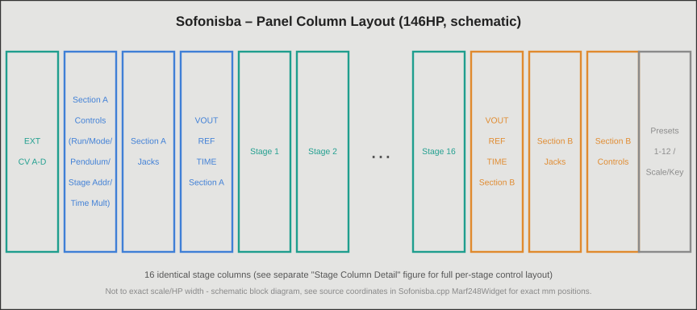
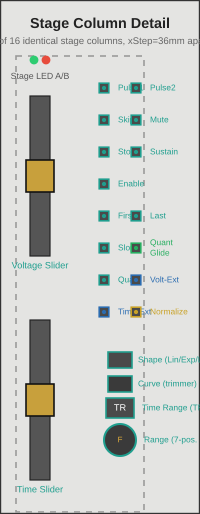
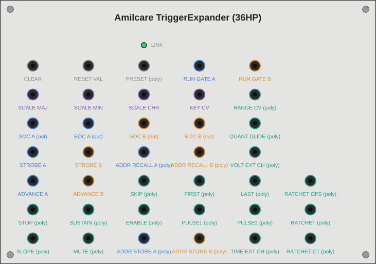
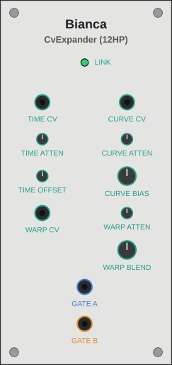

# Kinovice reminiscence of the unattained – Technical Documentation

This is the technical documentation of the VCV Rack C++ implementation of a multiple arbitrary function generator, heavily inspired by the wonderful Buchla world of modules. It describes the main module **Sofonisba**, its compact variant **Lucia**, and the two expansion modules **Amilcare** (trigger expander, 42HP) and **Bianca** (CV expander, 12HP): every control, every input and output, the internal signal processing, the most important C++ functions, and the known pitfalls in how the features interact.

The plugin comprises nine modules in total. The five others each have their own documentation: the quad function generator **Europa** (`Europa-Dokumentation_DE.md` / `Europa-Documentation_EN.md`), the polyphonic dual voltage processor **Minerva** (`Minerva-Dokumentation_DE.md` / `Minerva-Documentation_EN.md`), the CV processor **Elena** (`Elena-Dokumentation_DE.md` / `Elena-Documentation_EN.md`), the quad low-pass gate **Anna-Maria** (`AnnaMaria-Dokumentation_DE.md` / `AnnaMaria-Documentation_EN.md`), and the loop expander **Ritornello** (`Ritornello-Dokumentation_DE.md` / `Ritornello-Documentation_EN.md`).

Sources: publicly available user documentation and community resources on the hardware that inspired this module family.

**Note:** The plugin *Kinovice reminiscence of the unattained* is an independent work, heavily inspired by the wonderful Buchla world of modules. It has no affiliation with Buchla, Tiptop Audio, or any other manufacturer and is neither authorized nor endorsed by them. Product and company names mentioned are trademarks of their respective owners; they are used solely to describe which functional concepts inspired a module.

Status: All features described in this documentation were tested and confirmed live in a running Rack by Kinovice – among others Address Memory store/recall, the 4-channel A–D channel selection including zone boundaries and fallback behavior, backward compatibility of existing mono patches, V/Oct tempo control including right-click numeric entry, Stage Mute including APOUT suppression, the separation of Reference and Time output, the three-color RGB status LED, and the Stage Number Broadcast including undo/redo.

---

<a id="toc"></a>

## Table of Contents

*Each entry has two links: the first (standard Markdown anchor) works in GitHub, Codeberg, the VSCodium preview, and most other viewers. The link labeled "Obsidian" is the wikilink specifically for Obsidian. The first link can also be used in Obsidian; it just isn't always resolved reliably there, hence the second variant as a supplement.*

1. [Architecture Overview](#sec1) · [[#1. Architecture Overview|Obsidian]]
2. [Basic Concepts: Stage, Section, Modifier Bits](#sec2) · [[#2. Basic Concepts: Stage, Section, Modifier Bits|Obsidian]]
3. [Sofonisba – Main Module](#sec3) · [[#3. Sofonisba – Main Module|Obsidian]]
   - [Panel Layout](#sec3-1) · [[#3.1 Panel Layout|Obsidian]]
   - [Controls per Stage](#sec3-2) · [[#3.2 Controls per Stage|Obsidian]]
   - [Controls per Section (A/B)](#sec3-3) · [[#3.3 Controls per Section (A/B)|Obsidian]]
   - [Module-Wide Shared Elements](#sec3-4) · [[#3.4 Module-Wide Shared Elements|Obsidian]]
   - [Inputs/Outputs at a Glance](#sec3-5) · [[#3.5 Inputs/Outputs at a Glance|Obsidian]]
   - [Lucia – Compact Version](#sec3-6) · [[#3.6 Lucia – Compact Version|Obsidian]]
4. [Internal Signal Processing](#sec4) · [[#4. Internal Signal Processing|Obsidian]]
   - [The Afg Core (Sequencing Control of a Section)](#sec4-1) · [[#4.1 The Afg Core (Sequencing Control of a Section)|Obsidian]]
   - [Stage Advance Logic: Forward / Reverse / Pendulum / Skip](#sec4-2) · [[#4.2 Stage Advance Logic: Forward / Reverse / Pendulum / Skip|Obsidian]]
   - [Stage Address: Reset / Continuous / Strobe / Channel Select](#sec4-3) · [[#4.3 Stage Address: Reset / Continuous / Strobe / Channel Select|Obsidian]]
   - [Voltage Signal Path: Range, Quantize, Slew](#sec4-4) · [[#4.4 Voltage Signal Path: Range, Quantize, Slew|Obsidian]]
   - [Time Signal Path: Time Range, External Time, Time CV, Time Multiplier](#sec4-5) · [[#4.5 Time Signal Path: Time Range, External Time, Time CV, Time Multiplier|Obsidian]]
   - [Sustain / Enable / Stop](#sec4-6) · [[#4.6 Sustain / Enable / Stop|Obsidian]]
   - [Pulse Outputs: APOUT, EOS, P1/P2OUT, Start/End of Cycle](#sec4-7) · [[#4.7 Pulse Outputs: APOUT, EOS, P1/P2OUT, Start/End of Cycle|Obsidian]]
   - [Preset System (Pickup/Catch)](#sec4-8) · [[#4.8 Preset System (Pickup/Catch)|Obsidian]]
   - [Address Memory](#sec4-9) · [[#4.9 Address Memory|Obsidian]]
   - [Clock-Quantized Advance](#sec4-10) · [[#4.10 Clock-Quantized Advance|Obsidian]]
   - [Scale/Key Quantization](#sec4-11) · [[#4.11 Scale/Key Quantization|Obsidian]]
   - [Tempo/BPM Control (V/Oct, BEATS_FACTOR)](#sec4-12) · [[#4.12 Tempo/BPM Control (V/Oct, BEATS_FACTOR)|Obsidian]]
   - [Ratcheting](#sec4-13) · [[#4.13 Ratcheting|Obsidian]]
   - [Stage Number Broadcast](#sec4-14) · [[#4.14 Stage Number Broadcast|Obsidian]]
5. [Sofonisba – Function Reference (C++)](#sec5) · [[#5. Sofonisba – Function Reference (C++)|Obsidian]]
6. [Amilcare – Trigger Expander](#sec6) · [[#6. Amilcare – Trigger Expander|Obsidian]]
7. [Bianca – CV Expander](#sec7) · [[#7. Bianca – CV Expander|Obsidian]]
8. [Expander Mechanism (Communication Between Modules)](#sec8) · [[#8. Expander Mechanism (Communication Between Modules)|Obsidian]]
9. [Persistence (Patch Storage)](#sec9) · [[#9. Persistence (Patch Storage)|Obsidian]]
10. [Known Pitfalls in Interaction](#sec10) · [[#10. Known Pitfalls in Interaction|Obsidian]]
11. [Design Decisions & Boundaries](#sec11) · [[#11. Design Decisions & Boundaries|Obsidian]]
12. [Cross-Compile Workflow](#sec12) · [[#12. Cross-Compile Workflow|Obsidian]]
13. [List of Figures](#figures) · [[#List of Figures|Obsidian]]

---

<a id="sec1"></a>

## 1. Architecture Overview
*[↑ Back to table of contents](#toc) · [[#Table of Contents|Obsidian]]*

The plugin consists of nine VCV Rack modules. Four of them belong to the Sofonisba family and are described in this file; the five others (Europa, Minerva, Elena, Anna-Maria, Ritornello) each have their own documentation.

**Sofonisba** *(`Sofonisba.hpp`, `Sofonisba.cpp`)*<br>
The main module (146HP) contains two independent AFG sections (A/B) that share 16 common stages, as well as the entire core DSP logic.

**Lucia** *(`Sofonisba.cpp`, `modelMarf248Compact`)*<br>
The compact variant (about 40HP) uses the same `struct Marf248` and thus the same DSP engine, but has its own panel with only one visible stage slot (see [3.6](#sec3-6)). It can sit next to Sofonisba in the same patch without any problem.

**Amilcare** *(`SofonisbaTriggerExpander.hpp/.cpp`)*<br>
Optional 42HP expander with additional trigger and gate inputs and outputs: Clear, Presets, Scale/Key, Start/End of Cycle, Run Gates, Advance, Address Memory, Stage Modifier CV including VOLT_EXT/TIME_EXT channel selection, and SEXT.

**Bianca** *(`SofonisbaCvExpander.hpp/.cpp`)*<br>
Optional 12HP expander: polyphonic CV modulation of stage time and slew curve, plus polyphonic gate outputs per stage.

**Basic principle of the expander mechanism:** Both expanders have no DSP logic of their own – they are pure "jack carriers". `Marf248::process()` checks on every sample whether a matching module is docked on the left or right (`getLeftExpander()`/`getRightExpander()`), and reads and writes its parameters, inputs, and outputs directly. This avoids message passing and double buffering and is only permissible because the expanders have no independent processing of their own (see the VCV Rack Plugin API Guide, section "Expanders": "you can implement its entire DSP algorithm in the [primary] module"). Conversely, the expanders check on their own every frame whether a Sofonisba is docked, so that they cleanly reset their outputs and lights to 0V when removed or moved.

The trigger expander lookup is deliberately placed at the very beginning of `Marf248::process()`, before the stage address processing, because SEXT (external strobe pulses) must already know the trigger expander before `applyStageAddress()` is called.

**Europa** *(`Europa.cpp`, `EnvGen4.hpp`, `modelEuropa`)*<br>
Fifth module: quad function generator with VCA (four envelope generators with four stages each, 23HP). Own engine, technically independent of Sofonisba (see `Europa-Documentation_EN.md`).

**Minerva** *(`Minerva.cpp`, `VoltageProc.hpp`, `modelMinerva`)*<br>
Sixth module: polyphonic dual voltage processor (14HP) with two identical sections, each combining four voltages into one output voltage (attenuverter, crossfader, offset). Each of the 16 channels has its own control values; one shared channel selector applies to both sections. Own engine, technically independent of Sofonisba (see `Minerva-Documentation_EN.md`).

**Elena** *(`Elena.cpp`, `CvProcElena.hpp`, `modelElena`)*<br>
Seventh module: digital CV processor (42HP) with A/B transformation sections (input selection, transfer curve with optional breakpoint, adjustable per channel) and six slew limiters C–H with pulse output, arranged in three blocks of two slewers each. Own engine, technically independent of Sofonisba (see `Elena-Documentation_EN.md`).

**Anna-Maria** *(`AnnaMaria.cpp`, `AnnaMariaLpg.hpp`, `modelAnnaMaria`)*<br>
Eighth module: quad low-pass gate (31HP) with VCA mode, vactrol-like behavior, and optional resonance; four monophonic channels plus an ALL summing column. Own engine, technically independent of Sofonisba (see `AnnaMaria-Documentation_EN.md`).

**Ritornello** *(`SofonisbaLoopExpander.hpp/.cpp`, `modelMarf248LoopExpander`)*<br>
Ninth module: loop expander (12HP) for Sofonisba and Lucia. Via polyphonic gate inputs it marks the start and end of loops over arbitrary stages (nesting included), counts the passes via a polyphonic CV, and outputs an exit pulse, a remainder CV, and a digit display for each section. Like Amilcare and Bianca, it is a pure jack carrier; the loop logic resides in `Afg` (see `Ritornello-Documentation_EN.md` and [Section 8](#sec8)). The name deliberately departs from the naming scheme of the Anguissola family.

All nine modules are registered in `plugin.cpp`/`plugin.hpp` (`modelMarf248`, `modelMarf248Compact`, `modelMarf248TriggerExpander`, `modelMarf248CvExpander`, `modelEuropa`, `modelMinerva`, `modelElena`, `modelAnnaMaria`, `modelMarf248LoopExpander`).

---

<a id="sec2"></a>

## 2. Basic Concepts: Stage, Section, Modifier Bits
*[↑ Back to table of contents](#toc) · [[#Table of Contents|Obsidian]]*

- **Stage**: One of 16 programming steps (`NUM_STAGES = 16`). Each stage has a voltage value, a time value, a Range and a Curve control, and a bundle of digital modifier bits. The 16 stages are shared module-wide: Section A and Section B read the same programming but run independently as two separate "pointers" (`currentStage`) over it.
- **Section (A/B)**: Two independent AFG instances (`Afg afgA`, `Afg afgB` in `Marf248`). Each has its own run direction, its own run/stop state, its own time multiplier, and its own stage address source, but both step through the same 16 stages.
- **Modifier bits** (`enum StageModifierBits`, in `Sofonisba.hpp`): A single array `int stageModifier[NUM_STAGES]` encodes all digital states per stage as a bitmask. Overview:

| Bit | Meaning | Hardware precedent? |
|---|---|---|
| `MOD_QUANT_OCT` | Quantizes the stage voltage to Scale/Key | yes |
| `MOD_SLOPED` | Stage ramps (slews) instead of jumping | yes |
| `MOD_STOP` | Programmed stop stage | yes |
| `MOD_SUSTAIN` | Holds the stage as long as the Start gate is high | yes |
| `MOD_ENABLE` | Holds the stage as long as the Start gate is low | yes |
| `MOD_FIRST` | Marks the stage as the cycle start | yes |
| `MOD_LAST` | Marks the stage as the cycle end | yes |
| `MOD_SLEW_EXP` / `MOD_SLEW_LOG` | Curve shape of the ramp (no bit = linear) | yes |
| `MOD_RANGE_HALF` / `MOD_RANGE_LIMITED` (+ 3-bit octave offset) | Voltage range Full/Half/Limited | yes |
| `MOD_VOLT_EXT` / `MOD_TIME_EXT` | External voltage/time source (channel select A–D) instead of the control | yes |
| `MOD_PULSE1` / `MOD_PULSE2` | Programmed pulse outputs P1OUT/P2OUT | yes |
| `MOD_SKIP` | Stage is skipped during automatic sequencing | **no** (pure software extension) |
| `MOD_SLEW_NORMALIZE` | Stretches the visibly moving curve to the full stage time | **no** |
| `MOD_TRANGE_1/2/4` | Time Range TR1/TR2/TR4 (no bit = TR3, default) | yes (TR1–4) |
| `MOD_MUTE` | Suppresses P1OUT/P2OUT **and** APOUT for this stage without altering `MOD_PULSE1`/`MOD_PULSE2`; voltage/slew unaffected | **no** |
| `MOD_QUANT_GLIDE` | Quantizes the entire slew (not just the target value) to Scale/Key sample by sample – "staircase glide"; only effective together with `MOD_SLOPED` | **no** (pure software extension) |
| `MOD_RATCHET` | Ratcheting: N rhythmic sub-triggers on P1OUT/P2OUT instead of a single trigger per stage (only effective with a patched count CV on the trigger expander) | **no** (pure software extension) |

A 3-bit field (`RANGE_OFFSET_MASK`) additionally encodes the octave offset in Limited Range mode (five steps: +0/+2/+4/+6/+8 V).

Two further storage structures, independent of the modifier bit array, complement the stage programming: the preset system (the complete programming of all 16 stages, 12 slots, see [4.8](#sec4-8)) and the address memory (a pure jump bookmark to a stage index, 16 slots per section, see [4.9](#sec4-9)). Both systems are conceptually clearly separated from each other and must not be confused.

---

<a id="sec3"></a>

## 3. Sofonisba – Main Module
*[↑ Back to table of contents](#toc) · [[#Table of Contents|Obsidian]]*

<a id="sec3-1"></a>

### 3.1 Panel Layout
*[↑ Back to table of contents](#toc) · [[#Table of Contents|Obsidian]]*

The panel is 146HP wide (previously 120HP, then 126HP for the new output column, then wider again through the slider/button relayout) and divided into several vertical columns, from left to right:

```
[External CV A–D] [Section-A Controls] [Section-A Jacks] [Section-A Outputs] [Stage Array (16×)] [Section-B Outputs] [Section-B Jacks] [Section-B Controls] [Preset Column]
```

*[See [Figure 1](#fig1) for a schematic overview of this column structure · [[#Figure 1 – Sofonisba Panel Column Layout (Schematic Overview)|Obsidian]]]*

- **External CV column** (far left): the four module-wide shared external CV inputs (jacks A–D), which can be referenced per stage via `MOD_VOLT_EXT`/`MOD_TIME_EXT`.
- **Section A/B controls column**: tempo knob/attenuverter, BEATS_FACTOR trimmer, Run button, Mode/Pendulum button, stage address controls.
- **Section A/B jacks column** (12–121mm): Start/Stop, tempo CV, live BPM display, BEATS_FACTOR CV, P1OUT/P2OUT, APOUT, stage address CV, stage address channel select CV.
- **Section A/B output column** (12mm wide, 12–56mm; the frame was extended in the "Time/Reference output separation" session): VOUT (voltage output), Reference (`TOUT_A/B`, ramp), and Time (`TIMESTATIC_A/B`, new, static CV). This narrow column sits between the jacks column and the stage array, mirrored for A and B. It was moved out of the jacks column to make room there for the enlarged BPM display.
- **Stage array** (center, 16 identically built columns): the actual programming of the 16 stages.
- **Preset column** (far right): Load/Save, Scale/Key, 12 preset slots.
- Above the stage array, centered: **Global Clear**, **Reset Values**, and **Auto-Fill**.

For visual structure, each column is surrounded by a thin frame (`StageFrame` widget); functionally related jack groups are additionally set apart by thin horizontal divider lines (`HDivider`).

<a id="sec3-2"></a>

### 3.2 Controls per Stage
*[↑ Back to table of contents](#toc) · [[#Table of Contents|Obsidian]]*

*[See [Figure 2](#fig2) for the exact position of each control described below – all 16 stage columns are built identically · [[#Figure 2 – Sofonisba Stage Column Detail|Obsidian]]]*

Each of the 16 stage columns contains, from top to bottom:

**Voltage** (`STAGE_VOLTAGE_PARAM`) *(vertical slider, 0–10V)*<br>
Programmed output voltage of the stage. In External mode (`MOD_VOLT_EXT`), the control position instead serves as channel select A–D (four zones of 2.5V each). Depending on the state, the tooltip shows volts, a note name (with Quantize), or a channel name (with External), see `StageVoltageQuantity`. Right-click numeric entry additionally accepts note names (e.g. "C4", "C#4", "Db4" – note letter case-insensitive, accidental `#` or lowercase `b`, octave number mandatory, reference 0V = C4) instead of plain volt numbers. This works independently of the stage's Quantize state; on invalid input, evaluation falls back to normal number parsing.

**Time** (`STAGE_TIME_PARAM`) *(vertical slider, normalized 0–1)*<br>
Programmed stage time as a position within the selected Time Range (TR1–4). The tooltip shows the classic dial value (0–10, leading) with the exactly resolved number of seconds after it in parentheses, e.g. `4.0 (0.132 s)`, see `StageTimeQuantity`. Right-click numeric entry still accepts the 0–10 dial value. In External mode (`MOD_TIME_EXT`), the position serves as channel select A–D.

**Grip value display** *(both sliders, directly in the grip)*<br>
In addition to the tooltip, the slider grip shows the current value rounded to an integer (0–10) directly on the panel – for Voltage the voltage in volts, for Time the same classic dial value as in the tooltip (the leading number before the parentheses), since `pq->getDisplayValue()` returns the same 0–10 scale for both parameters. Font ShareTechMono, golden outline (RGB 235,170,60) with black fill, centered in the grip. In the special Quantize/External modes, the digit still shows the raw control value (0–10) instead of the resolved meaning (note name or channel select A–D); the tooltip is responsible for that, since an abbreviation in the 8×6mm grip would not be reliably legible.

**Two stage LEDs** (`STAGE_LIGHT_A/B`) *(light)*<br>
Indicate whether Section A or B is currently addressing this stage (green/red, side by side).

**Pulse 1 / Pulse 2 / Skip / Mute** *(LED buttons (toggle), all four red)*<br>
Pulse/output group in a 2×2 grid: `MOD_PULSE1`/`MOD_PULSE2` trigger a short pulse on the respective section's P1OUT/P2OUT when the stage is reached. `MOD_SKIP` (pure software extension) completely skips the stage during automatic timing – no time, no triggers, no voltage output. The bit only takes effect during automatic sequencing, not with manual addressing (Reset/Strobe/Continuous). `MOD_MUTE` fully suppresses P1OUT/P2OUT and APOUT of this stage without altering the Pulse1/Pulse2 programming itself; after it is lifted, that programming takes effect again immediately. Mute acts module-wide for both sections simultaneously (see [4.7](#sec4-7) and [Pitfalls](#sec10)) and can additionally be overridden by CV via `STAGE_MUTE_POLY_INPUT` on the trigger expander (see [6](#sec6)). For the uniform red LED color of these four buttons, see the rationale of the color scheme under [Design Decisions](#sec11) · [[#11. Design Decisions & Boundaries|Obsidian]].

**Stop / Sustain / Enable** *(LED buttons (toggle))*<br>
Row 2: `MOD_STOP` is the programmed stop stage (pauses sequencing until the section is restarted). `MOD_SUSTAIN` holds the stage as long as a high level (gate) is present at the Start input (release behavior like an ADSR). `MOD_ENABLE` holds the stage as long as no high level is present – so release only happens through a gate. Both hold states pause the dwell timer `elapsed`. **Caution, pitfall without a patched cable at START_A/B – see [Section 10](#sec10).**

**First / Last / Slope / Quantized Glide** *(LED buttons (toggle))*<br>
Row 3: `MOD_FIRST`/`MOD_LAST` mark cycle start and end (wrap points for Forward/Reverse/Pendulum; they trigger Start/End of Cycle triggers on the trigger expander, and multiple First/Last pairs are possible, see [4.2](#sec4-2)). `MOD_SLOPED` switches between stepped (default) and ramping (slew) voltage change. `MOD_QUANT_GLIDE`, placed directly next to Slope, quantizes the entire ramp sample by sample to the global Scale/Key grid instead of just the target value – for the resulting "staircase glide" effect see [4.4](#sec4-4). It is only audible and visible when Slope is also active.

**Quantize / Volt-Ext / Time-Ext** *(LED buttons (toggle))*<br>
Row 4: `MOD_QUANT_OCT` quantizes the target voltage to the global Scale/Key grid. `MOD_VOLT_EXT`/`MOD_TIME_EXT` switch the stage's voltage or time source to external (channel select via the respective control).

**Shape** (`STAGE_SHAPE_PARAM`) + two lights *(LED button (3-state cycle))*<br>
Cycle Linear → Exponential → Logarithmic, only effective with Slope active. Two separate LEDs (`STAGE_SHAPE_EXP_LIGHT`/`STAGE_SHAPE_LOG_LIGHT`) instead of a combined indicator; no bit set means linear.

**Curve** (`STAGE_CURVE_PARAM`) *(trimmer, 0–1)*<br>
Curve strength of the Exp/Log ramp. Center (0.5) corresponds to the reference curvature (`SLEW_CURVE_POWER = 2.5`); to the left the curve becomes more linear, to the right more strongly curved (up to exponent ≈ 15.6). Can additionally be modulated via the slew curve CV from the CV expander.

**Normalize** (`STAGE_NORMALIZE_PARAM`) *(LED button (toggle))*<br>
`MOD_SLEW_NORMALIZE` (pure software extension) stretches, with an extreme Curve setting, the visibly moving part of the curve to the full stage time instead of squeezing it into a tiny fraction of the time.

**Time Range** (`STAGE_TRANGE_PARAM`, `TrangeButton`) *(large, self-drawing button (4-state cycle))*<br>
Selects TR1 (0.002–0.03s) through TR4 (2–30s); the current digit 1–4 is shown directly on the button. TR3 (0.2–3s) is the default (no bit set). A right-click opens a context menu for direct selection.

**Range** (`STAGE_RANGE_PARAM`, `RangeKnob`) *(large rotary control with text display, 7 detent positions)*<br>
Full (0–10V unchanged) → Half (0–5V compressed) → Limited +0/+2/+4/+6/+8V (2V span, equivalent to two octaves at 1V/oct, shifted by the selected offset). The control shows the abbreviation ("F"/"H"/"L0"…"L8") directly, plus a colored pointer. A right-click opens a checklist context menu (more reliable than text entry for this snap control).

**Stage Number Broadcast** *(right-click context menu, "Stage Number Broadcast" session)*<br>
On nine of the toggle buttons (Pulse1/2, Skip, First/Last, Stop/Sustain/Enable, Slope) as well as on all four continuous controls (Voltage, Time, Range, Curve), a right-click opens the entry "Apply … to all stages" in addition to the respective standard menu. It transfers the current state or value of the clicked stage to all 16 stages at once and can be completely undone in a single step with Ctrl+Z. For details on scope, triggers, and the undo mechanism see [4.14](#sec4-14).

<a id="sec3-3"></a>

### 3.3 Controls per Section (A/B)
*[↑ Back to table of contents](#toc) · [[#Table of Contents|Obsidian]]*

Section A and B are built identically, just mirrored:

**Controls column** (top to bottom):
- **Tempo** (`TIME_MULT_A/B_PARAM`, −5…+5V) with **attenuverter** (`TIME_MULT_ATTEN_A/B_PARAM`, −1..+1) for the associated CV input. Breaking change compared to the original 0.5×–4.0× factor semantics: The control now stores a V/Oct tempo voltage (0V = 120 BPM, exponential) instead of a direct time factor. Tooltip and right-click numeric entry work in BPM (`TempoQuantity`); the full derivation is in [4.12](#sec4-12).
- **BEATS_FACTOR** (`BEATS_FACTOR_A/B_PARAM`, trimmer 0.1–64, default 4) with associated CV input: determines how many beats a full cycle across all non-skipped stages should represent; the effectively applied time factor is back-calculated from this. Can be switched to **Auto** via right-click context menu (segment length sync instead of a fixed value; the CV remains additively effective), see [4.12](#sec4-12).
- **Run** (`RUN_A/B_PARAM`, LED button): toggles start/stop of the section (green LED = running), OR-combined with an external Start/Stop gate from the trigger expander. **Ignored as long as Advance is patched – see [4.10](#sec4-10) and [Pitfalls](#sec10).**
- **Mode** (`MODE_A/B_PARAM`, LED button): reverses the base run direction (off = Forward, on = Reverse).
- **Pendulum** (`PENDULUM_A/B_PARAM`, LED button): additionally enables back-and-forth swinging between First and Last (see [4.2](#sec4-2)).
- **Stage address knob** (`STAGE_ADDR_KNOB_A/B_PARAM`, trimmer 0–15): internal stage address, only effective in Int mode. **It never moves `currentStage` on its own – only Strobe/Continuous/Reset actually apply the address, see [Pitfalls](#sec10).**
- **Stage address Int/Ext** (`STAGE_ADDR_MODE_A/B_PARAM`, LED button): selects between the internal knob and external CV (`STAGE_ADDR_EXT_A/B_INPUT`) as the address source.
- **Continuous** (`STAGE_ADDR_CONT_A/B_PARAM`, LED button): keeps `currentStage` synchronized with the address every frame and forces immediate full deflection. The section does not run internally in this state (`running` is neutralized in `applyStageAddress()`). An active slope ramp to the addressed target value nevertheless continues (see [4.3](#sec4-3)).
- **Strobe** (`STAGE_ADDR_STROBE_A/B_PARAM`, momentary button): single jump to the current address; afterwards normal timing and slew continue. As feedback, the button briefly flashes blue.
- **Reset** (`STAGE_ADDR_RESET_A/B_PARAM`, momentary button): jumps immediately to the MOD_FIRST stage with the lowest index (`findLowestFirst()`, fallback: stage 1). This matters with multiple First/Last segments, see [4.2](#sec4-2).

**Jacks column** (top to bottom): Start trigger, Stop trigger, tempo CV input, live BPM display (pure text readout, not a component; shows the actually effective tempo including CV, see [4.12](#sec4-12)), BEATS_FACTOR CV input, P1OUT/P2OUT (programmed pulses, with a red ring light `PulseRingLight` around the jack that blinks along with the pulse), APOUT (All Pulses, fires on every stage change), stage address CV input, stage address channel select CV input.

**Output column** (own narrow column between jacks column and stage array): VOUT (voltage output), Reference (`TOUT_A/B_OUTPUT`; 0–10V falling ramp over the stage time, intended for downstream low-pass gate modules), and Time (`TIMESTATIC_A/B_OUTPUT`, new in the "Time/Reference output separation" session; static CV 0–10V, placed directly below Reference, same 14.5mm pitch as VOUT→Reference; the output frame was extended from 12–44mm to 12–56mm for this). Name correction: The jack originally called "TOUT" actually computes the ramp described in the reference documentation as "Reference Output", not the static "Time Output" voltage. Both functions now exist as separate jacks, see [4.5](#sec4-5).

**"Run/Hold/Stop" status LED** (three-color, at the same panel position): a single RGB LED (`RUN_A/B_LIGHT`, as a 3-channel light block `_R`/`_G`/`_B`) instead of separate individual lights, with additive color mixing:
- Green (G channel only): The section is running normally – or Advance mode is active, which is deliberately displayed like "running" (see [4.10](#sec4-10)).
- Yellow (R+G together, G dimmed to `HOLD_BRIGHTNESS = 0.5` so that yellow differs from pure red and green): The section is waiting in a Sustain/Enable stage for a Start gate.
- Red (R channel only): The section is stopped (button/pulse, programmed stop stage, or active Continuous addressing).

<a id="sec3-4"></a>

### 3.4 Module-Wide Shared Elements
*[↑ Back to table of contents](#toc) · [[#Table of Contents|Obsidian]]*

- **Global Clear** (`CLEAR_PARAM`, LED button, red flash light): resets all modifier bits, Range (→ Full), and Curve (→ center) on all 16 stages and additionally discards pending preset pickups. The command deliberately follows only the subset described in the reference documentation (Output Pulses, voltage programming, Operating Mode, Time Range); the Voltage/Time controls themselves are left untouched. The address memory is unaffected by Global Clear (see [4.9](#sec4-9)).
- **Reset Values** (`RESET_VALUES_PARAM`, LED button, yellow flash light): pure software extension without hardware precedent. Resets only the Voltage and Time controls of all 16 stages to their defaults (0V and time center, respectively); modifier bits, Range, and Curve remain unchanged. This clearly separates it from Global Clear.
- **Auto-Fill** (`AUTOFILL_PARAM`, LED button, blue flash light): pure software extension without hardware precedent, developed for the phasor generator use case. Sets the 16 shared Voltage controls to a linear 0–10V grid (step size 10/16 = 0.625V, stage 1 = 0V … stage 16 = 9.375V) and simultaneously forces `Range = Full` per stage. Time controls and modifier bits are left untouched (analogous to Reset Values). Since voltage and range are shared module-wide between Section A and B, there is deliberately only a single global button – separate A/B variants would be architecturally impossible without fundamentally restructuring the shared stage data structure.
- **Preset system** (`LOAD_PARAM`, `SAVE_PARAM`, `PRESET_PARAM` ×12): Load or Save is first "armed" (latching); the next press on one of the 12 preset buttons then selects the slot. A preset stores the complete programming of all 16 stages (Voltage/Time/Range/Curve control values plus all modifier bits), see [4.8](#sec4-8) (Pickup/Catch). Empty slots are ignored on load so that nothing is reset by accident; a short flash signals "nothing is stored here".
- **Scale/Key** (`SCALE_PARAM`, `KEY_PARAM`): same arming principle as Load/Save, with the same 12 preset buttons doing double duty. Scale: only buttons 10/11/12 are valid (Major/Minor/Chromatic). Key: all 12 buttons are valid (C…B). See [4.11](#sec4-11).

<a id="sec3-5"></a>

### 3.5 Inputs/Outputs at a Glance
*[↑ Back to table of contents](#toc) · [[#Table of Contents|Obsidian]]*

| Category | Inputs/outputs | Shared? |
|---|---|---|
| Section Start/Stop | `START_A/B_INPUT`, `STOP_A/B_INPUT` | per section |
| External voltage sources | `EXT_A/B/C/D_INPUT` | shared module-wide |
| Stage address CV | `STAGE_ADDR_EXT_A/B_INPUT` (poly, up to 4 channels A–D) | per section |
| Stage address channel select CV | `STAGE_ADDR_EXT_CHANNEL_A/B_INPUT` (new) | per section |
| Time multiplier CV | `TIME_MULT_CV_A/B_INPUT` (tempo, V/Oct) | per section |
| BEATS_FACTOR CV | `BEATS_FACTOR_CV_A/B_INPUT` (new) | per section |
| Section outputs | `VOUT_A/B` (voltage), `TOUT_A/B` (Reference, falling ramp), `TIMESTATIC_A/B` (Time, new, static CV), `APOUT_A/B`, `P1OUT_A/B`, `P2OUT_A/B` | per section |

---

<a id="sec3-6"></a>

### 3.6 Lucia – Compact Version
*[↑ Back to table of contents](#toc) · [[#Table of Contents|Obsidian]]*

**Lucia** is the compact variant of Sofonisba, named after the Anguissola sister regarded as the most talented painter of the family. It uses the same `struct Marf248` and thus the same DSP engine, but has its own panel (`Marf248CompactWidget`, second model `modelMarf248Compact`, slug `Marf248Compact`) with only one visible stage slot instead of 16 parallel stage columns. It is about 40HP wide (derived from the column spacings in the widget) instead of 146HP. Both versions can sit in the same patch at the same time.

**Panel layout**<br>
From left to right: External CV column (EXT A–D), Section A controls, Section A jacks, Section A outputs (with STAGE selection), the single stage slot, Section B outputs, Section B jacks, Section B controls, and the preset column. All elements except the stage slot correspond to the full version.

**A single shared stage slot**<br>
`STAGE_VOLTAGE_PARAM`, `STAGE_TIME_PARAM`, `STAGE_RANGE_PARAM`, `STAGE_CURVE_PARAM`, and all modifier bits are each a single array across all 16 stages, not separate per section. A second slot for Section B would therefore write the same params as the one for Section A. For that reason, Lucia has exactly one slot for both sections – like the shared stage columns of the full version.

**STAGE selection and ACTIVATE**<br>
A selection knob (14mm) with center display and an Activate button (8mm) sit in the output column of Section A. Dragging vertically preselects the stage (`pendingStage`), ACTIVATE adopts it (`displayedStage`). The number in the knob is green when preselection and display match, otherwise amber; the button is then green, otherwise red. Only after activation does the slot show the values of the selected stage.

**Not a param, JSON persistence**<br>
`pendingStage` and `displayedStage` (int 0–15) are members of `struct Marf248`, but deliberately not Rack params: Pickup/Catch, history, and preset recall are not supposed to affect pure GUI navigation. Both are saved via `dataToJson()`/`dataFromJson()` with clamping. The members also exist in the full version, unused there and without any behavioral difference.

**Expanders**<br>
Amilcare and Bianca dock to Lucia just as they do to Sofonisba, see [Section 8](#sec8).

---

<a id="sec4"></a>

## 4. Internal Signal Processing
*[↑ Back to table of contents](#toc) · [[#Table of Contents|Obsidian]]*

<a id="sec4-1"></a>

### 4.1 The Afg Core (Sequencing Control of a Section)
*[↑ Back to table of contents](#toc) · [[#Table of Contents|Obsidian]]*

`struct Afg` (in `Sofonisba.hpp`) encapsulates the complete runtime state and the sequencing control of a single section (A or B). `Marf248` holds two instances (`afgA`, `afgB`) that both read the same stage data (via function parameters) but run independently of each other.

Important state fields:
- `currentStage`: index (0–15) of the currently addressed stage.
- `running` / `effectiveRunning`: `running` stores the persistent button/pulse state; `effectiveRunning = running || runGateHigh` is the run state actually effective for the respective frame (see trigger expander run gate). It is deliberately kept independent of Advance mode (see [4.10](#sec4-10)).
- `elapsed`: dwell timer counting since entry into the current stage.
- `voltageFrom` / `voltageOut`: start value and current value of the running ramp, for seamless slew across stage boundaries.
- `reverseMode`, `pendulumMode`, `pendulumDir`, `pendulumHeld`, `pendulumWasOn`: run direction control (see [4.2](#sec4-2)).
- `continuousActive`: remembers whether `applyStageAddress()` ran through the Continuous branch in this frame (see [4.3](#sec4-3)).
- `advanceModeActive`: true as long as `ADVANCE_A/B_INPUT` is patched (see [4.10](#sec4-10)).
- `statusHeld`, `statusStoppedByStage`: states for the three-color status LED.
- Several `dsp::PulseGenerator` and `dsp::SchmittTrigger` instances for trigger detection and pulse output, including `advanceTrigger` (true edge detection, only processed when the jack is patched) and `runGateTrigger` (pure level detection with Schmitt hysteresis).

<a id="sec4-2"></a>

### 4.2 Stage Advance Logic: Forward / Reverse / Pendulum / Skip
*[↑ Back to table of contents](#toc) · [[#Table of Contents|Obsidian]]*

`Afg::advanceStage()` is called as soon as `elapsed >= stageTime[currentStage]` (automatic sequencing) or immediately if the current stage is marked as Skip. Flow:

1. **Determine the next stage**, depending on the run mode:
   - **Forward** (default): `next = currentStage + 1`. When the end of the array or a `MOD_LAST` stage is reached, sequencing wraps back to the next `MOD_FIRST` stage (`findFirstBefore()`).
   - **Reverse** (`reverseMode`): mirror image of Forward – decrements and wraps at `MOD_FIRST` to the next `MOD_LAST` stage (`findLastAfter()`).
   - **Pendulum** (`pendulumMode`): swings back and forth between First and Last, with First…Last assumed to be a contiguous, non-wrapping range. At each turning point the stage is repeated once (`pendulumHeld`) before the direction reverses. The total period is thereby exactly 2×M (M = number of stages in the First–Last range) instead of 2×(M−1), which keeps Pendulum in sync with a section running forward in parallel. The starting direction when Pendulum is switched on is derived from `reverseMode` (Forward → bounce toward Last, Reverse → bounce toward First). Toggling `reverseMode` while Pendulum is already running only takes effect on the next off/on cycle; an abrupt jump in the middle of the bounce is thus ruled out.

   **Sync behavior with a forward-running parallel section** (verified live, August 2026 session): With identical stage times on both sections, an exactly periodic two-state pattern results over 2 forward cycles each (= 1 complete Pendulum round trip, 2×M ticks). In the first cycle both run in perfect alignment (Pendulum rises like Forward), in the second mirror-inverted (Pendulum falls while Forward rises again); both states count as "in sync" in terms of the voltage curve. A turning-point hold that was removed as a test (period 2×(M−1) instead of 2×M) was discarded again: Without the hold, the Pendulum period is no longer a clean multiple of the Forward period M (the least common multiple of M=16 and 2×(M−1)=30 would be 240 ticks), and both sections drifted completely apart instead of staying in sync. An initially observed single outlier (3 of 4 passes in sync, one not) could not be traced to a code error; it disappeared after a joint restart of both sections and pointed to a start-time offset between A and B, not to a Pendulum logic problem.

2. **Skipping Skip stages**: A loop (at most `NUM_STAGES` attempts as a safety net) repeats the same stepping logic as long as the found stage has `MOD_SKIP` set. Skip only acts during automatic sequencing, not with manual addressing.
3. **Set the ramp starting point** (`voltageFrom = voltageOut`), `elapsed` to 0, trigger `allPulseGen` (APOUT).
4. On re-entry without an index change (repetition at the Pendulum turning point): an additional short retrigger pulse (`regateGen`, `REGATE_GAP_SECONDS = 5ms`) for the CV expander, so that downstream envelope generators retrigger reliably.
5. `resetPulseEdgeState()` resets the edge previous-values for P1/P2/First/Last (see [4.7](#sec4-7)).

**Multiple First/Last segments:** Since `findFirstBefore()`/`findLastAfter()` wrap locally – relative to the current position – instead of globally, the 16-stage field can be divided into several independently looping segments (e.g. First=1/Last=3, First=5/Last=8, First=12/Last=16). Each segment loops independently within its boundaries. Switching between segments happens actively via external stage address CV with Strobe/Continuous, not automatically. In this case, Reset jumps deliberately to the very first segment (`findLowestFirst()`, lowest index) – not to the First nearest from the current position's point of view. That would have been the case with `findFirstBefore()` and would have hit a different segment depending on `currentStage`.

**Loops (Ritornello):** If a Ritornello is docked and Begin and End are patched, `Afg` layers Begin/End loops with a counter over this sequencing: When leaving an End stage (in Reverse: the Begin stage), `advanceStage()` jumps to the counterpart as long as passes remain; at the end of `advanceStage()` and `jumpToStage()`, `onStageEntered()` lets the counters of loops that do not contain the new stage expire. Begin and End are independent of First/Last, the wraps remain untouched. Without Ritornello or without both cables, behavior is bit-identical. With Pendulum, the loops are inactive. Details: `Ritornello-Documentation_EN.md`, Section 3.

<a id="sec4-3"></a>

### 4.3 Stage Address: Reset / Continuous / Strobe / Channel Select
*[↑ Back to table of contents](#toc) · [[#Table of Contents|Obsidian]]*

`Afg::applyStageAddress()` is called before the actual `Afg::process()`. The order matters because Continuous must neutralize `running` so that the normal timing logic pauses within the same frame:

- **Reset**: jumps immediately to the MOD_FIRST stage with the lowest index (`findLowestFirst()`, fallback stage 1) – independent of the current mode and independent of Continuous/Strobe. Reset is the highest-priority branch in `applyStageAddress()` and is checked before Continuous/Strobe. Reset is not a clock-synchronous action as with classic step sequencers: `elapsed` is set to 0 immediately, and the ramp or internal timer starts in the same sample without waiting for an external clock – even when clock-quantized Advance is currently active for this section (see [10.13](#sec10)).
- **Continuous**: keeps `currentStage` synchronized with the address (knob or external CV) every frame and forces immediate full deflection. The actual ramp progress (`elapsed += sampleTime`) continues to run continuously in `process()`, so that a slope ramp to the newly addressed target value still progresses smoothly. This corresponds to the behavior described in the reference documentation (the slope time corresponds to the programmed interval time, also with external/Continuous addressing) and is used deliberately for glide behavior in string-like patches, for instance. Start/Stop is not applicable in Continuous mode (`running` stays neutralized).
- **Freeze** (new, only on the trigger expander, `STAGE_ADDR_FREEZE_POLY_INPUT`): holds `currentStage` as long as the gate is high. The address CV (e.g. a phasor) keeps running unhindered, but `jumpToStage()` is suppressed in the Continuous branch until the gate goes low again. `elapsed` keeps running independently during Freeze (see the Continuous paragraph above), i.e. a slope ramp currently running toward the most recently addressed stage finishes cleanly instead of breaking off hard at the current value. On release, `currentStage` jumps directly to the address the CV has meanwhile arrived at – even across several stages if the CV has moved a lot in the meantime. This is not a malfunction but follows necessarily from direct addressing: `addr` is computed fresh from the voltage every frame, and gradual catching up does not exist (confirmed by Kinovice's test). Freeze only acts while Continuous is active for the respective section; outside Continuous, the gate has no effect, because Start/Stop/Sustain/Enable are already available there for pausing.
- **Strobe**: single jump to the current address (`jumpToStage()`); afterwards normal sequencing and slew continue unchanged. In the Continuous branch, Strobe is deliberately ignored through the early `return`.

The address itself comes either from the internal knob (`STAGE_ADDR_KNOB_A/B`) or – with Ext mode active – from the external CV (`STAGE_ADDR_EXT_A/B_INPUT`).

**4-channel A–D channel select (new):** `STAGE_ADDR_EXT_A/B_INPUT` is now a polyphonic input and can carry up to four independent address CVs (channels A–D) at the same time. Which channel is actually read is determined by the new, dedicated channel select CV `STAGE_ADDR_EXT_CHANNEL_A/B_INPUT` (0–10V, divided into four equally sized 2.5V zones – the same zone principle as with `MOD_VOLT_EXT`/`MOD_TIME_EXT`). If the channel select jack is not patched, channel selection automatically falls back to channel A (index 0). As a result, existing mono patches at `STAGE_ADDR_EXT_A/B_INPUT`, which automatically land on channel 1, remain fully functional (backward compatibility, verified live by Kinovice). For a live test of the channel select, Continuous is needed in addition to Ext mode so that the section actually follows the selected source – Ext mode alone only provides the address value and, just like the internal knob, does not apply it automatically (see [Pitfalls](#sec10)).

In addition, an external strobe pulse ("SEXT", from the trigger expander) can trigger the panel Strobe button in an OR combination.

<a id="sec4-4"></a>

### 4.4 Voltage Signal Path: Range, Quantize, Slew
*[↑ Back to table of contents](#toc) · [[#Table of Contents|Obsidian]]*

Order in the signal path (in `Afg::process()`), per sample:

1. **Range** (`applyRange()`): first scales and shifts the raw slider voltage (Full unchanged, Half compressed to 0–5V, Limited compressed to a 2V span plus octave offset).
2. **Quantize** (`quantizeToScale()`), if `MOD_QUANT_OCT` is set: snaps the already scaled result to the nearest note within the selected Scale+Key (Major/Minor: 7-note grid; Chromatic: pure semitone grid, Key has no effect). The search for the nearest scale member happens in a window of ±12 semitones around the naively rounded value.
3. **Slew** (`applySlewCurve()`), if `MOD_SLOPED` is set: interpolates between `voltageFrom` and the target value `target` based on the normalized phase `t = elapsed / stageTime` and the selected curve shape:
   - Linear (default): `f(t) = t`
   - Exponential: `f(t) = 1 - (1-t)^power` (fast start, gentle target)
   - Logarithmic: `f(t) = t^power` (gentle start, fast target)

   `power` is computed per stage from the Curve control position (plus optional slew curve CV from the CV expander): center corresponds to `SLEW_CURVE_POWER = 2.5`, the end stops linear (power=1) and strongly curved (power≈15.6), with a quadratically smoothed transition curve between `CURVE_FACTOR_CENTER` and `CURVE_FACTOR_EXTREME`.

   Without `MOD_SLOPED`, `voltageOut` jumps to the target value immediately (stepped behavior).
4. **Normalize** (`MOD_SLEW_NORMALIZE`, optional): corrects, with an extreme Curve setting, the fact that the theoretically almost-reached curve (>99.9%) would otherwise have "reached" the target value before `t=1` and stuck there – the time axis is stretched for this (`slewExpNormalized()`).
5. **Quantized Glide** (`quantizeToScale()` again), if both `MOD_SLOPED` and `MOD_QUANT_GLIDE` are set: Unlike step 2, which quantizes only the target value once, here the already interpolated `voltageOut` is re-quantized at every sample during the entire ramp. Each time the running voltage crosses a scale grid boundary, the output snaps there and holds until the next boundary is crossed. This creates an audible and visible staircase within a single stage transition instead of a smooth ramp that only locks in at the very end (Kinovice feature without a direct hardware precedent; on comparable hardware the same effect is achieved with an externally patched quantizer behind VOUT). Quantized Glide acts independently of `MOD_QUANT_OCT`: Even if the target value itself is not separately quantized, the resting value stays on the grid thanks to the continuous re-quantization during the ramp.

<a id="sec4-5"></a>

### 4.5 Time Signal Path: Time Range, External Time, Time CV, Time Multiplier
*[↑ Back to table of contents](#toc) · [[#Table of Contents|Obsidian]]*

The Time control of each stage does not store a direct number of seconds, but a normalized position 0–1 within the range (TR1–TR4) selected via `STAGE_TRANGE_PARAM`. This is resolved in `Marf248::process()` – not in `Afg`, because `Afg` only knows the finished time in seconds:

1. **Time Range** (`getTimeRangeIndex()`) determines `[timeRangeMin, timeRangeMax]` from `TIME_RANGE_MIN[]`/`TIME_RANGE_MAX[]` (TR1: 0.002–0.03s … TR4: 2–30s; TR3 = 0.2–3s is the default with no bit set).
2. **External Time** (`MOD_TIME_EXT`): the normalized control position serves as channel select A–D (four equally sized zones). If the selected channel has no patch cable, the time falls back to the fastest value of the range (as specified by the reference documentation).
3. **Internal Time**: `resolvedTime[i] = timeRangeMin + stageTime[i] * timeRangeSpan`.
4. **Additive stage time CV** (CV expander, optional): is added to the resolved time, scaled relative to the span of the respectively selected Time Range (see [Section 7](#sec7)).
5. Clamp to `[0.001s, 30s]`.
6. **Tempo/time multiplier** (per section, V/Oct BPM control with BEATS_FACTOR back-calculation, modulated via CV and attenuverter): additionally scales the already resolved time, separately for Section A (`resolvedTimeA`) and B (`resolvedTimeB`), because these values are not shared module-wide. Breaking change compared to the original 0.5×–4.0× factor semantics; the full derivation is in [4.12](#sec4-12).

**Reference vs. Time Output ("Time/Reference output separation" session):** The reference documentation describes two separate jacks that had originally been merged into a single one in the code:

- **Reference Output** (`TOUT_A/B_OUTPUT`, originally named "TOUT"): `(1.f - phase) * 10.f` – a ramp falling over the stage time, intended as a control voltage for downstream low-pass gate modules. This is a pure name correction of the `configOutput()` description, with no change in behavior.
- **Time Output** (`TIMESTATIC_A/B_OUTPUT`, new): `stageTime[stage] * 10.f` – a static voltage proportional to the raw Interval Time slider position of the currently addressed stage (0–1 → 0–10V), independent of Time Range, external source, and running sequencing phase. The derivation of the value range follows the wording of the reference documentation, which describes the output as proportional to the Interval Time slider position (not to the elapsed stage time) – this speaks for a static value programmed per stage instead of a phase-dependent signal. The firmware source code was not available, so the value range is an assumption.

<a id="sec4-6"></a>

### 4.6 Sustain / Enable / Stop
*[↑ Back to table of contents](#toc) · [[#Table of Contents|Obsidian]]*

The three hold modifiers pause `elapsed` (the counter increment `elapsed += sampleTime` and the comparison `elapsed >= stageTime` both sit within the same condition, which additionally requires `!continuousActive && !advanceModeActive`):

- **Stop**: pauses unconditionally.
- **Sustain**: pauses as long as a high level is present at the Start input (gate, threshold `GATE_THRESHOLD = 2V`; covers both 10V triggers and 5V hold levels). Release behavior like an ADSR.
- **Enable**: pauses as long as no high level is present – release only happens through a gate.

After the hold ends, `elapsed` continues exactly from the frozen value. The hold time does not count toward the stage time; the actually elapsed time until the next stage change is correspondingly longer. When a Sustain/Enable hold ends (transition `statusHeld` true→false, without `advanceStage()`/`jumpToStage()` being called, since `currentStage` stays unchanged), `regateGen` additionally fires – from the point of view of a downstream envelope generator, the stage thereby "starts" anew all the same.

If Sustain and Enable are set simultaneously on the same stage, Enable effectively applies without a patched gate (the section holds): Both conditions are evaluated independently and combined via OR in `statusHeld`; Sustain contributes nothing to the holding in this case, but does not prevent it either. **For the counterintuitive behavior of Sustain/Enable at an unconnected Start input, be sure to see [Section 10](#sec10).**

STOP/SUSTAIN/ENABLE also take precedence over clock-quantized Advance (see [4.10](#sec4-10)): A trigger arriving during a hold is simply not evaluated – there is no queue and no catching up after the hold ends.

<a id="sec4-7"></a>

### 4.7 Pulse Outputs: APOUT, EOS, P1/P2OUT, Start/End of Cycle
*[↑ Back to table of contents](#toc) · [[#Table of Contents|Obsidian]]*

- **APOUT** (`allPulseGen`): fires on every stage entry, also on re-entry without an index change; 1ms trigger.
- **EOS** (`eosGen`, new, "End of Stage", only available on the trigger expander): also fires on every stage entry, triggered at the same places as `allPulseGen` (`advanceStage()` and `jumpToStage()`). Manual jumps (Strobe button, Reset, Address Memory recall) thus trigger EOS just like automatic sequencing. Unlike APOUT, EOS is unaffected by `MOD_MUTE`, because it is a structural transition marker rather than a programmed output pulse like P1/P2/APOUT – the same principle as with Start/End of Cycle (see below), which are likewise not subject to Mute. EOS fires simultaneously with APOUT, not before it, since both generators are triggered in the same sample within `advanceStage()`/`jumpToStage()`. Deliberately, no 1-sample delay of the remaining stage triggers was imposed on this simultaneity (Kinovice decision, verified by test): In a sample-based system, stage end and stage start fall on the same discrete point in time; an intermediate step does not exist.
- **P1OUT/P2OUT**: fire when the current stage has `MOD_PULSE1`/`MOD_PULSE2` set. Detection happens as continuous edge detection, not just once on entry: `resetPulseEdgeState()` resets the previous values (`pulse1PrevActive` etc.) to `false` on (re-)entry; the actual firing then happens every sample in `Afg::process()` via edge comparison (`bit-active && !prevActive`). This also detects a gate set externally via CV (trigger expander) that only goes high in the middle of the stage dwell, instead of missing it until the next stage change. Repeated gate toggling during a stage (e.g. by an external clock) triggers every rising edge anew – a deliberate design decision for free clock operation instead of "only once per visit".
- **Start/End of Cycle** (only available on the trigger expander): analogous principle for `MOD_FIRST`/`MOD_LAST`, independent of the run direction. Even on the repetition at the Pendulum turning point (the stage is deliberately visited twice), every landing triggers its own pulse.
- **`MOD_MUTE`**: fully suppresses `p1Gen`/`p2Gen` and `allPulseGen` – i.e. P1OUT, P2OUT, and APOUT – for the stage in question without altering `MOD_PULSE1`/`MOD_PULSE2` themselves. The programming is preserved and takes effect again immediately once Mute is lifted. This is implemented as a guard directly before the `allPulseGen.trigger(1e-3f)` calls in `jumpToStage()`/`advanceStage()` as well as in the `pulse1Active`/`pulse2Active` computation in `Afg::process()`. APOUT was deliberately included as well instead of only P1/P2, because otherwise both pulse bits would have to be deactivated individually to make a stage truly completely silent. The stage's voltage/slew output remains completely unaffected – the intervention only concerns trigger generation, not `applyRange()`/`applySlewCurve()`. Like all other modifier bits, `MOD_MUTE` applies module-wide per stage, not per Section A/B. Controllable via panel button/light (`STAGE_MUTE_PARAM`/`STAGE_MUTE_LIGHT`, see [3.2](#sec3-2)) and additionally overridable by CV via `STAGE_MUTE_POLY_INPUT` on the trigger expander (see [6](#sec6)); with a patched cable, the CV takes precedence over the manual click.

<a id="sec4-8"></a>

### 4.8 Preset System (Pickup/Catch)
*[↑ Back to table of contents](#toc) · [[#Table of Contents|Obsidian]]*

A preset slot (`Marf248::PresetSlot`) stores the complete programming of all 16 stages: the Voltage, Time, Range, and Curve control values (raw, not resolved) as well as all modifier bits.

- `savePreset(slot)`: copies the current raw control values and modifiers into the slot and marks it as `used`.
- `loadPreset(slot)`: The modifier bits are adopted immediately (purely digital states). The four continuous controls, on the other hand, are not set directly – that would make the physical control value "jump". Instead, Pickup/Catch is armed per control (`PickupState::arm()`).

**`PickupState`** (in `Sofonisba.hpp`): holds a pending target value separately from the current control value. `resolve(currentRaw)` delivers every frame either the stored target value (as long as the pickup is pending) or the physical control value directly. The crossover is detected by a sign change of the difference "control value − target value" between two consecutive frames. This also covers the case where the control happens to already sit on the target value when loading – an immediate pickup follows.

**Distinction from the address memory (see [4.9](#sec4-9)):** A preset stores the complete stage programming; the address memory only remembers a stage index as a jump target. Both systems can be used independently of each other.

<a id="sec4-9"></a>

### 4.9 Address Memory
*[↑ Back to table of contents](#toc) · [[#Table of Contents|Obsidian]]*

New feature (trigger expander, row 12): a pure jump-bookmark system for the stage address function, independent of the preset system. There are 16 slots per section (`AddrMemorySlot addrMemA[NUM_STAGES]`, `addrMemB[NUM_STAGES]`), and each slot stores only `{bool used; int stage;}` – no voltage, time, range, curve, or modifier values like a preset.

- **Store** (`ADDR_STORE_A/B_POLY_INPUT`, poly 16 channels, channel i = slot i): A rising edge immediately writes the currently addressed stage (`afgA.currentStage`/`afgB.currentStage`) into slot i and marks it as `used`. There is no arming mechanism – the same principle as with `PRESET_LOAD_POLY_INPUT`.
- **Recall** (`ADDR_RECALL_A/B_POLY_INPUT`, poly 16 channels): A rising edge calls `afgA/B.jumpToStage(addrMemA/B[i].stage, stageModifier)`, but only if `used` is set. A slot that was never written remains without effect – analogous to the empty-slot protection in the preset system.

Store/Recall are only processed after `afgA.process()`/`afgB.process()` in the same frame, so they take effect from the next sample frame, but then take precedence over Continuous/Strobe/Int-Ext for that frame. If Continuous remains active, it automatically overwrites the jump again in the frame after next – predictable behavior, not a bug.

`performGlobalClear()` leaves the address memory untouched (like the presets); only `onReset()` (VCV Rack "Initialize") clears both arrays. JSON persistence: one array of 16 `{used, stage}` objects per section, always written in full.

Store/Recall have no panel buttons. The trigger expander is deliberately a pure jack carrier without controls of its own; a real cable from a trigger or gate source is therefore mandatory (see [Pitfalls](#sec10)).

<a id="sec4-10"></a>

### 4.10 Clock-Quantized Advance
*[↑ Back to table of contents](#toc) · [[#Table of Contents|Obsidian]]*

New feature (trigger expander, `ADVANCE_A/B_INPUT`, pure edge-trigger input – no level as with the Run Gate): As soon as the jack is patched, `advanceModeActive` takes complete control over the stage change for the section in question, independent of `running`/`effectiveRunning`. The Start/Stop button and Run Gate are deliberately ignored as long as the cable is plugged in (analogous to `continuousActive`).

Behavior in detail:
- `elapsed` keeps running (capped at `stageTime[currentStage]`), so that Slope and TOUT look as if the stage time had elapsed regularly: The stage remains at the target value or at TOUT=0 until the next trigger arrives.
- The actual stage change does not depend on this time value, but exclusively on the trigger: If the trigger arrives before the stage time has elapsed, the change happens immediately – the trigger always takes precedence over the time.
- Skip remains immediately effective, independent of Advance mode.
- STOP/SUSTAIN/ENABLE still take precedence (see [4.6](#sec4-6)): A trigger during a hold is ignored, there is no queue.
- Mutually exclusive with Continuous: With Continuous active, the Advance branch stays inactive, since Continuous addresses the stage directly anyway.
- With Advance mode active, the three-color RUN/STOP status LED deliberately shows green (running) instead of red – unlike Continuous, which is still displayed as red (stop). Since `advanceModeActive` itself does not change `effectiveRunning`, this is evaluated separately.

On the panel, `ADVANCE_A_INPUT`/`ADVANCE_B_INPUT` sit on the trigger expander in the existing Run Gate row (column C/D), because there was still room there (see [Section 6](#sec6)).

<a id="sec4-11"></a>

### 4.11 Scale/Key Quantization
*[↑ Back to table of contents](#toc) · [[#Table of Contents|Obsidian]]*

Scale and Key apply globally (module-wide) to all stages with `MOD_QUANT_OCT` active and to both sections: `currentKey` (0 = C … 11 = B) and `currentScale` (0 = Major, 1 = Minor, 2 = Chromatic as default). `quantizeToScale()`:

- **Chromatic**: identical to the pure semitone grid (`quantizeToSemitone()`), Key has no effect.
- **Major/Minor**: searches, in a window of ±12 semitones around the naively rounded target value, for the nearest member of the 7-note scale (`SCALE_MAJOR`/`SCALE_MINOR`) relative to the selected Key.

Operation: The Scale/Key buttons are first "armed"; the next press on one of the 12 preset buttons then selects the value (see [3.4](#sec3-4)).

<a id="sec4-12"></a>

### 4.12 Tempo/BPM Control (V/Oct, BEATS_FACTOR)
*[↑ Back to table of contents](#toc) · [[#Table of Contents|Obsidian]]*

Breaking change: `TIME_MULT_A/B_PARAM` originally stored a direct time factor (0.5×–4.0×). The same parameter slot now stores a V/Oct tempo voltage (−5…+5V). Existing patches and presets therefore interpret the stored raw value completely differently (the old 2.0 meant a 2.0× time factor, now 2 volts mean 480 BPM). The tempo knob in old patches has to be set anew.

**Basic formula** (`tempoVoltsToBpm()`, Sofonisba.hpp):

```
BPM = 120 × 2^Volt
```

0V corresponds to 120 BPM (`TEMPO_BASE_BPM`), exponential following the 1V/oct convention (1V = one octave = doubling of the tempo). CV is added directly in volts to the knob value (no "full span at X volts" concept as with the old time multiplier); the attenuverter only scales the CV amplitude:

```
totalVolts = Knob + Attenuverter × CV
```

`totalVolts` is clamped to ±8V (`TEMPO_VOLT_SAFETY_CLAMP`). This is a purely numerical safeguard against absurd BPM values on a cable misconnection, not a musical limit.

**BEATS_FACTOR back-calculation:** `BEATS_FACTOR_A/B_PARAM` (plus CV, additive; ±5V cover the full parameter span 0.1–64) determines how many beats a full cycle across all non-skipped stages should represent. From this, the multiplier that actually acts on `resolvedTime[]` is back-calculated:

```
baseCycleTime = Σ resolvedTime[i]  (only stages without MOD_SKIP)
desiredCycleTime = (60 / BPM) × BEATS_FACTOR
multiplier = desiredCycleTime / baseCycleTime
```

The multiplier is additionally clamped to `[1e-4, 1e4]` – purely a computational safeguard, e.g. against division by 0 if all stages are skipped.

**BEATS_FACTOR Auto mode (segment length sync):** Alternative to the fixed trimpot value, switchable via right-click context menu on the BEATS_FACTOR trimpot (`BeatsFactorTrimpot::appendContextMenu()`, checkbox "Auto (Segment Length)"), independent per section. In Auto mode, BEATS_FACTOR is not taken from the trimpot value but derived from the number of non-skipped stages in the currently active First/Last segment around the addressed stage. The summation basis for the multiplier is then also only this segment, no longer all 16 stages:

```
segment = [next First at/before currentStage … next Last at/after currentStage]
BEATS_FACTOR = number of non-skipped stages in the segment (+ CV, additive)
baseCycleTime = Σ resolvedTime[i]  (only stages in the segment without MOD_SKIP)
```

Without First/Last programming, the segment automatically corresponds to all 16 stages (fallback of `findFirstBefore()`/`findLastAfter()`), i.e. the previous behavior. `BEATS_FACTOR_CV_A/B_INPUT` remains additively effective in Auto mode (same scaling as in manual mode, ±5V ≈ full 64 span); only the raw trimpot value itself is ignored. It remains stored and visible and takes effect again immediately when switching back to manual.

Since `stageModifier[]` is shared module-wide but `currentStage` runs independently per section, Section A and B can be synchronized to different segments of the same 16-stage array at the same time (multi-segment configurations, see [4.2](#sec4-2)).

Segment boundaries and sum are cached and only recomputed on an actual segment change (`Afg::updateAutoSegment()`), not every sample. A `currentStage` comparison cheaply decides per sample whether a recomputation is needed. At this point in the signal flow, `currentStage` reflects the state from the end of the previous frame (stage addressing only runs afterwards in `process()`) – a one-sample delay on segment changes, musically irrelevant.

**Pendulum behavior (option B, deliberate decision):** BEATS_FACTOR always refers to a single pass only (the forward leg across all non-skipped stages), regardless of whether Pendulum is active – in manual as well as in Auto mode (in Auto mode, "a pass" means one trip through the segment). With Pendulum active, a full back-and-forth cycle therefore automatically lasts 2×BEATS_FACTOR beats; there is no automatic doubling or halving in the code. Anyone who wants a fixed cycle value sets BEATS_FACTOR halved accordingly (not possible in Auto mode, since the value cannot be freely chosen there – only switching back to manual helps here).

**Live BPM display** (`TempoBpmDisplay`, jacks column): pure NVG text readout without interaction of its own, shows per section the actually effective tempo including CV. The display is updated decimated in the `stageButtonDivider` rhythm (not audio rate); the actual multiplier computation still runs every sample, since it directly feeds `resolvedTimeA/B`. Same amber color and outline technique as with the `TrangeButton` (Time Range), for visual consistency.

**Right-click numeric entry** (`TempoQuantity`): `getDisplayValue()`/`setDisplayValue()` are mapped to BPM (not volts), with log2 back-transformation (`Volt = log2(BPM / 120)`) – input and tooltip display are the same field. Important bug from development: An earlier version overrode only `getDisplayValueString()` (tooltip text), but not `getDisplayValue()`/`setDisplayValue()`. Right-click entry therefore accessed the raw volt value while the tooltip showed BPM; an entered "120" ended up as 120 volts and was immediately clamped to the stop (5V). Fixed by explicitly overriding both methods.

**Practical rule of thumb:** BEATS_FACTOR=4 (default) means 1 stage = 1 sixteenth note. At real 120 BPM, this gives a 2s cycle time across all 16 stages – often too hectic for the rather leisurely function generator character. BEATS_FACTOR=8 (1 stage = 1 eighth note, 4s/cycle at 120 BPM) or 16 (1 stage = 1 quarter note/beat, 8s/cycle) have proven to fit classic patches better.

---

<a id="sec4-13"></a>

### 4.13 Ratcheting
*[↑ Back to table of contents](#toc) · [[#Table of Contents|Obsidian]]*

Kinovice feature (rhythmic sub-triggers per stage in the Tangerine Dream style), without a hardware counterpart. As long as it is active, it replaces the continuous P1/P2 edge detection described in [4.7](#sec4-7) with N sub-triggers distributed evenly (or distorted via Warp/Offset) across the stage time. The envelope or slew (`voltageOut`) remains completely unaffected by this – Ratcheting concerns only the trigger outputs.

**Activation and bit (`MOD_RATCHET`):** Like `MOD_MUTE`, there is no panel counterpart. The bit is set and cleared exclusively via `STAGE_RATCHET_POLY_INPUT` on the trigger expander (level override, threshold 2V). Without a patched cable, the bit stays permanently cleared, since there is no "last panel click" state to fall back to.

**Sub-trigger count (1–8, `STAGE_RATCHET_COUNT_POLY_INPUT`):** eight equally sized zones of 1.25V each in the 0–10V range (`resolveRatchetCount()` in `Sofonisba.hpp`). Important: Despite a set `MOD_RATCHET` bit, Ratcheting remains completely without effect as long as this jack is not patched – the stage then automatically falls back to normal P1/P2 behavior (deliberate design decision, no panel default exists). With Count=0 (unpatched), a stage with an active Enable gate behaves exactly as if there were no Ratcheting.

**Timing formula:** Sub-trigger i (i = 0…N−1) fires at `rawPhase = i / N`, optionally distorted by Warp and Offset (see below):

```
targetTime = ratchetTargetPhase(rawPhase, blend, offset) × stageTime
```

Since `rawPhase < 1` for all i<N, the last sub-trigger is guaranteed to fall before the stage time elapses – unlike, for example, Befaco Burst, where the last trigger does not necessarily lie synchronously with the stage end.

**Target outputs – P1OUT/P2OUT, not unconditional:** Ratcheting only replaces the type of trigger on an output that is already enabled via `MOD_PULSE1`/`MOD_PULSE2`. If both bits are set, P1OUT and P2OUT fire synchronously; if only one is set, only that one fires; if both are cleared, the internal sub-trigger counter still runs along (for the case that the bits are set after the fact via CV during the stage dwell), but nothing is output. `MOD_MUTE` suppresses Ratcheting just like the normal pulse triggers (see [4.7](#sec4-7)).

**Warp blend (Bianca, `WARP_CV_INPUT`/`WARP_CV_ATTEN_PARAM`/`WARP_GLOBAL_PARAM`):** continuously blends the linear sub-trigger distribution into a smootherstep-distorted distribution (`smootherstep01()`/`ratchetWarpPhase()` in `Sofonisba.hpp`), 0–100% (`WARP_GLOBAL_PARAM`; always acts, even without a patched CV cable, analogous to `CURVE_GLOBAL_PARAM`). Smootherstep has fixed points at `rawPhase=0` and `rawPhase=1` (derivative 0 at both ends). With ratchet count 1 and 2, Warp therefore has no audible effect: With Count=1 there is only `rawPhase=0` (fixed point), with Count=2 additionally `rawPhase=0.5`, which is likewise a fixed point under smootherstep (`smootherstep01(0.5)=0.5`). Warp only becomes audible from Count≥3, where true intermediate phases (not 0, not 1, not 0.5) are noticeably pulled toward the edge or the center by the S-curve.

**Phase offset (`STAGE_RATCHET_OFFSET_POLY_INPUT`, trigger expander):** direct linear 0–10V → 0–100% mapping (no zone grid as with the count), additive shift of the already warp-distorted phase toward the stage end, hard-capped at `RATCHET_OFFSET_PHASE_CEILING = 0.9995` (`ratchetTargetPhase()` in `Sofonisba.hpp`). Deliberately no wraparound back to phase 0: A wraparound would scramble the temporal order of multiple sub-triggers (N>1), since the target times would then no longer rise monotonically with the index – that would break the incremental "while (elapsed ≥ target) fire" logic in `Afg::process()` contrary to its assumptions. Instead, with a high offset and N>1, the later sub-triggers get compressed toward the stage end instead of jumping back to the start. With Count=1, the offset shifts the single pulse cleanly and continuously from the stage start to just before the stage end.

**Activation in the middle of the stage dwell: miss instead of catch up** (`ratchetWasActive` edge detection): If the Enable gate is only armed after the stage begins (e.g. via CV), Ratcheting does not make up for already elapsed sub-trigger times afterwards as a burst (Kinovice decision: better to miss and start on the next pass). Technically: On the activation edge (inactive→active), the sub-trigger counter is fast-forwarded once to the current position (strict `>` comparison `elapsed > targetTime`, without firing); afterwards the regular fire loop (`>=` comparison) continues unchanged. With a regular, immediate stage entry (`elapsed==0`), this skip-over effect does not apply – the first sub-trigger fires quite normally at the stage start even with an active offset.

**Bugfix – pulse duration adapted to the sub-trigger spacing instead of fixed 1ms:** `dsp::PulseGenerator::trigger()` from the Rack SDK only extends the remaining high time if the newly requested duration is longer than what remains; it never shortens it. With a short stage time and/or high ratchet count, the sub-trigger spacing can fall below the originally fixed 1ms pulse duration – the next trigger then landed in the previous high level, and both merged into a single, longer-lasting pulse instead of two clean blips. The fix clamps the pulse duration per sub-trigger dynamically to the spacing to the next sub-trigger (or to the stage end for the last one): `rack::clamp(nextTargetTime - targetTime, 1e-4f, 1e-3f)`.

**Example Count=2** (Warp blend=0, linear): sub-triggers at `rawPhase=0` (stage start) and `rawPhase=0.5` (exactly stage center). The third theoretical slot at phase 1.0 does not exist, since only two sub-triggers are programmed.

---

<a id="sec4-14"></a>

### 4.14 Stage Number Broadcast
*[↑ Back to table of contents](#toc) · [[#Table of Contents|Obsidian]]*

The right-click context menu entry "Apply … to all stages" on a modifier button or a continuous control transfers the current state or value of the clicked source stage to all 16 stages at once. Technically there are two separate paths, because the two control categories are stored differently.

**Scope (Kinovice decision from the session's design question):**
- Bit modifiers (`StageModBroadcastButton`, replaces the previously bare `LEDButton` for exactly these nine param families): Pulse1, Pulse2, Skip, First, Last, Stop, Sustain, Enable, Slope.
- Continuous controls: Voltage and Time (both via `StageSlider`), Range (`RangeKnob`), Curve (new `StageCurveTrimpot` wrapper around `Trimpot`).
- Deliberately excluded: Quantize, Quantized Glide, Normalize, Mute, Volt-Ext/Time-Ext channel select, Shape – not part of this session.

**Bit modifier path:** The nine bits live in `Marf248::stageModifier[]`, a module-internal array that is not an engine-managed param – VCV's built-in `history::ParamChange` therefore does not apply here. `broadcastModifierBitToAllStages()` adopts the bit state of the source stage (set → set on all, cleared → clear on all) and creates its own `StageModifierBroadcastAction : history::Action`, which saves a complete snapshot of the `stageModifier[]` array before and after the broadcast (16× int, cheap) instead of tracking only the single bit.

**Path for continuous controls:** These are normal, engine-managed `ParamQuantity`s. A collection of standard `history::ParamChange` objects (Rack built-ins) in a `history::ComplexAction` is enough for this; a custom action class is not needed (`broadcastParamToAllStages()`). The values are set via `APP->engine->setParamValue()` (the engine-thread-safe way).

**Undo/redo (Kinovice decision: the full VCV history system instead of a safety prompt):** Both paths create exactly one undo step per broadcast – Ctrl+Z undoes the complete operation in one step. This is necessary because a single broadcast potentially overwrites 16 stage values at once. If nothing changes (all stages already had the same state or value), no undo entry is created; this avoids empty, ineffective history entries.

**Trigger (Kinovice decision):** exclusively the right-click context menu, no Shift-click and no dedicated panel button. For the nine bit modifier buttons and the Curve trimpot, only a pure widget class change was needed (no rendering difference compared to the previous `LEDButton`/`Trimpot` instances). Therefore there was no enum reordering and no changed ParamId – existing patch cables and presets remain untouched.

---

<a id="sec5"></a>

## 5. Sofonisba – Function Reference (C++)
*[↑ Back to table of contents](#toc) · [[#Table of Contents|Obsidian]]*

### `Sofonisba.hpp`

**`applySlewCurve(t, mod, power)`**<br>
Applies the selected slew curve shape (Exp/Log/Linear) to the normalized phase `t`, including optional normalization.

**`slewExpNormalized(t, power)`**<br>
Helper function for `MOD_SLEW_NORMALIZE`: compresses or stretches the time axis so that the curve reaches the threshold exactly at `t=1`.

**`quantizeToSemitone(v)`**<br>
Snaps a voltage to the nearest 1V/oct semitone grid.

**`quantizeToScale(v, key, scaleMode)`**<br>
Quantizes to a Major/Minor/Chromatic scale plus Key.

**`applyRange(raw, mod)`**<br>
Applies the Full/Half/Limited Range scaling including octave offset.

**`voltageToNoteName(v)`**<br>
Converts a 1V/oct voltage into a note name (Eurorack convention, 0V = C4).

**`noteNameToVoltage(raw, outVoltage)`**<br>
Inverse function of `voltageToNoteName()`: parses a note name entered via right-click (e.g. "C4", "C#4", "Db4" – note letter case-insensitive, `#` or lowercase `b` as accidental, octave number mandatory) into a 1V/oct voltage. On success, the function returns `true` and writes the result to `outVoltage`; on invalid input it returns `false`, so that the caller can fall back to normal number parsing.

**`getTimeRangeIndex(mod)`**<br>
Resolves the exclusive `MOD_TRANGE_*` bits to an index 0–3 (TR3 = default).

**`getRangeOffsetIndex(mod)` / `setRangeOffsetIndex(mod, idx)`**<br>
Reading and writing the 3-bit octave offset field in Limited Range mode.

**`tempoVoltsToBpm(volts)`**<br>
Converts a V/Oct tempo voltage into a BPM number according to `BPM = 120 × 2^Volt`, see [4.12](#sec4-12).

**`resolveRatchetCount(voltage)`**<br>
New: resolves a 0–10V CV into a ratchet count 1–8 in eight equally sized zones (1.25V/zone), see [4.13](#sec4-13).

**`smootherstep01(x)`**<br>
New: Ken Perlin smootherstep (`x³(x(6x−15)+10)`), derivative 0 at both ends – basis for the ratchet warp, see [4.13](#sec4-13).

**`ratchetWarpPhase(rawPhase, blendAmount)`**<br>
New: blends between linear (`rawPhase`) and smootherstep-distorted phase, `blendAmount` 0–1.

**`ratchetTargetPhase(rawPhase, blendAmount, offset)`**<br>
New: combines `ratchetWarpPhase()` with an additive phase offset, hard-capped at `RATCHET_OFFSET_PHASE_CEILING` (0.9995) instead of wraparound. Delivers the final target phase for a ratchet sub-trigger, see [4.13](#sec4-13).

**`PickupState::arm(target, currentRaw)`**<br>
Activates pickup for a new target value (preset load).

**`PickupState::resolve(currentRaw)`**<br>
Delivers per frame the value to be effectively used (target or physical control value) and detects the crossover.

**`Afg::jumpToStage(stage, mod)`**<br>
Immediate jump to a specific stage (Reset/Strobe/Continuous/Address Memory recall); the most recently output value is retained as the ramp start. Extended: additionally triggers `eosGen` (End of Stage), regardless of `MOD_MUTE`, see [4.7](#sec4-7).

**`Afg::applyStageAddress(continuous, addr, strobe, reset, mod, frozen)`**<br>
Processes Reset/Continuous/Strobe/Freeze addressing, see [4.3](#sec4-3).

**`Afg::findLowestFirst(mod)`**<br>
New: finds the `MOD_FIRST` stage with the lowest index, independent of `currentStage` – for Reset, so that with multiple First/Last segments the very first segment is always approached.

**`Afg::findFirstBefore(mod, idx)` / `Afg::findLastAfter(mod, idx)`**<br>
Ring search for the next `MOD_FIRST` or `MOD_LAST` stage for the automatic wraparound during Forward/Reverse sequencing.

**`Afg::advanceStage(mod)`**<br>
Core logic for the next stage step (Forward/Reverse/Pendulum, Skip handling), see [4.2](#sec4-2). Extended: like `jumpToStage()`, additionally triggers `eosGen`, see [4.7](#sec4-7).

**`Afg::resetPulseEdgeState()`**<br>
Resets the edge previous-values for P1/P2/First/Last (on every stage (re-)entry). Extended: additionally resets `ratchetIndex` and `ratchetWasActive`, see [4.13](#sec4-13).

**`Afg::process(...)`**<br>
Main processing of a section per sample: Start/Stop, Run Gate, Advance, Sustain/Enable/Stop logic, automatic sequencing, voltage and time output, all pulse outputs including Ratcheting (see [4.13](#sec4-13)). Takes the already resolved stage arrays (voltage, time, modifier, curve power, ratchet count, warp blend, ratchet offset) as well as Key/Scale and the Start/Stop/Run Gate/Advance inputs. The signature is extended by a `float* outEos` output parameter (EOS pulse voltage, see [4.7](#sec4-7)).

### `Sofonisba.cpp`

**`StageVoltageQuantity::getDisplayValueString()`**<br>
Tooltip text of the Voltage control: channel name for External, note name for Quantize, otherwise volt number.

**`StageVoltageQuantity::setDisplayValueString()`**<br>
Right-click numeric entry: first tries to interpret the input as a note name via `noteNameToVoltage()` (always active, independent of the stage's Quantize state); if that fails, the previous number parsing including the comma fix (`normalizeDecimalComma()`) takes over. Fixes a bug where note names could not be entered despite correct display in `getDisplayValueString()`.

**`StageTimeQuantity::getDisplayValue()` / `setDisplayValue()`**<br>
New: converts the internal 0–1 raw value for display and right-click entry to the classic dial convention (0–10). The internal parameter value remains 0–1 unchanged – no breaking change for existing presets.

**`StageTimeQuantity::getDisplayValueString()`**<br>
Tooltip text of the Time control: shows the 0–10 dial value leading, followed in parentheses by the number of seconds resolved exactly against the current Time Range (e.g. `4.0 (0.132 s)`).

**`StageRangeQuantity::getDisplayValueString()`**<br>
Tooltip text of the Range control in plain text ("Full", "Half", "Lim +0"…"+8").

**`TempoQuantity::getDisplayValue()` / `setDisplayValue()`**<br>
New: maps the raw volt parameter value to BPM (`getDisplayValue`) or converts an entered BPM number back into volts via log2 (`setDisplayValue`) – tooltip and right-click entry use the same field, see [4.12](#sec4-12).

**`TempoBpmDisplay::draw()`**<br>
New: self-drawing live text widget (not a ParamWidget), shows `displayBpmA/B` in amber, same outline technique as `TrangeButton`.

**`Marf248::onReset(e)`**<br>
Reacts to VCV Rack "Initialize": in addition to the standard params, also fully resets modifier bits, both Afg instances, Mode/Pendulum, Stage Address, presets, the address memory, and Scale/Key (all fields that are not stored as Rack params).

**`Marf248::savePreset(slot)` / `loadPreset(slot)`**<br>
See [4.8](#sec4-8).

**`Marf248::performGlobalClear()`**<br>
Resets modifier bits, Range, and Curve of all stages, discards pending pickups, and triggers the flash light. Used equally by the panel button and the trigger expander input. Leaves the address memory untouched.

**`Marf248::performResetValues()`**<br>
Resets only Voltage/Time of all stages to defaults. Used equally by the panel button and the trigger expander input.

**`Marf248::performAutoFill()`**<br>
New: sets the 16 shared Voltage controls to a linear 0–10V grid and forces `Range = Full` per stage, see [3.4](#sec3-4).

**`Marf248::process(args)`**<br>
Central processing function, called per sample. Flow (see also Sections 3–4): trigger expander lookup (right at the beginning, for SEXT) → Global Clear/Reset Values/Auto-Fill → Preset/Scale/Key arm logic → stage modifier click buttons (decimated via `stageButtonDivider`) → stage modifier poly CV overrides from the trigger expander (every sample, unthrottled) → resolution of Voltage/Time/Curve per stage (Range, external sources, Time Range, additive CV, curve power cache) → tempo/BEATS_FACTOR resolution and multiplier back-calculation per section, including BEATS_FACTOR Auto mode/segment length sync (see [4.12](#sec4-12)) → stage address processing per section (including channel select CV) → calls of `afgA.process()`/`afgB.process()` (including Run Gate and Advance) → write outputs, including `TIMESTATIC_A/B_OUTPUT` (static CV proportional to the raw Time slider position of the currently addressed stage, see [4.5](#sec4-5)) → decimated adoption of the live BPM display values → trigger expander actions (Clear/Reset/Preset/Address Memory Store/Recall/Scale/Key/Start/End of Cycle) → CV expander gate output → three-color RGB status LEDs (see [3.3](#sec3-3)).

**`Marf248::dataToJson()` / `dataFromJson(rootJ)`**<br>
Persists modifier bits, Mode/Pendulum/Stage Address states, Scale/Key, all 12 preset slots, and the address memory (see [Section 9](#sec9)).

**`TrangeButton::draw()`**<br>
Self-drawing Time Range button (no SVG asset): dark rounded background plus digit 1–4 in amber with dark outline.

**`TrangeButton::appendContextMenu()`**<br>
Right-click checklist for direct TR1–4 selection (manipulates `stageModifier` directly instead of going through the momentary button raw value).

**`RangeKnob::draw()`**<br>
In addition to the standard `RoundBlackKnob`, draws a colored pointer (which covers the original SVG pointer) as well as a text abbreviation of the current state in the middle of the knob.

**`RangeKnob::appendContextMenu()`**<br>
Right-click checklist for direct Range selection (the standard text entry proved unreliable for this snap control in practical testing).

**`PulseRingLight`**<br>
Custom light widget: draws a thin ring around the P1/P2 output jack instead of a separate dot.

**`StageModifierBroadcastAction`** *(struct, `history::Action`)*<br>
New, "Stage Number Broadcast" session: custom undo/redo action for bit modifier broadcasts. Saves a complete snapshot of `stageModifier[NUM_STAGES]` before and after the broadcast, since the bits are not an engine-managed param.

**`broadcastModifierBitToAllStages(m, bit, sourceStage, actionName)`**<br>
New: adopts the state of a single modifier bit from `sourceStage` onto all 16 stages and creates the associated `StageModifierBroadcastAction` undo step. No history entry if nothing changes.

**`broadcastParamToAllStages(m, baseParamId, sourceStage, actionName)`**<br>
New: transfers the current value of a continuous control (Voltage/Time/Range/Curve) from `sourceStage` to all 16 stages, set via `APP->engine->setParamValue()`, bundled in a `history::ComplexAction` of standard `history::ParamChange` objects.

**`StageModBroadcastButton::appendContextMenu()`**<br>
New: replaces the previously bare `LEDButton` for the nine broadcastable bit modifier families (Pulse1/2, Skip, First/Last, Stop/Sustain/Enable, Slope). Looks up its own `paramId` in `BROADCAST_BIT_TABLE` and adds the menu entry "Apply … to all stages".

**`StageSlider::appendContextMenu()`**<br>
New: distinguishes between the Voltage and Time families based on the `paramId` range (both share the `StageSlider` class) and offers the respective broadcast menu entry.

**`RangeKnob::appendContextMenu()`**<br>
Extended: in addition to the existing Full/Half/Limited checklist, now also a broadcast menu entry for Range.

**`StageCurveTrimpot::appendContextMenu()`**<br>
New: thin `Trimpot` wrapper only for `STAGE_CURVE_PARAM` (previously a bare `Trimpot` without its own widget class), hooks into Rack's standard context menu and adds the Curve broadcast entry.

**`Marf248Widget::Marf248Widget(module)`**<br>
Builds the complete 146HP panel: frames, column geometry (including the VOUT/Reference/Time output column per section with the output frame extended to 12–56mm), all controls, buttons, jacks, and lights for External CV, both sections, and the 16 stage columns, as well as the preset column (see [3.1](#sec3-1)).

---

<a id="sec6"></a>

## 6. Amilcare – Trigger Expander
*[↑ Back to table of contents](#toc) · [[#Table of Contents|Obsidian]]*

42HP expander (development history: 12HP → 18HP for the stage modifier poly CVs → 24HP for Advance → 30HP for the panel labeling session, which needed a 5th column and larger, more legible type → 36HP for the Ratcheting session with a 6th column for the three new ratchet inputs → 42HP for the "End of Stage Output" session, which needed a 7th column for the two new EOS outputs, because the 36HP panel was already fully occupied at that point (7 rows × 6 columns); see panel layout below). Pure jack carrier without DSP logic of its own – all processing takes place in `Marf248::process()` as soon as the module is detected as a left or right neighbor (`LINK_LIGHT` shows the docking status).

*[See [Figure 3](#fig3) for the complete panel with all labeled jacks · [[#Figure 3 – Amilcare Panel (42HP)|Obsidian]]]*

### Inputs

**`CLEAR_INPUT`** *(trigger)*<br>
Triggers `performGlobalClear()` (like the panel button).

**`RESET_VALUES_INPUT`** *(trigger)*<br>
Triggers `performResetValues()`.

**`PRESET_LOAD_POLY_INPUT`** *(poly trigger, 12 channels)*<br>
Channel p (0–11) loads preset p+1 immediately, without an arming mechanism. Empty slots are ignored; unused channels deliver 0V (no trigger). Channels 13–16 are not evaluated – the processing loop only runs from p=0 to p=11 (see [Pitfalls](#sec10)).

**`SCALE_MAJOR_INPUT` / `SCALE_MINOR_INPUT` / `SCALE_CHROMATIC_INPUT`** *(trigger)*<br>
Set `currentScale` directly (no arming needed).

**`KEY_CV_INPUT`** *(continuous CV, 0–10V)*<br>
Sets `currentKey` directly (0–11 = C–B), only effective if the jack is actually patched (the `isConnected()` check prevents an unwanted fallback to C).

**`STROBE_A_INPUT` / `STROBE_B_INPUT`** ("SEXT") *(trigger)*<br>
Trigger the same effect as the respective panel Strobe button (OR-combined), including the Continuous lock.

**`RUN_GATE_A_INPUT` / `RUN_GATE_B_INPUT`** *(level (gate), Schmitt hysteresis 0.1V/1V)*<br>
OR-combined with the Run button state (`effectiveRunning = running || runGateHigh`); the button state itself is retained when the gate falls back. Ignored as long as Advance is patched on the same section.

**`ADVANCE_A_INPUT` / `ADVANCE_B_INPUT`** *(pure edge trigger)*<br>
Clock-quantized Advance, see [4.10](#sec4-10). Since the panel labeling session, it sits in row 5, column A/B.

**`STAGE_SKIP_POLY_INPUT`, `STAGE_FIRST_POLY_INPUT`, `STAGE_LAST_POLY_INPUT`, `STAGE_STOP_POLY_INPUT`, `STAGE_SUSTAIN_POLY_INPUT`, `STAGE_ENABLE_POLY_INPUT`, `STAGE_PULSE1_POLY_INPUT`, `STAGE_PULSE2_POLY_INPUT`, `STAGE_SLOPE_POLY_INPUT`** *(poly gate, 16 channels = stages 1–16)*<br>
Level override (threshold `GATE_THRESHOLD = 2V`) for the respective modifier bit. Only effective as long as the jack is patched (`isConnected()`); the CV then takes precedence and overrides a manual click processed in the same frame. Without a cable, the state last set by click is retained. Shape (Lin/Exp/Log) deliberately has no CV override, since it is a true 3-state cycle rather than a simple bit.

**`STAGE_MUTE_POLY_INPUT`** *(poly gate, 16 channels = stages 1–16)*<br>
The same level override principle, sets `MOD_MUTE` instead of one of the above bits (see [4.7](#sec4-7)). Sits in row 7, column B. Complements the panel button/light on the main module (`STAGE_MUTE_PARAM`/`STAGE_MUTE_LIGHT`, see [3.2](#sec3-2)) with a CV override option; with a patched cable, the CV takes precedence over the manual click.

**`STAGE_VOLTEXT_CH_POLY_INPUT` / `STAGE_TIMEEXT_CH_POLY_INPUT`** *(new, poly CV, 16 channels = stages 1–16)*<br>
Channel select via CV for `MOD_VOLT_EXT`/`MOD_TIME_EXT` (see [4.5](#sec4-5) and the bit table in [2.](#sec2)). Extends the bit override principle of the other stage modifier poly inputs with a simultaneous channel select (A–D), instead of just an on/off gate. Five zones of 2V each in the 0–10V range: 0–2V = Internal (bit is cleared), 2–4V = channel A, 4–6V = B, 6–8V = C, 8–10V = D (bit set and channel forced). Only effective as long as the jack is patched – the CV then takes precedence over the panel button and over the previous slider channel select (otherwise the control position determines the channel). Without a cable, the existing behavior (button click + slider position as channel select) remains unchanged. Unaddressed poly channels automatically deliver 0V = Internal zone. The inputs are deliberately separate rather than shared, because Voltage and Time channel selection can be independent. Also deliberately not housed on the CV expander, even though these are CV signals: They are state or bit overrides analogous to Skip/First/Last etc., not additive or attenuated modulation values like Stage Time CV/Curve CV – that is why they consistently sit on the trigger expander, where all other stage modifier poly overrides already are. `VOLT EXT CH` sits in row 4, column E, `TIME EXT CH` in row 7, column E (both previously empty spots, no panel widening needed).

**`ADDR_STORE_A_POLY_INPUT` / `ADDR_STORE_B_POLY_INPUT`** *(poly trigger, 16 channels = slots 1–16)*<br>
Address Memory Store, see [4.9](#sec4-9). Sits in row 7, column C/D.

**`ADDR_RECALL_A_POLY_INPUT` / `ADDR_RECALL_B_POLY_INPUT`** *(poly trigger, 16 channels = slots 1–16)*<br>
Address Memory Recall, see [4.9](#sec4-9). Sits in row 4, column C/D (next to SEXT, since the panel labeling session).

**`STAGE_RANGE_POLY_INPUT`** *(poly CV, 16 channels = stages 1–16)*<br>
Channel select via CV for the 7-position Range rotary switch (`STAGE_RANGE_PARAM`/`RangeKnob`, see [3.2](#sec3-2)). Seven equally sized zones of approx. 1.4286V in the 0–10V range – without an "Internal/Off" special case like the 5-zone scheme of Volt-Ext/Time-Ext, since every zone corresponds to a valid Range position: zone 0 = Full, 1 = Half, 2–6 = Limited +0/+2/+4/+6/+8V (`RANGE_ZONE_THRESHOLDS[6]`/`resolveRangeZone()` in `Sofonisba.hpp`). With a patched cable, the CV completely overrides the panel control position (including pickup); unaddressed poly channels automatically deliver 0V = zone 0 = Full. Sits in row 2, column E.

**`STAGE_QUANTGLIDE_POLY_INPUT`** *(poly gate, 16 channels = stages 1–16)*<br>
Level override for `MOD_QUANT_GLIDE` (see [4.4](#sec4-4)), same principle as `STAGE_SLOPE_POLY_INPUT` above (threshold 2V, `isConnected()` guard, overrides a manual panel click). Sits in row 3, column E, directly below Range CV.

**`STAGE_RATCHET_POLY_INPUT`** *(new, poly gate, 16 channels = stages 1–16)*<br>
Ratcheting enable, see [4.13](#sec4-13). The same level override principle as above (threshold 2V), sets `MOD_RATCHET`. There is no panel button/light on the main module – unlike Mute (see above), this is currently the only way to operate Ratcheting. Sits in row 6, column F.

**`STAGE_RATCHET_COUNT_POLY_INPUT`** *(new, poly CV, 16 channels = stages 1–16)*<br>
Ratchet sub-trigger count, see [4.13](#sec4-13). Eight zones of 1.25V each in the 0–10V range = count 1–8 (`resolveRatchetCount()`). Not patched = Ratcheting remains without effect, even with an active Enable gate. Sits in row 7, column F, directly below Ratchet Enable.

**`STAGE_RATCHET_OFFSET_POLY_INPUT`** *(new, poly CV, 16 channels = stages 1–16)*<br>
Ratchet phase offset, see [4.13](#sec4-13). Direct linear 0–10V → 0–100% mapping (no zone grid as with the count), shifts the sub-trigger phase additively toward the stage end (capped, no wraparound). Not patched = 0% (no shift). Sits in row 5, column F.

**`STAGE_ADDR_POLY_INPUT`** *(poly CV, channel 1 = Section A, channel 2 = Section B)*<br>
Full override of the stage address: With a patched cable, it bypasses the panel knob and the Int/Ext logic completely, independent of the current `STAGE_ADDR_MODE_A/B` state. 0–10V = stage 1–16, linear. Is itself also used by Continuous/Freeze (see [4.3](#sec4-3)). Sits in row 1, column F.

**`STAGE_ADDR_INTEXT_POLY_INPUT`** *(poly gate, channel 1 = Section A, channel 2 = Section B)*<br>
Level override (threshold `ADDR_GATE_THRESHOLD = 2V`) for the Int/Ext panel button (`STAGE_ADDR_MODE_A/B_PARAM`). Independent of `STAGE_ADDR_CONTINUOUS_POLY_INPUT` (Continuous acts with Int and Ext alike, no mutual exclusion). Sits in row 2, column F.

**`STAGE_ADDR_CONTINUOUS_POLY_INPUT`** *(poly gate, channel 1 = Section A, channel 2 = Section B)*<br>
The same level override principle as above, overrides `STAGE_ADDR_CONT_A/B_PARAM`. For the Continuous behavior itself, see [4.3](#sec4-3). Sits in row 3, column F.

**`STAGE_ADDR_FREEZE_POLY_INPUT`** *(new, poly gate, channel 1 = Section A, channel 2 = Section B)*<br>
Holds `currentStage` as long as the gate is high (threshold 2V, identical level comparison as `STAGE_ADDR_CONTINUOUS_POLY_INPUT`). For the complete behavior including the jump on release, see [4.3](#sec4-3). Only effective while Continuous is active for the respective section. No dedicated panel button (pure expander feature, analogous to `STAGE_RATCHET_POLY_INPUT`), no stored state needed. Sits in row 4, column F.

### Outputs

**`START_CYCLE_A/B_OUTPUT`**<br>
Fires a 1ms trigger when Section A/B reaches a stage marked with `MOD_FIRST` (continuous edge detection, independent of the run direction).

**`END_CYCLE_A/B_OUTPUT`**<br>
Analogous for `MOD_LAST`.

**`EOS_A_OUTPUT` / `EOS_B_OUTPUT`** *(new, "End of Stage")*<br>
Fires a 1ms trigger on every stage entry of the respective section – triggered at the same places as APOUT (`advanceStage()` and `jumpToStage()`). The complete behavior (simultaneity with APOUT, independence from `MOD_MUTE`) is described in [4.7](#sec4-7). Sits in row 3 (A) or row 4 (B), column G – directly next to Start/End of Cycle or the stage address Continuous/Freeze gate.

### Panel Layout (42HP, 7 columns at 27mm pitch, 14mm row grid)

Since the panel labeling session (pure code/NanoVG labels instead of SVG artwork, see [1.](#sec1)), the panel has gained a 5th column and a more generous row grid: The larger, more legible type (9pt instead of the initially too small 6pt) needed more space, which Kinovice took as an occasion to regroup some jacks more sensibly at the same time. The Ratcheting session added the 6th column (`colF`), because the 5-column version was already fully occupied at that point and no room was left for the three new ratchet inputs. The "End of Stage Output" session added the 7th column (`colG`) for the same reason: The 36HP panel (7 rows × 6 columns) was already completely occupied. The panel thus has 7 columns (`colA`=16mm … `colG`=178mm) and 7 rows (`y`=20mm to 104mm in 14mm steps):

- **Row 1** (y=20): Clear (A) / Reset Values (B) / Preset Load, poly (C) / Run Gate A (D) / Run Gate B (E) / Stage Address CV (F). Run Gate has sat here since this session instead of in a row of its own, because it thematically fits the other global housekeeping controls.
- **Row 2** (y=34): Scale Major (A) / Scale Minor (B) / Scale Chromatic (C) / Key CV (D) / Stage Range channel select CV (E) / Stage Address Int/Ext gate (F).
- **Row 3** (y=48): Start of Cycle A (A) / End of Cycle A (B) / Start of Cycle B (C) / End of Cycle B (D) / Stage Quantized Glide gate (E) / Stage Address Continuous gate (F) / **EOS A (G, new)**.
- **Row 4** (y=62): Strobe A/SEXT (A) / Strobe B/SEXT (B) / Address Memory Recall A (C) / Address Memory Recall B (D) / Voltage External channel select CV (E) / Stage Address Freeze gate (F) / **EOS B (G, new)**. Recall A/B has sat here since the panel labeling session instead of in a row of its own (Kinovice's request: Recall next to Strobe).
- **Row 5** (y=76): Advance A (A) / Advance B (B) / Stage Skip (C) / Stage First (D) / Stage Last (E) / Ratchet Phase Offset (F).
- **Row 6** (y=90): Stage Stop (A) / Stage Sustain (B) / Stage Enable (C) / Stage Pulse1 (D) / Stage Pulse2 (E) / Ratchet Enable (F).
- **Row 7** (y=104): Stage Slope (A) / Stage Mute (B) / Address Memory Store A (C) / Address Memory Store B (D) / Time External channel select CV (E) / Ratchet Count (F).

The two channel select CV inputs (`STAGE_VOLTEXT_CH_POLY_INPUT` in row 4, `STAGE_TIMEEXT_CH_POLY_INPUT` in row 7) have occupied, since the panel labeling session, the only two column E spots in the 30HP panel that had been empty until then. The three ratchet inputs occupy column F, newly created in the Ratcheting session, in rows 5–7. The four stage address poly overrides (CV/Int-Ext/Continuous from an earlier session not recorded here previously, plus the Freeze gate) fill column F in rows 1–4 – column F is thus occupied in all 7 rows. The new column G is so far only occupied in rows 3/4 (EOS A/B); rows 1/2/5–7 currently still leave column G free. Color coding by function: System (gray) / Musical (violet) / Section A (blue) / Section B (orange) / Stage modifier (turquoise), consistently across all rows. Still open: the visual collision check of the labels directly in Rack – the positioning was checked numerically but not yet confirmed on screen.

### Important Implementation Note: Continuous Instead of One-Time Edge Detection

An earlier bug: `triggerStagePulses()` evaluated the P1/P2/First/Last bits only once, exactly in the entry sample. A gate set externally via CV that only went high in the middle of the stage dwell was thereby missed completely. The fix: `resetPulseEdgeState()` now only resets the four edge previous-values; the actual firing has since happened continuously every sample in `Afg::process()` via edge detection. It was deliberately not decimated by `stageButtonDivider`, because a fast external CV gate between two divider ticks would otherwise be swallowed (aliasing). The additional CPU cost (about 10 operations per sample and section) is negligible.

---

<a id="sec7"></a>

## 7. Bianca – CV Expander
*[↑ Back to table of contents](#toc) · [[#Table of Contents|Obsidian]]*

12HP expander (originally 6HP, extended for the slew curve CV column; the width also stayed at 12HP in the Ratcheting session – the new Warp Blend row was added vertically instead of through another column, see below). Likewise a pure jack carrier without DSP logic of its own.

*[See [Figure 4](#fig4) for the complete panel with all labeled jacks and controls · [[#Figure 4 – Bianca Panel (12HP)|Obsidian]]]*

### Inputs

**`STAGE_TIME_CV_INPUT`** (poly, 16 channels)<br>
Additive CV per stage on the resolved stage time – after the external/internal time resolution, but before the time multiplier (so it is scaled along by the latter). A shared attenuverter (`TIME_CV_ATTEN_PARAM`) scales all 16 channels together; ±5V CV at full attenuverter deflection cover the complete span of the respectively active Time Range (TR1–4).

**`CURVE_CV_INPUT`** (poly, 16 channels)<br>
Additive CV per stage on the Curve knob position (curvature of the slew curve), added before the power computation. Own attenuverter (`CURVE_CV_ATTEN_PARAM`), ±5V reference span.

**`WARP_CV_INPUT`** (new, poly, 16 channels)<br>
Ratchet warp blend CV, see [4.13](#sec4-13). Added onto `WARP_GLOBAL_PARAM`, before the clamp to 0–1. Own attenuverter (`WARP_CV_ATTEN_PARAM`), ±5V reference span (analogous to the Curve CV, but with unipolar 0–100% target semantics instead of a bipolar curvature direction).

### Parameters

**`TIME_CV_ATTEN_PARAM`**<br>
Attenuverter for Stage Time CV (−1..+1).

**`TIME_CV_OFFSET_PARAM`**<br>
Offset trimmer (−10..+10V), subtracted from the raw CV before the attenuverter – this makes it possible to use a unipolar source (e.g. a 0–10V envelope) bipolarly.

**`CURVE_CV_ATTEN_PARAM`**<br>
Attenuverter for Slew Curve CV (−1..+1).

**`CURVE_GLOBAL_PARAM`**<br>
Global bias knob (−1..+1): always acts on all 16 stages, even without a patched cable at `CURVE_CV_INPUT` – unlike `TIME_CV_OFFSET_PARAM`, which remains without effect without a cable.

**`WARP_CV_ATTEN_PARAM`** *(new)*<br>
Attenuverter for Ratchet Warp Blend CV (−1..+1).

**`WARP_GLOBAL_PARAM`** *(new)*<br>
Global blend bias (0..1, displayed in %): always acts on all 16 stages, even without a patched cable at `WARP_CV_INPUT` – analogous to `CURVE_GLOBAL_PARAM`, but unipolar instead of bipolar (0% = purely linear, 100% = full smootherstep distortion), because the blend amount, unlike the Curve curvature direction, is not a bipolar concept.

### Outputs

**`GATE_A_OUTPUT` / `GATE_B_OUTPUT`** (poly, 16 channels)<br>
Channel i is high (10V) as soon as Section A/B is currently addressing stage i – independent of the run state. Optional retrigger gap (context menu, `regateGapEnabled`, default on): Pulls the gate of the currently addressed stage briefly to 0V (about 5ms) when a re-entry without an index change is detected (Pendulum turning point, Strobe to the same address, Sustain/Enable release), so that downstream envelope generators retrigger reliably. Unaffected by Ratcheting: Even with Ratcheting active, the gate stays high for the full stage duration and does not pulse along with the sub-triggers (deliberate design decision so that the stage gate remains externally usable independent of Ratcheting; the actual ratchet sub-triggers are at P1OUT/P2OUT of the main module, see [4.13](#sec4-13)). Pitfall: Because of the seamless channel transitions, the poly-to-mono conversion of these gates produces a continuously high level (verified with Bogaudio MONO on the scope) – for trigger purposes, APOUT is the better choice, see [Section 10](#sec10).

### Context Menu

Right-click on the panel: "Retrigger gap on stage re-entry (~5ms)" (checkbox, `regateGapEnabled`, persisted via JSON).

### Panel Layout (Addendum, Ratcheting Session)

The Warp Blend row (`WARP_CV_INPUT` left, `WARP_CV_ATTEN_PARAM` right) as well as `WARP_GLOBAL_PARAM` below it (right column) were inserted below the existing Time/Curve rows instead of as a third column – with only 12HP there was no horizontal room for it, but there was the vertical buffer already noted by the original author. `GATE_A_OUTPUT`/`GATE_B_OUTPUT` thereby move down two rows (28mm). Checked numerically (the label of the last row ends just before the lower mounting screws), but, as always in the sandbox without the Rack SDK, not visually confirmed on screen.

---

<a id="sec8"></a>

## 8. Expander Mechanism (Communication Between Modules)
*[↑ Back to table of contents](#toc) · [[#Table of Contents|Obsidian]]*

All three expanders (Amilcare, Bianca, Ritornello) detect Sofonisba or Lucia to their left or right (`getLeftExpander()`/`getRightExpander()`) and indicate this via a green `LINK_LIGHT`. Detection works via `dynamic_cast` against the slim marker interface `struct Marf248Host { virtual ~Marf248Host() = default; };` in `Sofonisba.hpp` (`Marf248 : Module, Marf248Host`) – instead of, as before, via a comparison of `getModel()`. Reason: Sofonisba and Lucia use the same `struct Marf248` with two different models; a model comparison would have detected only one of the two. The interface is necessary because `struct Marf248` is defined entirely in `Sofonisba.cpp` and `dynamic_cast` needs the complete target type. As long as no Sofonisba is docked, the expanders reset their own outputs to 0V themselves every frame; this way no voltage is left hanging when removing or moving.

Conversely, `Marf248::process()` searches for a `Marf248TriggerExpander`, `Marf248CvExpander`, or `Marf248LoopExpander` (Ritornello) via the chain search (`marf248CollectChain`, see below). The hits are cached (`Marf248LinkCache`, `marf248ExpanderLinkedCached`), so that only a pointer comparison per sample is needed instead of a `dynamic_cast`. The engine reads or writes their parameters, inputs, and outputs directly via `getParam()`/`getInput()`/`getOutput()` – without message passing, since the expanders have no processing of their own. Ritornello additionally has display state (`restShown`, `blinkTimer`) that only `Marf248::process()` writes; the widget only reads. The expander types can dock independently of one another (none, one, or several simultaneously). If an expander is missing, the associated modulations simply drop out (e.g. Curve CV/Time CV = 0, no poly gate overrides, no Advance, no address memory).

Only the direct left or right neighbor is checked; there is no chain search. Amilcare and Bianca must therefore dock on different sides of the main module. If both are on the same side (Sofonisba – Amilcare – Bianca), the one further away is not detected. The same applies to Ritornello: Amilcare and Ritornello on different sides work (tested in Rack); simultaneous operation of Amilcare, Bianca, and Ritornello on one Sofonisba is a known neighbor problem and remains a separate, later topic.

The external CV inputs are generally treated so that without a patch cable, exactly the behavior without an expander is retained: 0V on unpatched poly channels and `isConnected()` checks where 0V would collide with a valid state (e.g. Key CV or the new stage address channel select CV).

---

<a id="sec9"></a>

## 9. Persistence (Patch Storage)
*[↑ Back to table of contents](#toc) · [[#Table of Contents|Obsidian]]*

In addition to the params automatically saved by VCV Rack, `Marf248::dataToJson()`/`dataFromJson()` persist:

- `stageModifier[]` (all 16 stages) as a JSON array
- `reverseA/B`, `pendulumOnA/B`, `addrExtA/B`, `addrContOnA/B`
- `currentKey`, `currentScale`
- `beatsFactorAutoA/B` (BEATS_FACTOR Auto mode, see [4.12](#sec4-12))
- all 12 preset slots (`used` flag plus Voltage/Time/Range/Curve arrays and modifier array per slot)
- New: the address memory – per section a JSON array of 16 `{used, stage}` objects (`addrMemA`/`addrMemB`), always written in full (no sparse skip as with presets, the data volume is trivial)

`Marf248CvExpander::dataToJson()`/`dataFromJson()` additionally persists `regateGapEnabled`.

Breaking change (Time Range changeover): Since the introduction of TR1–4, the Time control stores a normalized position 0–1 instead of seconds directly. Old patches therefore interpret the stored raw value differently (0.1 used to mean e.g. 0.1s, now 10% position in the selected TR range) – the Time sliders in old patches may need to be set anew. The display itself (dial value + seconds, see [5](#sec5)) is not affected by this, since only the presentation, not the storage, was changed.

---

<a id="sec10"></a>

## 10. Known Pitfalls in Interaction
*[↑ Back to table of contents](#toc) · [[#Table of Contents|Obsidian]]*

This section collects all misunderstandings and counterintuitive but correct (non-bug) behaviors that have arisen in the development sessions so far – each with its location in the code.

### 10.1 Sustain/Enable Without a Patched Start Cable Act in Opposite Ways

`startVoltage` is the raw voltage at `START_A/B_INPUT`, regardless of `startConnected`. An unconnected input returns 0V in Rack, and that is treated exactly like a permanently LOW gate – not like "gate concept switched off" or "neutral". For Sustain and Enable, this has opposite consequences:

- Sustain without a cable never holds (`startGateHigh` is always `false`): The stage apparently runs through like a normal stage, so the Sustain bit has no visible effect without a patched gate.
- Enable without a cable always holds (`!startGateHigh` is always `true`): The stage stays put forever, no matter how many Advance triggers arrive or whether the stage time elapses. This looks like a stuck or broken module, but is exactly the specified "waits for release via gate" semantics.

For testing: patch a cable (e.g. from a manual trigger/gate button module) to START_A/B and toggle the gate high and low – only then does the respective other, releasing behavior show up (Sustain then holds during high, Enable holds during low and releases on high). (Code: `GATE_THRESHOLD` comment block in `Afg::process()`, `Sofonisba.hpp`.)

### 10.2 The Stage Address Knob Never Moves currentStage on Its Own

The internal stage address knob (`STAGE_ADDR_KNOB_A/B_PARAM`) only delivers a value, not an action. Only Strobe (single jump), Continuous (continuous tracking), or Reset actually apply the address. Merely turning the knob – or changing the external address CV – does not move `currentStage`. This applies unchanged to the channel select CV as well: Ext mode only delivers the address value via the selected channel and, just like the internal knob, does not apply it automatically. For a live test of the 4-channel channel select, Continuous is therefore additionally needed so that the section actually follows the selected source continuously.

### 10.3 Address Memory Store/Recall Have No Panel Buttons

`ADDR_STORE/RECALL_A/B_POLY_INPUT` are pure CV/trigger jacks on the trigger expander, without an associated panel button. Store and Recall work exclusively via an actually patched cable from a trigger or gate source – a mouse click is deliberately not provided here, because the trigger expander is conceptually a pure jack carrier without controls of its own.

### 10.4 Channel Number for Store/Recall = Slot, Not Stage

The channel number (1–16) at the `ADDR_STORE`/`ADDR_RECALL` poly input determines only the slot number (the "storage compartment") and has nothing to do with the currently addressed stage number. Stage 12 can thus quite happily be stored in slot 1 – channel and stage are completely independent numbers. A mono cable into one of these poly jacks lands automatically on channel 1 (= slot 1).

### 10.5 Preset Load Poly: Channels 13–16 Are Ignored

The processing loop for `PRESET_LOAD_POLY_INPUT` only runs from p=0 to p=11 (12 presets). A trigger on channel 13–16 is never evaluated (`getPolyVoltage()` is not even queried for these channels) – not a malfunction, but simply outside the valid range. The `configInput` tooltip ("poly, ch. 1-12 = preset 1-12") describes this correctly.

### 10.6 Continuous + Advance + Timer Auto-Advance Are Mutually Exclusive

Per section there are three mechanisms that can change `currentStage`: the normal timer auto-advance, Continuous addressing, and clock-quantized Advance. All three are explicitly decoupled from one another in the code via mutual `!continuousActive`/`!advanceModeActive` guards: Continuous always takes precedence (timer and Advance stay inactive as long as Continuous is running), while Advance ignores Start/Stop and Run Gate completely as long as the Advance jack is patched. Anyone who tries, for example, to use Run Gate and Advance simultaneously to control the same section will find that Advance always wins.

### 10.7 CV Expander Gates: Poly-to-Mono Conversion Yields a Continuous Level

The polyphonic gate outputs (`GATE_A/B_OUTPUT`) of the CV expander are designed so that exactly one channel – the currently addressed stage – is high. When converting to a mono signal (e.g. via Bogaudio MONO), however, the seamless channel transitions between the 16 channels produce a continuously high level instead of individual trigger pulses (verified on the scope). For pure trigger purposes, APOUT is the right choice instead, as it delivers a true 1ms pulse on every stage change.

### 10.8 Start/Stop Has No Effect During Continuous Addressing

`applyStageAddress()` forces `running = false` in the Continuous branch – independent of the state of the Start/Stop button or pulse. A Start button pressed during active Continuous addressing therefore apparently has no effect. This is intentional (Continuous addresses the stage directly, a timer concept does not apply there), not defective. The `addrContOnA/B` state is persisted via JSON: A preset saved with Continuous active automatically reactivates Continuous on load.

### 10.8b Freeze Jumps Across Several Stages on Release Instead of Catching Up Smoothly

During the gate, `STAGE_ADDR_FREEZE_POLY_INPUT` only suppresses the `jumpToStage()` call – the address CV is still evaluated normally every frame. When the gate falls back to low, `currentStage` therefore jumps directly to the address the CV has meanwhile reached, even across several stages. This is intentional and not a bug: Continuous fundamentally has no gradual catching up, Freeze merely delays the otherwise unavoidable next jump (see [4.3](#sec4-3)). A smooth recapture (glide instead of jump) would be a separate feature that has not been implemented yet.

### 10.9 Multiple First/Last Segments: Reset Always Jumps to the First Segment

With multiple First/Last pairs in the 16-stage field, Reset always jumps to the `MOD_FIRST` stage with the lowest index (`findLowestFirst()`), regardless of which segment `currentStage` is currently in. This deliberately differs from the wrap logic of automatic sequencing (`findFirstBefore()`), which instead wraps locally to the nearest First point. Anyone who wants to switch between segments has to do so actively via external stage address CV combined with Strobe or Continuous – a simple Reset press always brings you back to the very first segment.

### 10.10 Global Clear Permanently Erased First/Last Bits (Fixed, August 2026)

A bug, not design – in contrast to the other points in this section. `performGlobalClear()` set `stageModifier[i] = 0` for all 16 stages without subsequently restoring the factory state bits (stage 1 = `MOD_FIRST`, stage 16 = `MOD_LAST`) like `onReset()` and the constructor do. Since `stageModifier[]` is shared module-wide (one array, not separated per section), both sections were affected after pressing Global Clear.

Symptoms this triggered:
- Pendulum got stuck at stage 16 without any turning point (`rack::clamp` upper limit in `advanceStage()`). The turnaround depends exclusively on `wasFirst`/`wasLast`, unlike Forward/Reverse, which additionally have an array-boundary fallback (`next >= NUM_STAGES`) and therefore continued to wrap correctly despite the missing bits. This masked the bug for a long time: Forward/Reverse felt normal after Global Clear, only Pendulum showed visibly broken behavior.
- Start/End of Cycle outputs on the trigger expander also stayed silent after Global Clear (same bit dependency, see [4.7](#sec4-7)).

Fix: `performGlobalClear()` sets `stageModifier[0] |= MOD_FIRST` and `stageModifier[NUM_STAGES-1] |= MOD_LAST` again after clearing – analogous to `onReset()`. A VCV "Initialize" (right-click → Initialize) had already repaired the state before the fix, since `onReset()` set the bits correctly anew; only the panel/CV button for Global Clear itself was affected.

### 10.11 Mute Acts Module-Wide per Stage and Has No Dedicated CV Reset Mechanism

Correction note: This section originally described Mute as a pure CV function without a panel control. Since the "Main module relayout" session, Mute has its own panel button/light (`STAGE_MUTE_PARAM`/`STAGE_MUTE_LIGHT`, see [3.2](#sec3-2)); the description has been updated accordingly.

Two peculiarities of `MOD_MUTE` that easily lead to confusion in the first test:

- Module-wide per stage, not per Section A/B – like all other modifier bits, Section A and B share the same `stageModifier[]`. A high gate at `STAGE_MUTE_POLY_INPUT` channel i mutes stage i for both sections simultaneously as soon as they reach this stage – regardless of whether Mute was set via panel click or via CV.
- No dedicated CV reset mechanism – if the CV cable at `STAGE_MUTE_POLY_INPUT` is pulled while the channel was high, the stage stays muted permanently (same fallback behavior as with all other poly overrides, see [6](#sec6)). Then either a click on the panel button of the affected stage or Global Clear helps (`performGlobalClear()` sets `stageModifier[i] = 0` for all stages).

### 10.12 Curve Only Acts With Active Slope AND Shape ≠ Linear

The Curve trimpot (`STAGE_CURVE_PARAM`) of a stage always computes a `power`, but this only takes effect under two simultaneously fulfilled conditions (see [4.4](#sec4-4)):

- `MOD_SLOPED` must be set (Slope button on). Without Slope, `voltageOut` jumps to the target value immediately – there is no ramp on which a curve shape could become visible.
- Shape must not be set to Linear (`STAGE_SHAPE_PARAM`, click cycle Linear → Exponential → Logarithmic → Linear). With Linear, `applySlewCurve()` returns `t` unchanged – `power` is passed along but ignored.

On the panel, that means: Slope button on, then click the Shape button until the Exp or Log LED lights up – only then does the Curve trimpot move anything at all. In addition, an actual voltage jump between the predecessor and target stage is needed, otherwise the ramp is active but without audible or visible amplitude. With a very extreme Curve setting, `MOD_SLEW_NORMALIZE` (point 4 in [4.4](#sec4-4)) helps against a curve squeezed into a tiny fraction of the time – pure fine-tuning, not a prerequisite.

For testing (also the CV side, `CURVE_CV_INPUT`/`WARP_CV_INPUT` on the CV expander, see [7](#sec7)): a SurgeXT QuadLFO (unipolar 0–10V) as CV source on several poly channels, several stages set to Slope + Exp/Log simultaneously, and observing the curve shape live has proven effective.

### 10.13 Reset Is Not a Clock-Synchronous Sequencer Action

In a VCV Rack forum discussion about the reset behavior of sequencers during running operation, three common variants were distinguished: (1) jump to a pseudo-0 step, only the next clock brings step 1; (2) reset lands on step 1, but it is not output, only step 2 follows on the next clock; (3) reset lands on step 1 and waits there until the next clock before values are output.

This module's Reset (`STAGE_ADDR_RESET_A/B_PARAM`, [4.3](#sec4-3)) does not fit exactly into any of the three categories, because it is not a classic sequencer clocked per step but runs internally via a timer (`elapsed`). `applyStageAddress()` treats Reset as the highest-priority, immediate branch, even before Continuous/Strobe:

- `jumpToStage(findLowestFirst(...))` jumps immediately, in the same sample, to the First stage (fallback stage 1).
- `elapsed = 0.f`, `voltageFrom = voltageOut` – output and ramp begin immediately, independent of `running`/`effectiveRunning` and independent of whether clock-quantized Advance is currently active for this section (see [4.10](#sec4-10)).
- Stage 1 is thus actually output (unlike variant 2), but there is no "waiting for the next clock" as in variant 3 – the ramp or internal timer starts immediately with the reset trigger.
- Only in Advance mode does the next external Advance trigger determine the change to stage 2 – stage 1 itself is addressed immediately, independent of it, not only at this trigger.
- If stage 1 is marked as `MOD_SKIP`, it is advanced immediately, even before stage time or an Advance trigger become relevant at all (see [4.2](#sec4-2)).

Most comparable to variant 3 (stage 1 is actually output, no skipping), but without clock binding for the start time: The reset trigger triggers the output directly instead of waiting for an external clock.

### 10.14 Momentary Buttons (Scale/Key, Load/Save, Clear, Stage Modifier) Do Not Mark the Patch as "Unsaved"

VCV Rack's asterisk indicator for unsaved changes depends exclusively on `APP->history->isSaved()` – i.e. on Rack's own undo/redo history, not on a generic check "has the module state changed". Continuous params (sliders, knobs, trimpots) land in this history automatically on every drag and reliably trigger the asterisk. Momentary trigger buttons (`configButton()`, e.g. `SCALE_PARAM`/`KEY_PARAM`, `LOAD_PARAM`/`SAVE_PARAM`, `CLEAR_PARAM`/`RESET_VALUES_PARAM`/`AUTOFILL_PARAM` as well as the stage modifier click buttons) generally do not do this – a click on them leaves no history entry, although internally it quite changes persistent state (e.g. `currentKey`/`currentScale`, preset slots, `stageModifier[]` bits). These values are correctly captured in `dataToJson()` and reliably saved along when saving explicitly – but the asterisk does not appear in the process, although the patch has in fact changed.

Practical consequence: Relying on the asterisk alone when deciding "do I still need to save?" is not reliable with this module (as with many other modules with a similar button pattern). A "proper" fix would mean moving the affected state change out of `process()` (real-time audio thread) into the widget's GUI event handlers in order to actively call `APP->history->push()` there. That, however, contradicts the principle of never making GUI or history accesses from the real-time context (see architecture principles). Deliberately not fixed; documented as a known Rack peculiarity instead of being treated as a module bug.

### 10.15 Stage Number Broadcast Does Mark the Patch as "Unsaved" – Unlike the Single Click

A direct contrast to [10.14](#sec10): A single click on a stage modifier button leaves no history entry (see above), but a broadcast via the right-click context menu of the same button does. Reason: The broadcast is not triggered from the real-time audio thread, but directly from a GUI event handler (`appendContextMenu()` lambda) – exactly the context in which, according to [10.14](#sec10), an `APP->history->push()` would be permissible in principle. Both broadcast paths (`StageModifierBroadcastAction` for bit modifiers, `history::ComplexAction`/`history::ParamChange` for continuous controls, see [4.14](#sec4-14)) therefore push reliably, and Ctrl+Z undoes the complete broadcast in one step. Not an inconsistency, but two different trigger contexts with different Rack default behavior.

---

<a id="sec11"></a>

## 11. Design Decisions & Boundaries
*[↑ Back to table of contents](#toc) · [[#Table of Contents|Obsidian]]*

- **Skip, Normalize, Reset Values, Auto-Fill, Global Clear flash light** are pure software extensions without a direct hardware precedent.
- **Shape (Lin/Exp/Log cycle) remains without CV override**, since it is a true 3-state cycle – unlike all other on/off bits overridable via poly CV, including Slope.
- **`Afg` knows no inputs/ports directly.** External voltage/time sources and the stage address channel select are resolved centrally in `Marf248::process()`; `Afg` is only handed the already fully resolved values. This keeps the core logic independent of the module-wide I/O layout.
- **Stage address CV and per-stage external voltage are independent mechanisms.** The address inputs are deliberately on the main module and not on the expander, so that the core function does not depend on an optional module.
- **The address memory is not a preset replacement.** It deliberately stores only a stage index as a jump target, not a complete programming – a clear separation of concepts (see [4.8](#sec4-8)/[4.9](#sec4-9)).
- **Auto-Fill exists only globally, not per section.** Since `STAGE_VOLTAGE_PARAM` and `STAGE_RANGE_PARAM` are shared module-wide between Section A and B, a separate A/B variant would only be possible with a larger structural rebuild.
- **APOUT is a pure trigger, not a gate.** For envelopes, an AD envelope is better suited than an ADSR.
- **ART (CV+gate combination output) and Autotune** from the Python emulator are explicitly not part of the C++ port. To be distinguished from this: **APOUT** (`APOUT_A/B_OUTPUT`, "All Pulses") very much exists in the C++ port – a simple trigger output that fires on every stage entry (see [4.7](#sec4-7)). An older, misleading note on this topic has been corrected.
- **Mute deliberately also suppresses APOUT, not just P1/P2** – otherwise one would have to deactivate both pulse bits individually to make a stage truly completely silent (see [4.7](#sec4-7)).
- **Mute is module-wide per stage, not per Section A/B** – like all other modifier bits, since `stageModifier[]` is shared between Section A and B.
- **Since the "Main module relayout" session, Mute has its own panel button/light** (`STAGE_MUTE_PARAM`/`STAGE_MUTE_LIGHT`, see [3.2](#sec3-2)), additionally still overridable via CV on the trigger expander (`STAGE_MUTE_POLY_INPUT`, see [6](#sec6)). The relayout was implemented with 2 instead of the originally planned 4 button columns per stage (Kinovice's feedback after the first draft: narrower stage column, longer sliders in return). Important here: The VCV module height is fixed (`RACK_GRID_HEIGHT`), so a relayout can only make the module wider, never lower.
- **TR3 is the implicit default** (no bit set), following the same pattern as the Range, Shape, and Slope defaults.
- **The gate threshold is uniformly 2V** (not the 5V for Enable specified in the reference documentation) – a deliberate project decision, verifiable later if needed.
- **SIMD is used for the curve power computation** ("CPU optimization of stage resolution (SIMD)" session, follow-up to a previous CPU analysis that had identified `std::pow()` for `stageCurvePower[]` as the main cost driver): In `Marf248::process()`, 4 adjacent stages each are processed together via `rack::simd::float_4` (4 batches for `NUM_STAGES=16`), including a dirty cache working at batch rather than per-stage level. The remaining per-stage computations (quantization, CV expander scans) continue to run scalar, since no comparable cost driver has been identified there so far. An extension to further areas (e.g. a future polyphony extension) would be a possible next step.
- **Advance and Continuous are deliberately mutually exclusive.** Both mechanisms address the stage in conceptually different ways (trigger-based vs. direct addressing); a combination would be semantically contradictory.
- **The tempo knob is V/Oct instead of a linear factor** (breaking change, see [4.12](#sec4-12)). It follows the Eurorack standard convention instead of a custom scale and makes the module compatible with external V/Oct pitch and tempo sources.
- **With Pendulum, BEATS_FACTOR deliberately does not automatically refer to the full back-and-forth cycle** (option B, see [4.12](#sec4-12)): A parameter keeps a fixed, predictable meaning instead of a hidden Pendulum special case in the code.
- **The BEATS_FACTOR Auto mode recomputes segment boundaries only on an actual segment change, not every sample** (see [4.12](#sec4-12)): The `currentStage` comparison serves as a cheap gate in front of the more expensive boundary search and summation loop, analogous to the quantize cache pattern in [4.11](#sec4-11). Deliberate side effect: If First/Last changes for the currently active segment without `currentStage` crossing the segment boundary, the cached value stays in place until the next stage change.
- **The multiplier safety clamps (`[1e-4, 1e4]`) are pure computational protection, not a musical limit** – analogous to the existing CV expander time clamp (`[0.001s, 30s]`).
- **Like Mute in this session, Ratcheting has no panel counterpart.** Enable, Count, and Offset are controllable exclusively via CV on the trigger expander (see [4.13](#sec4-13)); panel controls follow at the earliest with the separately planned panel relayout session.
- **Ratchet count is deliberately without effect with no patched CV – there is no default value.** Unlike Range (default "Full"), for example, there is no sensible implicit default here, since a panel control is missing. A stage with an active Enable bit but without a Count CV therefore behaves exactly like a stage without Ratcheting.
- **Ratchet sub-triggers fire on P1OUT/P2OUT only if the respective `MOD_PULSE1`/`MOD_PULSE2` bit is set.** Ratcheting only replaces the trigger type on an already enabled output but does not enable an output on its own – a deliberate decision so as not to have to implicitly introduce an additional, separate "Ratchet Out" jack.
- **Ratchet offset uses additive shift with a cap instead of wraparound.** A wraparound would scramble the temporal order of multiple sub-triggers (the target times must rise monotonically for the incremental fire logic), see [4.13](#sec4-13).
- **Activating Ratcheting in the middle of the stage dwell does not catch up a trigger burst.** Already elapsed sub-trigger times are silently skipped instead of all being fired at once after the fact (Kinovice decision, see [4.13](#sec4-13)).
- **The CvExpander Gate A/B remains unaffected by Ratcheting** – deliberately separate from the ratchet sub-trigger mechanism on P1OUT/P2OUT, so that the stage gate remains externally usable independently.
- **Light color scheme of the stage modifier buttons** (defined and documented after the fact, prompted by Kinovice's question why Mute is red instead of green – see [Pitfalls 10.11](#sec10)): The 14 LED buttons of each stage column follow four color categories instead of a purely row-wise grouping:
  - Red – sequencing/output behavior of the stage deviates from the normal state: `Pulse1`/`Pulse2` (fire triggers), `Skip` (excludes the stage completely), `Stop`/`Sustain`/`Enable` (halt sequencing), `Mute` (suppresses trigger output).
  - Green – pure structure/curve modifiers without direct intervention in trigger firing or sequencing control: `First`/`Last`, `Slope`, `Quant`, `QuantGlide`.
  - Blue – channel/state selection: `Volt-Ext`/`Time-Ext` channel select, Shape Exp/Log state indicator.
  - Yellow – the single case `Normalize`, a deliberately set-apart pure fine-tuning function without a category of its own.

  `Skip` originally followed the green category (reasoning at the time: "only acts during automatic sequencing", i.e. a pure address-flow property). On review it became apparent that `Skip` sits in the same thematic pair as `Mute` (see [3.2](#sec3-2)) but was inconsistent in color. Since `Skip` – like `Pulse1`/`Pulse2`/`Mute` – directly determines whether and how a stage is perceptible to the outside (completely invisible instead of just silent), it was subsequently switched to red to be consistent with this group.
- **Reference Output and Time Output are two deliberately separate jacks** ("Time/Reference output separation" session, see [4.5](#sec4-5)). The originally single `TOUT_A/B_OUTPUT` jack already correctly computed the Reference ramp, but was misleadingly called "Time Output" in the code. Instead of reinterpreting the existing jack, a second, new jack (`TIMESTATIC_A/B_OUTPUT`) was added and only the `configOutput()` description of the existing one was corrected – no breaking change, existing Reference patches continue to work unchanged.
- **The Time Output value range (0–10V, proportional to the raw slider position)** was derived, for lack of public firmware source code, from the wording of the reference documentation (output proportional to the Interval Time slider, see [4.5](#sec4-5)) – deliberately analogous to the already existing Voltage Output behavior, not 1V/oct-like and not related to the resolved number of seconds.
- **The status LED is a single RGB LED instead of four separate individual lights** ("Status LED green/yellow/red" session, see [3.3](#sec3-3)): additive color mixing (green = Run, red = Stop, yellow = R+G with dimmed `HOLD_BRIGHTNESS`) instead of four independent LightIds (`HOLD_x_LIGHT`/`STOP_x_LIGHT`), although their computation logic already existed in the code as orphaned preparatory work. Since light indices – unlike params/inputs/outputs – are not saved in patches, the consolidation was possible without concern.
- **Stage Number Broadcast runs exclusively via the right-click context menu** ("Stage Number Broadcast" session, see [4.14](#sec4-14)). Deliberately decided against Shift-click or a dedicated panel button: A right-click menu entry costs the least panel area and fits seamlessly into the already existing context menus of `RangeKnob`/`TrangeButton`.
- **The broadcast scope is deliberately limited to nine bit modifiers plus four continuous controls.** Quantize, Quantized Glide, Normalize, Mute, as well as the Volt-Ext/Time-Ext channel select and Shape are left out, since they either already act module-wide elsewhere (Mute) or their semantics would be unclear in a bulk overwrite (e.g. Shape as a 3-state cycle instead of an on/off bit).
- **The broadcast uses VCV's full history system instead of a mere safety prompt** (Kinovice decision). A single broadcast can potentially overwrite 16 stage values at once; a simple confirmation dialog could not have undone the risk of a misclick. Two separate undo mechanisms were necessary, since bit modifiers (`stageModifier[]`) and continuous controls (engine params) are stored differently, see [4.14](#sec4-14).
- **Lucia: one shared stage slot for both sections** (Kinovice decision after code review). The original assumption "one slot per section" was corrected: The stage params are each one array across 16 stages, not separated per section – a second slot would write the same params. See [3.6](#sec3-6).
- **`pendingStage`/`displayedStage` are deliberately not a param.** Pickup/Catch, history, and preset recall are not supposed to affect GUI navigation; persistence is via JSON with clamping. The same decision later applies to the generator selection of Europa.
- **`dynamic_cast` instead of model comparison in expander detection** (Kinovice decision, 2026-09-19): A code inspection disproved the assumption that a type check was already being used. Both directions were switched over, with the marker interface `Marf248Host`, so that Lucia uses the same expanders without changes to the expander headers. See [Section 8](#sec8).
- **Europa gets its own documentation and its own engine** (Kinovice): The quad function generator shares no code with `Afg`, so that the feature-complete Sofonisba remains untouched (engine path B). Details in `Europa-Documentation_EN.md`.
- **Europa: free cycle as the third position of the LOOP switch** (Kinovice decision, 2026-10-01) – instead of a separate switch or a new param. The values 0 (Off) and 1 (Gate) keep their meaning, saved patches remain valid. Only acts in One-Shot; the retrigger behavior deliberately remains unchanged. Prompted by a public community thread on emulating envelope generators from the Buchla world – the reference documentation is only a source of ideas, the implementation is independent.
- **Europa: Rate CV on channel 5 of the TIME CV input** (Kinovice decision, 2026-10-01): bipolar, exponential (one octave per volt, limited to ±5V), and shape-preserving. Deliberately on the existing poly input instead of a jack of its own, because the panel already had nine jack columns and old patches remain valid. No global switch for unipolar CVs.
- **Europa: OR outputs and panel at 23HP** (Kinovice decision, 2026-10-01): two outputs with the maximum of the ENV levels per pair (1+2, 3+4) before the VCA, purely on the output side. A column of its own on the right instead of a tenth column in the grid or a context menu (which would have cost the envelope outputs of generators 2 and 4). 22HP was too narrow, 24HP too wide.
- **Europa: quadrature coupling** (Kinovice decision, 2026-10-01): switchable per pair; generator 2 or 4 starts at the end of the partner's Attack (discarded: start of Release, end of cycle). A decision of its own, because the hardware behavior is not clearly evident from the reference documentation. The follower's own gate is ignored; in Sustain, it follows the partner's gate. Details, tests, and Rack results for all four Europa extensions: `Europa-Documentation_EN.md`, Section 8.
- **Minerva and Elena as separate modules** (Kinovice decision, 2026-09-29): Analog voltage computation (attenuverter, crossfader, offset) and digital transfer curve transformation with slew limiting are two different functions, hence two modules instead of a hybrid. Both have their own documentation and their own engines (`VoltageProc.hpp`, `CvProcElena.hpp`); Sofonisba remains untouched.
- **Minerva: shared channel selector for both sections** (Kinovice decision, 2026-09-29): The module is polyphonic, each of the 16 channels has its own control values, and the channel selection applies to both sections together. `pendingCh`/`displayedCh` are, as with Lucia and Europa, deliberately not params. The "+.5" switch (adds 5V to Vb within the crossfade) was later retrofitted per section and channel; the params hang at the end of the enum, old patches remain unchanged.
- **Minerva: context menu options module-wide, JSON only** (Kinovice decision, 2026-09-30): The range of the M control is unlimited by default (control −1…+2, default 0.5; four-quadrant multiplication, ring modulation), switchable to 0…1. The output limiting is off by default, switchable to soft or hard with a fixed level of ±12V; the soft threshold is fixed at 0.9 · L = 10.8V, so that the 0–10V range stays undistorted. Both are not params, so that saved patches remain compatible.
- **Elena: A/B per channel, slew sections global** (Kinovice decision, 2026-09-29): The A/B sections (input selection, transfer curve with breakpoint) are adjustable per channel, as with Minerva. The slew sections C–H have global controls, shared in pairs (C/D, E/F, G/H), because for slew, 16 individual controls would bring little and would multiply the number of params. The signals remain polyphonic; each slewer acts only on its own input. Auto-Pulse runs via a dedicated button with an LED per pair instead of via the hold gesture of the model, because that is impractical in Rack and the state would not be visible. A transfer curve graphic replaces the LED chain. The assignment of Rate (exponential tracking) and Time (linear slope) remains according to the reference documentation; swapping them based on contradictory search engine texts was rejected. Measurements in Rack matched the calculation. Details: `Elena-Documentation_EN.md`, Section 9.
- **Ritornello as a separate expander module** (Kinovice decision, 2026-10-30): The loop counter gets a module of its own from the start instead of space in Amilcare – like Amilcare and Bianca a pure jack carrier without DSP of its own, the logic resides in `Afg`. The name Ritornello deliberately departs from the (exhausted) naming scheme of the Anguissola family; internally it remains `Marf248LoopExpander`.
- **Ritornello: Begin/End independent of First/Last, nestable** (Kinovice decision, 2026-10-30): own markers instead of the First/Last segments, pairing by bracketing (each End closes the most recently opened Begin), one counter per End stage, configuration on the channel of the End stage, shared for Section A and B with separate counter states. Reverse swaps the roles of Begin and End (confirmed in Rack, left as is); Strobe jumps into a loop, Recall out of it (state rule: counter only active as long as the stage lies in [Begin..End]); Pendulum is excluded in version 1.
- **Ritornello: Count = repetitions** (Kinovice decision, 2026-11-02): 1V per repetition (0V endless, 1V = 2 passes, 9V = 10 passes). REST CV and display show remaining passes of the innermost loop, including the running one. Endless loops read the Count voltage continuously, counted ones only on loading. EXIT fires on every regular exit, also with inner loops. Details and a continuous example: `Ritornello-Documentation_EN.md`, Section 8.

---

<a id="sec12"></a>

## 12. Cross-Compile Workflow
*[↑ Back to table of contents](#toc) · [[#Table of Contents|Obsidian]]*

The VCV Rack Plugin Toolchain is available for Windows and Linux builds away from the local development machine – set up and verified working. This workflow is an additional step before releases and GitHub pushes; it does not replace the normal local development workflow (`make clean && make -j4 && make install` in the project folder) for day-to-day feature work.

Toolchain repo: `~/vcvrack-sdk/rack-plugin-toolchain` (cloned from `github.com/VCVRack/rack-plugin-toolchain`, branch `v2`).

Prerequisites: Docker is installed (not Podman), and the user `held` is a member of the `docker` group.

Mac support is deliberately not set up (no MacOSX SDK available). Three lines are commented out in the Dockerfile for this:
- `COPY MacOSX${MACOS_SDK_VERSION}.sdk.tar.*`
- `RUN JOBS=$JOBS make toolchain-mac`
- `RUN rm MacOSX12.3.sdk.tar.*`

### One-Time Image Build

Only needed on a toolchain or SDK update, in the toolchain repo root:

```bash
JOBS=$(nproc) make docker-build
```

### Building the Plugin per Release (Nushell)

`PLUGIN_DIR` must always be given as an absolute path, no `~`:

```nu
cd ~/vcvrack-sdk/rack-plugin-toolchain
make -j8 docker-plugin-build-lin-x64 PLUGIN_DIR=/path/to/plugin-folder
make -j8 docker-plugin-build-win-x64 PLUGIN_DIR=/path/to/plugin-folder
```

Important: The targets are called `-lin-x64`/`-win-x64`/`-mac-x64`/`-mac-arm64`, not `-lin`/`-win`. The generic `docker-plugin-build` (without suffix) tries to build all four platforms including Mac and fails because of the missing Mac toolchain.

The resulting packages (`.vcvplugin`, technically a zip archive) end up in `~/vcvrack-sdk/rack-plugin-toolchain/plugin-build/`.

### Testing Locally in Rack

```bash
unzip plugin-build/reminiscence-of-the-unattained-<version>-lin-x64.vcvplugin -d <Rack-plugin-folder>
```

This is usually `~/.Rack2/plugins-linux-x64/`. Remove any old version of the plugin there beforehand and then restart Rack.

---

<a id="figures"></a>

## List of Figures
*[↑ Back to table of contents](#toc) · [[#Table of Contents|Obsidian]]*

The following figures are schematic panel diagrams (not a photorealistic Rack export), generated from the same coordinate constants that are also found in the `ModuleWidget` constructors – positions and colors therefore correspond to the actual panel. The coloring follows the panel's five-part color scheme: System (gray), Musical (violet), Section A (blue), Section B (orange), Stage modifier (turquoise) – see [1.](#sec1). The files are available as SVG (vector graphics, losslessly scalable) in the `docs/figures/` folder next to this file.

<a id="fig1"></a>

#### Figure 1 – Sofonisba Panel Column Layout (Schematic Overview)
*[[#Figure 1 – Sofonisba Panel Column Layout (Schematic Overview)|Obsidian]]*

<br>
Referenced from [3.1](#sec3-1) · [[#3.1 Panel Layout|Obsidian]]. Shows the column structure described there (External CV / Section A controls-jacks-outputs / 16× Stage / Section B outputs-jacks-controls / Preset column). Since all 16 stage columns are structurally identical, only the first two and the last are drawn in full; the rest is summarized as "…" – see Figure 2 for the detailed per-stage layout.

<a id="fig2"></a>

#### Figure 2 – Sofonisba Stage Column Detail
*[[#Figure 2 – Sofonisba Stage Column Detail|Obsidian]]*

<br>
Referenced from [3.2](#sec3-2) · [[#3.2 Controls per Stage|Obsidian]]. One representative stage column (all 16 are identical, `xStep=36mm` spacing), with Voltage/Time sliders, the two stage LEDs, all 8 button rows (2 columns each, `buttonRowsY`/`buttonColOffsets` in `Sofonisba.cpp`) including the new Quantized Glide button next to Slope, as well as the Shape/Curve/Time Range/Range block.

<a id="fig3"></a>

#### Figure 3 – Amilcare Panel (42HP)
*[[#Figure 3 – Amilcare Panel (42HP)|Obsidian]]*

<br>
Referenced from [6.](#sec6) · [[#6. Amilcare – Trigger Expander|Obsidian]]. All 7 columns × 7 rows plus the LINK light, matching the coordinate table in the Panel Layout subsection, including Stage Range CV (row 2E), Quantized Glide (row 3E), the three ratchet inputs in column F (Offset row 5, Enable row 6, Count row 7), and the two EOS outputs in column G (rows 3 and 4).

<a id="fig4"></a>

#### Figure 4 – Bianca Panel (12HP)
*[[#Figure 4 – Bianca Panel (12HP)|Obsidian]]*

<br>
Referenced from [7.](#sec7) · [[#7. Bianca – CV Expander|Obsidian]]. Stage Time CV and Slew Curve CV inputs with their attenuverters and offset/bias controls, the new Ratchet Warp Blend row (CV, attenuverter, global bias) below them, and the Gate A/B outputs (moved down by two rows).
