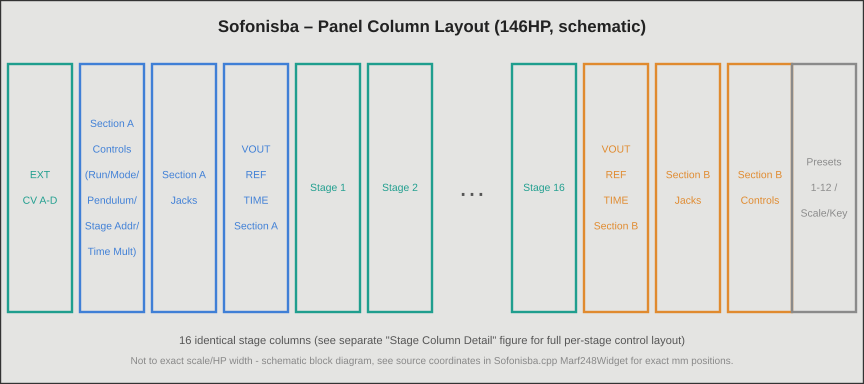
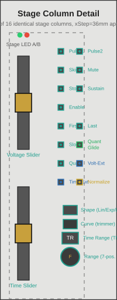
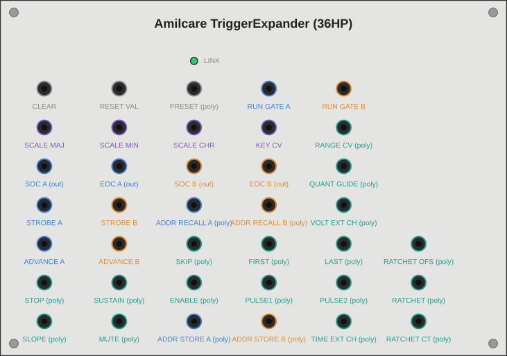
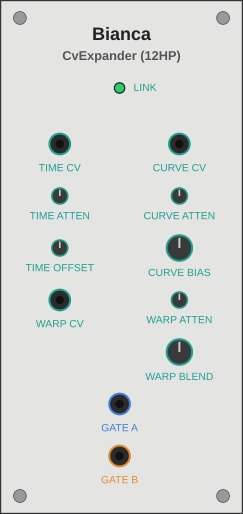

# Kinovice reminiscence of the unattained – Technische Dokumentation

Dies ist die technische Dokumentation der VCV-Rack-C++-Implementierung eines Multiple Arbitrary Function Generators, stark inspiriert von der wunderbaren Buchla-Modulwelt. Beschrieben werden das Hauptmodul **Sofonisba**, seine kompakte Variante **Lucia** sowie die beiden Erweiterungsmodule **Amilcare** (Trigger-Expander, 42HP) und **Bianca** (CV-Expander, 12HP): jedes Bedienelement, jeder Ein- und Ausgang, die interne Signalverarbeitung, die wichtigsten C++-Funktionen und die bekannten Fallstricke im Zusammenspiel der Funktionen.

Das Plugin umfasst insgesamt neun Module. Die fünf übrigen haben jeweils eine eigene Dokumentation: der Quad Function Generator **Europa** (`Europa-Dokumentation_DE.md` / `Europa-Documentation_EN.md`), der polyphone Dual-Spannungsprozessor **Minerva** (`Minerva-Dokumentation_DE.md` / `Minerva-Documentation_EN.md`), der CV-Prozessor **Elena** (`Elena-Dokumentation_DE.md` / `Elena-Documentation_EN.md`), das Quad-Lowpass-Gate **Anna-Maria** (`AnnaMaria-Dokumentation_DE.md` / `AnnaMaria-Documentation_EN.md`) und der Loop-Expander **Ritornello** (`Ritornello-Dokumentation_DE.md` / `Ritornello-Documentation_EN.md`).

Quellen: öffentlich verfügbare Benutzerdokumentation und Community-Ressourcen zur Hardware, die diese Modulfamilie inspiriert hat.

**Hinweis:** Das Plugin *Kinovice reminiscence of the unattained* ist ein eigenständiges Werk, stark inspiriert von der wunderbaren Buchla-Modulwelt. Es steht in keiner Verbindung zu Buchla, Tiptop Audio oder einem anderen Hersteller und wird von diesen weder autorisiert noch unterstützt. Erwähnte Produkt- und Firmennamen sind Marken ihrer jeweiligen Inhaber; sie dienen ausschließlich dazu zu beschreiben, welche funktionalen Konzepte ein Modul inspiriert haben.

Stand: Alle in dieser Dokumentation beschriebenen Features wurden von Kinovice live im laufenden Rack getestet und bestätigt – unter anderem Adress-Speicher Store/Recall, die 4-Kanal-A–D-Kanalwahl inklusive Zonengrenzen und Fallback-Verhalten, die Backward-Kompatibilität bestehender Mono-Patches, die V/Oct-Tempo-Steuerung inklusive Rechtsklick-Zahleneingabe, Stage Mute inklusive APOUT-Unterdrückung, die Trennung von Reference- und Time-Output, die dreifarbige RGB-Status-LED und den Stage-Number-Broadcast inklusive Undo/Redo.

---

<a id="toc"></a>

## Inhaltsverzeichnis

*Jeder Eintrag hat zwei Links: Der erste (Standard-Markdown-Anker) funktioniert in GitHub, Codeberg, der VSCodium-Vorschau und den meisten anderen Viewern. Der Link mit der Bezeichnung „Obsidian" ist der Wikilink speziell für Obsidian. Auch in Obsidian lässt sich der erste Link nutzen; er wird dort nur nicht immer zuverlässig aufgelöst, deshalb die zweite Variante als Ergänzung.*

1. [Architektur-Überblick](#sec1) · [[#1. Architektur-Überblick|Obsidian]]
2. [Grundbegriffe: Stage, Section, Modifier-Bits](#sec2) · [[#2. Grundbegriffe: Stage, Section, Modifier-Bits|Obsidian]]
3. [Sofonisba – Hauptmodul](#sec3) · [[#3. Sofonisba – Hauptmodul|Obsidian]]
   - [Panel-Layout](#sec3-1) · [[#3.1 Panel-Layout|Obsidian]]
   - [Bedienelemente pro Stage](#sec3-2) · [[#3.2 Bedienelemente pro Stage|Obsidian]]
   - [Bedienelemente pro Section (A/B)](#sec3-3) · [[#3.3 Bedienelemente pro Section (A/B)|Obsidian]]
   - [Modulweit geteilte Elemente](#sec3-4) · [[#3.4 Modulweit geteilte Elemente|Obsidian]]
   - [Ein-/Ausgänge im Überblick](#sec3-5) · [[#3.5 Ein-/Ausgänge im Überblick|Obsidian]]
   - [Lucia – Kompaktversion](#sec3-6) · [[#3.6 Lucia – Kompaktversion|Obsidian]]
4. [Interne Signalverarbeitung](#sec4) · [[#4. Interne Signalverarbeitung|Obsidian]]
   - [Der Afg-Kern (Ablaufsteuerung einer Section)](#sec4-1) · [[#4.1 Der Afg-Kern (Ablaufsteuerung einer Section)|Obsidian]]
   - [Stage-Advance-Logik: Forward / Reverse / Pendulum / Skip](#sec4-2) · [[#4.2 Stage-Advance-Logik: Forward / Reverse / Pendulum / Skip|Obsidian]]
   - [Stage Address: Reset / Continuous / Strobe / Kanalwahl](#sec4-3) · [[#4.3 Stage Address: Reset / Continuous / Strobe / Kanalwahl|Obsidian]]
   - [Voltage-Signalpfad: Range, Quantize, Slew](#sec4-4) · [[#4.4 Voltage-Signalpfad: Range, Quantize, Slew|Obsidian]]
   - [Time-Signalpfad: Time Range, External Time, Time-CV, Time Multiplier](#sec4-5) · [[#4.5 Time-Signalpfad: Time Range, External Time, Time-CV, Time Multiplier|Obsidian]]
   - [Sustain / Enable / Stop](#sec4-6) · [[#4.6 Sustain / Enable / Stop|Obsidian]]
   - [Pulse-Ausgänge: APOUT, EOS, P1/P2OUT, Start-/End-of-Cycle](#sec4-7) · [[#4.7 Pulse-Ausgänge: APOUT, EOS, P1/P2OUT, Start-/End-of-Cycle|Obsidian]]
   - [Preset-System (Pickup/Catch)](#sec4-8) · [[#4.8 Preset-System (Pickup/Catch)|Obsidian]]
   - [Adress-Speicher (Address Memory)](#sec4-9) · [[#4.9 Adress-Speicher (Address Memory)|Obsidian]]
   - [Clock-quantisiertes Advance](#sec4-10) · [[#4.10 Clock-quantisiertes Advance|Obsidian]]
   - [Scale/Key-Quantisierung](#sec4-11) · [[#4.11 Scale/Key-Quantisierung|Obsidian]]
   - [Tempo/BPM-Steuerung (V/Oct, BEATS_FACTOR)](#sec4-12) · [[#4.12 Tempo/BPM-Steuerung (V/Oct, BEATS_FACTOR)|Obsidian]]
   - [Ratcheting](#sec4-13) · [[#4.13 Ratcheting|Obsidian]]
   - [Stage-Number-Broadcast](#sec4-14) · [[#4.14 Stage-Number-Broadcast|Obsidian]]
5. [Sofonisba – Funktionsreferenz (C++)](#sec5) · [[#5. Sofonisba – Funktionsreferenz (C++)|Obsidian]]
6. [Amilcare – Trigger-Expander](#sec6) · [[#6. Amilcare – Trigger-Expander|Obsidian]]
7. [Bianca – CV-Expander](#sec7) · [[#7. Bianca – CV-Expander|Obsidian]]
8. [Expander-Mechanismus (Kommunikation zwischen den Modulen)](#sec8) · [[#8. Expander-Mechanismus (Kommunikation zwischen den Modulen)|Obsidian]]
9. [Persistenz (Patch-Speicherung)](#sec9) · [[#9. Persistenz (Patch-Speicherung)|Obsidian]]
10. [Bekannte Fallstricke im Zusammenspiel](#sec10) · [[#10. Bekannte Fallstricke im Zusammenspiel|Obsidian]]
11. [Design-Entscheidungen & Abgrenzungen](#sec11) · [[#11. Design-Entscheidungen & Abgrenzungen|Obsidian]]
12. [Cross-Compile-Workflow](#sec12) · [[#12. Cross-Compile-Workflow|Obsidian]]
13. [Abbildungsverzeichnis](#figures) · [[#Abbildungsverzeichnis|Obsidian]]

---

<a id="sec1"></a>

## 1. Architektur-Überblick
*[↑ Zurück zum Inhaltsverzeichnis](#toc) · [[#Inhaltsverzeichnis|Obsidian]]*

Das Plugin besteht aus neun VCV-Rack-Modulen. Vier davon gehören zur Sofonisba-Familie und werden in dieser Datei beschrieben; die fünf übrigen (Europa, Minerva, Elena, Anna-Maria, Ritornello) haben jeweils eine eigene Dokumentation.

**Sofonisba** *(`Sofonisba.hpp`, `Sofonisba.cpp`)*<br>
Das Hauptmodul (146HP) enthält zwei unabhängige AFG-Sections (A/B), die sich 16 gemeinsame Stages teilen, sowie die gesamte DSP-Kernlogik.

**Lucia** *(`Sofonisba.cpp`, `modelMarf248Compact`)*<br>
Die kompakte Variante (etwa 40HP) nutzt dieselbe `struct Marf248` und damit dieselbe DSP-Engine, besitzt aber ein eigenes Panel mit nur einem sichtbaren Stage-Slot (siehe [3.6](#sec3-6)). Sie kann problemlos neben Sofonisba im selben Patch liegen.

**Amilcare** *(`SofonisbaTriggerExpander.hpp/.cpp`)*<br>
Optionaler 42HP-Expander mit zusätzlichen Trigger- und Gate-Ein- und -Ausgängen: Clear, Presets, Scale/Key, Start/End-of-Cycle, Run-Gates, Advance, Adress-Speicher, Stage-Modifier-CV inklusive VOLT_EXT/TIME_EXT-Kanalwahl und SEXT.

**Bianca** *(`SofonisbaCvExpander.hpp/.cpp`)*<br>
Optionaler 12HP-Expander: polyphone CV-Modulation der Stage-Zeit und der Slew-Kurve sowie polyphone Gate-Ausgänge pro Stage.

**Grundprinzip des Expander-Mechanismus:** Beide Expander besitzen selbst keine DSP-Logik – sie sind reine „Jack-Träger". `Marf248::process()` prüft bei jedem Sample, ob links oder rechts ein passendes Modul andockt (`getLeftExpander()`/`getRightExpander()`), und liest und schreibt dessen Parameter, Inputs und Outputs direkt. Das vermeidet Message-Passing und Doppelpufferung und ist nur zulässig, weil die Expander keine eigene, unabhängige Verarbeitung haben (siehe VCV-Rack-Plugin-API-Guide, Abschnitt „Expanders": „you can implement its entire DSP algorithm in the [primary] module"). Die Expander prüfen umgekehrt jeden Frame eigenständig, ob ein Sofonisba andockt, um ihre Outputs und Lichter beim Entfernen oder Verschieben sauber auf 0V zurückzusetzen.

Der Lookup des Trigger-Expanders steht bewusst ganz am Anfang von `Marf248::process()`, noch vor der Stage-Address-Verarbeitung, denn SEXT (externe Strobe-Pulse) muss den Trigger-Expander bereits kennen, bevor `applyStageAddress()` aufgerufen wird.

**Europa** *(`Europa.cpp`, `EnvGen4.hpp`, `modelEuropa`)*<br>
Fünftes Modul: Quad Function Generator mit VCA (vier Hüllkurvengeneratoren mit je vier Stages, 23HP). Eigene Engine, technisch unabhängig von Sofonisba (siehe `Europa-Dokumentation_DE.md`).

**Minerva** *(`Minerva.cpp`, `VoltageProc.hpp`, `modelMinerva`)*<br>
Sechstes Modul: polyphoner Dual-Spannungsprozessor (14HP) mit zwei identischen Sektionen, die je vier Spannungen zu einer Ausgangsspannung verrechnen (Attenuverter, Crossfader, Offset). Jeder der 16 Kanäle hat eigene Reglerwerte; ein gemeinsamer Kanalwähler gilt für beide Sektionen. Eigene Engine, technisch unabhängig von Sofonisba (siehe `Minerva-Dokumentation_DE.md`).

**Elena** *(`Elena.cpp`, `CvProcElena.hpp`, `modelElena`)*<br>
Siebtes Modul: digitaler CV-Prozessor (42HP) mit A/B-Transformationssektionen (Eingangswahl, Kennlinie mit optionalem Breakpoint, pro Kanal einstellbar) und sechs Slew-Limitern C–H mit Pulse-Ausgang, angeordnet in drei Blöcken zu je zwei Slewern. Eigene Engine, technisch unabhängig von Sofonisba (siehe `Elena-Dokumentation_DE.md`).

**Anna-Maria** *(`AnnaMaria.cpp`, `AnnaMariaLpg.hpp`, `modelAnnaMaria`)*<br>
Achtes Modul: Quad-Lowpass-Gate (31HP) mit VCA-Modus, Vactrol-artigem Verhalten und optionaler Resonanz; vier monophone Kanäle plus Summenspalte ALL. Eigene Engine, technisch unabhängig von Sofonisba (siehe `AnnaMaria-Dokumentation_DE.md`).

**Ritornello** *(`SofonisbaLoopExpander.hpp/.cpp`, `modelMarf248LoopExpander`)*<br>
Neuntes Modul: Loop-Expander (12HP) für Sofonisba und Lucia. Über polyphone Gate-Eingänge markiert er Anfang und Ende von Schleifen über beliebige Stages (auch verschachtelt), zählt die Durchläufe über eine polyphone CV und gibt je Section einen Austrittsimpuls, eine Restwert-CV und eine Ziffernanzeige aus. Wie Amilcare und Bianca ist er ein reiner Jack-Träger; die Schleifenlogik liegt in `Afg` (siehe `Ritornello-Dokumentation_DE.md` und [Abschnitt 8](#sec8)). Der Name verlässt bewusst das Namensschema der Anguissola-Familie.

Alle neun Module werden in `plugin.cpp`/`plugin.hpp` registriert (`modelMarf248`, `modelMarf248Compact`, `modelMarf248TriggerExpander`, `modelMarf248CvExpander`, `modelEuropa`, `modelMinerva`, `modelElena`, `modelAnnaMaria`, `modelMarf248LoopExpander`).

---

<a id="sec2"></a>

## 2. Grundbegriffe: Stage, Section, Modifier-Bits
*[↑ Zurück zum Inhaltsverzeichnis](#toc) · [[#Inhaltsverzeichnis|Obsidian]]*

- **Stage**: Eine von 16 Programmierstufen (`NUM_STAGES = 16`). Jede Stage besitzt einen Spannungswert, einen Zeitwert, einen Range- und einen Curve-Regler sowie ein Bündel digitaler Modifier-Bits. Die 16 Stages sind modulweit geteilt: Section A und Section B lesen dieselbe Programmierung, laufen aber unabhängig als zwei eigene „Zeiger" (`currentStage`) darüber.
- **Section (A/B)**: Zwei unabhängige AFG-Instanzen (`Afg afgA`, `Afg afgB` in `Marf248`). Jede hat eine eigene Laufrichtung, einen eigenen Run/Stop-Zustand, einen eigenen Time-Multiplier und eine eigene Stage-Address-Quelle, aber beide fahren dieselben 16 Stages ab.
- **Modifier-Bits** (`enum StageModifierBits`, in `Sofonisba.hpp`): Ein einzelnes Array `int stageModifier[NUM_STAGES]` kodiert pro Stage alle digitalen Zustände als Bitmaske. Übersicht:

| Bit | Bedeutung | Hardware-Vorbild? |
|---|---|---|
| `MOD_QUANT_OCT` | Quantisierung der Stage-Spannung auf Scale/Key | ja |
| `MOD_SLOPED` | Stage rampt (Slew) statt zu springen | ja |
| `MOD_STOP` | Programmierte Stop-Stage | ja |
| `MOD_SUSTAIN` | Hält die Stage, solange Start-Gate high ist | ja |
| `MOD_ENABLE` | Hält die Stage, solange Start-Gate low ist | ja |
| `MOD_FIRST` | Markiert die Stage als Zyklus-Anfang | ja |
| `MOD_LAST` | Markiert die Stage als Zyklus-Ende | ja |
| `MOD_SLEW_EXP` / `MOD_SLEW_LOG` | Kurvenform der Rampe (kein Bit = linear) | ja |
| `MOD_RANGE_HALF` / `MOD_RANGE_LIMITED` (+ 3-Bit-Oktav-Offset) | Voltage-Range Full/Half/Limited | ja |
| `MOD_VOLT_EXT` / `MOD_TIME_EXT` | Externe Spannungs-/Zeitquelle (Kanalwahl A–D) statt Regler | ja |
| `MOD_PULSE1` / `MOD_PULSE2` | Programmierte Impuls-Ausgänge P1OUT/P2OUT | ja |
| `MOD_SKIP` | Stage wird beim automatischen Ablauf übersprungen | **nein** (reine Software-Erweiterung) |
| `MOD_SLEW_NORMALIZE` | Streckt die sichtbar bewegte Kurve auf die volle Stage-Zeit | **nein** |
| `MOD_TRANGE_1/2/4` | Time Range TR1/TR2/TR4 (kein Bit = TR3, Default) | ja (TR1–4) |
| `MOD_MUTE` | Unterdrückt P1OUT/P2OUT **und** APOUT für diese Stage, ohne `MOD_PULSE1`/`MOD_PULSE2` zu verändern; Voltage/Slew unbeeinflusst | **nein** |
| `MOD_QUANT_GLIDE` | Quantisiert den kompletten Slew (nicht nur den Zielwert) Sample für Sample auf Scale/Key – „Treppen-Glide"; nur wirksam zusammen mit `MOD_SLOPED` | **nein** (reine Software-Erweiterung) |
| `MOD_RATCHET` | Ratcheting: N rhythmische Sub-Trigger auf P1OUT/P2OUT statt einmaligem Trigger pro Stage (nur wirksam mit gepatchter Count-CV am Trigger-Expander) | **nein** (reine Software-Erweiterung) |

Ein 3-Bit-Feld (`RANGE_OFFSET_MASK`) kodiert zusätzlich den Oktav-Offset im Limited-Range-Modus (fünf Stufen: +0/+2/+4/+6/+8 V).

Zwei weitere, vom Modifier-Bit-Array unabhängige Speicherstrukturen ergänzen die Stage-Programmierung: das Preset-System (die komplette Programmierung aller 16 Stages, 12 Slots, siehe [4.8](#sec4-8)) und der Adress-Speicher (ein reines Sprung-Lesezeichen auf einen Stage-Index, 16 Slots pro Section, siehe [4.9](#sec4-9)). Beide Systeme sind konzeptionell klar voneinander getrennt und dürfen nicht verwechselt werden.

---

<a id="sec3"></a>

## 3. Sofonisba – Hauptmodul
*[↑ Zurück zum Inhaltsverzeichnis](#toc) · [[#Inhaltsverzeichnis|Obsidian]]*

<a id="sec3-1"></a>

### 3.1 Panel-Layout
*[↑ Zurück zum Inhaltsverzeichnis](#toc) · [[#Inhaltsverzeichnis|Obsidian]]*

Das Panel ist 146HP breit (vorher 120HP, dann 126HP für die neue Ausgangsspalte, dann durch das Slider-/Button-Relayout nochmals breiter geworden) und in mehrere senkrechte Spalten gegliedert, von links nach rechts:

```
[External CV A–D] [Section-A-Controls] [Section-A-Jacks] [Section-A-Ausgänge] [Stage-Array (16×)] [Section-B-Ausgänge] [Section-B-Jacks] [Section-B-Controls] [Preset-Spalte]
```

*[Siehe [Abbildung 1](#fig1) für eine schematische Übersicht dieser Spaltenstruktur · [[#Abbildung 1 – Sofonisba Panel-Spaltenlayout (schematische Übersicht)|Obsidian]]]*

- **External-CV-Spalte** (ganz links): die vier modulweit geteilten externen CV-Eingänge (Buchsen A–D), die je Stage über `MOD_VOLT_EXT`/`MOD_TIME_EXT` referenziert werden können.
- **Section-A/B-Controls-Spalte**: Tempo-Knob/Attenuverter, BEATS_FACTOR-Trimmer, Run-Taster, Mode-/Pendulum-Taster, Stage-Address-Bedienelemente.
- **Section-A/B-Jacks-Spalte** (12–121mm): Start/Stop, Tempo-CV, Live-BPM-Anzeige, BEATS_FACTOR-CV, P1OUT/P2OUT, APOUT, Stage-Address-CV, Stage-Address-Kanalwahl-CV.
- **Section-A/B-Ausgangsspalte** (12mm breit, 12–56mm; der Rahmen wurde in der Session „Time/Reference-Output-Trennung" erweitert): VOUT (Voltage-Ausgang), Reference (`TOUT_A/B`, Rampe) und Time (`TIMESTATIC_A/B`, neu, statische CV). Diese schmale Spalte liegt zwischen Jacks-Spalte und Stage-Array, spiegelbildlich für A und B. Sie wurde aus der Jacks-Spalte ausgelagert, um dort Platz für die vergrößerte BPM-Anzeige zu schaffen.
- **Stage-Array** (Mitte, 16 gleich aufgebaute Spalten): die eigentliche Programmierung der 16 Stages.
- **Preset-Spalte** (ganz rechts): Load/Save, Scale/Key, 12 Preset-Slots.
- Über dem Stage-Array mittig: **Global Clear**, **Reset Values** und **Auto-Fill**.

Zur optischen Gliederung ist jede Spalte von einem dünnen Rahmen (`StageFrame`-Widget) umgeben; funktional zusammengehörige Buchsengruppen werden zusätzlich durch dünne horizontale Trennlinien (`HDivider`) abgesetzt.

<a id="sec3-2"></a>

### 3.2 Bedienelemente pro Stage
*[↑ Zurück zum Inhaltsverzeichnis](#toc) · [[#Inhaltsverzeichnis|Obsidian]]*

*[Siehe [Abbildung 2](#fig2) für die exakte Position jedes unten beschriebenen Bedienelements – alle 16 Stage-Spalten sind identisch aufgebaut · [[#Abbildung 2 – Sofonisba Stage-Spalten-Detail|Obsidian]]]*

Jede der 16 Stage-Spalten enthält von oben nach unten:

**Voltage** (`STAGE_VOLTAGE_PARAM`) *(vertikaler Schieberegler, 0–10V)*<br>
Programmierte Ausgangsspannung der Stage. Im External-Modus (`MOD_VOLT_EXT`) dient die Reglerposition stattdessen als Kanalwahl A–D (vier Zonen à 2,5V). Der Tooltip zeigt je nach Zustand Volt, einen Notennamen (bei Quantize) oder einen Kanalnamen (bei External), siehe `StageVoltageQuantity`. Die Rechtsklick-Zahleneingabe akzeptiert zusätzlich Notennamen (z.B. „C4", „C#4", „Db4" – Notenbuchstabe case-insensitiv, Vorzeichen `#` oder Kleinbuchstabe `b`, Oktavzahl obligatorisch, Referenz 0V = C4) statt reiner Volt-Zahlen. Das funktioniert unabhängig vom Quantize-Zustand der Stage; bei ungültiger Eingabe fällt die Auswertung auf normales Zahlen-Parsing zurück.

**Time** (`STAGE_TIME_PARAM`) *(vertikaler Schieberegler, normalisiert 0–1)*<br>
Programmierte Stage-Zeit als Position innerhalb des gewählten Time-Range-Bereichs (TR1–4). Der Tooltip zeigt den klassischen Dial-Wert (0–10, führend) mit der exakt aufgelösten Sekundenzahl dahinter in Klammern, z.B. `4.0 (0.132 s)`, siehe `StageTimeQuantity`. Die Rechtsklick-Zahleneingabe akzeptiert weiterhin den 0–10-Dial-Wert. Im External-Modus (`MOD_TIME_EXT`) dient die Position als Kanalwahl A–D.

**Griff-Wertanzeige** *(beide Slider, direkt im Griff)*<br>
Zusätzlich zum Tooltip zeigt der Schieberegler-Griff den aktuellen Wert gerundet auf eine Ganzzahl (0–10) direkt auf dem Panel an – bei Voltage die Spannung in Volt, bei Time denselben klassischen Dial-Wert wie im Tooltip (die führende Zahl vor der Klammer), da `pq->getDisplayValue()` für beide Parameter dieselbe 0–10-Skala liefert. Schriftart ShareTechMono, goldener Rand (RGB 235,170,60) mit schwarzer Füllung, mittig im Griff. In den Quantize-/External-Sondermodi zeigt die Ziffer weiterhin den rohen Reglerwert (0–10) statt der aufgelösten Bedeutung (Notenname bzw. Kanalwahl A–D); dafür ist der Tooltip zuständig, denn eine Kürzung im 8×6mm-Griff wäre nicht zuverlässig lesbar.

**Zwei Stage-LEDs** (`STAGE_LIGHT_A/B`) *(Licht)*<br>
Zeigen an, ob Section A bzw. B gerade diese Stage adressiert (grün/rot, nebeneinander).

**Pulse 1 / Pulse 2 / Skip / Mute** *(LED-Taster (Toggle), alle vier rot)*<br>
Gruppe Puls/Output im 2×2-Raster: `MOD_PULSE1`/`MOD_PULSE2` lösen beim Erreichen der Stage einen kurzen Trigger auf P1OUT/P2OUT der jeweiligen Section aus. `MOD_SKIP` (reine Software-Erweiterung) überspringt die Stage beim automatischen Zeitablauf vollständig – keine Zeit, keine Trigger, keine Voltage-Ausgabe. Das Bit wirkt nur beim automatischen Ablauf, nicht bei manueller Adressierung (Reset/Strobe/Continuous). `MOD_MUTE` unterdrückt P1OUT/P2OUT und APOUT dieser Stage vollständig, ohne die Pulse1/Pulse2-Programmierung selbst zu verändern; nach dem Aufheben greift sie sofort wieder. Mute wirkt modulweit für beide Sections gleichzeitig (siehe [4.7](#sec4-7) und [Fallstricke](#sec10)) und ist zusätzlich per CV überschreibbar über `STAGE_MUTE_POLY_INPUT` am Trigger-Expander (siehe [6](#sec6)). Zur einheitlich roten LED-Farbe dieser vier Taster siehe die Begründung des Farbschemas unter [Design-Entscheidungen](#sec11) · [[#11. Design-Entscheidungen & Abgrenzungen|Obsidian]].

**Stop / Sustain / Enable** *(LED-Taster (Toggle))*<br>
Reihe 2: `MOD_STOP` ist die programmierte Stop-Stage (pausiert den Ablauf, bis die Section neu gestartet wird). `MOD_SUSTAIN` hält die Stage, solange am Start-Eingang ein High-Pegel (Gate) anliegt (Release-Verhalten wie bei einer ADSR). `MOD_ENABLE` hält die Stage, solange kein High-Pegel anliegt – die Freigabe erfolgt also erst durch ein Gate. Beide Haltezustände pausieren den Verweilzeit-Zähler `elapsed`. **Achtung, Fallstrick ohne gepatchtes Kabel an START_A/B – siehe [Abschnitt 10](#sec10).**

**First / Last / Slope / Quantized Glide** *(LED-Taster (Toggle))*<br>
Reihe 3: `MOD_FIRST`/`MOD_LAST` markieren Zyklus-Anfang und -Ende (Wrap-Punkte für Forward/Reverse/Pendulum; sie lösen Start-/End-of-Cycle-Trigger am Trigger-Expander aus, und mehrere First/Last-Paare sind möglich, siehe [4.2](#sec4-2)). `MOD_SLOPED` schaltet zwischen gesprungener (Stepped, Default) und rampender (Slew) Spannungsänderung um. `MOD_QUANT_GLIDE`, direkt neben Slope platziert, quantisiert die komplette Rampe Sample für Sample auf das globale Scale/Key-Raster statt nur den Zielwert – zum daraus entstehenden „Treppen-Glide"-Effekt siehe [4.4](#sec4-4). Hör- und sichtbar ist das nur, wenn Slope ebenfalls aktiv ist.

**Quantize / Volt-Ext / Time-Ext** *(LED-Taster (Toggle))*<br>
Reihe 4: `MOD_QUANT_OCT` quantisiert die Zielspannung auf das globale Scale/Key-Raster. `MOD_VOLT_EXT`/`MOD_TIME_EXT` schalten die Spannungs- bzw. Zeitquelle der Stage auf extern (Kanalwahl über den jeweiligen Regler).

**Shape** (`STAGE_SHAPE_PARAM`) + zwei Lichter *(LED-Taster (3-Zustands-Zyklus))*<br>
Zyklus Linear → Exponentiell → Logarithmisch, nur wirksam bei aktivem Slope. Zwei separate LEDs (`STAGE_SHAPE_EXP_LIGHT`/`STAGE_SHAPE_LOG_LIGHT`) statt einer kombinierten Anzeige; kein gesetztes Bit bedeutet linear.

**Curve** (`STAGE_CURVE_PARAM`) *(Trimmer, 0–1)*<br>
Kurvenstärke der Exp/Log-Rampe. Mitte (0,5) entspricht der Referenzkrümmung (`SLEW_CURVE_POWER = 2,5`); links wird die Kurve linearer, rechts stärker gekrümmt (bis Exponent ≈ 15,6). Lässt sich zusätzlich per Slew-Curve-CV vom CV-Expander modulieren.

**Normalize** (`STAGE_NORMALIZE_PARAM`) *(LED-Taster (Toggle))*<br>
`MOD_SLEW_NORMALIZE` (reine Software-Erweiterung) streckt bei extremer Curve-Einstellung den sichtbar bewegten Teil der Kurve auf die volle Stage-Zeit, statt ihn in einen winzigen Zeitbruchteil zu quetschen.

**Time Range** (`STAGE_TRANGE_PARAM`, `TrangeButton`) *(großer, selbstzeichnender Taster (4-Zustands-Zyklus))*<br>
Wählt TR1 (0,002–0,03s) bis TR4 (2–30s); die aktuelle Ziffer 1–4 steht direkt auf dem Taster. TR3 (0,2–3s) ist der Default (kein Bit gesetzt). Ein Rechtsklick öffnet ein Kontextmenü mit direkter Auswahl.

**Range** (`STAGE_RANGE_PARAM`, `RangeKnob`) *(großer Drehregler mit Textanzeige, 7 Raststellungen)*<br>
Full (0–10V unverändert) → Half (0–5V gestaucht) → Limited +0/+2/+4/+6/+8V (2V-Spanne, entspricht zwei Oktaven bei 1V/Okt., um den gewählten Offset verschoben). Der Regler zeigt das Kürzel („F"/„H"/„L0"…"L8") direkt an sowie einen farbigen Zeiger. Ein Rechtsklick öffnet ein Checklisten-Kontextmenü (bei diesem snap-Regler zuverlässiger als die Texteingabe).

**Stage-Number-Broadcast** *(Rechtsklick-Kontextmenü, Session „Stage-Number-Broadcast")*<br>
Auf neun der Toggle-Taster (Pulse1/2, Skip, First/Last, Stop/Sustain/Enable, Slope) sowie auf allen vier kontinuierlichen Reglern (Voltage, Time, Range, Curve) öffnet ein Rechtsklick zusätzlich zum jeweiligen Standardmenü den Eintrag „Apply … to all stages". Er überträgt den aktuellen Zustand bzw. Wert der angeklickten Stage auf alle 16 Stages gleichzeitig und ist mit Strg+Z in einem einzigen Schritt vollständig rückgängig machbar. Details zu Umfang, Auslösern und Undo-Mechanismus siehe [4.14](#sec4-14).

<a id="sec3-3"></a>

### 3.3 Bedienelemente pro Section (A/B)
*[↑ Zurück zum Inhaltsverzeichnis](#toc) · [[#Inhaltsverzeichnis|Obsidian]]*

Section A und B sind identisch aufgebaut, nur spiegelbildlich:

**Controls-Spalte** (von oben nach unten):
- **Tempo** (`TIME_MULT_A/B_PARAM`, −5…+5V) mit **Attenuverter** (`TIME_MULT_ATTEN_A/B_PARAM`, −1..+1) für den zugehörigen CV-Eingang. Breaking Change gegenüber der ursprünglichen 0,5×–4,0×-Faktor-Semantik: Der Regler speichert jetzt eine V/Oct-Tempo-Spannung (0V = 120 BPM, exponentiell) statt eines direkten Zeitfaktors. Tooltip und Rechtsklick-Zahleneingabe arbeiten in BPM (`TempoQuantity`); die vollständige Herleitung steht in [4.12](#sec4-12).
- **BEATS_FACTOR** (`BEATS_FACTOR_A/B_PARAM`, Trimmer 0,1–64, Default 4) mit zugehörigem CV-Eingang: legt fest, wie viele Beats ein voller Zyklus über alle nicht geskippten Stages darstellen soll; daraus wird der tatsächlich wirksame Zeitfaktor zurückgerechnet. Per Rechtsklick-Kontextmenü auf **Auto** umschaltbar (Segmentlängen-Sync statt fester Wert; die CV bleibt additiv wirksam), siehe [4.12](#sec4-12).
- **Run** (`RUN_A/B_PARAM`, LED-Taster): schaltet Start/Stop der Section um (grüne LED = läuft), ODER-verknüpft mit einem externen Start/Stop-Gate vom Trigger-Expander. **Wird ignoriert, solange Advance gepatcht ist – siehe [4.10](#sec4-10) und [Fallstricke](#sec10).**
- **Mode** (`MODE_A/B_PARAM`, LED-Taster): kehrt die Basis-Laufrichtung um (aus = Forward, an = Reverse).
- **Pendulum** (`PENDULUM_A/B_PARAM`, LED-Taster): schaltet zusätzlich das Hin-und-Her-Pendeln zwischen First und Last dazu (siehe [4.2](#sec4-2)).
- **Stage-Address-Knob** (`STAGE_ADDR_KNOB_A/B_PARAM`, Trimmer 0–15): interne Stage-Adresse, nur wirksam im Int-Modus. **Er bewegt `currentStage` aus sich selbst heraus nie – erst Strobe/Continuous/Reset wenden die Adresse tatsächlich an, siehe [Fallstricke](#sec10).**
- **Stage-Address Int/Ext** (`STAGE_ADDR_MODE_A/B_PARAM`, LED-Taster): wählt zwischen internem Knob und externer CV (`STAGE_ADDR_EXT_A/B_INPUT`) als Adressquelle.
- **Continuous** (`STAGE_ADDR_CONT_A/B_PARAM`, LED-Taster): hält `currentStage` jeden Frame synchron zur Adresse und erzwingt sofortige volle Auslenkung. Die Section läuft dabei intern nicht (`running` wird in `applyStageAddress()` unwirksam gemacht). Eine aktive Slope-Rampe zum adressierten Zielwert läuft trotzdem weiter (siehe [4.3](#sec4-3)).
- **Strobe** (`STAGE_ADDR_STROBE_A/B_PARAM`, Momentary-Taster): einmaliger Sprung auf die aktuelle Adresse; danach laufen der normale Zeitablauf und der Slew weiter. Als Feedback blitzt der Taster kurz blau auf.
- **Reset** (`STAGE_ADDR_RESET_A/B_PARAM`, Momentary-Taster): springt sofort auf die MOD_FIRST-Stage mit dem niedrigsten Index (`findLowestFirst()`, Fallback: Stage 1). Das ist bei mehreren First/Last-Segmenten wichtig, siehe [4.2](#sec4-2).

**Jacks-Spalte** (von oben nach unten): Start-Trigger, Stop-Trigger, Tempo-CV-Eingang, Live-BPM-Anzeige (reiner Text-Readout, kein Bauteil; zeigt das tatsächlich wirksame Tempo inklusive CV, siehe [4.12](#sec4-12)), BEATS_FACTOR-CV-Eingang, P1OUT/P2OUT (programmierte Impulse, mit rotem Ring-Licht `PulseRingLight` um die Buchse, das mit dem Puls mitblinkt), APOUT (All-Pulses, feuert bei jedem Stage-Wechsel), Stage-Address-CV-Eingang, Stage-Address-Kanalwahl-CV-Eingang.

**Ausgangsspalte** (eigene schmale Spalte zwischen Jacks-Spalte und Stage-Array): VOUT (Voltage-Ausgang), Reference (`TOUT_A/B_OUTPUT`; 0–10V absteigende Rampe über die Stage-Zeit, gedacht für nachgeschaltete Low-Pass-Gate-Module) und Time (`TIMESTATIC_A/B_OUTPUT`, neu in der Session „Time/Reference-Output-Trennung"; statische CV 0–10V, direkt unter Reference platziert, gleicher 14,5mm-Pitch wie VOUT→Reference; der Ausgangsrahmen wurde dafür von 12–44mm auf 12–56mm erweitert). Namenskorrektur: Die ursprünglich als „TOUT" bezeichnete Buchse berechnet tatsächlich die in der Referenzdokumentation als „Reference Output" beschriebene Rampe, nicht die statische „Time Output"-Spannung. Beide Funktionen existieren inzwischen als getrennte Buchsen, siehe [4.5](#sec4-5).

**Status-LED „Run/Hold/Stop"** (drei farbig, an derselben Panel-Position): eine einzelne RGB-LED (`RUN_A/B_LIGHT`, als 3-Kanal-Lichtblock `_R`/`_G`/`_B`) statt separater Einzel-Lights, mit additiver Farbmischung:
- Grün (nur G-Kanal): Die Section läuft normal – oder der Advance-Modus ist aktiv, was bewusst wie „läuft" angezeigt wird (siehe [4.10](#sec4-10)).
- Gelb (R+G gemeinsam, G auf `HOLD_BRIGHTNESS = 0,5` gedimmt, damit sich Gelb von reinem Rot und Grün unterscheidet): Die Section wartet in einer Sustain-/Enable-Stage auf ein Start-Gate.
- Rot (nur R-Kanal): Die Section ist gestoppt (Taster/Puls, programmierte Stop-Stage oder aktive Continuous-Adressierung).

<a id="sec3-4"></a>

### 3.4 Modulweit geteilte Elemente
*[↑ Zurück zum Inhaltsverzeichnis](#toc) · [[#Inhaltsverzeichnis|Obsidian]]*

- **Global Clear** (`CLEAR_PARAM`, LED-Taster, rotes Blitzlicht): setzt bei allen 16 Stages sämtliche Modifier-Bits, Range (→ Full) und Curve (→ Mitte) zurück und verwirft zusätzlich ausstehende Preset-Pickups. Der Befehl folgt bewusst nur der in der Referenzdokumentation beschriebenen Teilmenge (Output Pulses, Voltage-Programmierung, Operating Mode, Time Range); die Voltage-/Time-Regler selbst bleiben unangetastet. Der Adress-Speicher bleibt von Global Clear unberührt (siehe [4.9](#sec4-9)).
- **Reset Values** (`RESET_VALUES_PARAM`, LED-Taster, gelbes Blitzlicht): reine Software-Erweiterung ohne Hardware-Vorbild. Setzt nur die Voltage- und Time-Regler aller 16 Stages auf ihren Default zurück (0V bzw. Zeit-Mitte); Modifier-Bits, Range und Curve bleiben unverändert. Damit ist es klar von Global Clear abgegrenzt.
- **Auto-Fill** (`AUTOFILL_PARAM`, LED-Taster, blaues Blitzlicht): reine Software-Erweiterung ohne Hardware-Vorbild, entwickelt für den Phasor-Generator-Anwendungsfall. Setzt die 16 geteilten Voltage-Regler auf ein lineares 0–10V-Raster (Schrittweite 10/16 = 0,625V, Stage 1 = 0V … Stage 16 = 9,375V) und erzwingt gleichzeitig `Range = Full` je Stage. Zeit-Regler und Modifier-Bits bleiben unangetastet (analog zu Reset Values). Da Voltage und Range modulweit zwischen Section A und B geteilt sind, gibt es bewusst nur einen einzigen globalen Button – getrennte A/B-Varianten wären architektonisch nicht möglich, ohne die geteilte Stage-Datenstruktur grundlegend umzubauen.
- **Preset-System** (`LOAD_PARAM`, `SAVE_PARAM`, `PRESET_PARAM` ×12): Load bzw. Save werden zunächst „scharf geschaltet" (latching); der nächste Druck auf einen der 12 Preset-Taster wählt dann den Slot. Ein Preset speichert die komplette Programmierung aller 16 Stages (Voltage-/Time-/Range-/Curve-Reglerwerte plus aller Modifier-Bits), siehe [4.8](#sec4-8) (Pickup/Catch). Leere Slots werden beim Laden ignoriert, damit nichts versehentlich zurückgesetzt wird; ein kurzer Blitz signalisiert „hier ist nichts gespeichert".
- **Scale/Key** (`SCALE_PARAM`, `KEY_PARAM`): gleiches Arm-Prinzip wie bei Load/Save, mit den denselben 12 Preset-Tastern als Doppelbelegung. Scale: nur Taster 10/11/12 sind gültig (Major/Minor/Chromatic). Key: alle 12 Taster sind gültig (C…B). Siehe [4.11](#sec4-11).

<a id="sec3-5"></a>

### 3.5 Ein-/Ausgänge im Überblick
*[↑ Zurück zum Inhaltsverzeichnis](#toc) · [[#Inhaltsverzeichnis|Obsidian]]*

| Kategorie | Ein-/Ausgänge | Geteilt? |
|---|---|---|
| Section-Start/Stop | `START_A/B_INPUT`, `STOP_A/B_INPUT` | pro Section |
| Externe Spannungsquellen | `EXT_A/B/C/D_INPUT` | modulweit geteilt |
| Stage-Address-CV | `STAGE_ADDR_EXT_A/B_INPUT` (poly, bis zu 4 Kanäle A–D) | pro Section |
| Stage-Address-Kanalwahl-CV | `STAGE_ADDR_EXT_CHANNEL_A/B_INPUT` (neu) | pro Section |
| Time-Multiplier-CV | `TIME_MULT_CV_A/B_INPUT` (Tempo, V/Oct) | pro Section |
| BEATS_FACTOR-CV | `BEATS_FACTOR_CV_A/B_INPUT` (neu) | pro Section |
| Section-Ausgänge | `VOUT_A/B` (Voltage), `TOUT_A/B` (Reference, absteigende Rampe), `TIMESTATIC_A/B` (Time, neu, statische CV), `APOUT_A/B`, `P1OUT_A/B`, `P2OUT_A/B` | pro Section |

---

<a id="sec3-6"></a>

### 3.6 Lucia – Kompaktversion
*[↑ Zurück zum Inhaltsverzeichnis](#toc) · [[#Inhaltsverzeichnis|Obsidian]]*

**Lucia** ist die kompakte Variante von Sofonisba, benannt nach der Anguissola-Schwester, die als begabteste Malerin der Familie gilt. Sie nutzt dieselbe `struct Marf248` und damit dieselbe DSP-Engine, hat aber ein eigenes Panel (`Marf248CompactWidget`, zweites Model `modelMarf248Compact`, Slug `Marf248Compact`) mit nur einem sichtbaren Stage-Slot statt 16 parallelen Stage-Spalten. Sie ist etwa 40HP breit (abgeleitet aus den Spaltenabständen im Widget) statt 146HP. Beide Versionen können gleichzeitig im selben Patch liegen.

**Panel-Aufbau**<br>
Von links nach rechts: External-CV-Spalte (EXT A–D), Section-A-Controls, Section-A-Jacks, Section-A-Ausgänge (mit STAGE-Auswahl), der eine Stage-Slot, Section-B-Ausgänge, Section-B-Jacks, Section-B-Controls und die Preset-Spalte. Alle Elemente außer dem Stage-Slot entsprechen der Vollversion.

**Ein gemeinsamer Stage-Slot**<br>
`STAGE_VOLTAGE_PARAM`, `STAGE_TIME_PARAM`, `STAGE_RANGE_PARAM`, `STAGE_CURVE_PARAM` und alle Modifier-Bits sind jeweils ein einziges Array über alle 16 Stages, nicht getrennt pro Section. Ein zweiter Slot für Section B würde deshalb dieselben Params beschreiben wie der für Section A. Aus dem Grund hat Lucia genau einen Slot für beide Sections – wie die geteilten Stage-Spalten der Vollversion.

**STAGE-Auswahl und AKTIVIEREN**<br>
Ein Auswahl-Knob (14mm) mit Zentrumsanzeige und ein Aktivieren-Button (8mm) sitzen in der Ausgangsspalte von Section A. Vertikales Ziehen wählt die Stage vor (`pendingStage`), AKTIVIEREN übernimmt sie (`displayedStage`). Die Zahl im Knob ist grün, wenn Vorwahl und Anzeige übereinstimmen, sonst amber; der Button ist dann grün, sonst rot. Erst nach dem Aktivieren zeigt der Slot die Werte der gewählten Stage.

**Kein Param, JSON-Persistenz**<br>
`pendingStage` und `displayedStage` (int 0–15) sind Member von `struct Marf248`, aber bewusst keine Rack-Params: Pickup/Catch, History und Preset-Recall sollen die reine GUI-Navigation nicht beeinflussen. Gesichert werden beide per `dataToJson()`/`dataFromJson()` mit Clamp. Die Member existieren auch in der Vollversion, dort ungenutzt und ohne Verhaltensunterschied.

**Expander**<br>
Amilcare und Bianca docken an Lucia genauso an wie an Sofonisba, siehe [Abschnitt 8](#sec8).

---

<a id="sec4"></a>

## 4. Interne Signalverarbeitung
*[↑ Zurück zum Inhaltsverzeichnis](#toc) · [[#Inhaltsverzeichnis|Obsidian]]*

<a id="sec4-1"></a>

### 4.1 Der Afg-Kern (Ablaufsteuerung einer Section)
*[↑ Zurück zum Inhaltsverzeichnis](#toc) · [[#Inhaltsverzeichnis|Obsidian]]*

`struct Afg` (in `Sofonisba.hpp`) kapselt den kompletten Laufzeitzustand und die Ablaufsteuerung einer einzelnen Section (A oder B). `Marf248` hält zwei Instanzen (`afgA`, `afgB`), die beide dieselben Stage-Daten lesen (über Funktionsparameter), aber unabhängig voneinander laufen.

Wichtige Zustandsfelder:
- `currentStage`: Index (0–15) der aktuell adressierten Stage.
- `running` / `effectiveRunning`: `running` speichert den persistenten Taster-/Puls-Zustand; `effectiveRunning = running || runGateHigh` ist der für den jeweiligen Frame tatsächlich wirksame Laufzustand (siehe Trigger-Expander-Run-Gate). Vom Advance-Modus wird das bewusst unabhängig gehalten (siehe [4.10](#sec4-10)).
- `elapsed`: Verweilzeit-Zähler seit Eintritt in die aktuelle Stage.
- `voltageFrom` / `voltageOut`: Start- bzw. aktueller Wert der laufenden Rampe, für nahtloses Slew über Stage-Grenzen hinweg.
- `reverseMode`, `pendulumMode`, `pendulumDir`, `pendulumHeld`, `pendulumWasOn`: Laufrichtungssteuerung (siehe [4.2](#sec4-2)).
- `continuousActive`: merkt sich, ob `applyStageAddress()` in diesem Frame durch den Continuous-Zweig lief (siehe [4.3](#sec4-3)).
- `advanceModeActive`: true, solange `ADVANCE_A/B_INPUT` gepatcht ist (siehe [4.10](#sec4-10)).
- `statusHeld`, `statusStoppedByStage`: Zustände für die dreifarbige Status-LED.
- Mehrere `dsp::PulseGenerator`- und `dsp::SchmittTrigger`-Instanzen für Trigger-Erkennung und Impuls-Ausgabe, darunter `advanceTrigger` (echte Flankenerkennung, wird nur verarbeitet, wenn die Buchse gepatcht ist) und `runGateTrigger` (reine Pegelerkennung mit Schmitt-Hysterese).

<a id="sec4-2"></a>

### 4.2 Stage-Advance-Logik: Forward / Reverse / Pendulum / Skip
*[↑ Zurück zum Inhaltsverzeichnis](#toc) · [[#Inhaltsverzeichnis|Obsidian]]*

`Afg::advanceStage()` wird aufgerufen, sobald `elapsed >= stageTime[currentStage]` (automatischer Ablauf) oder sofort, wenn die aktuelle Stage als Skip markiert ist. Ablauf:

1. **Nächste Stage ermitteln**, abhängig vom Laufmodus:
   - **Forward** (Default): `next = currentStage + 1`. Wird das Ende des Feldes oder eine `MOD_LAST`-Stage erreicht, wrappt der Ablauf zurück auf die nächste `MOD_FIRST`-Stage (`findFirstBefore()`).
   - **Reverse** (`reverseMode`): Spiegelbild von Forward – dekrementiert und wrappt bei `MOD_FIRST` auf die nächste `MOD_LAST`-Stage (`findLastAfter()`).
   - **Pendulum** (`pendulumMode`): pendelt zwischen First und Last hin und her, wobei First…Last als zusammenhängender, nicht wrappender Bereich angenommen wird. An jedem Wendepunkt wird die Stage einmal wiederholt (`pendulumHeld`), bevor die Richtung umkehrt. Die Gesamtperiode beträgt dadurch exakt 2×M (M = Anzahl der Stages im First–Last-Bereich) statt 2×(M−1), was Pendulum synchron zu einer parallel vorwärts laufenden Section hält. Die Startrichtung beim Einschalten von Pendulum wird aus `reverseMode` abgeleitet (Forward → Bounce Richtung Last, Reverse → Bounce Richtung First). Ein Umschalten von `reverseMode`, während Pendulum bereits läuft, wirkt sich erst beim nächsten Aus/An-Zyklus aus; ein abrupter Sprung mitten im Bounce ist so ausgeschlossen.

   **Sync-Verhalten mit einer parallel laufenden Forward-Section** (live verifiziert, Session August 2026): Bei identischer Stage-Zeit auf beiden Sections ergibt sich ein exakt periodisches Zwei-Zustands-Muster über je 2 Forward-Umläufe (= 1 vollständige Pendulum-Hin-und-Rückfahrt, 2×M Ticks). Im ersten Umlauf laufen beide deckungsgleich (Pendulum steigt wie Forward), im zweiten spiegelbildlich (Pendulum fällt, während Forward erneut steigt); beide Zustände gelten im Sinne des Spannungsverlaufs als „synchron". Ein testweise entfernter Wendepunkt-Halt (Periode 2×(M−1) statt 2×M) wurde wieder verworfen: Ohne den Halt ist die Pendulum-Periode kein sauberes Vielfaches der Forward-Periode M mehr (das kleinste gemeinsame Vielfache von M=16 und 2×(M−1)=30 wäre 240 Ticks), und beide Sections liefen komplett auseinander, statt synchron zu bleiben. Ein anfänglich beobachteter Einzelausreißer (3 von 4 Durchgängen synchron, einer nicht) ließ sich nicht auf einen Code-Fehler zurückführen; er verschwand nach einem gemeinsamen Neustart beider Sections und deutete auf einen Startzeitpunkt-Versatz zwischen A und B hin, nicht auf ein Pendulum-Logikproblem.

2. **Skip überspringen**: Eine Schleife (maximal `NUM_STAGES` Versuche als Sicherheitsnetz) wiederholt dieselbe Schrittlogik, solange die gefundene Stage `MOD_SKIP` gesetzt hat. Skip wirkt nur beim automatischen Ablauf, nicht bei manueller Adressierung.
3. **Rampen-Startpunkt** setzen (`voltageFrom = voltageOut`), `elapsed` auf 0, `allPulseGen` triggern (APOUT).
4. Bei Wiedereintritt ohne Indexwechsel (Wiederholung am Pendulum-Wendepunkt): zusätzlicher kurzer Retrigger-Impuls (`regateGen`, `REGATE_GAP_SECONDS = 5ms`) für den CV-Expander, damit nachgeschaltete Hüllkurvengeneratoren zuverlässig neu triggern.
5. `resetPulseEdgeState()` setzt die Flanken-Vorwerte für P1/P2/First/Last zurück (siehe [4.7](#sec4-7)).

**Mehrere First/Last-Segmente:** Da `findFirstBefore()`/`findLastAfter()` lokal – relativ zur aktuellen Position – wrappen statt global, lässt sich das 16-Stage-Feld in mehrere unabhängig loopende Segmente unterteilen (z.B. First=1/Last=3, First=5/Last=8, First=12/Last=16). Jedes Segment loopt eigenständig innerhalb seiner Grenzen. Der Wechsel zwischen Segmenten erfolgt aktiv über externe Stage-Address-CV mit Strobe/Continuous, nicht automatisch. Reset springt in diesem Fall gezielt zum allerersten Segment (`findLowestFirst()`, niedrigster Index) – nicht zum aus Sicht der aktuellen Position nächstgelegenen First. Das wäre bei `findFirstBefore()` der Fall gewesen und hätte je nach `currentStage` ein anderes Segment getroffen.

**Schleifen (Ritornello):** Ist ein Ritornello angedockt und sind Begin und End gepatcht, legt `Afg` Begin/End-Schleifen mit Zähler über diesen Ablauf: Beim Verlassen einer End-Stage (in Reverse: der Begin-Stage) springt `advanceStage()` zur Gegenstelle, solange Durchläufe übrig sind; `onStageEntered()` lässt am Ende von `advanceStage()` und `jumpToStage()` die Zähler der Schleifen verfallen, die die neue Stage nicht enthalten. Begin und End sind unabhängig von First/Last, die Wraps bleiben unberührt. Ohne Ritornello oder ohne beide Kabel ist das Verhalten bitgleich. Bei Pendulum sind die Schleifen inaktiv. Details: `Ritornello-Dokumentation_DE.md`, Abschnitt 3.

<a id="sec4-3"></a>

### 4.3 Stage Address: Reset / Continuous / Strobe / Kanalwahl
*[↑ Zurück zum Inhaltsverzeichnis](#toc) · [[#Inhaltsverzeichnis|Obsidian]]*

`Afg::applyStageAddress()` wird vor dem eigentlichen `Afg::process()` aufgerufen. Die Reihenfolge ist wichtig, weil Continuous `running` unwirksam machen muss, damit die normale Zeitablauflogik noch im selben Frame pausiert:

- **Reset**: springt sofort auf die MOD_FIRST-Stage mit dem niedrigsten Index (`findLowestFirst()`, Fallback Stage 1) – unabhängig vom aktuellen Modus und unabhängig von Continuous/Strobe. Reset ist der höchstpriorisierte Zweig in `applyStageAddress()` und wird noch vor Continuous/Strobe geprüft. Reset ist keine Clock-synchrone Aktion wie bei klassischen Step-Sequencern: `elapsed` wird sofort auf 0 gesetzt, und die Rampe bzw. der interne Timer beginnt im selben Sample, ohne auf einen externen Clock zu warten – auch dann, wenn Clock-quantisiertes Advance für diese Section gerade aktiv ist (siehe [10.13](#sec10)).
- **Continuous**: hält `currentStage` jeden Frame synchron zur Adresse (Knob oder externe CV) und erzwingt sofortige volle Auslenkung. Der eigentliche Rampen-Fortschritt (`elapsed += sampleTime`) läuft dabei in `process()` weiterhin kontinuierlich weiter, sodass eine Slope-Rampe zum neu adressierten Zielwert trotzdem sanft fortschreitet. Das entspricht dem in der Referenzdokumentation beschriebenen Verhalten (die Slope-Zeit entspricht der programmierten Intervallzeit, auch bei externer/Continuous-Adressierung) und wird z.B. in String-artigen Patches bewusst für Glide-Verhalten genutzt. Start/Stop ist im Continuous-Modus nicht anwendbar (`running` bleibt unwirksam).
- **Freeze** (neu, nur am Trigger-Expander, `STAGE_ADDR_FREEZE_POLY_INPUT`): hält `currentStage` fest, solange das Gate high ist. Die Adress-CV (z.B. ein Phasor) läuft dabei ungebremst weiter, aber `jumpToStage()` wird im Continuous-Zweig unterdrückt, bis das Gate wieder low geht. `elapsed` läuft während des Freeze unabhängig davon weiter (siehe Continuous-Absatz oben), d.h. eine gerade laufende Slope-Rampe zur zuletzt adressierten Stage läuft sauber zu Ende, statt hart auf dem aktuellen Wert abzubrechen. Beim Loslassen springt `currentStage` direkt zu der Adresse, an der die CV inzwischen angekommen ist – auch über mehrere Stages hinweg, falls sich die CV inzwischen stark bewegt hat. Das ist kein Fehlverhalten, sondern folgt zwingend aus der direkten Adressierung: `addr` wird jeden Frame frisch aus der Spannung berechnet, ein schrittweises Nachlaufen existiert nicht (durch Kinovice-Test bestätigt). Freeze wirkt nur, während Continuous für die jeweilige Section aktiv ist; außerhalb von Continuous hat das Gate keine Wirkung, weil dort bereits Start/Stop/Sustain/Enable zum Pausieren zur Verfügung stehen.
- **Strobe**: einmaliger Sprung auf die aktuelle Adresse (`jumpToStage()`); danach laufen der normale Ablauf und der Slew unverändert weiter. Im Continuous-Zweig wird Strobe durch das frühe `return` bewusst ignoriert.

Die Adresse selbst kommt entweder vom internen Knob (`STAGE_ADDR_KNOB_A/B`) oder – bei aktivem Ext-Modus – aus der externen CV (`STAGE_ADDR_EXT_A/B_INPUT`).

**4-Kanal-A–D-Kanalwahl (neu):** `STAGE_ADDR_EXT_A/B_INPUT` ist inzwischen ein polyphoner Eingang und kann bis zu vier unabhängige Adress-CVs (Kanal A–D) gleichzeitig führen. Welcher Kanal tatsächlich gelesen wird, bestimmt die neue, dedizierte Kanalwahl-CV `STAGE_ADDR_EXT_CHANNEL_A/B_INPUT` (0–10V, aufgeteilt in vier gleich große 2,5V-Zonen – dasselbe Zonenprinzip wie bei `MOD_VOLT_EXT`/`MOD_TIME_EXT`). Ist die Kanalwahl-Buchse nicht gepatcht, fällt die Kanalwahl automatisch auf Kanal A (Index 0) zurück. Dadurch bleiben bestehende Mono-Patches an `STAGE_ADDR_EXT_A/B_INPUT`, die automatisch auf Kanal 1 landen, unverändert funktionsfähig (Backward-Kompatibilität, von Kinovice live verifiziert). Für einen Live-Test der Kanalwahl braucht es zusätzlich zum Ext-Modus auch Continuous, damit die Section der gewählten Quelle tatsächlich folgt – der Ext-Modus allein liefert nur den Adresswert und wendet ihn, genau wie der interne Knob, nicht automatisch an (siehe [Fallstricke](#sec10)).

Zusätzlich kann ein externer Strobe-Puls („SEXT", vom Trigger-Expander) den Panel-Strobe-Taster ODER-verknüpft auslösen.

<a id="sec4-4"></a>

### 4.4 Voltage-Signalpfad: Range, Quantize, Slew
*[↑ Zurück zum Inhaltsverzeichnis](#toc) · [[#Inhaltsverzeichnis|Obsidian]]*

Reihenfolge im Signalpfad (in `Afg::process()`), pro Sample:

1. **Range** (`applyRange()`): skaliert und verschiebt die rohe Slider-Spannung zuerst (Full unverändert, Half auf 0–5V gestaucht, Limited auf eine 2V-Spanne gestaucht plus Oktav-Offset).
2. **Quantize** (`quantizeToScale()`), falls `MOD_QUANT_OCT` gesetzt: snappt das bereits skalierte Ergebnis auf den nächsten Ton innerhalb der gewählten Scale+Key (Major/Minor: 7-Ton-Raster; Chromatic: reines Halbton-Raster, Key wirkungslos). Gesucht wird im Fenster ±12 Halbtöne um den naiv gerundeten Wert nach dem nächstgelegenen Scale-Mitglied.
3. **Slew** (`applySlewCurve()`), falls `MOD_SLOPED` gesetzt: interpoliert zwischen `voltageFrom` und dem Zielwert `target` anhand der normalisierten Phase `t = elapsed / stageTime` und der gewählten Kurvenform:
   - Linear (Default): `f(t) = t`
   - Exponentiell: `f(t) = 1 - (1-t)^power` (schneller Start, sanftes Ziel)
   - Logarithmisch: `f(t) = t^power` (sanfter Start, schnelles Ziel)

   `power` wird pro Stage aus der Curve-Reglerposition (plus optionaler Slew-Curve-CV vom CV-Expander) berechnet: Mitte entspricht `SLEW_CURVE_POWER = 2,5`, die Anschläge linear (power=1) bzw. stark gekrümmt (power≈15,6), mit quadratisch geglätteter Übergangskurve zwischen `CURVE_FACTOR_CENTER` und `CURVE_FACTOR_EXTREME`.

   Ohne `MOD_SLOPED` springt `voltageOut` sofort auf den Zielwert (Stepped-Verhalten).
4. **Normalize** (`MOD_SLEW_NORMALIZE`, optional): korrigiert bei extremer Curve-Einstellung, dass die theoretisch fast erreichte Kurve (>99,9%) den Zielwert sonst schon vor `t=1` „erreicht" hätte und dort hängenbliebe – die Zeitachse wird dafür gestreckt (`slewExpNormalized()`).
5. **Quantized Glide** (erneut `quantizeToScale()`), falls sowohl `MOD_SLOPED` als auch `MOD_QUANT_GLIDE` gesetzt sind: Anders als Schritt 2, der nur den Zielwert einmalig quantisiert, wird hier das bereits interpolierte `voltageOut` bei jedem Sample während der gesamten Rampe erneut quantisiert. Jedes Mal, wenn die laufende Spannung eine Scale-Raster-Grenze überschreitet, snapt der Ausgang dorthin und hält, bis die nächste Grenze überschritten wird. So entsteht eine hör- und sichtbare Treppe innerhalb eines einzelnen Stage-Übergangs statt einer glatten Rampe, die erst ganz am Ende einrastet (Kinovice-Feature ohne direktes Hardware-Vorbild; auf vergleichbarer Hardware erreicht man denselben Effekt mit einem extern nachgeschalteten Quantizer hinter VOUT). Quantized Glide wirkt unabhängig von `MOD_QUANT_OCT`: Auch wenn der Zielwert selbst nicht separat quantisiert ist, bleibt der Ruhewert dank der kontinuierlichen Neuquantisierung während der Rampe auf dem Raster.

<a id="sec4-5"></a>

### 4.5 Time-Signalpfad: Time Range, External Time, Time-CV, Time Multiplier
*[↑ Zurück zum Inhaltsverzeichnis](#toc) · [[#Inhaltsverzeichnis|Obsidian]]*

Der Time-Regler jeder Stage speichert keine direkte Sekundenzahl, sondern eine normalisierte Position 0–1 innerhalb des per `STAGE_TRANGE_PARAM` gewählten Bereichs (TR1–TR4). Aufgelöst wird das in `Marf248::process()` – nicht in `Afg`, denn `Afg` kennt nur die fertige Sekundenzeit:

1. **Time Range** (`getTimeRangeIndex()`) bestimmt `[timeRangeMin, timeRangeMax]` aus `TIME_RANGE_MIN[]`/`TIME_RANGE_MAX[]` (TR1: 0,002–0,03s … TR4: 2–30s; TR3 = 0,2–3s ist der Default ohne gesetztes Bit).
2. **External Time** (`MOD_TIME_EXT`): die normalisierte Reglerposition dient als Kanalwahl A–D (vier gleich große Zonen). Fehlt am gewählten Kanal ein Patchkabel, fällt die Zeit auf den schnellsten Wert des Bereichs zurück (Vorgabe der Referenzdokumentation).
3. **Internal Time**: `resolvedTime[i] = timeRangeMin + stageTime[i] * timeRangeSpan`.
4. **Additive Stage-Time-CV** (CV-Expander, optional): wird zur aufgelösten Zeit addiert, skaliert relativ zur Spanne des jeweils gewählten Time Range (siehe [Abschnitt 7](#sec7)).
5. Clamp auf `[0,001s, 30s]`.
6. **Tempo/Time Multiplier** (pro Section, V/Oct-BPM-Steuerung mit BEATS_FACTOR-Rückrechnung, moduliert per CV und Attenuverter): skaliert die bereits aufgelöste Zeit zusätzlich, getrennt für Section A (`resolvedTimeA`) und B (`resolvedTimeB`), weil diese Werte nicht modulweit geteilt sind. Breaking Change gegenüber der ursprünglichen 0,5×–4,0×-Faktor-Semantik; die volle Herleitung steht in [4.12](#sec4-12).

**Reference- vs. Time-Output (Session „Time/Reference-Output-Trennung"):** Die Referenzdokumentation beschreibt zwei separate Buchsen, die im Code ursprünglich zu einer einzigen verschmolzen waren:

- **Reference Output** (`TOUT_A/B_OUTPUT`, ursprünglich als „TOUT" benannt): `(1.f - phase) * 10.f` – eine über die Stage-Zeit abfallende Rampe, gedacht als Steuerspannung für nachgeschaltete Low-Pass-Gate-Module. Es handelt sich um eine reine Namenskorrektur der `configOutput()`-Beschreibung, ohne Verhaltensänderung.
- **Time Output** (`TIMESTATIC_A/B_OUTPUT`, neu): `stageTime[stage] * 10.f` – eine statische Spannung proportional zur rohen Interval-Time-Sliderposition der aktuell adressierten Stage (0–1 → 0–10V), unabhängig von Time Range, External-Quelle und laufender Ablaufphase. Die Herleitung des Wertebereichs folgt der Formulierung der Referenzdokumentation, die den Ausgang als proportional zur Interval-Time-Sliderposition beschreibt (nicht zur verstrichenen Stage-Zeit) – das spricht für einen statischen, pro Stage fest programmierten Wert statt eines phasenabhängigen Signals. Der Firmware-Quellcode stand nicht zur Verfügung, der Wertebereich ist daher eine Annahme.

<a id="sec4-6"></a>

### 4.6 Sustain / Enable / Stop
*[↑ Zurück zum Inhaltsverzeichnis](#toc) · [[#Inhaltsverzeichnis|Obsidian]]*

Die drei Halte-Modifier pausieren `elapsed` (der Zählerstand `elapsed += sampleTime` und der Vergleich `elapsed >= stageTime` liegen beide innerhalb derselben Bedingung, die zusätzlich `!continuousActive && !advanceModeActive` verlangt):

- **Stop**: pausiert bedingungslos.
- **Sustain**: pausiert, solange am Start-Eingang ein High-Pegel anliegt (Gate, Schwelle `GATE_THRESHOLD = 2V`; deckt sowohl 10V-Trigger als auch 5V-Hold-Pegel ab). Release-Verhalten wie bei einer ADSR.
- **Enable**: pausiert, solange kein High-Pegel anliegt – die Freigabe erfolgt erst durch ein Gate.

Nach Ende der Haltung läuft `elapsed` exakt ab dem eingefrorenen Wert weiter. Die Haltezeit zählt nicht zur Stage Time; die real verstrichene Zeit bis zum nächsten Stage-Wechsel ist entsprechend länger. Beim Ende einer Sustain/Enable-Haltung (Übergang `statusHeld` true→false, ohne dass `advanceStage()`/`jumpToStage()` aufgerufen wird, da `currentStage` unverändert bleibt) feuert zusätzlich `regateGen` – aus Sicht eines nachgeschalteten Envelope-Generators „startet" die Stage dadurch trotzdem neu.

Sind Sustain und Enable gleichzeitig auf derselben Stage gesetzt, gilt ohne gepatchtes Gate effektiv Enable (die Section hält): Beide Bedingungen werden unabhängig ausgewertet und per OR in `statusHeld` zusammengeführt; Sustain trägt in diesem Fall nichts zum Halten bei, verhindert es aber auch nicht. **Zum kontraintuitiven Verhalten von Sustain/Enable an einem unverbundenen Start-Eingang siehe unbedingt [Abschnitt 10](#sec10).**

STOP/SUSTAIN/ENABLE haben zudem Vorrang vor Clock-quantisiertem Advance (siehe [4.10](#sec4-10)): Ein Trigger, der während einer Haltung eintrifft, wird schlicht nicht ausgewertet – es gibt keine Warteschlange und kein Nachholen nach Ende der Haltung.

<a id="sec4-7"></a>

### 4.7 Pulse-Ausgänge: APOUT, EOS, P1/P2OUT, Start-/End-of-Cycle
*[↑ Zurück zum Inhaltsverzeichnis](#toc) · [[#Inhaltsverzeichnis|Obsidian]]*

- **APOUT** (`allPulseGen`): feuert bei jedem Stage-Eintritt, auch bei Wiedereintritt ohne Indexwechsel; 1ms-Trigger.
- **EOS** (`eosGen`, neu, „End of Stage", nur am Trigger-Expander verfügbar): feuert ebenfalls bei jedem Stage-Eintritt, ausgelöst an denselben Stellen wie `allPulseGen` (`advanceStage()` und `jumpToStage()`). Manuelle Sprünge (Strobe-Taster, Reset, Address-Memory-Recall) lösen EOS also genauso aus wie der automatische Zeitablauf. Anders als APOUT bleibt EOS von `MOD_MUTE` unberührt, denn es handelt sich um einen strukturellen Übergangsmarker statt eines programmierten Output-Pulses wie P1/P2/APOUT – dasselbe Prinzip wie bei Start-/End-of-Cycle (siehe unten), die ebenfalls keinem Mute unterliegen. EOS feuert zeitgleich mit APOUT, nicht davor, da beide Generatoren im selben Sample innerhalb von `advanceStage()`/`jumpToStage()` ausgelöst werden. Auf diese Gleichzeitigkeit wurde bewusst keine 1-Sample-Verzögerung der übrigen Stage-Trigger gelegt (Kinovice-Entscheidung, per Test verifiziert): Stage-Ende und Stage-Start fallen in einem sample-basierten System auf denselben diskreten Zeitpunkt, ein Zwischenschritt existiert nicht.
- **P1OUT/P2OUT**: feuern, wenn die aktuelle Stage `MOD_PULSE1`/`MOD_PULSE2` gesetzt hat. Die Erkennung erfolgt als kontinuierliche Flankenerkennung, nicht nur einmalig beim Eintritt: `resetPulseEdgeState()` setzt beim (Wieder-)Eintritt die Vorwerte (`pulse1PrevActive` usw.) auf `false` zurück; das eigentliche Feuern passiert danach jeden Sample in `Afg::process()` per Flankenvergleich (`bit-aktiv && !prevActive`). Damit wird auch ein extern per CV (Trigger-Expander) gesetztes Gate erkannt, das erst mitten im Stage-Aufenthalt high wird, statt bis zum nächsten Stage-Wechsel verpasst zu werden. Mehrfaches Gate-Toggeln während einer Stage (z.B. durch einen externen Clock) löst jede steigende Flanke erneut aus – eine bewusste Design-Entscheidung für freien Clock-Betrieb statt „nur einmal pro Besuch".
- **Start-/End-of-Cycle** (nur am Trigger-Expander verfügbar): analoges Prinzip für `MOD_FIRST`/`MOD_LAST`, unabhängig von der Laufrichtung. Auch bei der Wiederholung am Pendulum-Wendepunkt (die Stage wird bewusst zweimal angefahren) löst jede Landung einen eigenen Puls aus.
- **`MOD_MUTE`**: unterdrückt `p1Gen`/`p2Gen` und `allPulseGen` – also P1OUT, P2OUT und APOUT – für die betreffende Stage vollständig, ohne `MOD_PULSE1`/`MOD_PULSE2` selbst zu verändern. Die Programmierung bleibt erhalten und greift sofort wieder, sobald Mute aufgehoben wird. Umgesetzt ist das als Guard direkt vor den `allPulseGen.trigger(1e-3f)`-Aufrufen in `jumpToStage()`/`advanceStage()` sowie in der `pulse1Active`/`pulse2Active`-Berechnung in `Afg::process()`. Bewusst wurde auch APOUT einbezogen statt nur P1/P2, denn sonst müssten beide Pulse-Bits einzeln deaktiviert werden, um eine Stage wirklich komplett stumm zu bekommen. Die Voltage-/Slew-Ausgabe der Stage bleibt vollständig unbeeinflusst – der Eingriff betrifft nur die Trigger-Erzeugung, nicht `applyRange()`/`applySlewCurve()`. `MOD_MUTE` ist wie alle anderen Modifier-Bits modulweit pro Stage gültig, nicht pro Section A/B. Steuerbar per Panel-Button/Light (`STAGE_MUTE_PARAM`/`STAGE_MUTE_LIGHT`, siehe [3.2](#sec3-2)) und zusätzlich per CV überschreibbar über `STAGE_MUTE_POLY_INPUT` am Trigger-Expander (siehe [6](#sec6)); bei gepatchtem Kabel hat die CV Vorrang vor dem manuellen Klick.

<a id="sec4-8"></a>

### 4.8 Preset-System (Pickup/Catch)
*[↑ Zurück zum Inhaltsverzeichnis](#toc) · [[#Inhaltsverzeichnis|Obsidian]]*

Ein Preset-Slot (`Marf248::PresetSlot`) speichert die vollständige Programmierung aller 16 Stages: die Voltage-, Time-, Range- und Curve-Reglerwerte (roh, nicht aufgelöst) sowie alle Modifier-Bits.

- `savePreset(slot)`: kopiert die aktuellen Regler-Rohwerte und Modifier in den Slot und markiert ihn als `used`.
- `loadPreset(slot)`: Die Modifier-Bits werden sofort übernommen (rein digitale Zustände). Die vier kontinuierlichen Regler werden dagegen nicht direkt gesetzt – das würde den physischen Reglerwert „verspringen" lassen. Stattdessen wird pro Regler Pickup/Catch scharf gemacht (`PickupState::arm()`).

**`PickupState`** (in `Sofonisba.hpp`): hält einen ausstehenden Zielwert getrennt vom aktuellen Reglerwert. `resolve(currentRaw)` liefert jeden Frame entweder den gespeicherten Zielwert (solange Pickup aussteht) oder den physischen Reglerwert direkt. Die Überkreuzung wird durch einen Vorzeichenwechsel der Differenz „Reglerwert − Zielwert" zwischen zwei aufeinanderfolgenden Frames erkannt. Auch der Fall, dass der Regler beim Laden bereits zufällig auf dem Zielwert steht, ist damit abgedeckt – es folgt ein sofortiges Pickup.

**Abgrenzung zum Adress-Speicher (siehe [4.9](#sec4-9)):** Ein Preset speichert die komplette Stage-Programmierung; der Adress-Speicher merkt sich nur einen Stage-Index als Sprungziel. Beide Systeme sind unabhängig voneinander nutzbar.

<a id="sec4-9"></a>

### 4.9 Adress-Speicher (Address Memory)
*[↑ Zurück zum Inhaltsverzeichnis](#toc) · [[#Inhaltsverzeichnis|Obsidian]]*

Neues Feature (Trigger-Expander, Reihe 12): ein reines Sprung-Lesezeichen-System für die Stage-Address-Funktion, unabhängig vom Preset-System. Es gibt 16 Slots pro Section (`AddrMemorySlot addrMemA[NUM_STAGES]`, `addrMemB[NUM_STAGES]`), und jeder Slot speichert lediglich `{bool used; int stage;}` – keine Voltage-, Time-, Range-, Curve- oder Modifier-Werte wie ein Preset.

- **Store** (`ADDR_STORE_A/B_POLY_INPUT`, poly 16 Kanäle, Kanal i = Slot i): Eine steigende Flanke schreibt sofort die aktuell adressierte Stage (`afgA.currentStage`/`afgB.currentStage`) in Slot i und markiert ihn als `used`. Es gibt keinen Arm-Mechanismus – dasselbe Prinzip wie bei `PRESET_LOAD_POLY_INPUT`.
- **Recall** (`ADDR_RECALL_A/B_POLY_INPUT`, poly 16 Kanäle): Eine steigende Flanke ruft `afgA/B.jumpToStage(addrMemA/B[i].stage, stageModifier)` auf, aber nur, wenn `used` gesetzt ist. Ein nie beschriebener Slot bleibt wirkungslos – analog zum Leer-Slot-Schutz beim Preset-System.

Store/Recall werden erst nach `afgA.process()`/`afgB.process()` im selben Frame verarbeitet, wirken also ab dem nächsten Sample-Frame, haben dann aber für diesen Frame Vorrang vor Continuous/Strobe/Int-Ext. Bleibt Continuous aktiv, überschreibt es den Sprung im übernächsten Frame automatisch wieder – vorhersehbares Verhalten, kein Bug.

`performGlobalClear()` lässt den Adress-Speicher unangetastet (wie die Presets); nur `onReset()` (VCV-Rack „Initialize") leert beide Arrays. JSON-Persistenz: pro Section ein Array mit 16 `{used, stage}`-Objekten, das immer vollständig geschrieben wird.

Store/Recall besitzen keine Panel-Taster. Der Trigger-Expander ist bewusst ein reiner Jack-Träger ohne eigene Bedienelemente; es wird also zwingend ein echtes Kabel von einer Trigger- oder Gate-Quelle benötigt (siehe [Fallstricke](#sec10)).

<a id="sec4-10"></a>

### 4.10 Clock-quantisiertes Advance
*[↑ Zurück zum Inhaltsverzeichnis](#toc) · [[#Inhaltsverzeichnis|Obsidian]]*

Neues Feature (Trigger-Expander, `ADVANCE_A/B_INPUT`, reiner Flanken-Trigger-Eingang – kein Pegel wie beim Run-Gate): Sobald die Buchse gepatcht ist, übernimmt `advanceModeActive` für die betreffende Section vollständig die Kontrolle über den Stage-Wechsel, unabhängig von `running`/`effectiveRunning`. Start/Stop-Taster und Run-Gate werden solange das Kabel steckt bewusst ignoriert (analog zu `continuousActive`).

Verhalten im Detail:
- `elapsed` läuft weiter (gecappt auf `stageTime[currentStage]`), sodass Slope und TOUT so aussehen, als wäre die Stage-Zeit regulär abgelaufen: Die Stage verharrt am Zielwert bzw. bei TOUT=0, bis der nächste Trigger kommt.
- Der eigentliche Stage-Wechsel hängt nicht an diesem Zeitwert, sondern ausschließlich am Trigger: Kommt der Trigger vor Ablauf der Stage-Zeit, wird sofort gewechselt – der Trigger hat immer Vorrang vor der Zeit.
- Skip bleibt sofort wirksam, unabhängig vom Advance-Modus.
- STOP/SUSTAIN/ENABLE haben weiterhin Vorrang (siehe [4.6](#sec4-6)): Ein Trigger während einer Haltung wird ignoriert, es gibt keine Warteschlange.
- Gegenseitig ausschließend zu Continuous: Bei aktivem Continuous bleibt der Advance-Zweig inaktiv, da Continuous die Stage ohnehin direkt adressiert.
- Die dreifarbige RUN/STOP-Status-LED zeigt bei aktivem Advance-Modus bewusst Grün (läuft) statt Rot – im Unterschied zu Continuous, das weiterhin als Rot (Stop) angezeigt wird. Da `advanceModeActive` selbst nichts an `effectiveRunning` ändert, wird das separat ausgewertet.

Auf dem Panel sitzen `ADVANCE_A_INPUT`/`ADVANCE_B_INPUT` auf dem Trigger-Expander in der bestehenden Run-Gate-Reihe (Spalte C/D), weil dort noch Platz frei war (siehe [Abschnitt 6](#sec6)).

<a id="sec4-11"></a>

### 4.11 Scale/Key-Quantisierung
*[↑ Zurück zum Inhaltsverzeichnis](#toc) · [[#Inhaltsverzeichnis|Obsidian]]*

Scale und Key gelten global (modulweit) für alle Stages mit aktivem `MOD_QUANT_OCT` und für beide Sections: `currentKey` (0 = C … 11 = B) und `currentScale` (0 = Major, 1 = Minor, 2 = Chromatic als Default). `quantizeToScale()`:

- **Chromatic**: identisch zum reinen Halbton-Raster (`quantizeToSemitone()`), Key wirkungslos.
- **Major/Minor**: sucht im Fenster ±12 Halbtöne um den naiv gerundeten Zielwert das nächstgelegene Mitglied der 7-Ton-Skala (`SCALE_MAJOR`/`SCALE_MINOR`) relativ zum gewählten Key.

Bedienung: Scale/Key-Taster werden zunächst „scharf geschaltet" (Arm); der nächste Druck auf einen der 12 Preset-Taster wählt dann den Wert (siehe [3.4](#sec3-4)).

<a id="sec4-12"></a>

### 4.12 Tempo/BPM-Steuerung (V/Oct, BEATS_FACTOR)
*[↑ Zurück zum Inhaltsverzeichnis](#toc) · [[#Inhaltsverzeichnis|Obsidian]]*

Breaking Change: `TIME_MULT_A/B_PARAM` speicherte ursprünglich einen direkten Zeitfaktor (0,5×–4,0×). Derselbe Parameter-Slot speichert jetzt eine V/Oct-Tempo-Spannung (−5…+5V). Bestehende Patches und Presets interpretieren den gespeicherten Rohwert dadurch komplett anders (alte 2,0 bedeutete einen 2,0×-Zeitfaktor, jetzt bedeuten 2 Volt 480 BPM). Der Tempo-Knob in alten Patches muss neu eingestellt werden.

**Grundformel** (`tempoVoltsToBpm()`, Sofonisba.hpp):

```
BPM = 120 × 2^Volt
```

0V entsprechen 120 BPM (`TEMPO_BASE_BPM`), exponentiell nach 1V/Oct-Konvention (1V = eine Oktave = Tempo-Verdopplung). CV wird direkt additiv in Volt zum Knob-Wert addiert (kein „volle Spanne bei X Volt"-Konzept wie beim alten Time Multiplier); der Attenuverter skaliert nur die CV-Amplitude:

```
totalVolts = Knob + Attenuverter × CV
```

`totalVolts` wird auf ±8V geklemmt (`TEMPO_VOLT_SAFETY_CLAMP`). Das ist eine rein numerische Absicherung gegen absurde BPM-Werte bei Kabel-Fehlanschluss, keine musikalische Grenze.

**BEATS_FACTOR-Rückrechnung:** `BEATS_FACTOR_A/B_PARAM` (plus CV, additiv; ±5V decken die volle Parameterspanne 0,1–64 ab) legt fest, wie viele Beats ein voller Zyklus über alle nicht geskippten Stages darstellen soll. Daraus wird der Multiplier zurückgerechnet, der tatsächlich auf `resolvedTime[]` wirkt:

```
baseCycleTime = Σ resolvedTime[i]  (nur Stages ohne MOD_SKIP)
desiredCycleTime = (60 / BPM) × BEATS_FACTOR
multiplier = desiredCycleTime / baseCycleTime
```

Der Multiplier wird zusätzlich auf `[1e-4, 1e4]` geklemmt – reiner Rechenschutz, z.B. gegen Division durch 0, falls alle Stages geskippt sind.

**BEATS_FACTOR Auto-Modus (Segmentlängen-Sync):** Alternative zum festen Trimpot-Wert, per Rechtsklick-Kontextmenü am BEATS_FACTOR-Trimpot umschaltbar (`BeatsFactorTrimpot::appendContextMenu()`, Checkbox „Auto (Segment Length)"), pro Section unabhängig. Im Auto-Modus wird BEATS_FACTOR nicht aus dem Trimpot-Wert genommen, sondern aus der Anzahl nicht geskippter Stages im aktuell aktiven First/Last-Segment um die adressierte Stage abgeleitet. Auch die Summationsbasis für den Multiplier ist dann nur dieses Segment, nicht mehr alle 16 Stages:

```
segment = [nächstes First bei/vor currentStage … nächstes Last bei/nach currentStage]
BEATS_FACTOR = Anzahl nicht geskippter Stages im Segment (+ CV, additiv)
baseCycleTime = Σ resolvedTime[i]  (nur Stages im Segment ohne MOD_SKIP)
```

Ohne First/Last-Programmierung entspricht das Segment automatisch allen 16 Stages (Fallback von `findFirstBefore()`/`findLastAfter()`), also dem bisherigen Verhalten. `BEATS_FACTOR_CV_A/B_INPUT` bleibt im Auto-Modus additiv wirksam (gleiche Skalierung wie im manuellen Modus, ±5V ≈ volle 64er-Spanne); nur der Trimpot-Rohwert selbst wird ignoriert. Er bleibt gespeichert und sichtbar und greift beim Zurückschalten auf manuell sofort wieder.

Da `stageModifier[]` modulweit geteilt ist, `currentStage` aber pro Section unabhängig läuft, können Section A und B gleichzeitig auf unterschiedliche Segmente desselben 16-Stage-Arrays synchronisiert sein (Multi-Segment-Konfigurationen, siehe [4.2](#sec4-2)).

Segmentgrenzen und -summe werden gecacht und nur bei tatsächlichem Segmentwechsel neu berechnet (`Afg::updateAutoSegment()`), nicht jeden Sample. Ein `currentStage`-Vergleich entscheidet pro Sample billig, ob eine Neuberechnung nötig ist. An dieser Stelle im Signalfluss spiegelt `currentStage` den Stand vom Ende des vorherigen Frames wider (die Stage-Adressierung läuft in `process()` erst danach) – eine Sample-Verzögerung bei Segmentwechseln, musikalisch irrelevant.

**Pendulum-Verhalten (Option B, bewusste Entscheidung):** BEATS_FACTOR bezieht sich immer nur auf einen Durchlauf (den Hinweg über alle nicht geskippten Stages), unabhängig davon, ob Pendulum aktiv ist – im manuellen wie im Auto-Modus (im Auto-Modus bezeichnet „ein Durchlauf" einen Weg durch das Segment). Bei aktivem Pendulum dauert ein voller Hin-und-Rück-Umlauf dadurch automatisch 2×BEATS_FACTOR Beats; eine automatische Verdopplung oder Halbierung gibt es im Code nicht. Wer einen festen Umlaufwert möchte, stellt BEATS_FACTOR entsprechend halbiert ein (im Auto-Modus nicht möglich, da der Wert dort nicht frei wählbar ist – hier hilft nur der Wechsel zurück auf manuell).

**Live-BPM-Anzeige** (`TempoBpmDisplay`, Jacks-Spalte): reiner NVG-Text-Readout ohne eigene Interaktion, zeigt pro Section das tatsächlich wirksame Tempo inklusive CV. Aktualisiert wird die Anzeige dezimiert im `stageButtonDivider`-Rhythmus (nicht audio-rate); die eigentliche Multiplier-Berechnung läuft weiterhin jeden Sample, da sie direkt `resolvedTimeA/B` speist. Dieselbe Amber-Farbe und Outline-Technik wie beim `TrangeButton` (Time Range), der optischen Konsistenz wegen.

**Rechtsklick-Zahleneingabe** (`TempoQuantity`): `getDisplayValue()`/`setDisplayValue()` sind auf BPM (nicht Volt) gemappt, mit log2-Rücktransformation (`Volt = log2(BPM / 120)`) – Eingabe und Tooltip-Anzeige sind dasselbe Feld. Wichtiger Bug aus der Entwicklungszeit: Eine frühere Fassung überschrieb nur `getDisplayValueString()` (Tooltip-Text), nicht aber `getDisplayValue()`/`setDisplayValue()`. Die Rechtsklick-Eingabe griff dadurch auf den rohen Volt-Wert zu, während der Tooltip BPM zeigte; eine eingegebene „120" landete als 120 Volt und wurde sofort auf den Anschlag (5V) geklemmt. Gefixt durch explizites Überschreiben beider Methoden.

**Praxis-Richtwert:** BEATS_FACTOR=4 (Default) bedeutet 1 Stage = 1 Sechzehntelnote. Bei echten 120 BPM ergibt das 2s Zykluszeit über alle 16 Stages – für den eher gemächlichen Funktionsgenerator-Charakter oft zu hektisch. BEATS_FACTOR=8 (1 Stage = 1 Achtelnote, 4s/Zyklus bei 120 BPM) oder 16 (1 Stage = 1 Viertelnote/Beat, 8s/Zyklus) passen erfahrungsgemäß besser zu klassischen Patches.

---

<a id="sec4-13"></a>

### 4.13 Ratcheting
*[↑ Zurück zum Inhaltsverzeichnis](#toc) · [[#Inhaltsverzeichnis|Obsidian]]*

Kinovice-Feature (rhythmische Sub-Trigger pro Stage im Tangerine-Dream-Stil), ohne Hardware-Entsprechung. Solange aktiv, ersetzt es die in [4.7](#sec4-7) beschriebene kontinuierliche P1/P2-Flankenerkennung durch N gleichmäßig (oder per Warp/Offset verzerrt) über die Stage-Zeit verteilte Sub-Trigger. Die Hüllkurve bzw. der Slew (`voltageOut`) bleibt davon vollständig unbeeinflusst – Ratcheting betrifft ausschließlich die Trigger-Ausgänge.

**Aktivierung und Bit (`MOD_RATCHET`):** Wie `MOD_MUTE` gibt es kein Panel-Gegenstück. Das Bit wird ausschließlich über `STAGE_RATCHET_POLY_INPUT` am Trigger-Expander gesetzt und gelöscht (Pegel-Override, Schwelle 2V). Ohne gepatchtes Kabel bleibt das Bit dauerhaft gelöscht, denn es gibt keinen „letzten Panel-Klick"-Zustand, auf den zurückgefallen werden könnte.

**Sub-Trigger-Count (1–8, `STAGE_RATCHET_COUNT_POLY_INPUT`):** acht gleich große Zonen à 1,25V im 0–10V-Bereich (`resolveRatchetCount()` in `Sofonisba.hpp`). Wichtig: Ratcheting bleibt trotz gesetztem `MOD_RATCHET`-Bit vollständig wirkungslos, solange diese Buchse nicht gepatcht ist – die Stage fällt dann automatisch auf das normale P1/P2-Verhalten zurück (bewusste Design-Entscheidung, ein Panel-Default existiert nicht). Bei Count=0 (unpatched) verhält sich eine Stage mit aktivem Enable-Gate exakt so, als gäbe es kein Ratcheting.

**Timing-Formel:** Sub-Trigger i (i = 0…N−1) feuert bei `rawPhase = i / N`, optional verzerrt durch Warp und Offset (siehe unten):

```
targetTime = ratchetTargetPhase(rawPhase, blend, offset) × stageTime
```

Da `rawPhase < 1` für alle i<N, liegt der letzte Sub-Trigger garantiert vor Ablauf der Stage-Zeit – anders als z.B. bei Befaco Burst, wo der letzte Trigger nicht zwingend synchron zum Stage-Ende liegt.

**Ziel-Ausgänge – P1OUT/P2OUT, nicht bedingungslos:** Ratcheting ersetzt nur die Art des Triggers auf einem ohnehin per `MOD_PULSE1`/`MOD_PULSE2` aktivierten Ausgang. Sind beide Bits gesetzt, feuern P1OUT und P2OUT synchron; ist nur eines gesetzt, feuert nur dieses; sind beide gelöscht, läuft der interne Sub-Trigger-Zähler trotzdem mit (für den Fall, dass die Bits während des Stage-Aufenthalts per CV nachträglich gesetzt werden), es wird aber nichts ausgegeben. `MOD_MUTE` unterdrückt Ratcheting genauso wie die normalen Pulse-Trigger (siehe [4.7](#sec4-7)).

**Warp-Blend (Bianca, `WARP_CV_INPUT`/`WARP_CV_ATTEN_PARAM`/`WARP_GLOBAL_PARAM`):** blendet die lineare Sub-Trigger-Verteilung kontinuierlich zu einer Smootherstep-verzerrten Verteilung über (`smootherstep01()`/`ratchetWarpPhase()` in `Sofonisba.hpp`), 0–100% (`WARP_GLOBAL_PARAM`; wirkt immer, auch ohne gepatchtes CV-Kabel, analog zu `CURVE_GLOBAL_PARAM`). Smootherstep hat bei `rawPhase=0` und `rawPhase=1` Fixpunkte (Ableitung 0 an beiden Enden). Bei Ratchet-Count 1 und 2 hat Warp deshalb keine hörbare Wirkung: Bei Count=1 gibt es nur `rawPhase=0` (Fixpunkt), bei Count=2 zusätzlich `rawPhase=0,5`, was unter Smootherstep ebenfalls ein Fixpunkt ist (`smootherstep01(0,5)=0,5`). Warp wird erst ab Count≥3 hörbar, wo echte Zwischen-Phasen (nicht 0, nicht 1, nicht 0,5) durch die S-Kurve spürbar Richtung Rand oder Mitte gezogen werden.

**Phasen-Offset (`STAGE_RATCHET_OFFSET_POLY_INPUT`, Trigger-Expander):** direkte lineare 0–10V → 0–100%-Zuordnung (kein Zonen-Raster wie beim Count), additive Verschiebung der bereits warp-verzerrten Phase Richtung Stage-Ende, hart gedeckelt bei `RATCHET_OFFSET_PHASE_CEILING = 0,9995` (`ratchetTargetPhase()` in `Sofonisba.hpp`). Bewusst kein Wraparound zurück auf Phase 0: Ein Wraparound würde bei mehreren Sub-Triggern (N>1) deren zeitliche Reihenfolge durcheinanderbringen, da die Zielzeiten dann nicht mehr monoton mit dem Index steigen – das würde die inkrementelle „while (elapsed ≥ target) feuern"-Logik in `Afg::process()` voraussetzungswidrig brechen. Stattdessen stauchen sich bei hohem Offset und N>1 die späteren Sub-Trigger Richtung Stage-Ende, statt an den Anfang zurückzuspringen. Bei Count=1 verschiebt der Offset den einzelnen Puls sauber und stufenlos vom Stage-Anfang bis kurz vor das Stage-Ende.

**Aktivierung mitten im Stage-Aufenthalt: verpassen statt nachholen** (`ratchetWasActive`-Flankenerkennung): Wird das Enable-Gate erst nach Stage-Beginn scharf geschaltet (z.B. per CV), holt Ratcheting bereits verstrichene Sub-Trigger-Zeitpunkte nicht nachträglich als Burst nach (Kinovice-Entscheidung: lieber verpassen und beim nächsten Durchlauf starten). Technisch: Bei der Aktivierungsflanke (inaktiv→aktiv) wird der Sub-Trigger-Zähler einmalig auf die aktuelle Position vorgespult (strikter `>`-Vergleich `elapsed > targetTime`, ohne dabei zu feuern); danach läuft der reguläre Feuer-Loop (`>=`-Vergleich) unverändert weiter. Bei einem regulären, unmittelbaren Stage-Eintritt (`elapsed==0`) greift dieser Überspring-Effekt nicht – der erste Sub-Trigger feuert dort auch bei aktivem Offset ganz normal am Stage-Anfang.

**Bugfix – Pulsdauer statt fest 1ms an den Sub-Trigger-Abstand angepasst:** `dsp::PulseGenerator::trigger()` aus dem Rack-SDK verlängert die verbleibende High-Zeit nur, wenn die neu angeforderte Dauer länger ist als das noch Verbleibende; verkürzt wird sie nie. Bei kurzer Stage-Zeit und/oder hohem Ratchet-Count kann der Sub-Trigger-Abstand unter die ursprünglich feste 1ms-Pulsdauer fallen – der nächste Trigger landete dann noch im vorherigen High-Pegel, und beide verschmolzen zu einem einzigen, länger anhaltenden Puls statt zweier sauberer Blips. Der Fix klemmt die Pulsdauer pro Sub-Trigger dynamisch auf den Abstand zum nächsten Sub-Trigger (bzw. zum Stage-Ende beim letzten): `rack::clamp(nextTargetTime - targetTime, 1e-4f, 1e-3f)`.

**Beispiel Count=2** (Warp-Blend=0, linear): Sub-Trigger bei `rawPhase=0` (Stage-Anfang) und `rawPhase=0,5` (exakt Stage-Mitte). Der dritte theoretische Slot bei Phase 1,0 existiert nicht, da nur zwei Sub-Trigger programmiert sind.

---

<a id="sec4-14"></a>

### 4.14 Stage-Number-Broadcast
*[↑ Zurück zum Inhaltsverzeichnis](#toc) · [[#Inhaltsverzeichnis|Obsidian]]*

Der Rechtsklick-Kontextmenü-Eintrag „Apply … to all stages" auf einem Modifier-Button oder einem kontinuierlichen Regler überträgt den aktuellen Zustand bzw. Wert der angeklickten Quell-Stage auf alle 16 Stages gleichzeitig. Technisch gibt es zwei getrennte Pfade, weil die beiden Regler-Kategorien unterschiedlich gespeichert werden.

**Umfang (Kinovice-Entscheidung aus der Session-Design-Frage):**
- Bit-Modifier (`StageModBroadcastButton`, ersetzt den bisher nackten `LEDButton` bei genau diesen neun Param-Familien): Pulse1, Pulse2, Skip, First, Last, Stop, Sustain, Enable, Slope.
- Kontinuierliche Regler: Voltage und Time (beide über `StageSlider`), Range (`RangeKnob`), Curve (neuer `StageCurveTrimpot`-Wrapper um `Trimpot`).
- Bewusst ausgenommen: Quantize, Quantized Glide, Normalize, Mute, Volt-Ext/Time-Ext-Kanalwahl, Shape – nicht Teil dieser Session.

**Bit-Modifier-Pfad:** Die neun Bits leben in `Marf248::stageModifier[]`, einem modul-internen Array, das kein von der Engine verwaltetes Param ist – VCVs eingebautes `history::ParamChange` greift hier also nicht. `broadcastModifierBitToAllStages()` übernimmt den Bit-Zustand der Quell-Stage (gesetzt → bei allen setzen, gelöscht → bei allen löschen) und erzeugt dabei eine eigene `StageModifierBroadcastAction : history::Action`, die einen kompletten Snapshot des `stageModifier[]`-Arrays vor und nach dem Broadcast sichert (16× int, billig), statt nur das einzelne Bit zu tracken.

**Pfad für kontinuierliche Regler:** Hier handelt es sich um normale, von der Engine verwaltete `ParamQuantity`s. Dafür genügt eine Sammlung aus Standard-`history::ParamChange`-Objekten (Rack-Bordmittel) in einer `history::ComplexAction`; eine eigene Action-Klasse ist nicht nötig (`broadcastParamToAllStages()`). Die Werte werden über `APP->engine->setParamValue()` gesetzt (der Engine-Thread-sichere Weg).

**Undo/Redo (Kinovice-Entscheidung: das volle VCV-History-System statt einer Sicherheitsabfrage):** Beide Pfade erzeugen genau einen Undo-Schritt pro Broadcast – Strg+Z macht den kompletten Vorgang in einem Schritt rückgängig. Das ist nötig, weil ein einzelner Broadcast potenziell 16 Stage-Werte gleichzeitig überschreibt. Ändert sich nichts (alle Stages hatten bereits denselben Zustand bzw. Wert), entsteht kein Undo-Eintrag; das vermeidet leere, wirkungslose History-Einträge.

**Auslöser (Kinovice-Entscheidung):** ausschließlich das Rechtsklick-Kontextmenü, kein Shift-Klick und kein dedizierter Panel-Button. Bei den neun Bit-Modifier-Buttons und dem Curve-Trimpot war nur eine reine Widget-Klassen-Umstellung nötig (kein Rendering-Unterschied gegenüber den bisherigen `LEDButton`/`Trimpot`-Instanzen). Deshalb gab es keine Enum-Umsortierung und keine geänderte ParamId – bestehende Patch-Kabel und Presets bleiben unberührt.

---

<a id="sec5"></a>

## 5. Sofonisba – Funktionsreferenz (C++)
*[↑ Zurück zum Inhaltsverzeichnis](#toc) · [[#Inhaltsverzeichnis|Obsidian]]*

### `Sofonisba.hpp`

**`applySlewCurve(t, mod, power)`**<br>
Wendet die gewählte Slew-Kurvenform (Exp/Log/Linear) auf die normalisierte Phase `t` an, inklusive optionaler Normalisierung.

**`slewExpNormalized(t, power)`**<br>
Hilfsfunktion für `MOD_SLEW_NORMALIZE`: staucht bzw. streckt die Zeitachse so, dass die Kurve exakt bei `t=1` die Schwelle erreicht.

**`quantizeToSemitone(v)`**<br>
Snappt eine Spannung auf das nächste 1V/Okt-Halbton-Raster.

**`quantizeToScale(v, key, scaleMode)`**<br>
Quantisiert auf Major-/Minor-/Chromatic-Skala plus Key.

**`applyRange(raw, mod)`**<br>
Wendet die Full/Half/Limited-Range-Skalierung inklusive Oktav-Offset an.

**`voltageToNoteName(v)`**<br>
Wandelt eine 1V/Okt-Spannung in einen Notennamen um (Eurorack-Konvention, 0V = C4).

**`noteNameToVoltage(raw, outVoltage)`**<br>
Kehrfunktion zu `voltageToNoteName()`: parst einen per Rechtsklick eingegebenen Notennamen (z.B. „C4", „C#4", „Db4" – Notenbuchstabe case-insensitiv, `#` oder Kleinbuchstabe `b` als Vorzeichen, Oktavzahl obligatorisch) zu einer 1V/Okt-Spannung. Bei Erfolg gibt die Funktion `true` zurück und schreibt das Ergebnis nach `outVoltage`, bei ungültiger Eingabe `false`, sodass der Aufrufer auf normales Zahlen-Parsing zurückfallen kann.

**`getTimeRangeIndex(mod)`**<br>
Löst die exklusiven `MOD_TRANGE_*`-Bits zu einem Index 0–3 auf (TR3 = Default).

**`getRangeOffsetIndex(mod)` / `setRangeOffsetIndex(mod, idx)`**<br>
Lesen und Schreiben des 3-Bit-Oktav-Offset-Felds im Limited-Range-Modus.

**`tempoVoltsToBpm(volts)`**<br>
Rechnet eine V/Oct-Tempo-Spannung nach `BPM = 120 × 2^Volt` in eine BPM-Zahl um, siehe [4.12](#sec4-12).

**`resolveRatchetCount(voltage)`**<br>
Neu: löst eine 0–10V-CV in acht gleich großen Zonen (1,25V/Zone) auf einen Ratchet-Count 1–8 auf, siehe [4.13](#sec4-13).

**`smootherstep01(x)`**<br>
Neu: Ken-Perlin-Smootherstep (`x³(x(6x−15)+10)`), Ableitung 0 an beiden Enden – Basis für den Ratchet-Warp, siehe [4.13](#sec4-13).

**`ratchetWarpPhase(rawPhase, blendAmount)`**<br>
Neu: blendet zwischen linearer (`rawPhase`) und Smootherstep-verzerrter Phase, `blendAmount` 0–1.

**`ratchetTargetPhase(rawPhase, blendAmount, offset)`**<br>
Neu: kombiniert `ratchetWarpPhase()` mit additivem Phasen-Offset, hart gedeckelt bei `RATCHET_OFFSET_PHASE_CEILING` (0,9995) statt Wraparound. Liefert die finale Zielphase für einen Ratchet-Sub-Trigger, siehe [4.13](#sec4-13).

**`PickupState::arm(target, currentRaw)`**<br>
Aktiviert Pickup für einen neuen Zielwert (Preset-Load).

**`PickupState::resolve(currentRaw)`**<br>
Liefert pro Frame den effektiv zu nutzenden Wert (Ziel oder physischer Reglerwert) und erkennt die Überkreuzung.

**`Afg::jumpToStage(stage, mod)`**<br>
Sofortiger Sprung auf eine konkrete Stage (Reset/Strobe/Continuous/Adress-Speicher-Recall); als Rampen-Start bleibt der zuletzt ausgegebene Wert erhalten. Erweitert: triggert zusätzlich `eosGen` (End of Stage), ungeachtet von `MOD_MUTE`, siehe [4.7](#sec4-7).

**`Afg::applyStageAddress(continuous, addr, strobe, reset, mod, frozen)`**<br>
Verarbeitet die Reset-/Continuous-/Strobe-/Freeze-Adressierung, siehe [4.3](#sec4-3).

**`Afg::findLowestFirst(mod)`**<br>
Neu: findet die `MOD_FIRST`-Stage mit dem niedrigsten Index, unabhängig von `currentStage` – für Reset, damit bei mehreren First/Last-Segmenten immer das allererste Segment angefahren wird.

**`Afg::findFirstBefore(mod, idx)` / `Afg::findLastAfter(mod, idx)`**<br>
Ring-Suche nach der nächsten `MOD_FIRST`- bzw. `MOD_LAST`-Stage für den automatischen Wrap-Around beim Forward-/Reverse-Ablauf.

**`Afg::advanceStage(mod)`**<br>
Kernlogik für den nächsten Stage-Schritt (Forward/Reverse/Pendulum, Skip-Behandlung), siehe [4.2](#sec4-2). Erweitert: triggert wie `jumpToStage()` zusätzlich `eosGen`, siehe [4.7](#sec4-7).

**`Afg::resetPulseEdgeState()`**<br>
Setzt die Flanken-Vorwerte für P1/P2/First/Last zurück (bei jedem Stage-(Wieder-)Eintritt). Erweitert: setzt zusätzlich `ratchetIndex` und `ratchetWasActive` zurück, siehe [4.13](#sec4-13).

**`Afg::process(...)`**<br>
Hauptverarbeitung einer Section pro Sample: Start/Stop, Run-Gate, Advance, Sustain/Enable/Stop-Logik, automatischer Zeitablauf, Voltage- und Zeit-Ausgabe, alle Puls-Ausgänge inklusive Ratcheting (siehe [4.13](#sec4-13)). Nimmt die bereits aufgelösten Stage-Arrays entgegen (Spannung, Zeit, Modifier, Curve-Power, Ratchet-Count, Warp-Blend, Ratchet-Offset) sowie Key/Scale und die Start/Stop/Run-Gate/Advance-Eingaben. Die Signatur ist um einen `float* outEos`-Ausgabeparameter erweitert (EOS-Pulsspannung, siehe [4.7](#sec4-7)).

### `Sofonisba.cpp`

**`StageVoltageQuantity::getDisplayValueString()`**<br>
Tooltip-Text des Voltage-Reglers: Kanalname bei External, Notenname bei Quantize, sonst Volt-Zahl.

**`StageVoltageQuantity::setDisplayValueString()`**<br>
Rechtsklick-Zahleneingabe: versucht die Eingabe zuerst per `noteNameToVoltage()` als Notenname zu interpretieren (immer aktiv, unabhängig vom Quantize-Zustand der Stage); schlägt das fehl, greift das bisherige Zahlen-Parsing inklusive Komma-Fix (`normalizeDecimalComma()`). Behebt einen Bug, bei dem Notennamen trotz korrekter Anzeige in `getDisplayValueString()` nicht eingegeben werden konnten.

**`StageTimeQuantity::getDisplayValue()` / `setDisplayValue()`**<br>
Neu: rechnet den internen 0–1-Rohwert für Anzeige und Rechtsklick-Eingabe auf die klassische Dial-Konvention (0–10) um. Der interne Parameterwert bleibt unverändert 0–1 – kein Breaking Change für bestehende Presets.

**`StageTimeQuantity::getDisplayValueString()`**<br>
Tooltip-Text des Time-Reglers: zeigt den 0–10-Dial-Wert führend, dahinter die exakt gegen den aktuellen Time Range aufgelöste Sekundenzahl in Klammern (z.B. `4.0 (0.132 s)`).

**`StageRangeQuantity::getDisplayValueString()`**<br>
Tooltip-Text des Range-Reglers als Klartext („Full", „Half", „Lim +0"…„+8").

**`TempoQuantity::getDisplayValue()` / `setDisplayValue()`**<br>
Neu: mappt den rohen Volt-Parameterwert auf BPM (`getDisplayValue`) bzw. rechnet eine eingegebene BPM-Zahl per log2 zurück in Volt (`setDisplayValue`) – Tooltip und Rechtsklick-Eingabe nutzen dasselbe Feld, siehe [4.12](#sec4-12).

**`TempoBpmDisplay::draw()`**<br>
Neu: selbstzeichnendes Live-Text-Widget (kein ParamWidget), zeigt `displayBpmA/B` in Amber, gleiche Outline-Technik wie `TrangeButton`.

**`Marf248::onReset(e)`**<br>
Reagiert auf VCV-Rack „Initialize": setzt zusätzlich zu den Standard-Params auch Modifier-Bits, beide Afg-Instanzen, Mode/Pendulum, Stage Address, Presets, den Adress-Speicher und Scale/Key vollständig zurück (alles Felder, die nicht als Rack-Params gespeichert sind).

**`Marf248::savePreset(slot)` / `loadPreset(slot)`**<br>
Siehe [4.8](#sec4-8).

**`Marf248::performGlobalClear()`**<br>
Setzt Modifier-Bits, Range und Curve aller Stages zurück, verwirft ausstehende Pickups und löst das Blitzlicht aus. Wird vom Panel-Taster und vom Trigger-Expander-Eingang gleichermaßen verwendet. Lässt den Adress-Speicher unangetastet.

**`Marf248::performResetValues()`**<br>
Setzt nur Voltage/Time aller Stages auf Default zurück. Wird vom Panel-Taster und vom Trigger-Expander-Eingang gleichermaßen verwendet.

**`Marf248::performAutoFill()`**<br>
Neu: setzt die 16 geteilten Voltage-Regler auf ein lineares 0–10V-Raster und erzwingt `Range = Full` je Stage, siehe [3.4](#sec3-4).

**`Marf248::process(args)`**<br>
Zentrale Verarbeitungsfunktion, wird pro Sample aufgerufen. Ablauf (siehe auch die Abschnitte 3–4): Trigger-Expander-Lookup (ganz am Anfang, für SEXT) → Global Clear/Reset Values/Auto-Fill → Preset-/Scale-/Key-Arm-Logik → Stage-Modifier-Klick-Buttons (dezimiert per `stageButtonDivider`) → Stage-Modifier-Poly-CV-Overrides vom Trigger-Expander (jeden Sample, ungedrosselt) → Auflösung von Voltage/Time/Curve pro Stage (Range, External-Quellen, Time Range, additive CV, Curve-Power-Cache) → Tempo-/BEATS_FACTOR-Auflösung und Multiplier-Rückrechnung je Section, inklusive BEATS_FACTOR Auto-Modus/Segmentlängen-Sync (siehe [4.12](#sec4-12)) → Stage-Address-Verarbeitung je Section (inklusive Kanalwahl-CV) → Aufrufe von `afgA.process()`/`afgB.process()` (inklusive Run-Gate und Advance) → Ausgabe schreiben, inklusive `TIMESTATIC_A/B_OUTPUT` (statische CV proportional zur rohen Time-Sliderposition der aktuell adressierten Stage, siehe [4.5](#sec4-5)) → dekimierte Übernahme der Live-BPM-Anzeigewerte → Trigger-Expander-Aktionen (Clear/Reset/Preset/Adress-Speicher Store/Recall/Scale/Key/Start-End-of-Cycle) → CV-Expander-Gate-Ausgabe → dreifarbige RGB-Status-LEDs (siehe [3.3](#sec3-3)).

**`Marf248::dataToJson()` / `dataFromJson(rootJ)`**<br>
Persistiert Modifier-Bits, Mode-/Pendulum-/Stage-Address-Zustände, Scale/Key, alle 12 Preset-Slots sowie den Adress-Speicher (siehe [Abschnitt 9](#sec9)).

**`TrangeButton::draw()`**<br>
Selbstzeichnender Time-Range-Taster (kein SVG-Asset): dunkler abgerundeter Hintergrund plus Ziffer 1–4 in Amber mit dunklem Outline.

**`TrangeButton::appendContextMenu()`**<br>
Rechtsklick-Checkliste zur direkten TR1–4-Auswahl (manipuliert `stageModifier` direkt statt über den Momentary-Button-Rohwert).

**`RangeKnob::draw()`**<br>
Zeichnet zusätzlich zum Standard-`RoundBlackKnob` einen farbigen Zeiger (der den Original-SVG-Zeiger abdeckt) sowie ein Textkürzel des aktuellen Zustands in der Knopfmitte.

**`RangeKnob::appendContextMenu()`**<br>
Rechtsklick-Checkliste zur direkten Range-Auswahl (die Standard-Texteingabe war laut Praxistest bei diesem snap-Regler unzuverlässig).

**`PulseRingLight`**<br>
Eigenes Licht-Widget: zeichnet einen dünnen Ring um die P1/P2-Ausgangsbuchse statt eines separaten Punkts.

**`StageModifierBroadcastAction`** *(struct, `history::Action`)*<br>
Neu, Session „Stage-Number-Broadcast": eigene Undo/Redo-Aktion für Bit-Modifier-Broadcasts. Sichert einen kompletten Snapshot von `stageModifier[NUM_STAGES]` vor und nach dem Broadcast, da die Bits kein von der Engine verwaltetes Param sind.

**`broadcastModifierBitToAllStages(m, bit, sourceStage, actionName)`**<br>
Neu: übernimmt den Zustand eines einzelnen Modifier-Bits von `sourceStage` auf alle 16 Stages und erzeugt dabei den zugehörigen `StageModifierBroadcastAction`-Undo-Schritt. Kein History-Eintrag, falls sich nichts ändert.

**`broadcastParamToAllStages(m, baseParamId, sourceStage, actionName)`**<br>
Neu: überträgt den aktuellen Wert eines kontinuierlichen Reglers (Voltage/Time/Range/Curve) von `sourceStage` auf alle 16 Stages, gesetzt über `APP->engine->setParamValue()`, gebündelt in einer `history::ComplexAction` aus Standard-`history::ParamChange`-Objekten.

**`StageModBroadcastButton::appendContextMenu()`**<br>
Neu: ersetzt den bisher nackten `LEDButton` bei den neun broadcastbaren Bit-Modifier-Familien (Pulse1/2, Skip, First/Last, Stop/Sustain/Enable, Slope). Schlägt anhand des eigenen `paramId` in `BROADCAST_BIT_TABLE` nach und fügt den Menüeintrag „Apply … to all stages" hinzu.

**`StageSlider::appendContextMenu()`**<br>
Neu: unterscheidet anhand des `paramId`-Bereichs zwischen Voltage- und Time-Familie (beide teilen sich die `StageSlider`-Klasse) und bietet den jeweiligen Broadcast-Menüeintrag an.

**`RangeKnob::appendContextMenu()`**<br>
Erweitert: zusätzlich zur bestehenden Full/Half/Limited-Checkliste jetzt auch ein Broadcast-Menüeintrag für Range.

**`StageCurveTrimpot::appendContextMenu()`**<br>
Neu: dünner `Trimpot`-Wrapper nur für `STAGE_CURVE_PARAM` (bisher ein nackter `Trimpot` ohne eigene Widget-Klasse), hängt sich an Racks Standard-Kontextmenü und ergänzt den Curve-Broadcast-Eintrag.

**`Marf248Widget::Marf248Widget(module)`**<br>
Baut das komplette 146HP-Panel auf: Rahmen, Spalten-Geometrie (inklusive der VOUT/Reference/Time-Ausgangsspalte pro Section mit dem auf 12–56mm erweiterten Ausgangsrahmen), alle Regler, Taster, Buchsen und Lichter für External-CV, beide Sections und die 16 Stage-Spalten sowie die Preset-Spalte (siehe [3.1](#sec3-1)).

---

<a id="sec6"></a>

## 6. Amilcare – Trigger-Expander
*[↑ Zurück zum Inhaltsverzeichnis](#toc) · [[#Inhaltsverzeichnis|Obsidian]]*

42HP-Expander (Entwicklungsverlauf: 12HP → 18HP für die Stage-Modifier-Poly-CVs → 24HP für Advance → 30HP für die Panel-Beschriftungs-Session, die eine 5. Spalte und größere, besser lesbare Schrift brauchte → 36HP für die Ratcheting-Session mit einer 6. Spalte für die drei neuen Ratchet-Eingänge → 42HP für die Session „End of Stage Output", die eine 7. Spalte für die beiden neuen EOS-Ausgänge brauchte, weil das 36HP-Panel zu diesem Zeitpunkt bereits voll belegt war (7 Reihen × 6 Spalten); siehe Panel-Layout unten). Reiner Jack-Träger ohne eigene DSP-Logik – die gesamte Verarbeitung findet in `Marf248::process()` statt, sobald das Modul als linker oder rechter Nachbar erkannt wird (`LINK_LIGHT` zeigt den Andock-Status).

*[Siehe [Abbildung 3](#fig3) für das vollständige Panel mit allen beschrifteten Buchsen · [[#Abbildung 3 – Amilcare Panel (42HP)|Obsidian]]]*

### Eingänge

**`CLEAR_INPUT`** *(Trigger)*<br>
Löst `performGlobalClear()` aus (wie der Panel-Taster).

**`RESET_VALUES_INPUT`** *(Trigger)*<br>
Löst `performResetValues()` aus.

**`PRESET_LOAD_POLY_INPUT`** *(Poly-Trigger, 12 Kanäle)*<br>
Kanal p (0–11) lädt Preset p+1 sofort, ohne Arm-Mechanismus. Leere Slots werden ignoriert; unbenutzte Kanäle liefern 0V (kein Trigger). Kanäle 13–16 werden nicht ausgewertet – die Verarbeitungsschleife läuft nur von p=0 bis p=11 (siehe [Fallstricke](#sec10)).

**`SCALE_MAJOR_INPUT` / `SCALE_MINOR_INPUT` / `SCALE_CHROMATIC_INPUT`** *(Trigger)*<br>
Setzen `currentScale` direkt (kein Arm nötig).

**`KEY_CV_INPUT`** *(kontinuierliche CV, 0–10V)*<br>
Setzt `currentKey` direkt (0–11 = C–B), nur wirksam, wenn die Buchse tatsächlich gepatcht ist (die `isConnected()`-Prüfung verhindert einen ungewollten Rückfall auf C).

**`STROBE_A_INPUT` / `STROBE_B_INPUT`** („SEXT") *(Trigger)*<br>
Lösen denselben Effekt aus wie der jeweilige Panel-Strobe-Taster (ODER-verknüpft), inklusive der Continuous-Sperre.

**`RUN_GATE_A_INPUT` / `RUN_GATE_B_INPUT`** *(Pegel (Gate), Schmitt-Hysterese 0,1V/1V)*<br>
ODER-verknüpft mit dem Run-Taster-Zustand (`effectiveRunning = running || runGateHigh`); der Taster-Zustand selbst bleibt erhalten, wenn das Gate zurückfällt. Wird ignoriert, solange Advance auf derselben Section gepatcht ist.

**`ADVANCE_A_INPUT` / `ADVANCE_B_INPUT`** *(reiner Flanken-Trigger)*<br>
Clock-quantisiertes Advance, siehe [4.10](#sec4-10). Sitzt seit der Panel-Beschriftungs-Session in Reihe 5, Spalte A/B.

**`STAGE_SKIP_POLY_INPUT`, `STAGE_FIRST_POLY_INPUT`, `STAGE_LAST_POLY_INPUT`, `STAGE_STOP_POLY_INPUT`, `STAGE_SUSTAIN_POLY_INPUT`, `STAGE_ENABLE_POLY_INPUT`, `STAGE_PULSE1_POLY_INPUT`, `STAGE_PULSE2_POLY_INPUT`, `STAGE_SLOPE_POLY_INPUT`** *(Poly-Gate, 16 Kanäle = Stage 1–16)*<br>
Pegel-Override (Schwelle `GATE_THRESHOLD = 2V`) für das jeweilige Modifier-Bit. Nur wirksam, solange die Buchse gepatcht ist (`isConnected()`); dann hat die CV Vorrang und überschreibt einen im selben Frame verarbeiteten manuellen Klick. Ohne Kabel bleibt der zuletzt per Klick gesetzte Zustand erhalten. Shape (Lin/Exp/Log) hat bewusst keinen CV-Override, da es ein echter 3-Zustands-Zyklus statt eines einfachen Bits ist.

**`STAGE_MUTE_POLY_INPUT`** *(Poly-Gate, 16 Kanäle = Stage 1–16)*<br>
Dasselbe Pegel-Override-Prinzip, setzt `MOD_MUTE` statt eines der obigen Bits (siehe [4.7](#sec4-7)). Sitzt in Reihe 7, Spalte B. Ergänzt den Panel-Button/Light am Hauptmodul (`STAGE_MUTE_PARAM`/`STAGE_MUTE_LIGHT`, siehe [3.2](#sec3-2)) um eine CV-Override-Möglichkeit; bei gepatchtem Kabel hat die CV Vorrang vor dem manuellen Klick.

**`STAGE_VOLTEXT_CH_POLY_INPUT` / `STAGE_TIMEEXT_CH_POLY_INPUT`** *(neu, Poly-CV, 16 Kanäle = Stage 1–16)*<br>
Kanalwahl per CV für `MOD_VOLT_EXT`/`MOD_TIME_EXT` (siehe [4.5](#sec4-5) und die Bit-Tabelle in [2.](#sec2)). Ergänzt das Bit-Override-Prinzip der übrigen Stage-Modifier-Poly-Inputs um eine gleichzeitige Kanalwahl (A–D), statt nur um ein Ein/Aus-Gate. Fünf Zonen à 2V im 0–10V-Bereich: 0–2V = Intern (Bit wird gelöscht), 2–4V = Kanal A, 4–6V = B, 6–8V = C, 8–10V = D (Bit gesetzt und Kanal erzwungen). Nur wirksam, solange die Buchse gepatcht ist – dann hat die CV Vorrang vor dem Panel-Button und vor der bisherigen Slider-Kanalwahl (sonst bestimmt die Reglerposition den Kanal). Ohne Kabel bleibt das bestehende Verhalten (Button-Klick + Slider-Position als Kanalwahl) unverändert. Nicht angesteuerte Poly-Kanäle liefern automatisch 0V = Intern-Zone. Die Eingänge sind bewusst getrennt statt gemeinsam, weil Voltage- und Time-Kanalwahl unabhängig sein können. Ebenfalls bewusst nicht auf dem CV-Expander untergebracht, obwohl es sich um CV-Signale handelt: Es sind Zustands- bzw. Bit-Overrides analog zu Skip/First/Last usw., keine additiven oder attenuierten Modulationswerte wie Stage Time CV/Curve CV – deshalb sitzen sie konsequent beim Trigger-Expander, wo bereits alle anderen Stage-Modifier-Poly-Overrides liegen. `VOLT EXT CH` sitzt in Reihe 4, Spalte E, `TIME EXT CH` in Reihe 7, Spalte E (beides bisher leere Plätze, keine Panel-Verbreiterung nötig).

**`ADDR_STORE_A_POLY_INPUT` / `ADDR_STORE_B_POLY_INPUT`** *(Poly-Trigger, 16 Kanäle = Slot 1–16)*<br>
Adress-Speicher Store, siehe [4.9](#sec4-9). Sitzt in Reihe 7, Spalte C/D.

**`ADDR_RECALL_A_POLY_INPUT` / `ADDR_RECALL_B_POLY_INPUT`** *(Poly-Trigger, 16 Kanäle = Slot 1–16)*<br>
Adress-Speicher Recall, siehe [4.9](#sec4-9). Sitzt in Reihe 4, Spalte C/D (neben SEXT, seit der Panel-Beschriftungs-Session).

**`STAGE_RANGE_POLY_INPUT`** *(Poly-CV, 16 Kanäle = Stage 1–16)*<br>
Kanalwahl per CV für den 7-Positionen-Range-Drehschalter (`STAGE_RANGE_PARAM`/`RangeKnob`, siehe [3.2](#sec3-2)). Sieben gleich große Zonen à ca. 1,4286V im 0–10V-Bereich – ohne „Intern/Aus"-Sonderfall wie beim 5-Zonen-Schema von Volt-Ext/Time-Ext, da jede Zone einer gültigen Range-Position entspricht: Zone 0 = Full, 1 = Half, 2–6 = Limited +0/+2/+4/+6/+8V (`RANGE_ZONE_THRESHOLDS[6]`/`resolveRangeZone()` in `Sofonisba.hpp`). Bei gepatchtem Kabel überschreibt die CV die Panel-Reglerposition komplett (inklusive Pickup); nicht angesteuerte Poly-Kanäle liefern automatisch 0V = Zone 0 = Full. Sitzt in Reihe 2, Spalte E.

**`STAGE_QUANTGLIDE_POLY_INPUT`** *(Poly-Gate, 16 Kanäle = Stage 1–16)*<br>
Pegel-Override für `MOD_QUANT_GLIDE` (siehe [4.4](#sec4-4)), gleiches Prinzip wie `STAGE_SLOPE_POLY_INPUT` oben (Schwelle 2V, `isConnected()`-Guard, überschreibt einen manuellen Panel-Klick). Sitzt in Reihe 3, Spalte E, direkt unterhalb von Range CV.

**`STAGE_RATCHET_POLY_INPUT`** *(neu, Poly-Gate, 16 Kanäle = Stage 1–16)*<br>
Ratcheting-Enable, siehe [4.13](#sec4-13). Dasselbe Pegel-Override-Prinzip wie oben (Schwelle 2V), setzt `MOD_RATCHET`. Es gibt keinen Panel-Button/Light am Hauptmodul – im Unterschied zu Mute (siehe oben) ist dies aktuell die einzige Bedienmöglichkeit für Ratcheting. Sitzt in Reihe 6, Spalte F.

**`STAGE_RATCHET_COUNT_POLY_INPUT`** *(neu, Poly-CV, 16 Kanäle = Stage 1–16)*<br>
Ratchet-Sub-Trigger-Count, siehe [4.13](#sec4-13). Acht Zonen à 1,25V im 0–10V-Bereich = Count 1–8 (`resolveRatchetCount()`). Nicht gepatcht = Ratcheting bleibt wirkungslos, auch bei aktivem Enable-Gate. Sitzt in Reihe 7, Spalte F, direkt unterhalb von Ratchet Enable.

**`STAGE_RATCHET_OFFSET_POLY_INPUT`** *(neu, Poly-CV, 16 Kanäle = Stage 1–16)*<br>
Ratchet-Phasen-Offset, siehe [4.13](#sec4-13). Direkte lineare 0–10V → 0–100%-Zuordnung (kein Zonen-Raster wie beim Count), verschiebt die Sub-Trigger-Phase additiv Richtung Stage-Ende (gedeckelt, kein Wraparound). Nicht gepatcht = 0% (keine Verschiebung). Sitzt in Reihe 5, Spalte F.

**`STAGE_ADDR_POLY_INPUT`** *(Poly-CV, Kanal 1 = Section A, Kanal 2 = Section B)*<br>
Volles Override der Stage-Adresse: Bei gepatchtem Kabel umgeht es den Panel-Knob und die Int/Ext-Logik komplett, unabhängig vom aktuellen `STAGE_ADDR_MODE_A/B`-Zustand. 0–10V = Stage 1–16, linear. Wird selbst von Continuous/Freeze mitverwendet (siehe [4.3](#sec4-3)). Sitzt in Reihe 1, Spalte F.

**`STAGE_ADDR_INTEXT_POLY_INPUT`** *(Poly-Gate, Kanal 1 = Section A, Kanal 2 = Section B)*<br>
Pegel-Override (Schwelle `ADDR_GATE_THRESHOLD = 2V`) für den Int/Ext-Panel-Taster (`STAGE_ADDR_MODE_A/B_PARAM`). Unabhängig von `STAGE_ADDR_CONTINUOUS_POLY_INPUT` (Continuous wirkt mit Int und Ext gleichermaßen, kein gegenseitiger Ausschluss). Sitzt in Reihe 2, Spalte F.

**`STAGE_ADDR_CONTINUOUS_POLY_INPUT`** *(Poly-Gate, Kanal 1 = Section A, Kanal 2 = Section B)*<br>
Dasselbe Pegel-Override-Prinzip wie oben, überschreibt `STAGE_ADDR_CONT_A/B_PARAM`. Zum Continuous-Verhalten selbst siehe [4.3](#sec4-3). Sitzt in Reihe 3, Spalte F.

**`STAGE_ADDR_FREEZE_POLY_INPUT`** *(neu, Poly-Gate, Kanal 1 = Section A, Kanal 2 = Section B)*<br>
Hält `currentStage` fest, solange das Gate high ist (Schwelle 2V, identischer Pegelvergleich wie `STAGE_ADDR_CONTINUOUS_POLY_INPUT`). Zum vollständigen Verhalten einschließlich des Sprungs beim Loslassen siehe [4.3](#sec4-3). Nur wirksam, während Continuous für die jeweilige Section aktiv ist. Kein eigener Panel-Taster (reines Expander-Feature, analog zu `STAGE_RATCHET_POLY_INPUT`), kein gespeicherter Zustand nötig. Sitzt in Reihe 4, Spalte F.

### Ausgänge

**`START_CYCLE_A/B_OUTPUT`**<br>
Feuert einen 1ms-Trigger, wenn Section A/B eine mit `MOD_FIRST` markierte Stage erreicht (kontinuierliche Flankenerkennung, unabhängig von der Laufrichtung).

**`END_CYCLE_A/B_OUTPUT`**<br>
Analog für `MOD_LAST`.

**`EOS_A_OUTPUT` / `EOS_B_OUTPUT`** *(neu, „End of Stage")*<br>
Feuert einen 1ms-Trigger bei jedem Stage-Eintritt der jeweiligen Section – ausgelöst an denselben Stellen wie APOUT (`advanceStage()` und `jumpToStage()`). Das vollständige Verhalten (Gleichzeitigkeit mit APOUT, Unabhängigkeit von `MOD_MUTE`) steht in [4.7](#sec4-7). Sitzt in Reihe 3 (A) bzw. Reihe 4 (B), Spalte G – direkt neben Start-/End-of-Cycle bzw. dem Stage-Address-Continuous/Freeze-Gate.

### Panel-Layout (42HP, 7 Spalten à 27mm Abstand, 14mm-Zeilenraster)

Seit der Panel-Beschriftungs-Session (reine Code-/NanoVG-Labels statt SVG-Artwork, siehe [1.](#sec1)) hat das Panel eine 5. Spalte und ein großzügigeres Zeilenraster bekommen: Die größere, besser lesbare Schrift (9pt statt der anfänglich zu kleinen 6pt) brauchte mehr Platz, was Kinovice zum Anlass nahm, gleichzeitig einige Buchsen sinnvoller zusammenzugruppieren. Die Ratcheting-Session ergänzte die 6. Spalte (`colF`), weil die 5-Spalten-Version zu diesem Zeitpunkt bereits voll belegt war und für die drei neuen Ratchet-Eingänge kein Platz mehr übrig blieb. Die Session „End of Stage Output" ergänzte aus demselben Grund die 7. Spalte (`colG`): Das 36HP-Panel (7 Reihen × 6 Spalten) war bereits vollständig belegt. Das Panel hat damit 7 Spalten (`colA`=16mm … `colG`=178mm) und 7 Reihen (`y`=20mm bis 104mm in 14mm-Schritten):

- **Reihe 1** (y=20): Clear (A) / Reset Values (B) / Preset Load, Poly (C) / Run Gate A (D) / Run Gate B (E) / Stage-Address-CV (F). Run Gate sitzt seit dieser Session hier statt in einer eigenen Reihe, weil es thematisch zu den übrigen globalen Housekeeping-Controls passt.
- **Reihe 2** (y=34): Scale Major (A) / Scale Minor (B) / Scale Chromatic (C) / Key CV (D) / Stage-Range-Kanalwahl-CV (E) / Stage-Address Int/Ext-Gate (F).
- **Reihe 3** (y=48): Start of Cycle A (A) / End of Cycle A (B) / Start of Cycle B (C) / End of Cycle B (D) / Stage-Quantized-Glide-Gate (E) / Stage-Address-Continuous-Gate (F) / **EOS A (G, neu)**.
- **Reihe 4** (y=62): Strobe A/SEXT (A) / Strobe B/SEXT (B) / Address Memory Recall A (C) / Address Memory Recall B (D) / Voltage-External-Kanalwahl-CV (E) / Stage-Address-Freeze-Gate (F) / **EOS B (G, neu)**. Recall A/B sitzt seit der Panel-Beschriftungs-Session hier statt in einer eigenen Reihe (Kinovice-Wunsch: Recall neben Strobe).
- **Reihe 5** (y=76): Advance A (A) / Advance B (B) / Stage Skip (C) / Stage First (D) / Stage Last (E) / Ratchet-Phasen-Offset (F).
- **Reihe 6** (y=90): Stage Stop (A) / Stage Sustain (B) / Stage Enable (C) / Stage Pulse1 (D) / Stage Pulse2 (E) / Ratchet Enable (F).
- **Reihe 7** (y=104): Stage Slope (A) / Stage Mute (B) / Address Memory Store A (C) / Address Memory Store B (D) / Time-External-Kanalwahl-CV (E) / Ratchet Count (F).

Die beiden Kanalwahl-CV-Eingänge (`STAGE_VOLTEXT_CH_POLY_INPUT` in Reihe 4, `STAGE_TIMEEXT_CH_POLY_INPUT` in Reihe 7) belegen seit der Panel-Beschriftungs-Session die einzigen beiden bis dahin leeren Spalte-E-Plätze im 30HP-Panel. Die drei Ratchet-Eingänge belegen die in der Ratcheting-Session neu geschaffene Spalte F in den Reihen 5–7. Die vier Stage-Address-Poly-Overrides (CV/Int-Ext/Continuous aus einer früheren, hier zuvor nicht erfassten Session plus dem Freeze-Gate) füllen Spalte F in den Reihen 1–4 – damit ist Spalte F in allen 7 Reihen belegt. Die neue Spalte G ist bislang nur in Reihe 3/4 belegt (EOS A/B); die Reihen 1/2/5–7 lassen Spalte G aktuell noch frei. Farbcodierung nach Funktion: System (grau) / Musical (violett) / Section A (blau) / Section B (orange) / Stage-Modifier (türkis), durchgängig über alle Reihen. Noch offen: die visuelle Kollisionsprüfung der Labels direkt in Rack – die Positionierung wurde numerisch geprüft, aber noch nicht am Bildschirm bestätigt.

### Wichtiger Implementierungshinweis: kontinuierliche statt einmalige Flankenerkennung

Ein früherer Bug: `triggerStagePulses()` wertete die P1/P2/First/Last-Bits nur einmal aus, exakt im Eintritts-Sample. Ein extern per CV gesetztes Gate, das erst mitten im Stage-Aufenthalt high wurde, wurde dadurch komplett verpasst. Der Fix: `resetPulseEdgeState()` setzt nur noch die vier Flanken-Vorwerte zurück; das eigentliche Feuern passiert seither kontinuierlich jeden Sample in `Afg::process()` per Flankenerkennung. Auf `stageButtonDivider` wurde das bewusst nicht dezimiert, denn ein schnelles externes CV-Gate zwischen zwei Divider-Ticks würde sonst verschluckt werden (Aliasing). Die CPU-Mehrkosten (rund 10 Operationen pro Sample und Section) sind vernachlässigbar.

---

<a id="sec7"></a>

## 7. Bianca – CV-Expander
*[↑ Zurück zum Inhaltsverzeichnis](#toc) · [[#Inhaltsverzeichnis|Obsidian]]*

12HP-Expander (ursprünglich 6HP, für die Slew-Curve-CV-Spalte erweitert; die Höhe blieb auch in der Ratcheting-Session bei 12HP – die neue Warp-Blend-Zeile wurde vertikal ergänzt statt durch eine weitere Spalte, siehe unten). Ebenfalls ein reiner Jack-Träger ohne eigene DSP-Logik.

*[Siehe [Abbildung 4](#fig4) für das vollständige Panel mit allen beschrifteten Buchsen und Reglern · [[#Abbildung 4 – Bianca Panel (12HP)|Obsidian]]]*

### Eingänge

**`STAGE_TIME_CV_INPUT`** (Poly, 16 Kanäle)<br>
Additive CV pro Stage auf die aufgelöste Stage-Zeit – nach der External/Internal-Zeitauflösung, aber vor dem Time Multiplier (wird also von diesem mitskaliert). Ein geteilter Attenuverter (`TIME_CV_ATTEN_PARAM`) skaliert alle 16 Kanäle gemeinsam; ±5V CV bei vollem Attenuverter-Ausschlag decken die komplette Spanne des jeweils aktiven Time Range (TR1–4) ab.

**`CURVE_CV_INPUT`** (Poly, 16 Kanäle)<br>
Additive CV pro Stage auf die Curve-Knob-Position (Krümmung der Slew-Kurve), vor der Power-Berechnung aufaddiert. Eigener Attenuverter (`CURVE_CV_ATTEN_PARAM`), ±5V-Referenzspanne.

**`WARP_CV_INPUT`** (neu, Poly, 16 Kanäle)<br>
Ratchet-Warp-Blend-CV, siehe [4.13](#sec4-13). Additiv auf `WARP_GLOBAL_PARAM` aufaddiert, vor dem Clamp auf 0–1. Eigener Attenuverter (`WARP_CV_ATTEN_PARAM`), ±5V-Referenzspanne (analog zur Curve-CV, aber mit unipolarer 0–100%-Zielsemantik statt bipolarer Krümmungsrichtung).

### Parameter

**`TIME_CV_ATTEN_PARAM`**<br>
Attenuverter für Stage-Time-CV (−1..+1).

**`TIME_CV_OFFSET_PARAM`**<br>
Offset-Trimmer (−10..+10V), wird vor dem Attenuverter von der rohen CV abgezogen – so lässt sich eine unipolare Quelle (z.B. eine 0–10V-Hüllkurve) bipolar nutzen.

**`CURVE_CV_ATTEN_PARAM`**<br>
Attenuverter für Slew-Curve-CV (−1..+1).

**`CURVE_GLOBAL_PARAM`**<br>
Globaler Bias-Knob (−1..+1): wirkt immer auf alle 16 Stages, auch ohne gepatchtes Kabel am `CURVE_CV_INPUT` – im Unterschied zu `TIME_CV_OFFSET_PARAM`, der ohne Kabel wirkungslos bleibt.

**`WARP_CV_ATTEN_PARAM`** *(neu)*<br>
Attenuverter für Ratchet-Warp-Blend-CV (−1..+1).

**`WARP_GLOBAL_PARAM`** *(neu)*<br>
Globaler Blend-Bias (0..1, Anzeige in %): wirkt immer auf alle 16 Stages, auch ohne gepatchtes Kabel am `WARP_CV_INPUT` – analog zu `CURVE_GLOBAL_PARAM`, aber unipolar statt bipolar (0% = rein linear, 100% = volle Smootherstep-Verzerrung), denn die Blend-Menge ist, anders als die Curve-Krümmungsrichtung, kein bipolares Konzept.

### Ausgänge

**`GATE_A_OUTPUT` / `GATE_B_OUTPUT`** (Poly, 16 Kanäle)<br>
Kanal i ist high (10V), sobald Section A/B aktuell Stage i adressiert – unabhängig vom Run-Zustand. Optionale Retrigger-Lücke (Kontextmenü, `regateGapEnabled`, Default an): Zieht das Gate der aktuell adressierten Stage kurz auf 0V (ca. 5ms), wenn ein Wiedereintritt ohne Indexwechsel erkannt wird (Pendulum-Wendepunkt, Strobe auf dieselbe Adresse, Sustain/Enable-Freigabe), damit nachgeschaltete Hüllkurvengeneratoren zuverlässig neu triggern. Bleibt von Ratcheting unberührt: Auch bei aktivem Ratcheting bleibt das Gate für die volle Stage-Dauer high und pulst nicht mit den Sub-Triggern mit (bewusste Design-Entscheidung, damit das Stage-Gate unabhängig vom Ratcheting extern nutzbar bleibt; die eigentlichen Ratchet-Sub-Trigger liegen an P1OUT/P2OUT des Hauptmoduls, siehe [4.13](#sec4-13)). Fallstrick: Wegen der nahtlosen Kanalübergänge erzeugt die Poly-zu-Mono-Konvertierung dieser Gates einen durchgehend hohen Pegel (verifiziert mit Bogaudio MONO am Scope) – für Trigger-Zwecke ist APOUT die bessere Wahl, siehe [Abschnitt 10](#sec10).

### Kontextmenü

Rechtsklick auf das Panel: „Retrigger-Lücke bei Stage-Wiedereintritt (~5ms)" (Checkbox, `regateGapEnabled`, persistiert per JSON).

### Panel-Layout (Nachtrag Ratcheting-Session)

Die Warp-Blend-Zeile (`WARP_CV_INPUT` links, `WARP_CV_ATTEN_PARAM` rechts) sowie darunter `WARP_GLOBAL_PARAM` (rechte Spalte) wurden unterhalb der bestehenden Time-/Curve-Reihen eingefügt statt als dritte Spalte – bei nur 12HP gab es dafür keinen horizontalen Platz, sehr wohl aber den vom ursprünglichen Autor bereits vermerkten vertikalen Puffer. `GATE_A_OUTPUT`/`GATE_B_OUTPUT` rücken dadurch zwei Zeilen (28mm) nach unten. Numerisch geprüft (das Label der letzten Zeile endet knapp vor den unteren Befestigungsschrauben), aber wie immer in der Sandbox ohne Rack-SDK nicht visuell am Bildschirm bestätigt.

---

<a id="sec8"></a>

## 8. Expander-Mechanismus (Kommunikation zwischen den Modulen)
*[↑ Zurück zum Inhaltsverzeichnis](#toc) · [[#Inhaltsverzeichnis|Obsidian]]*

Alle drei Expander (Amilcare, Bianca, Ritornello) erkennen Sofonisba oder Lucia links oder rechts von sich (`getLeftExpander()`/`getRightExpander()`) und zeigen das über ein grünes `LINK_LIGHT` an. Die Erkennung läuft per `dynamic_cast` gegen das schlanke Marker-Interface `struct Marf248Host { virtual ~Marf248Host() = default; };` in `Sofonisba.hpp` (`Marf248 : Module, Marf248Host`) – statt wie früher über einen Vergleich von `getModel()`. Grund: Sofonisba und Lucia verwenden dieselbe `struct Marf248` mit zwei verschiedenen Models; ein Modell-Vergleich hätte nur eines der beiden erkannt. Das Interface ist nötig, weil `struct Marf248` komplett in `Sofonisba.cpp` definiert ist und `dynamic_cast` den vollständigen Zieltyp braucht. Solange kein Sofonisba andockt, setzen die Expander ihre eigenen Ausgänge selbst jeden Frame auf 0V zurück; so bleibt beim Entfernen oder Verschieben keine Spannung hängen.

`Marf248::process()` sucht umgekehrt jeden Frame nach einem `Marf248TriggerExpander`, `Marf248CvExpander` bzw. `Marf248LoopExpander` (Ritornello) als direkten Nachbarn (ebenfalls per `dynamic_cast<Marf248TriggerExpander*>`, `<Marf248CvExpander*>` bzw. `<Marf248LoopExpander*>`; Ritornello wird zuerst links, dann rechts gesucht) und liest bzw. schreibt deren Parameter, Inputs und Outputs unmittelbar über `getParam()`/`getInput()`/`getOutput()` – ohne Message-Passing, denn die Expander haben keine eigene Verarbeitung. Ritornello hat zusätzlich Anzeigezustand (`restShown`, `blinkTimer`), den ausschließlich `Marf248::process()` beschreibt; das Widget liest nur. Die Expander-Typen können unabhängig voneinander andocken (keiner, einer oder mehrere gleichzeitig). Fehlt ein Expander, fallen die zugehörigen Modulationen einfach weg (z.B. Curve-CV/Time-CV = 0, keine Poly-Gate-Overrides, kein Advance, kein Adress-Speicher).

Geprüft wird nur der direkte linke bzw. rechte Nachbar, eine Ketten-Suche gibt es nicht. Amilcare und Bianca müssen deshalb auf unterschiedlichen Seiten des Hauptmoduls andocken. Stehen beide auf derselben Seite (Sofonisba – Amilcare – Bianca), wird der weiter entfernte nicht erkannt. Dasselbe gilt für Ritornello: Amilcare und Ritornello auf verschiedenen Seiten funktionieren (im Rack getestet); der gleichzeitige Betrieb von Amilcare, Bianca und Ritornello an einer Sofonisba ist ein bekanntes Nachbar-Problem und bleibt ein eigenes, späteres Thema.

Die externen CV-Eingaben werden generell so behandelt, dass ohne Patchkabel exakt das Verhalten ohne Expander erhalten bleibt: 0V auf nicht gepatchten Poly-Kanälen und `isConnected()`-Prüfungen dort, wo 0V mit einem gültigen Zustand kollidieren würde (z.B. Key CV oder die neue Stage-Address-Kanalwahl-CV).

---

<a id="sec9"></a>

## 9. Persistenz (Patch-Speicherung)
*[↑ Zurück zum Inhaltsverzeichnis](#toc) · [[#Inhaltsverzeichnis|Obsidian]]*

`Marf248::dataToJson()`/`dataFromJson()` persistieren zusätzlich zu den automatisch von VCV Rack gespeicherten Params:

- `stageModifier[]` (alle 16 Stages) als JSON-Array
- `reverseA/B`, `pendulumOnA/B`, `addrExtA/B`, `addrContOnA/B`
- `currentKey`, `currentScale`
- `beatsFactorAutoA/B` (BEATS_FACTOR Auto-Modus, siehe [4.12](#sec4-12))
- alle 12 Preset-Slots (`used`-Flag plus Voltage-/Time-/Range-/Curve-Arrays und Modifier-Array je Slot)
- Neu: der Adress-Speicher – pro Section ein JSON-Array mit 16 `{used, stage}`-Objekten (`addrMemA`/`addrMemB`), immer vollständig geschrieben (kein Sparse-Skip wie bei Presets, die Datenmenge ist trivial)

`Marf248CvExpander::dataToJson()`/`dataFromJson()` persistiert zusätzlich `regateGapEnabled`.

Breaking Change (Time-Range-Umstellung): Der Time-Regler speichert seit Einführung von TR1–4 eine normalisierte Position 0–1 statt direkt Sekunden. Alte Patches interpretieren den gespeicherten Rohwert dadurch anders (0,1 bedeutete früher z.B. 0,1s, jetzt 10% Position im gewählten TR-Bereich) – Time-Slider in alten Patches gegebenenfalls neu einstellen. Die Anzeige selbst (Dial-Wert + Sekunden, siehe [5](#sec5)) ist davon nicht betroffen, da nur die Darstellung, nicht die Speicherung geändert wurde.

---

<a id="sec10"></a>

## 10. Bekannte Fallstricke im Zusammenspiel
*[↑ Zurück zum Inhaltsverzeichnis](#toc) · [[#Inhaltsverzeichnis|Obsidian]]*

Dieser Abschnitt sammelt alle in den bisherigen Entwicklungssessions aufgetretenen Missverständnisse und kontraintuitiven, aber korrekten (Nicht-Bug-)Verhaltensweisen – jeweils mit Fundstelle im Code.

### 10.1 Sustain/Enable ohne gepatchtes Start-Kabel wirken gegensätzlich

`startVoltage` ist die rohe Spannung an `START_A/B_INPUT`, ohne Rücksicht auf `startConnected`. Ein unverbundener Eingang liefert in Rack 0V zurück, und das wird exakt wie ein dauerhaftes LOW-Gate behandelt – nicht wie „Gate-Konzept ausgeschaltet" oder „neutral". Für Sustain und Enable hat das gegensätzliche Konsequenzen:

- Sustain ohne Kabel hält nie (`startGateHigh` ist immer `false`): Die Stage läuft scheinbar wie eine normale Stage durch, das Sustain-Bit hat ohne gepatchtes Gate also keine sichtbare Wirkung.
- Enable ohne Kabel hält immer (`!startGateHigh` ist immer `true`): Die Stage bleibt für immer stehen, egal wie viele Advance-Trigger kommen oder ob die Stage-Zeit abläuft. Das sieht aus wie ein hängengebliebenes oder kaputtes Modul, ist aber exakt die spezifizierte „wartet auf Freigabe per Gate"-Semantik.

Zum Testen: ein Kabel (z.B. von einem manuellen Trigger-/Gate-Taster-Modul) an START_A/B patchen und das Gate hoch- und runterschalten – erst dann zeigt sich das jeweils andere, freigebende Verhalten (Sustain hält dann während High, Enable hält während Low und gibt bei High frei). (Code: `GATE_THRESHOLD`-Kommentarblock in `Afg::process()`, `Sofonisba.hpp`.)

### 10.2 Der Stage-Address-Knob bewegt currentStage nie von selbst

Der interne Stage-Address-Knob (`STAGE_ADDR_KNOB_A/B_PARAM`) liefert nur einen Wert, keine Aktion. Erst Strobe (einmaliger Sprung), Continuous (laufende Nachführung) oder Reset wenden die Adresse tatsächlich an. Ein reines Drehen am Knob – oder ein Ändern der externen Adress-CV – bewegt `currentStage` nicht. Das gilt unverändert auch für die Kanalwahl-CV: Der Ext-Modus liefert nur den Adresswert über den gewählten Kanal und wendet ihn, genau wie der interne Knob, nicht automatisch an. Für einen Live-Test der 4-Kanal-Kanalwahl braucht es daher zusätzlich Continuous, damit die Section der gewählten Quelle tatsächlich kontinuierlich folgt.

### 10.3 Adress-Speicher Store/Recall haben keine Panel-Taster

`ADDR_STORE/RECALL_A/B_POLY_INPUT` sind reine CV-/Trigger-Buchsen auf dem Trigger-Expander, ohne zugehörigen Panel-Taster. Store und Recall funktionieren ausschließlich über ein tatsächlich gepatchtes Kabel von einer Trigger- oder Gate-Quelle – ein Mausklick ist hier bewusst nicht vorgesehen, weil der Trigger-Expander konzeptionell ein reiner Jack-Träger ohne eigene Bedienelemente ist.

### 10.4 Kanal-Nummer bei Store/Recall = Slot, nicht Stage

Die Kanal-Nummer (1–16) am `ADDR_STORE`/`ADDR_RECALL`-Poly-Input bestimmt ausschließlich die Slot-Nummer (das „Ablagefach") und hat nichts mit der gerade adressierten Stage-Nummer zu tun. Stage 12 kann also ruhig in Slot 1 abgelegt werden – Kanal und Stage sind komplett unabhängige Zahlen. Ein Mono-Kabel in einen dieser Poly-Jacks landet automatisch auf Kanal 1 (= Slot 1).

### 10.5 Preset-Load-Poly: Kanäle 13–16 werden ignoriert

Die Verarbeitungsschleife für `PRESET_LOAD_POLY_INPUT` läuft nur von p=0 bis p=11 (12 Presets). Ein Trigger auf Kanal 13–16 wird nie ausgewertet (`getPolyVoltage()` für diese Kanäle wird gar nicht erst abgefragt) – kein Fehlverhalten, sondern schlicht außerhalb des gültigen Bereichs. Der `configInput`-Tooltip („poly, ch. 1-12 = preset 1-12") beschreibt das korrekt.

### 10.6 Continuous + Advance + Timer-Auto-Advance schließen sich gegenseitig aus

Pro Section gibt es drei Mechanismen, die `currentStage` verändern können: den normalen Timer-Auto-Advance, Continuous-Adressierung und Clock-quantisiertes Advance. Alle drei sind im Code über gegenseitige `!continuousActive`/`!advanceModeActive`-Guards explizit voneinander entkoppelt: Continuous hat immer Vorrang (Timer und Advance bleiben inaktiv, solange Continuous läuft), Advance ignoriert dafür Start/Stop und Run-Gate komplett, solange die Advance-Buchse gepatcht ist. Wer versucht, z.B. Run-Gate und Advance gleichzeitig zur Steuerung derselben Section zu nutzen, wird feststellen, dass Advance immer gewinnt.

### 10.7 CV-Expander-Gates: Poly-zu-Mono-Konvertierung liefert Dauerpegel

Die polyphonen Gate-Ausgänge (`GATE_A/B_OUTPUT`) des CV-Expanders sind so konzipiert, dass genau ein Kanal – die aktuell adressierte Stage – high ist. Bei der Konvertierung auf ein Mono-Signal (z.B. via Bogaudio MONO) entsteht durch die nahtlosen Kanalübergänge zwischen den 16 Kanälen aber ein durchgehend hoher Pegel statt einzelner Trigger-Impulse (per Scope verifiziert). Für reine Trigger-Zwecke ist stattdessen APOUT die richtige Wahl, das bei jedem Stage-Wechsel einen echten 1ms-Impuls liefert.

### 10.8 Start/Stop wirkt nicht während Continuous-Adressierung

`applyStageAddress()` erzwingt `running = false` im Continuous-Zweig – unabhängig vom Zustand des Start/Stop-Tasters oder -Pulses. Ein während aktiver Continuous-Adressierung gedrückter Start-Taster hat daher scheinbar keine Wirkung. Das ist beabsichtigt (Continuous adressiert die Stage direkt, ein Timer-Konzept ist dort nicht anwendbar), nicht defekt. Der Zustand `addrContOnA/B` wird per JSON persistiert: Ein Preset, das mit aktivem Continuous gespeichert wurde, reaktiviert Continuous beim Laden automatisch.

### 10.8b Freeze springt beim Loslassen über mehrere Stages statt sanft nachzuziehen

`STAGE_ADDR_FREEZE_POLY_INPUT` unterdrückt während des Gates nur den `jumpToStage()`-Aufruf – die Adress-CV wird trotzdem jeden Frame normal ausgewertet. Fällt das Gate wieder auf low, springt `currentStage` daher direkt zu der Adresse, die die CV inzwischen erreicht hat, auch über mehrere Stages hinweg. Das ist beabsichtigt und kein Bug: Continuous kennt grundsätzlich kein schrittweises Nachlaufen, Freeze verzögert nur den ohnehin unvermeidlichen nächsten Sprung (siehe [4.3](#sec4-3)). Ein sanftes Wiedereinfangen (Glide statt Sprung) wäre ein separates, noch nicht umgesetztes Feature.

### 10.9 Mehrere First/Last-Segmente: Reset springt immer zum ersten Segment

Bei mehreren First/Last-Paaren im 16-Stage-Feld springt Reset immer zur `MOD_FIRST`-Stage mit dem niedrigsten Index (`findLowestFirst()`), unabhängig davon, in welchem Segment sich `currentStage` gerade befindet. Das unterscheidet sich bewusst von der Wrap-Logik des automatischen Ablaufs (`findFirstBefore()`), die stattdessen lokal zum nächstgelegenen First-Punkt wrappt. Wer zwischen Segmenten wechseln will, muss das aktiv über externe Stage-Address-CV kombiniert mit Strobe oder Continuous tun – ein einfacher Reset-Druck bringt immer zum allerersten Segment zurück.

### 10.10 Global Clear löschte First/Last-Bits dauerhaft (behoben, August 2026)

Bug, nicht Design – im Gegensatz zu den übrigen Punkten in diesem Abschnitt. `performGlobalClear()` setzte `stageModifier[i] = 0` für alle 16 Stages, ohne anschließend wie `onReset()` und der Konstruktor die Werkszustand-Bits (Stage 1 = `MOD_FIRST`, Stage 16 = `MOD_LAST`) wieder zu setzen. Da `stageModifier[]` modulweit geteilt ist (ein Array, nicht pro Section getrennt), waren nach einem Druck auf Global Clear beide Sections betroffen.

Symptome, die das ausgelöst hat:
- Pendulum blieb ohne jeden Wendepunkt an Stage 16 hängen (`rack::clamp`-Obergrenze in `advanceStage()`). Der Turnaround hängt ausschließlich an `wasFirst`/`wasLast`, anders als Forward/Reverse, die zusätzlich einen Array-Grenzen-Fallback (`next >= NUM_STAGES`) haben und dadurch trotz fehlender Bits weiter korrekt wrappten. Das hat den Bug lange maskiert: Forward/Reverse fühlten sich nach Global Clear normal an, nur Pendulum zeigte sichtbar kaputtes Verhalten.
- Start-/End-of-Cycle-Ausgänge am Trigger-Expander blieben nach Global Clear ebenfalls stumm (gleiche Bit-Abhängigkeit, siehe [4.7](#sec4-7)).

Fix: `performGlobalClear()` setzt `stageModifier[0] |= MOD_FIRST` und `stageModifier[NUM_STAGES-1] |= MOD_LAST` nach dem Löschen wieder – analog zu `onReset()`. Ein VCV-„Initialize" (Rechtsklick → Initialize) hatte den Zustand schon vor dem Fix repariert, da `onReset()` die Bits korrekt neu gesetzt hat; betroffen war nur der Panel-/CV-Taster für Global Clear selbst.

### 10.11 Mute wirkt modulweit pro Stage und hat keinen eigenen CV-Reset-Mechanismus

Korrekturhinweis: Dieser Abschnitt beschrieb Mute ursprünglich als reine CV-Funktion ohne Panel-Bedienelement. Seit der Session „Hauptmodul-Relayout" hat Mute einen eigenen Panel-Button/Light (`STAGE_MUTE_PARAM`/`STAGE_MUTE_LIGHT`, siehe [3.2](#sec3-2)); die Beschreibung ist entsprechend aktualisiert.

Zwei Eigenheiten von `MOD_MUTE`, die beim ersten Test leicht zu Verwirrung führen:

- Modulweit pro Stage, nicht pro Section A/B – wie alle anderen Modifier-Bits teilen sich Section A und B dasselbe `stageModifier[]`. Ein High-Gate an `STAGE_MUTE_POLY_INPUT` Kanal i mutet Stage i für beide Sections gleichzeitig, sobald sie diese Stage erreichen – unabhängig davon, ob Mute per Panel-Klick oder per CV gesetzt wurde.
- Kein eigener CV-Reset-Mechanismus – wird das CV-Kabel an `STAGE_MUTE_POLY_INPUT` abgezogen, während der Kanal high war, bleibt die Stage dauerhaft gemutet (gleiches Rückfallverhalten wie bei allen anderen Poly-Overrides, siehe [6](#sec6)). Dann hilft entweder ein Klick auf den Panel-Button der betroffenen Stage oder Global Clear (`performGlobalClear()` setzt `stageModifier[i] = 0` für alle Stages).

### 10.12 Curve wirkt nur bei aktivem Slope UND Shape ≠ Linear

Der Curve-Trimpot (`STAGE_CURVE_PARAM`) einer Stage berechnet zwar immer eine `power`, die sich aber nur unter zwei gleichzeitig erfüllten Bedingungen auswirkt (siehe [4.4](#sec4-4)):

- `MOD_SLOPED` muss gesetzt sein (Slope-Button an). Ohne Slope springt `voltageOut` sofort auf den Zielwert – es gibt keine Rampe, auf der eine Kurvenform sichtbar werden könnte.
- Shape darf nicht auf Linear stehen (`STAGE_SHAPE_PARAM`, Klick-Zyklus Linear → Exponentiell → Logarithmisch → Linear). Bei Linear gibt `applySlewCurve()` `t` unverändert zurück – `power` wird mitgegeben, aber ignoriert.

Am Panel also: Slope-Button an, danach den Shape-Button klicken, bis die Exp- oder Log-LED leuchtet – erst dann bewegt der Curve-Trimpot überhaupt etwas. Zusätzlich braucht es einen tatsächlichen Spannungssprung zwischen Vorgänger- und Ziel-Stage, sonst ist die Rampe zwar aktiv, aber ohne hör- oder sichtbare Amplitude. Bei sehr extremer Curve-Stellung hilft `MOD_SLEW_NORMALIZE` (Punkt 4 in [4.4](#sec4-4)) gegen eine in einen winzigen Zeitbruchteil gequetschte Kurve – reine Feinjustage, keine Voraussetzung.

Zum Testen (auch der CV-Seite, `CURVE_CV_INPUT`/`WARP_CV_INPUT` am CV-Expander, siehe [7](#sec7)): bewährt hat sich ein SurgeXT QuadLFO (unipolar 0–10V) als CV-Quelle auf mehrere Poly-Kanäle, mehrere Stages gleichzeitig auf Slope + Exp/Log gestellt, Kurvenform live beobachtet.

### 10.13 Reset ist keine Clock-synchrone Sequencer-Aktion

In einer VCV-Rack-Forendiskussion über das Reset-Verhalten von Sequencern während des laufenden Betriebs wurden drei gängige Varianten unterschieden: (1) Sprung auf einen Pseudo-0-Step, erst der nächste Clock bringt Step 1; (2) Reset landet auf Step 1, dieser wird aber nicht ausgegeben, erst Step 2 folgt beim nächsten Clock; (3) Reset landet auf Step 1 und wartet dort bis zum nächsten Clock, bevor Werte ausgegeben werden.

Der Reset dieses Moduls (`STAGE_ADDR_RESET_A/B_PARAM`, [4.3](#sec4-3)) passt in keine der drei Kategorien exakt, weil es kein klassischer, Clock-per-Step getakteter Sequencer ist, sondern intern per Timer (`elapsed`) läuft. `applyStageAddress()` behandelt Reset als höchstpriorisierten, sofortigen Zweig, noch vor Continuous/Strobe:

- `jumpToStage(findLowestFirst(...))` springt sofort, im selben Sample, auf die First-Stage (Fallback Stage 1).
- `elapsed = 0.f`, `voltageFrom = voltageOut` – Ausgabe und Rampe beginnen unmittelbar, unabhängig von `running`/`effectiveRunning` und unabhängig davon, ob Clock-quantisiertes Advance für diese Section gerade aktiv ist (siehe [4.10](#sec4-10)).
- Stage 1 wird also tatsächlich ausgegeben (anders als bei Variante 2), aber es gibt kein „Warten auf den nächsten Clock" wie bei Variante 3 – Rampe bzw. interner Timer starten sofort mit dem Reset-Trigger.
- Nur im Advance-Modus bestimmt der nächste externe Advance-Trigger den Wechsel zu Stage 2 – Stage 1 selbst wird davon unabhängig sofort angesteuert, nicht erst bei diesem Trigger.
- Ist Stage 1 als `MOD_SKIP` markiert, wird sie sofort weitergeschaltet, noch bevor Stage-Zeit oder ein Advance-Trigger überhaupt relevant werden (siehe [4.2](#sec4-2)).

Am ehesten mit Variante 3 vergleichbar (Stage 1 wird tatsächlich ausgegeben, kein Überspringen), aber ohne Clock-Bindung für den Startzeitpunkt: Der Reset-Trigger löst die Ausgabe direkt aus, statt auf einen externen Takt zu warten.

### 10.14 Momentary-Taster (Scale/Key, Load/Save, Clear, Stage-Modifier) setzen den Patch nicht auf „ungespeichert"

VCV Racks Sternchen-Indikator für ungespeicherte Änderungen hängt ausschließlich an `APP->history->isSaved()` – also an Racks eigenem Undo/Redo-Verlauf, nicht an einer generischen Prüfung „hat sich der Modulzustand verändert". Kontinuierliche Params (Slider, Knobs, Trimpots) landen bei jedem Drag automatisch in dieser History und lösen den Stern zuverlässig aus. Momentane Trigger-Taster (`configButton()`, z.B. `SCALE_PARAM`/`KEY_PARAM`, `LOAD_PARAM`/`SAVE_PARAM`, `CLEAR_PARAM`/`RESET_VALUES_PARAM`/`AUTOFILL_PARAM` sowie die Stage-Modifier-Klick-Buttons) tun das in der Regel nicht – ein Klick darauf hinterlässt keinen History-Eintrag, obwohl er intern durchaus persistenten Zustand verändert (z.B. `currentKey`/`currentScale`, Preset-Slots, `stageModifier[]`-Bits). Diese Werte sind korrekt in `dataToJson()` erfasst und werden beim expliziten Speichern zuverlässig mitgespeichert – aber das Sternchen erscheint dabei nicht, obwohl sich der Patch faktisch geändert hat.

Praktische Konsequenz: Sich beim Entscheiden „muss ich noch speichern?" allein auf das Sternchen zu verlassen, ist bei diesem Modul (wie bei vielen anderen Modulen mit ähnlichem Button-Muster) nicht zuverlässig. Ein „richtiger" Fix würde bedeuten, die betroffene Zustandsänderung aus `process()` (Echtzeit-Audio-Thread) in die GUI-Event-Handler des Widgets zu verlagern, um dort aktiv `APP->history->push()` aufzurufen. Das widerspricht aber dem Grundsatz, niemals GUI- oder History-Zugriffe aus dem Realtime-Kontext zu tätigen (siehe Architekturprinzipien). Bewusst nicht behoben; als bekannte Rack-Eigenheit dokumentiert statt als Modul-Bug behandelt.

### 10.15 Stage-Number-Broadcast markiert den Patch sehr wohl als „ungespeichert" – im Gegensatz zum einzelnen Klick

Direkter Kontrast zu [10.14](#sec10): Ein einzelner Klick auf einen Stage-Modifier-Button hinterlässt keinen History-Eintrag (siehe oben), ein Broadcast über das Rechtsklick-Kontextmenü desselben Buttons aber sehr wohl. Grund: Der Broadcast wird nicht aus dem Echtzeit-Audio-Thread ausgelöst, sondern direkt aus einem GUI-Event-Handler (`appendContextMenu()`-Lambda) – genau der Kontext, in dem laut [10.14](#sec10) ein `APP->history->push()` grundsätzlich zulässig wäre. Beide Broadcast-Pfade (`StageModifierBroadcastAction` für Bit-Modifier, `history::ComplexAction`/`history::ParamChange` für kontinuierliche Regler, siehe [4.14](#sec4-14)) pushen daher zuverlässig, und Strg+Z macht den kompletten Broadcast in einem Schritt rückgängig. Keine Inkonsistenz, sondern zwei unterschiedliche Auslösekontexte mit unterschiedlichem Rack-Standardverhalten.

---

<a id="sec11"></a>

## 11. Design-Entscheidungen & Abgrenzungen
*[↑ Zurück zum Inhaltsverzeichnis](#toc) · [[#Inhaltsverzeichnis|Obsidian]]*

- **Skip, Normalize, Reset Values, Auto-Fill, Global-Clear-Blitzlicht** sind reine Software-Erweiterungen ohne direktes Hardware-Vorbild.
- **Shape (Lin/Exp/Log-Zyklus) bleibt ohne CV-Override**, da es sich um einen echten 3-Zustands-Zyklus handelt – im Unterschied zu allen anderen, per Poly-CV überschreibbaren Ein/Aus-Bits inklusive Slope.
- **`Afg` kennt keine Inputs/Ports direkt.** External-Voltage-/Time-Quellen und die Stage-Address-Kanalwahl werden zentral in `Marf248::process()` aufgelöst; `Afg` bekommt nur die bereits fertig aufgelösten Werte übergeben. Das hält die Kernlogik unabhängig vom modulweiten I/O-Layout.
- **Stage-Address-CV und per-Stage-External-Voltage sind unabhängige Mechanismen.** Die Adress-Eingänge liegen bewusst am Hauptmodul und nicht am Expander, damit die Kernfunktion nicht von einem optionalen Modul abhängt.
- **Der Adress-Speicher ist kein Preset-Ersatz.** Er speichert bewusst nur einen Stage-Index als Sprungziel, keine vollständige Programmierung – klare Trennung der Konzepte (siehe [4.8](#sec4-8)/[4.9](#sec4-9)).
- **Auto-Fill gibt es nur global, nicht pro Section.** Da `STAGE_VOLTAGE_PARAM` und `STAGE_RANGE_PARAM` modulweit zwischen Section A und B geteilt sind, wäre eine getrennte A/B-Variante nur mit größerem strukturellem Umbau möglich.
- **APOUT ist ein reiner Trigger, kein Gate.** Für Hüllkurven eignet sich ein AD-Envelope besser als ein ADSR.
- **ART (CV+Gate-Kombiausgang) und Autotune** aus dem Python-Emulator sind explizit nicht Teil des C++-Ports. Davon zu unterscheiden: **APOUT** (`APOUT_A/B_OUTPUT`, „All Pulses") existiert sehr wohl im C++-Port – ein einfacher Trigger-Ausgang, der bei jedem Stage-Eintritt feuert (siehe [4.7](#sec4-7)). Eine ältere, missverständliche Notiz zu diesem Thema wurde korrigiert.
- **Mute unterdrückt bewusst auch APOUT, nicht nur P1/P2** – sonst müsste man beide Pulse-Bits einzeln deaktivieren, um eine Stage wirklich komplett stumm zu bekommen (siehe [4.7](#sec4-7)).
- **Mute ist modulweit pro Stage, nicht pro Section A/B** – wie alle anderen Modifier-Bits, da `stageModifier[]` zwischen Section A und B geteilt ist.
- **Mute hat seit der Session „Hauptmodul-Relayout" einen eigenen Panel-Button/Light** (`STAGE_MUTE_PARAM`/`STAGE_MUTE_LIGHT`, siehe [3.2](#sec3-2)), zusätzlich weiterhin per CV am Trigger-Expander überschreibbar (`STAGE_MUTE_POLY_INPUT`, siehe [6](#sec6)). Das Relayout wurde mit 2 statt der ursprünglich geplanten 4 Button-Spalten pro Stage umgesetzt (Kinovice-Feedback nach dem ersten Entwurf: schmalere Stage-Spalte, dafür längere Slider). Wichtig dabei: Die VCV-Modulhöhe ist fix (`RACK_GRID_HEIGHT`), ein Relayout kann das Modul also nur breiter, nie niedriger machen.
- **TR3 ist der implizite Default** (kein Bit gesetzt), nach demselben Muster wie Range-, Shape- und Slope-Defaults.
- **Die Gate-Schwelle liegt einheitlich bei 2V** (nicht bei den in der Referenzdokumentation spezifizierten 5V für Enable) – bewusste Projektentscheidung, bei Bedarf später überprüfbar.
- **SIMD wird für die Curve-Power-Berechnung genutzt** (Session „CPU-Optimierung Stage-Resolution (SIMD)", Folge-Session auf eine vorherige CPU-Analyse, die `std::pow()` für `stageCurvePower[]` als Hauptkostentreiber identifiziert hatte): In `Marf248::process()` werden je 4 benachbarte Stages per `rack::simd::float_4` gemeinsam verarbeitet (4 Batches für `NUM_STAGES=16`), inklusive eines Dirty-Caches, der auf Batch- statt Pro-Stage-Ebene arbeitet. Die übrigen Pro-Stage-Berechnungen (Quantisierung, CV-Expander-Scans) laufen weiterhin skalar, da dort bislang kein vergleichbarer Kostentreiber identifiziert wurde. Eine Erweiterung auf weitere Bereiche (z.B. eine künftige Polyphonie-Erweiterung) wäre ein möglicher nächster Schritt.
- **Advance und Continuous sind bewusst gegenseitig exklusiv.** Beide Mechanismen adressieren die Stage auf konzeptionell unterschiedliche Art (triggerbasiert vs. direkt adressierend); eine Kombination wäre semantisch widersprüchlich.
- **Der Tempo-Knob ist V/Oct statt ein linearer Faktor** (Breaking Change, siehe [4.12](#sec4-12)). Er folgt der Eurorack-Standardkonvention statt einer eigenen Skala und macht das Modul kompatibel zu externen V/Oct-Pitch- und Tempo-Quellen.
- **BEATS_FACTOR bezieht sich bei Pendulum bewusst nicht automatisch auf den vollen Hin-und-Rück-Umlauf** (Option B, siehe [4.12](#sec4-12)): Ein Parameter behält eine feste, vorhersehbare Bedeutung statt eines versteckten Pendulum-Sonderfalls im Code.
- **Der BEATS_FACTOR Auto-Modus rechnet Segmentgrenzen nur bei tatsächlichem Segmentwechsel neu, nicht jeden Sample** (siehe [4.12](#sec4-12)): Der `currentStage`-Vergleich dient als billiges Gate vor der teureren Grenzsuche und Summierschleife, analog zum Quantize-Cache-Muster in [4.11](#sec4-11). Bewusste Nebenwirkung: Ändert sich First/Last für das gerade aktive Segment, ohne dass `currentStage` die Segmentgrenze überschreitet, bleibt der gecachte Wert bis zum nächsten Stage-Wechsel stehen.
- **Die Multiplier-Sicherheitsklammern (`[1e-4, 1e4]`) sind reiner Rechenschutz, keine musikalische Grenze** – analog zur bestehenden CV-Expander-Zeit-Klammer (`[0,001s, 30s]`).
- **Ratcheting hat wie Mute in dieser Session kein Panel-Gegenstück.** Enable, Count und Offset sind ausschließlich per CV am Trigger-Expander steuerbar (siehe [4.13](#sec4-13)); Panel-Regler folgen frühestens mit der separat geplanten Panel-Relayout-Session.
- **Ratchet-Count ist ohne gepatchte CV bewusst wirkungslos – es gibt keinen Default-Wert.** Anders als z.B. bei Range (Default „Full") existiert hier kein sinnvoller impliziter Standard, da ein Panel-Regler fehlt. Eine Stage mit aktivem Enable-Bit, aber ohne Count-CV verhält sich daher exakt wie eine Stage ohne Ratcheting.
- **Ratchet-Sub-Trigger feuern nur auf P1OUT/P2OUT, wenn das jeweilige `MOD_PULSE1`/`MOD_PULSE2`-Bit gesetzt ist.** Ratcheting ersetzt nur die Trigger-Art auf einem bereits aktivierten Ausgang, aktiviert aber keinen Ausgang selbstständig – bewusste Entscheidung, um nicht implizit einen zusätzlichen, separaten „Ratchet-Out"-Jack einführen zu müssen.
- **Ratchet-Offset nutzt additive Verschiebung mit Deckel statt Wraparound.** Ein Wraparound würde bei mehreren Sub-Triggern die zeitliche Reihenfolge durcheinanderbringen (die Zielzeiten müssen für die inkrementelle Feuer-Logik monoton steigen), siehe [4.13](#sec4-13).
- **Die Aktivierung von Ratcheting mitten im Stage-Aufenthalt holt keinen Trigger-Burst nach.** Bereits verstrichene Sub-Trigger-Zeitpunkte werden stillschweigend übersprungen statt nachträglich alle auf einmal zu feuern (Kinovice-Entscheidung, siehe [4.13](#sec4-13)).
- **Das CvExpander-Gate A/B bleibt von Ratcheting unberührt** – bewusst getrennt vom Ratchet-Sub-Trigger-Mechanismus auf P1OUT/P2OUT, damit das Stage-Gate weiterhin unabhängig extern nutzbar bleibt.
- **Lichtfarben-Schema der Stage-Modifier-Buttons** (nachträglich festgelegt und dokumentiert, ausgelöst durch die Kinovice-Nachfrage, warum Mute rot statt grün ist – siehe [Fallstricke 10.11](#sec10)): Die 14 LED-Taster jeder Stage-Spalte folgen vier Farbkategorien statt einer rein zeilenweisen Gruppierung:
  - Rot – Ablauf-/Ausgabe-Verhalten der Stage weicht vom Normalzustand ab: `Pulse1`/`Pulse2` (feuern Trigger), `Skip` (schließt die Stage komplett aus), `Stop`/`Sustain`/`Enable` (halten den Ablauf an), `Mute` (unterdrückt die Trigger-Ausgabe).
  - Grün – reine Struktur-/Kurven-Modifikatoren ohne direkten Eingriff in Trigger-Feuerung oder Ablaufsteuerung: `First`/`Last`, `Slope`, `Quant`, `QuantGlide`.
  - Blau – Kanal-/Zustandsauswahl: `Volt-Ext`/`Time-Ext`-Kanalwahl, Shape-Exp/Log-Zustandsanzeige.
  - Gelb – Einzelfall `Normalize`, bewusst abgesetzte reine Feinjustage-Funktion ohne eigene Kategorie.

  `Skip` folgte ursprünglich der Grün-Kategorie (Begründung damals: „wirkt nur beim automatischen Ablauf", also eine reine Adress-Fluss-Eigenschaft). Bei der Überprüfung fiel auf, dass `Skip` in derselben thematischen Zweiergruppe wie `Mute` sitzt (siehe [3.2](#sec3-2)), farblich aber inkonsistent war. Da `Skip` – wie `Pulse1`/`Pulse2`/`Mute` – direkt bestimmt, ob und wie eine Stage nach außen wahrnehmbar ist (komplett unsichtbar statt nur stumm), wurde es nachträglich auf Rot umgestellt, um mit dieser Gruppe konsistent zu sein.
- **Reference Output und Time Output sind zwei bewusst getrennte Buchsen** (Session „Time/Reference-Output-Trennung", siehe [4.5](#sec4-5)). Die ursprünglich einzige `TOUT_A/B_OUTPUT`-Buchse berechnete bereits korrekt die Reference-Rampe, wurde im Code aber irreführend „Time Output" genannt. Statt die bestehende Buchse umzudeuten, wurde eine zweite, neue Buchse (`TIMESTATIC_A/B_OUTPUT`) ergänzt und nur die `configOutput()`-Beschreibung der bestehenden korrigiert – kein Breaking Change, bestehende Reference-Patches funktionieren unverändert weiter.
- **Der Time-Output-Wertebereich (0–10V, proportional zur rohen Sliderposition)** wurde mangels öffentlichem Firmware-Quellcode anhand der Formulierung der Referenzdokumentation hergeleitet (Ausgang proportional zum Interval-Time-Slider, siehe [4.5](#sec4-5)) – bewusst analog zum bereits bestehenden Voltage-Output-Verhalten, nicht 1V/Okt-artig und nicht auf die aufgelöste Sekundenzahl bezogen.
- **Die Status-LED ist eine einzelne RGB-LED statt vier separater Einzel-Lights** (Session „Status-LED Grün/Gelb/Rot", siehe [3.3](#sec3-3)): additive Farbmischung (Grün = Run, Rot = Stop, Gelb = R+G mit gedimmtem `HOLD_BRIGHTNESS`) statt vier unabhängiger LightIds (`HOLD_x_LIGHT`/`STOP_x_LIGHT`), obwohl deren Berechnungslogik bereits als verwaiste Vorarbeit im Code vorhanden war. Da Light-Indizes – anders als Param/Input/Output – nicht in Patches gespeichert werden, war die Konsolidierung unbedenklich möglich.
- **Stage-Number-Broadcast läuft ausschließlich über das Rechtsklick-Kontextmenü** (Session „Stage-Number-Broadcast", siehe [4.14](#sec4-14)). Bewusst entschieden gegen Shift-Klick oder einen dedizierten Panel-Button: Ein Rechtsklick-Menüeintrag kostet am wenigsten Panel-Fläche und fügt sich nahtlos in die bereits bestehenden Kontextmenüs von `RangeKnob`/`TrangeButton` ein.
- **Der Broadcast-Umfang ist bewusst auf neun Bit-Modifier plus vier kontinuierliche Regler begrenzt.** Quantize, Quantized Glide, Normalize, Mute sowie die Volt-Ext/Time-Ext-Kanalwahl und Shape bleiben außen vor, da sie entweder bereits anderweitig modulweit wirken (Mute) oder ihre Semantik beim Sammel-Überschreiben unklar wäre (z.B. Shape als 3-Zustands-Zyklus statt Ein/Aus-Bit).
- **Der Broadcast nutzt VCVs volles History-System statt einer bloßen Sicherheitsabfrage** (Kinovice-Entscheidung). Ein einzelner Broadcast kann potenziell 16 Stage-Werte gleichzeitig überschreiben; ein einfacher Bestätigungsdialog hätte das Risiko eines Fehlklicks nicht rückgängig machen können. Zwei getrennte Undo-Mechanismen waren nötig, da Bit-Modifier (`stageModifier[]`) und kontinuierliche Regler (Engine-Params) unterschiedlich gespeichert werden, siehe [4.14](#sec4-14).
- **Lucia: ein gemeinsamer Stage-Slot für beide Sections** (Kinovice-Entscheidung nach Code-Prüfung). Die ursprüngliche Annahme „ein Slot pro Section" wurde korrigiert: Die Stage-Params sind je ein Array über 16 Stages, nicht getrennt pro Section – ein zweiter Slot würde dieselben Params beschreiben. Siehe [3.6](#sec3-6).
- **`pendingStage`/`displayedStage` sind bewusst kein Param.** Pickup/Catch, History und Preset-Recall sollen die GUI-Navigation nicht beeinflussen; persistiert wird per JSON mit Clamp. Dieselbe Entscheidung gilt später für die Generator-Auswahl von Europa.
- **`dynamic_cast` statt Modell-Vergleich bei der Expander-Erkennung** (Kinovice-Entscheidung, 2026-09-19): Eine Code-Inspektion widerlegte die Vermutung, dass bereits eine Typprüfung verwendet wird. Beide Richtungen wurden umgestellt, mit dem Marker-Interface `Marf248Host`, damit Lucia ohne Änderung der Expander-Header dieselben Expander nutzt. Siehe [Abschnitt 8](#sec8).
- **Europa bekommt eine eigene Dokumentation und eine eigene Engine** (Kinovice): Der Quad Function Generator teilt keinen Code mit `Afg`, damit das featurekomplette Sofonisba unberührt bleibt (Engine-Weg B). Details in `Europa-Dokumentation_DE.md`.
- **Europa: freier Zyklus als dritte Stellung des LOOP-Schalters** (Kinovice-Entscheidung, 2026-10-01) – statt eines eigenen Schalters oder neuen Params. Die Werte 0 (Off) und 1 (Gate) behalten ihre Bedeutung, gespeicherte Patches bleiben gültig. Wirkt nur im One-Shot; das Retrigger-Verhalten bleibt bewusst unverändert. Angeregt durch einen öffentlichen Community-Thread zur Emulation von Hüllkurvengeneratoren aus der Buchla-Welt – die Referenzdokumentation ist nur Ideenquelle, die Umsetzung ist eigenständig.
- **Europa: Rate-CV auf Kanal 5 des TIME-CV-Eingangs** (Kinovice-Entscheidung, 2026-10-01): bipolar, exponentiell (eine Oktave pro Volt, begrenzt auf ±5V) und formtreu. Bewusst auf dem bestehenden Poly-Eingang statt einer eigenen Buchse, weil das Panel schon neun Buchsenspalten hatte und alte Patches gültig bleiben. Kein globaler Schalter für unipolare CVs.
- **Europa: OR-Ausgänge und Panel auf 23HP** (Kinovice-Entscheidung, 2026-10-01): zwei Ausgänge mit dem Maximum der ENV-Pegel je Paar (1+2, 3+4) vor dem VCA, rein ausgangsseitig. Eigene Spalte rechts statt einer zehnten Spalte im Raster oder eines Kontextmenüs (das hätte die Hüllkurvenausgänge von Generator 2 und 4 gekostet). 22HP waren zu schmal, 24HP zu breit.
- **Europa: Quadratur-Kopplung** (Kinovice-Entscheidung, 2026-10-01): pro Paar schaltbar; Generator 2 bzw. 4 startet am Ende der Attack des Partners (verworfen: Beginn von Release, Zyklusende). Eigene Festlegung, weil das Hardware-Verhalten aus der Referenzdokumentation nicht eindeutig hervorgeht. Das eigene Gate des Followers wird ignoriert; im Sustain folgt er dem Gate des Partners. Details, Tests und Rack-Ergebnisse zu allen vier Europa-Erweiterungen: `Europa-Dokumentation_DE.md`, Abschnitt 8.
- **Minerva und Elena als getrennte Module** (Kinovice-Entscheidung, 2026-09-29): Analoge Spannungsrechnung (Attenuverter, Crossfader, Offset) und digitale Kennlinien-Transformation mit Slew-Limiting sind zwei verschiedene Funktionen, daher zwei Module statt einer Mischform. Beide haben eigene Dokumentationen und eigene Engines (`VoltageProc.hpp`, `CvProcElena.hpp`); Sofonisba bleibt unberührt.
- **Minerva: gemeinsamer Kanalwähler für beide Sektionen** (Kinovice-Entscheidung, 2026-09-29): Das Modul ist polyphon, jeder der 16 Kanäle hat eigene Reglerwerte, die Kanalwahl gilt für beide Sektionen gemeinsam. `pendingCh`/`displayedCh` sind wie bei Lucia und Europa bewusst keine Params. Der Schalter „+.5" (addiert 5V auf Vb innerhalb der Überblendung) wurde später pro Sektion und Kanal nachgerüstet; die Params hängen am Enum-Ende, alte Patches bleiben unverändert.
- **Minerva: Kontextmenü-Optionen modulweit, nur JSON** (Kinovice-Entscheidung, 2026-09-30): Der Bereich des M-Reglers ist standardmäßig unbegrenzt (Regler −1…+2, Standard 0,5; Vierquadranten-Multiplikation, Ringmodulation), umschaltbar auf 0…1. Die Ausgangsbegrenzung ist standardmäßig aus, umschaltbar auf weich oder hart mit festem Pegel ±12V; die Weich-Schwelle liegt fest bei 0,9 · L = 10,8V, damit der Bereich 0–10V unverzerrt bleibt. Beides sind keine Params, damit gespeicherte Patches kompatibel bleiben.
- **Elena: A/B pro Kanal, Slew-Sektionen global** (Kinovice-Entscheidung, 2026-09-29): Die A/B-Sektionen (Eingangswahl, Kennlinie mit Breakpoint) sind wie bei Minerva pro Kanal einstellbar. Die Slew-Sektionen C–H haben globale Regler, paarweise geteilt (C/D, E/F, G/H), denn bei Slew brächten 16 Einzelregler wenig und würden die Zahl der Params vervielfachen. Die Signale bleiben polyphon; jeder Slewer wirkt nur auf seinen eigenen Eingang. Auto-Pulse läuft über einen eigenen Taster mit LED pro Paar statt über die Halte-Geste des Vorbilds, weil diese in Rack unpraktisch ist und der Zustand nicht sichtbar wäre. Eine Kennlinien-Grafik ersetzt die LED-Kette. Die Zuordnung von Rate (exponentielles Nachlaufen) und Time (lineare Steigung) bleibt nach der Referenzdokumentation; ein Vertauschen nach widersprüchlichen Suchmaschinentexten wurde abgelehnt. Messungen im Rack stimmten mit der Rechnung überein. Details: `Elena-Dokumentation_DE.md`, Abschnitt 9.
- **Ritornello als eigenes Expander-Modul** (Kinovice-Entscheidung, 2026-10-30): Der Loop-Zähler bekommt von Anfang an ein eigenes Modul statt Platz in Amilcare – wie Amilcare und Bianca ein reiner Jack-Träger ohne eigene DSP, die Logik liegt in `Afg`. Der Name Ritornello verlässt bewusst das (ausgeschöpfte) Namensschema der Anguissola-Familie; intern bleibt `Marf248LoopExpander`.
- **Ritornello: Begin/End unabhängig von First/Last, verschachtelbar** (Kinovice-Entscheidung, 2026-10-30): eigene Markierungen statt der First/Last-Segmente, Paarung per Klammerung (jedes End schließt das zuletzt geöffnete Begin), ein Zähler je End-Stage, Konfiguration am Kanal der End-Stage, gemeinsam für Section A und B bei getrennten Zählerständen. Reverse tauscht die Rollen von Begin und End (im Rack bestätigt, so belassen); Strobe springt in eine Schleife hinein, Recall aus ihr heraus (Zustandsregel: Zähler nur aktiv, solange die Stage in [Begin..End] liegt); Pendulum ist in Version 1 ausgeschlossen.
- **Ritornello: Count = Wiederholungen** (Kinovice-Entscheidung, 2026-11-02): 1V pro Wiederholung (0V endlos, 1V = 2 Durchläufe, 9V = 10 Durchläufe). REST-CV und Anzeige zeigen verbleibende Durchläufe der innersten Schleife, einschließlich des laufenden. Endlose Schleifen lesen die Count-Spannung laufend nach, gezählte nur beim Laden. EXIT feuert bei jedem regulären Austritt, auch bei inneren Schleifen. Details und ein durchgehendes Beispiel: `Ritornello-Dokumentation_DE.md`, Abschnitt 8.

---

<a id="sec12"></a>

## 12. Cross-Compile-Workflow
*[↑ Zurück zum Inhaltsverzeichnis](#toc) · [[#Inhaltsverzeichnis|Obsidian]]*

Für Windows- und Linux-Builds abseits des lokalen Entwicklungsrechners steht die VCV Rack Plugin Toolchain bereit – eingerichtet und verifiziert funktionierend. Dieser Workflow ist ein zusätzlicher Schritt vor Releases und Github-Pushes; er ersetzt nicht den normalen lokalen Entwicklungs-Workflow (`make clean && make -j4 && make install` im Projektordner) für die tägliche Feature-Arbeit.

Toolchain-Repo: `~/vcvrack-sdk/rack-plugin-toolchain` (geklont von `github.com/VCVRack/rack-plugin-toolchain`, Branch `v2`).

Voraussetzungen: Docker ist installiert (nicht Podman), und der Nutzer `held` ist Mitglied der `docker`-Gruppe.

Mac-Support ist bewusst nicht eingerichtet (kein MacOSX-SDK vorhanden). Im Dockerfile sind dafür drei Zeilen auskommentiert:
- `COPY MacOSX${MACOS_SDK_VERSION}.sdk.tar.*`
- `RUN JOBS=$JOBS make toolchain-mac`
- `RUN rm MacOSX12.3.sdk.tar.*`

### Einmaliger Image-Build

Nur bei Toolchain- oder SDK-Update nötig, im Toolchain-Repo-Root:

```bash
JOBS=$(nproc) make docker-build
```

### Plugin pro Release bauen (Nushell)

`PLUGIN_DIR` muss immer als absoluter Pfad angegeben werden, kein `~`:

```nu
cd ~/vcvrack-sdk/rack-plugin-toolchain
make -j8 docker-plugin-build-lin-x64 PLUGIN_DIR=/pfad/zum/plugin-ordner
make -j8 docker-plugin-build-win-x64 PLUGIN_DIR=/pfad/zum/plugin-ordner
```

Wichtig: Die Targets heißen `-lin-x64`/`-win-x64`/`-mac-x64`/`-mac-arm64`, nicht `-lin`/`-win`. Das generische `docker-plugin-build` (ohne Suffix) versucht alle vier Plattformen inklusive Mac zu bauen und schlägt bei der fehlenden Mac-Toolchain fehl.

Die Ergebnis-Pakete (`.vcvplugin`, technisch ein Zip-Archiv) landen in `~/vcvrack-sdk/rack-plugin-toolchain/plugin-build/`.

### Lokal in Rack testen

```bash
unzip plugin-build/reminiscence-of-the-unattained-<version>-lin-x64.vcvplugin -d <Rack-Plugin-Ordner>
```

In der Regel ist das `~/.Rack2/plugins-linux-x64/`. Eine alte Version des Plugins dort vorher entfernen und Rack anschließend neu starten.

---

<a id="figures"></a>

## Abbildungsverzeichnis
*[↑ Zurück zum Inhaltsverzeichnis](#toc) · [[#Inhaltsverzeichnis|Obsidian]]*

Die folgenden Abbildungen sind schematische Panel-Diagramme (kein fotorealistischer Rack-Export), erzeugt aus denselben Koordinatenkonstanten, die auch in den `ModuleWidget`-Konstruktoren stehen – Positionen und Farben entsprechen also dem tatsächlichen Panel. Die Farbgebung folgt dem fünfteiligen Farbschema des Panels: System (grau), Musical (violett), Section A (blau), Section B (orange), Stage-Modifier (türkis) – siehe [1.](#sec1). Die Dateien liegen als SVG (Vektorgrafik, verlustfrei skalierbar) im Ordner `docs/figures/` neben dieser Datei.

<a id="fig1"></a>

#### Abbildung 1 – Sofonisba Panel-Spaltenlayout (schematische Übersicht)
*[[#Abbildung 1 – Sofonisba Panel-Spaltenlayout (schematische Übersicht)|Obsidian]]*

<br>
Referenziert aus [3.1](#sec3-1) · [[#3.1 Panel-Layout|Obsidian]]. Zeigt die dort beschriebene Spaltenstruktur (External CV / Section-A-Controls-Jacks-Ausgänge / 16× Stage / Section-B-Ausgänge-Jacks-Controls / Preset-Spalte). Da alle 16 Stage-Spalten strukturell identisch sind, sind nur die ersten zwei sowie die letzte vollständig gezeichnet; der Rest ist zu „…" zusammengefasst – siehe Abbildung 2 für das detaillierte Pro-Stage-Layout.

<a id="fig2"></a>

#### Abbildung 2 – Sofonisba Stage-Spalten-Detail
*[[#Abbildung 2 – Sofonisba Stage-Spalten-Detail|Obsidian]]*

<br>
Referenziert aus [3.2](#sec3-2) · [[#3.2 Bedienelemente pro Stage|Obsidian]]. Eine repräsentative Stage-Spalte (alle 16 sind identisch, `xStep=36mm` Abstand), mit Voltage-/Time-Slidern, den beiden Stage-LEDs, allen 8 Button-Reihen (je 2 Spalten, `buttonRowsY`/`buttonColOffsets` in `Sofonisba.cpp`) inklusive des neuen Quantized-Glide-Buttons neben Slope sowie dem Shape-/Curve-/Time-Range-/Range-Block.

<a id="fig3"></a>

#### Abbildung 3 – Amilcare Panel (42HP)
*[[#Abbildung 3 – Amilcare Panel (42HP)|Obsidian]]*

<br>
Referenziert aus [6.](#sec6) · [[#6. Amilcare – Trigger-Expander|Obsidian]]. Alle 7 Spalten × 7 Reihen plus das LINK-Licht, passend zur Koordinatentabelle im Panel-Layout-Unterabschnitt, inklusive Stage-Range-CV (Reihe 2E), Quantized Glide (Reihe 3E), den drei Ratchet-Eingängen in Spalte F (Offset Reihe 5, Enable Reihe 6, Count Reihe 7) sowie den beiden EOS-Ausgängen in Spalte G (Reihe 3 und 4).

<a id="fig4"></a>

#### Abbildung 4 – Bianca Panel (12HP)
*[[#Abbildung 4 – Bianca Panel (12HP)|Obsidian]]*

<br>
Referenziert aus [7.](#sec7) · [[#7. Bianca – CV-Expander|Obsidian]]. Stage-Time-CV- und Slew-Curve-CV-Eingänge mit ihren Attenuvertern und Offset-/Bias-Reglern, die neue Ratchet-Warp-Blend-Zeile (CV, Attenuverter, globaler Bias) darunter sowie die Gate-A/B-Ausgänge (um zwei Zeilen nach unten verschoben).